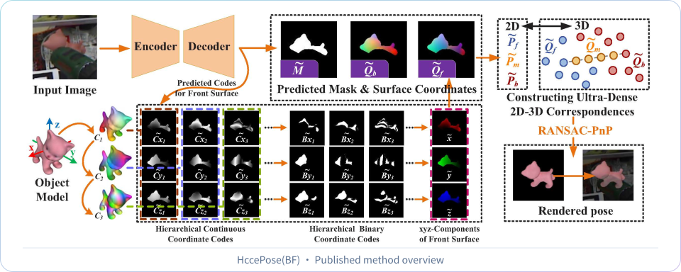
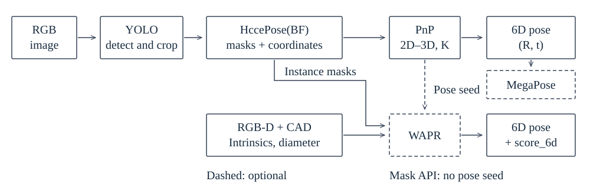
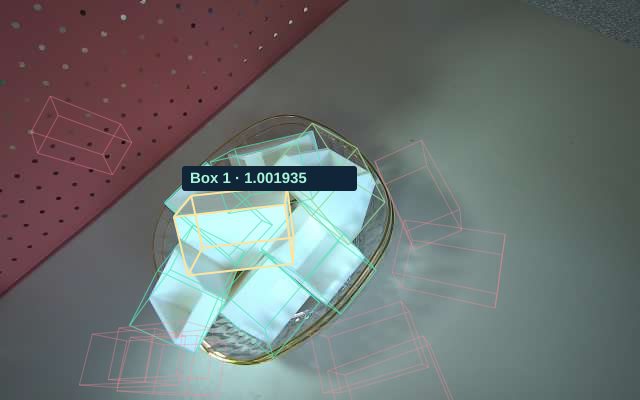
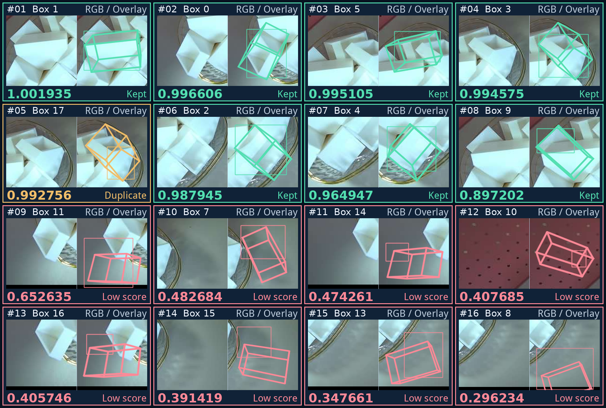
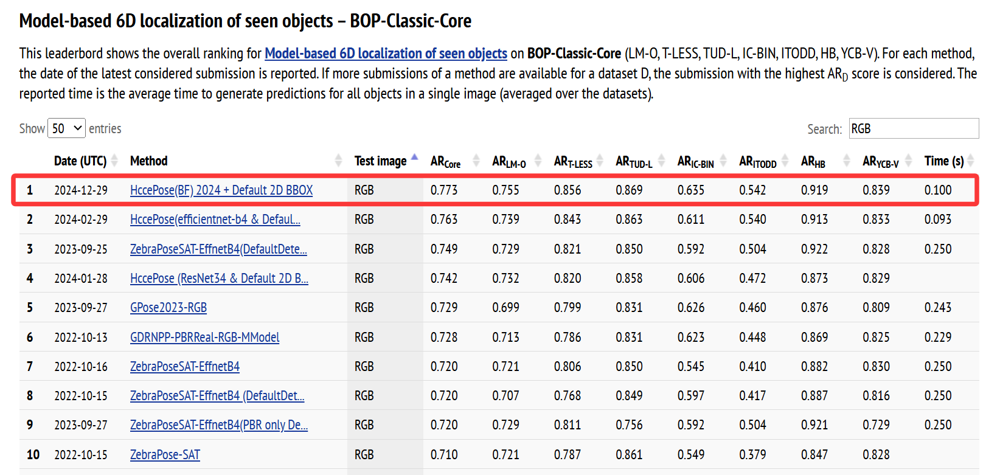
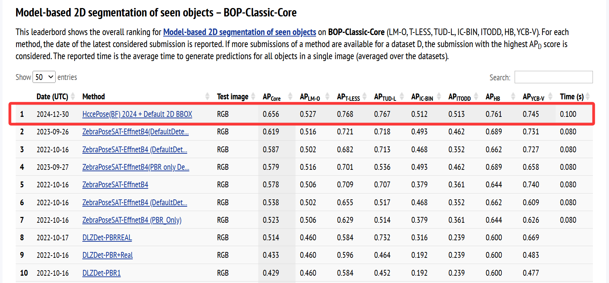
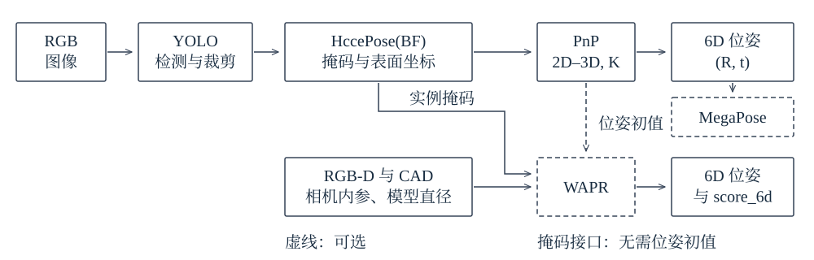
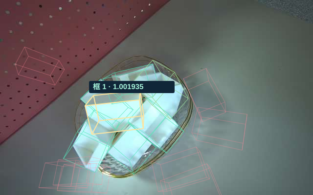

<p align="center"><a href="#user-content-language-en"><strong>English</strong></a> · <a href="#user-content-language-zh"><strong>中文</strong></a></p>

<p align="center">
  
</p>

<p align="center">
  <a href="https://wangyulin-seu.github.io/hccepose/?lang=en"></a>
  <a href="https://wangyulin-seu.github.io/hccepose/docs/index.html?lang=en"></a>
  <a href="https://arxiv.org/abs/2510.10177"></a>
  <a href="https://huggingface.co/datasets/SEU-WYL/HccePose"></a>
</p>

<details name="readme-language" lang="en" open>
<summary aria-label="Project guide" title="Project guide">&#8203;</summary>
<a name="language-en"></a>

<h3 align="center">6D pose estimation from a single RGB image</h3>
<p align="center">Predict front and back surface coordinates, then solve the object-to-camera pose from ultra-dense 2D–3D correspondences.</p>

<p align="center">
  <a href="docs/assets/figures/fig2.jpg"></a>
</p>
<p align="center">
  
</p>
<p align="center"><a href="docs/en/method.md">Explore the method →</a></p>

## Models and example data

Pretrained weights, object models and example inputs are hosted on **[Hugging Face](https://huggingface.co/datasets/SEU-WYL/HccePose)**.

Bundled inputs: [RGB images](sample_data/images/) · [RGB-D frames](sample_data/rgbd/) · [Videos](sample_data/videos/). Code tests are kept separately in `tests/`; downloaded resources follow the layout in the [assets guide](docs/en/assets.md).

<table align="center">
  <thead>
    <tr><th align="center">Resource</th><th align="center">Download / instructions</th></tr>
  </thead>
  <tbody>
    <tr><td align="center">Bin-picking models and detector/pose weights</td><td align="center"><a href="https://huggingface.co/datasets/SEU-WYL/HccePose/tree/4e482e540314622981ccd4fce5beddac7f9d3e1d/demo-bin-picking">Hugging Face files</a></td></tr>
    <tr><td align="center">RGB-D images, depth and camera intrinsics</td><td align="center"><a href="https://huggingface.co/datasets/SEU-WYL/HccePose/tree/4e482e540314622981ccd4fce5beddac7f9d3e1d/test_imgs_RGBD">RGB-D frames</a></td></tr>
    <tr><td align="center">RGB images and input videos</td><td align="center"><a href="https://huggingface.co/datasets/SEU-WYL/HccePose/tree/4e482e540314622981ccd4fce5beddac7f9d3e1d/test_imgs">Images</a> · <a href="https://huggingface.co/datasets/SEU-WYL/HccePose/tree/4e482e540314622981ccd4fce5beddac7f9d3e1d/test_videos">Videos</a></td></tr>
    <tr><td align="center">Seven core BOP datasets: pretrained pose weights</td><td align="center"><a href="docs/en/bop-evaluation.md#pretrained-weights">Weights and evaluation guide</a></td></tr>
  </tbody>
</table>

For a first run, follow [Models and inputs](docs/en/assets.md#download-one-rgb-d-example) to download the matching minimal set and prepare the camera matrix. The full resource repository also contains training data that this example does not need.

## Find your starting point

<table align="center">
  <thead>
    <tr><th align="center">Goal</th><th align="center">Documentation</th></tr>
  </thead>
  <tbody>
    <tr><td align="center">Run pretrained inference</td><td align="center"><a href="docs/en/installation.md">Installation</a> → <a href="docs/en/assets.md">Models and inputs</a> → <a href="docs/en/quickstart.md">First prediction</a></td></tr>
    <tr><td align="center">Process images or video</td><td align="center"><a href="docs/en/rgb-inference.md">RGB images</a> · <a href="docs/en/video.md">Video frames</a></td></tr>
    <tr><td align="center">Estimate or refine with depth</td><td align="center"><a href="docs/en/rgbd-wapr.md">WAPR</a> · <a href="docs/en/rgbd-megapose.md">MegaPose</a> · <a href="docs/en/depth-comparison.md">Depth comparison</a></td></tr>
    <tr><td align="center">Train new objects</td><td align="center"><a href="docs/en/object-preparation.md">Meshes and symmetry</a> → <a href="docs/en/rendering.md">PBR rendering</a> → <a href="docs/en/detector-training.md">Detector</a> → <a href="docs/en/coordinate-labels.md">Surface labels</a> → <a href="docs/en/pose-training.md">Pose training</a></td></tr>
    <tr><td align="center">Integrate into an application</td><td align="center"><a href="docs/en/tester-api.md">Tester</a> · <a href="docs/en/results-api.md">Results and coordinates</a> · <a href="docs/en/refinement-api.md">Refinement</a> · <a href="docs/en/data-api.md">Data loading</a> · <a href="docs/en/utilities-api.md">Utilities</a></td></tr>
    <tr><td align="center">Accelerate, evaluate or explore</td><td align="center"><a href="docs/en/acceleration.md">ONNX/TensorRT</a> · <a href="docs/en/bop-evaluation.md">BOP evaluation</a> · <a href="docs/en/changelog.md">Public changelog</a> · <a href="docs/en/project-structure.md">Project structure</a></td></tr>
  </tbody>
</table>

## Inference overview

<p align="center"><a href="docs/assets/readme-language/inference-flow-en.svg"></a></p>
<p align="center"><sub>The dashed pose-seed path denotes <a href="https://github.com/WangYuLin-SEU/WAPR/blob/4e591be318a828c91980c58ef8bbdc34e6599881/wapr/tracking.py#L29">optional WAPR refinement</a>; the example below uses the mask-estimation API.</sub></p>

## Get started

The project provides RGB inference, WAPR integration, and an optional interface to an external MegaPose installation. Prepare matching detector and object pose weights, object meshes, camera intrinsics, and input images, then run an inference example. See [installation](docs/en/installation.md), [resource conventions](docs/en/assets.md) and [your first prediction](docs/en/quickstart.md).

```bash
python s4_p3_test_mi10_bin_picking.py
```

Run from the project root after checking the model path, object IDs and camera calibration. This RGB example reads bundled JPG images and saves visualizations beside them; see the tutorial for the separate 640×400 RGB-D frame.

## WAPR integration

Install [WAPR](https://github.com/WangYuLin-SEU/WAPR/tree/4e591be318a828c91980c58ef8bbdc34e6599881) separately. The example uses registered RGB-D, camera intrinsics, and each object’s metric mesh and diameter. Choose `wapr_mode='estimate'` (default, no PnP), `'hybrid'` (PnP plus WAPR candidates), or `'refine'` (PnP refinement only). Raw `pose_4x4_m` translations use meters; `score_6d` is computed for the current input. See [WAPR usage](docs/en/rgbd-wapr.md).

Run `s4_p3_test_mi10_bin_picking_RGBD_wapr.py` to call `Tester.predict(..., use_wapr=True)` with automatic WBPS filtering and per-object CAD rendered-mask NMS. Raw and filtered JSON files are saved separately; see [the postprocessing tutorial](docs/en/wapr-postprocessing.md).

<p align="center"><sub>Saved outputs · WBPS ≥ 0.75 · Scores are not probabilities.</sub></p>

<table align="center">
<tr><th align="center">RGB · saved pose projections</th><th align="center">CAD + spatial frame</th></tr>
<tr><td align="center" width="50%"><a href="https://wangyulin-seu.github.io/hccepose/docs/rgbd-wapr.html?lang=en"></a></td><td align="center" width="50%">

```stl
solid hccepose_retained_cad_frame
facet normal -.993968 -.103567 -.036063
outer loop
vertex -.128282 .135053 -.336622
vertex -.128034 .131467 -.333146
vertex -.129991 .145252 -.318788
endloop
endfacet
facet normal .993969 .103562 .0360662
outer loop
vertex -.0686434 .141267 -.334458
vertex -.064729 .113697 -.363174
vertex -.0695929 .155024 -.347796
endloop
endfacet
facet normal .0978607 -.689227 -.717906
outer loop
vertex -.0672035 .149553 -.397935
vertex -.0873303 .151067 -.402132
vertex -.0674509 .153138 -.401411
endloop
endfacet
facet normal .993969 .103562 .0360657
outer loop
vertex -.0288846 .145409 -.333015
vertex -.0305944 .155608 -.315181
vertex -.0286372 .141824 -.329539
endloop
endfacet
facet normal -.0494901 .717105 -.695206
outer loop
vertex -.0335638 .198634 -.356894
vertex -.0674509 .153138 -.401411
vertex -.0610279 .195773 -.35789
endloop
endfacet
facet normal .049485 -.71711 .695201
outer loop
vertex -.0870829 .147481 -.398656
vertex -.0876857 .151727 -.394234
vertex -.117366 .163725 -.379744
endloop
endfacet
facet normal .097859 -.689232 -.717902
outer loop
vertex -.0846084 .111626 -.363896
vertex -.0644816 .110112 -.359698
vertex -.0843609 .108041 -.36042
endloop
endfacet
facet normal .993969 .103563 .0360638
outer loop
vertex -.0313591 .181264 -.367776
vertex -.0316066 .18485 -.371252
vertex -.0335638 .198634 -.356894
endloop
endfacet
facet normal -.993969 -.103562 -.0360661
outer loop
vertex -.0858631 .120463 -.354691
vertex -.0909973 .175051 -.36994
vertex -.0876857 .151727 -.394234
endloop
endfacet
facet normal .0494895 -.717105 .695206
outer loop
vertex -.0672035 .149553 -.397935
vertex -.0313591 .181264 -.367776
vertex -.0711179 .177122 -.369218
endloop
endfacet
facet normal .0494901 -.717105 .695206
outer loop
vertex -.117366 .163725 -.379744
vertex -.0909973 .175051 -.36994
vertex -.130756 .170908 -.371382
endloop
endfacet
facet normal -.633645 -.560586 -.533139
outer loop
vertex -.0843609 .108041 -.36042
vertex -.128034 .131467 -.333146
vertex -.114075 .127432 -.345494
endloop
endfacet
facet normal .993969 .103564 .036067
outer loop
vertex -.031966 .175483 -.334449
vertex -.0305944 .155608 -.315181
vertex -.0313591 .181264 -.367776
endloop
endfacet
facet normal -.0978599 .689228 .717905
outer loop
vertex -.129991 .145252 -.318788
vertex -.0305944 .155608 -.315181
vertex -.031966 .175483 -.334449
endloop
endfacet
facet normal .09786 -.689229 -.717905
outer loop
vertex -.128282 .135053 -.336622
vertex -.0909973 .175051 -.36994
vertex -.0887709 .14279 -.338665
endloop
endfacet
facet normal .0494898 -.717105 .695206
outer loop
vertex -.0286372 .141824 -.329539
vertex -.0305944 .155608 -.315181
vertex -.129991 .145252 -.318788
endloop
endfacet
facet normal -.993969 -.103562 -.036065
outer loop
vertex -.130756 .170908 -.371382
vertex -.132961 .188278 -.3605
vertex -.131003 .174494 -.374858
endloop
endfacet
facet normal .0978606 -.689228 -.717905
outer loop
vertex -.0873303 .151067 -.402132
vertex -.0672035 .149553 -.397935
vertex -.0870829 .147481 -.398656
endloop
endfacet
facet normal .09786 -.689229 -.717905
outer loop
vertex -.0658106 .129369 -.378368
vertex -.0846084 .111626 -.363896
vertex -.0870829 .147481 -.398656
endloop
endfacet
facet normal .0494896 -.717105 .695206
outer loop
vertex -.0909973 .175051 -.36994
vertex -.117366 .163725 -.379744
vertex -.0876857 .151727 -.394234
endloop
endfacet
facet normal -.0494898 .717105 -.695206
outer loop
vertex -.0885228 .139195 -.335179
vertex -.0858631 .120463 -.354691
vertex -.114075 .127432 -.345494
endloop
endfacet
facet normal -.0494897 .717105 -.695206
outer loop
vertex -.0610279 .195773 -.35789
vertex -.131003 .174494 -.374858
vertex -.132961 .188278 -.3605
endloop
endfacet
facet normal .993969 .103562 .0360659
outer loop
vertex -.0711179 .177122 -.369218
vertex -.0695929 .155024 -.347796
vertex -.0658106 .129369 -.378368
endloop
endfacet
facet normal .0494894 -.717105 .695206
outer loop
vertex -.0534583 .119864 -.350424
vertex -.129991 .145252 -.318788
vertex -.0644816 .110112 -.359698
endloop
endfacet
facet normal -.993969 -.103562 -.0360661
outer loop
vertex -.0885228 .139195 -.335179
vertex -.0887709 .14279 -.338665
vertex -.0858631 .120463 -.354691
endloop
endfacet
facet normal .09786 -.689228 -.717906
outer loop
vertex -.0846084 .111626 -.363896
vertex -.064729 .113697 -.363174
vertex -.0644816 .110112 -.359698
endloop
endfacet
facet normal .77204 -.41413 -.482132
outer loop
vertex -.064729 .113697 -.363174
vertex -.0534583 .119864 -.350424
vertex -.0644816 .110112 -.359698
endloop
endfacet
facet normal -.993969 -.103562 -.0360661
outer loop
vertex -.0909973 .175051 -.36994
vertex -.0858631 .120463 -.354691
vertex -.0887709 .14279 -.338665
endloop
endfacet
facet normal -.633645 -.560588 -.533137
outer loop
vertex -.117366 .163725 -.379744
vertex -.131003 .174494 -.374858
vertex -.0873303 .151067 -.402132
endloop
endfacet
facet normal -.0494899 .717105 -.695206
outer loop
vertex -.0674509 .153138 -.401411
vertex -.0335638 .198634 -.356894
vertex -.0316066 .18485 -.371252
endloop
endfacet
facet normal -.0494901 .717104 -.695207
outer loop
vertex -.0858631 .120463 -.354691
vertex -.0846084 .111626 -.363896
vertex -.114075 .127432 -.345494
endloop
endfacet
facet normal -.633644 -.560587 -.533139
outer loop
vertex -.114075 .127432 -.345494
vertex -.128034 .131467 -.333146
vertex -.128282 .135053 -.336622
endloop
endfacet
facet normal .097859 -.689225 -.717909
outer loop
vertex -.128282 .135053 -.336622
vertex -.0887709 .14279 -.338665
vertex -.0885228 .139195 -.335179
endloop
endfacet
facet normal .77204 -.414129 -.482133
outer loop
vertex -.0286372 .141824 -.329539
vertex -.0534583 .119864 -.350424
vertex -.0288846 .145409 -.333015
endloop
endfacet
facet normal .993969 .103562 .0360661
outer loop
vertex -.0658106 .129369 -.378368
vertex -.0672035 .149553 -.397935
vertex -.0711179 .177122 -.369218
endloop
endfacet
facet normal .0494904 -.717104 .695207
outer loop
vertex -.0644816 .110112 -.359698
vertex -.129991 .145252 -.318788
vertex -.0843609 .108041 -.36042
endloop
endfacet
facet normal -.993969 -.103562 -.036066
outer loop
vertex -.128282 .135053 -.336622
vertex -.129991 .145252 -.318788
vertex -.130756 .170908 -.371382
endloop
endfacet
facet normal -.0494898 .717105 -.695206
outer loop
vertex -.131003 .174494 -.374858
vertex -.0674509 .153138 -.401411
vertex -.0873303 .151067 -.402132
endloop
endfacet
facet normal .0978606 -.689228 -.717905
outer loop
vertex -.0658106 .129369 -.378368
vertex -.0870829 .147481 -.398656
vertex -.0672035 .149553 -.397935
endloop
endfacet
facet normal .0978601 -.689229 -.717905
outer loop
vertex -.0658106 .129369 -.378368
vertex -.064729 .113697 -.363174
vertex -.0846084 .111626 -.363896
endloop
endfacet
facet normal -.633645 -.560589 -.533136
outer loop
vertex -.114075 .127432 -.345494
vertex -.0846084 .111626 -.363896
vertex -.0843609 .108041 -.36042
endloop
endfacet
facet normal -.0978599 .689229 .717905
outer loop
vertex -.132961 .188278 -.3605
vertex -.129991 .145252 -.318788
vertex -.0610279 .195773 -.35789
endloop
endfacet
facet normal .77204 -.41413 -.482132
outer loop
vertex -.0534583 .119864 -.350424
vertex -.064729 .113697 -.363174
vertex -.0288846 .145409 -.333015
endloop
endfacet
facet normal .0978602 -.689228 -.717905
outer loop
vertex -.0288846 .145409 -.333015
vertex -.0686434 .141267 -.334458
vertex -.0695929 .155024 -.347796
endloop
endfacet
facet normal .0978602 -.689229 -.717905
outer loop
vertex -.0711179 .177122 -.369218
vertex -.0313591 .181264 -.367776
vertex -.0695929 .155024 -.347796
endloop
endfacet
facet normal .993969 .103562 .036066
outer loop
vertex -.0313591 .181264 -.367776
vertex -.0305944 .155608 -.315181
vertex -.0288846 .145409 -.333015
endloop
endfacet
facet normal .09786 -.689229 -.717905
outer loop
vertex -.0313591 .181264 -.367776
vertex -.0288846 .145409 -.333015
vertex -.0695929 .155024 -.347796
endloop
endfacet
facet normal .993969 .103562 .0360659
outer loop
vertex -.064729 .113697 -.363174
vertex -.0658106 .129369 -.378368
vertex -.0695929 .155024 -.347796
endloop
endfacet
facet normal .993969 .103561 .0360666
outer loop
vertex -.0313591 .181264 -.367776
vertex -.0335638 .198634 -.356894
vertex -.031966 .175483 -.334449
endloop
endfacet
facet normal .0494898 -.717105 .695206
outer loop
vertex -.0534583 .119864 -.350424
vertex -.0286372 .141824 -.329539
vertex -.129991 .145252 -.318788
endloop
endfacet
facet normal -.0494897 .717105 -.695206
outer loop
vertex -.131003 .174494 -.374858
vertex -.0610279 .195773 -.35789
vertex -.0674509 .153138 -.401411
endloop
endfacet
facet normal -.0494906 .717105 -.695205
outer loop
vertex -.0885228 .139195 -.335179
vertex -.114075 .127432 -.345494
vertex -.128282 .135053 -.336622
endloop
endfacet
facet normal .0978598 -.689229 -.717905
outer loop
vertex -.0909973 .175051 -.36994
vertex -.128282 .135053 -.336622
vertex -.130756 .170908 -.371382
endloop
endfacet
facet normal -.993969 -.103563 -.0360678
outer loop
vertex -.0876857 .151727 -.394234
vertex -.0870829 .147481 -.398656
vertex -.0846084 .111626 -.363896
endloop
endfacet
facet normal -.993969 -.103562 -.0360663
outer loop
vertex -.0876857 .151727 -.394234
vertex -.0846084 .111626 -.363896
vertex -.0858631 .120463 -.354691
endloop
endfacet
facet normal .0494898 -.717105 .695206
outer loop
vertex -.0843609 .108041 -.36042
vertex -.129991 .145252 -.318788
vertex -.128034 .131467 -.333146
endloop
endfacet
facet normal -.993969 -.103562 -.036066
outer loop
vertex -.132961 .188278 -.3605
vertex -.130756 .170908 -.371382
vertex -.129991 .145252 -.318788
endloop
endfacet
facet normal -.0978599 .689229 .717905
outer loop
vertex -.0610279 .195773 -.35789
vertex -.129991 .145252 -.318788
vertex -.0335638 .198634 -.356894
endloop
endfacet
facet normal -.09786 .689229 .717905
outer loop
vertex -.0335638 .198634 -.356894
vertex -.129991 .145252 -.318788
vertex -.031966 .175483 -.334449
endloop
endfacet
facet normal -.0494903 .717105 -.695206
outer loop
vertex -.0288846 .145409 -.333015
vertex -.064729 .113697 -.363174
vertex -.0686434 .141267 -.334458
endloop
endfacet
facet normal .77204 -.41413 -.482132
outer loop
vertex -.0316066 .18485 -.371252
vertex -.0313591 .181264 -.367776
vertex -.0672035 .149553 -.397935
endloop
endfacet
facet normal .77204 -.41413 -.482132
outer loop
vertex -.0674509 .153138 -.401411
vertex -.0316066 .18485 -.371252
vertex -.0672035 .149553 -.397935
endloop
endfacet
facet normal -.633645 -.560589 -.533137
outer loop
vertex -.0873303 .151067 -.402132
vertex -.0870829 .147481 -.398656
vertex -.117366 .163725 -.379744
endloop
endfacet
facet normal -.633645 -.560587 -.533139
outer loop
vertex -.131003 .174494 -.374858
vertex -.117366 .163725 -.379744
vertex -.130756 .170908 -.371382
endloop
endfacet
facet normal .0183974 -.702605 .711343
outer loop
vertex -.12393 .0446068 -.355535
vertex -.126451 .0415024 -.358536
vertex -.109183 .0345501 -.36585
endloop
endfacet
facet normal -.0184015 .702601 -.711346
outer loop
vertex -.125034 .0867629 -.398216
vertex -.159569 .100668 -.383589
vertex -.115361 .098675 -.3867
endloop
endfacet
facet normal -.86339 .347617 .365677
outer loop
vertex -.134359 .131712 -.353577
vertex -.13147 .120765 -.336349
vertex -.131838 .134817 -.350576
endloop
endfacet
facet normal -.0184011 .702602 -.711345
outer loop
vertex -.12577 .114867 -.426669
vertex -.111023 .10481 -.436984
vertex -.128291 .111763 -.429671
endloop
endfacet
facet normal .504199 .620898 .600224
outer loop
vertex -.080771 .142064 -.400971
vertex -.131838 .134817 -.350576
vertex -.0802625 .122651 -.381316
endloop
endfacet
facet normal -.504205 -.6209 -.600217
outer loop
vertex -.133991 .11766 -.33935
vertex -.128673 .115519 -.341603
vertex -.109534 .0885316 -.329763
endloop
endfacet
facet normal -.863393 .347611 .365675
outer loop
vertex -.159201 .0866155 -.369362
vertex -.16209 .097563 -.38659
vertex -.161722 .083511 -.372363
endloop
endfacet
facet normal -.0184008 .702603 -.711344
outer loop
vertex -.10056 .145912 -.396658
vertex -.0980388 .149016 -.393657
vertex -.080771 .142064 -.400971
endloop
endfacet
facet normal .0184015 -.702602 .711346
outer loop
vertex -.148131 .0821584 -.37405
vertex -.0994557 .103756 -.353978
vertex -.128673 .115519 -.341603
endloop
endfacet
facet normal -.504199 -.620899 -.600223
outer loop
vertex -.134359 .131712 -.353577
vertex -.10056 .145912 -.396658
vertex -.0998237 .117808 -.368204
endloop
endfacet
facet normal -.5042 -.620898 -.600223
outer loop
vertex -.109534 .0885316 -.329763
vertex -.0994557 .103756 -.353978
vertex -.0987197 .0756518 -.325524
endloop
endfacet
facet normal -.597497 -.251012 .761571
outer loop
vertex -.161722 .083511 -.372363
vertex -.126451 .0415024 -.358536
vertex -.135403 .0582719 -.360033
endloop
endfacet
facet normal -.0183992 .702601 -.711346
outer loop
vertex -.0970489 .122019 -.420349
vertex -.111023 .10481 -.436984
vertex -.10056 .145912 -.396658
endloop
endfacet
facet normal .863391 -.347615 -.365677
outer loop
vertex -.109183 .0345501 -.36585
vertex -.111023 .10481 -.436984
vertex -.0970489 .122019 -.420349
endloop
endfacet
facet normal -.863391 .347615 .365677
outer loop
vertex -.12393 .0446068 -.355535
vertex -.0994557 .103756 -.353978
vertex -.122138 .0758236 -.38098
endloop
endfacet
facet normal -.504199 -.620898 -.600223
outer loop
vertex -.128291 .111763 -.429671
vertex -.111023 .10481 -.436984
vertex -.109183 .0345501 -.36585
endloop
endfacet
facet normal .0184013 -.702602 .711345
outer loop
vertex -.0987197 .0756518 -.325524
vertex -.0789308 .071804 -.329836
vertex -.0961986 .0787563 -.322523
endloop
endfacet
facet normal -.863391 .347616 .365677
outer loop
vertex -.13147 .120765 -.336349
vertex -.134359 .131712 -.353577
vertex -.133991 .11766 -.33935
endloop
endfacet
facet normal -.863391 .347615 .365677
outer loop
vertex -.14855 .114237 -.370471
vertex -.159201 .0866155 -.369362
vertex -.133991 .11766 -.33935
endloop
endfacet
facet normal -.504199 -.620899 -.600223
outer loop
vertex -.0994557 .103756 -.353978
vertex -.109534 .0885316 -.329763
vertex -.128673 .115519 -.341603
endloop
endfacet
facet normal .504199 .620898 .600224
outer loop
vertex -.124666 .0727109 -.383989
vertex -.148131 .0821584 -.37405
vertex -.135403 .0582719 -.360033
endloop
endfacet
facet normal .5042 .620898 .600223
outer loop
vertex -.0802625 .122651 -.381316
vertex -.0961986 .0787563 -.322523
vertex -.0789308 .071804 -.329836
endloop
endfacet
facet normal -.0184015 .702602 -.711345
outer loop
vertex -.0998237 .117808 -.368204
vertex -.115361 .098675 -.3867
vertex -.14855 .114237 -.370471
endloop
endfacet
facet normal -.5042 -.620898 -.600223
outer loop
vertex -.151696 .10193 -.399838
vertex -.109183 .0345501 -.36585
vertex -.16209 .097563 -.38659
endloop
endfacet
facet normal .0184014 -.702602 .711346
outer loop
vertex -.124666 .0727109 -.383989
vertex -.122138 .0758236 -.38098
vertex -.148131 .0821584 -.37405
endloop
endfacet
facet normal -.863391 .347616 .365677
outer loop
vertex -.159201 .0866155 -.369362
vertex -.159569 .100668 -.383589
vertex -.16209 .097563 -.38659
endloop
endfacet
facet normal -.623522 .742615 -.244425
outer loop
vertex -.159569 .100668 -.383589
vertex -.151696 .10193 -.399838
vertex -.16209 .097563 -.38659
endloop
endfacet
facet normal .0184015 -.702602 .711346
outer loop
vertex -.0994557 .103756 -.353978
vertex -.148131 .0821584 -.37405
vertex -.122138 .0758236 -.38098
endloop
endfacet
facet normal -.597498 -.251014 .761569
outer loop
vertex -.109534 .0885316 -.329763
vertex -.0961986 .0787563 -.322523
vertex -.13147 .120765 -.336349
endloop
endfacet
facet normal .504199 .620898 .600224
outer loop
vertex -.131838 .134817 -.350576
vertex -.080771 .142064 -.400971
vertex -.0980388 .149016 -.393657
endloop
endfacet
facet normal .504199 .620898 .600224
outer loop
vertex -.148131 .0821584 -.37405
vertex -.159201 .0866155 -.369362
vertex -.135403 .0582719 -.360033
endloop
endfacet
facet normal -.597498 -.251013 .76157
outer loop
vertex -.135403 .0582719 -.360033
vertex -.126451 .0415024 -.358536
vertex -.12393 .0446068 -.355535
endloop
endfacet
facet normal -.863389 .347618 .36568
outer loop
vertex -.12393 .0446068 -.355535
vertex -.122138 .0758236 -.38098
vertex -.124666 .0727109 -.383989
endloop
endfacet
facet normal -.623522 .742615 -.244425
outer loop
vertex -.128291 .111763 -.429671
vertex -.151696 .10193 -.399838
vertex -.12577 .114867 -.426669
endloop
endfacet
facet normal -.0184015 .702601 -.711346
outer loop
vertex -.14855 .114237 -.370471
vertex -.134359 .131712 -.353577
vertex -.0998237 .117808 -.368204
endloop
endfacet
facet normal -.504199 -.620898 -.600224
outer loop
vertex -.16209 .097563 -.38659
vertex -.109183 .0345501 -.36585
vertex -.161722 .083511 -.372363
endloop
endfacet
facet normal .0184016 -.702602 .711346
outer loop
vertex -.12393 .0446068 -.355535
vertex -.109183 .0345501 -.36585
vertex -.0987197 .0756518 -.325524
endloop
endfacet
facet normal .504199 .620898 .600224
outer loop
vertex -.0961986 .0787563 -.322523
vertex -.131838 .134817 -.350576
vertex -.13147 .120765 -.336349
endloop
endfacet
facet normal -.863391 .347616 .365676
outer loop
vertex -.14855 .114237 -.370471
vertex -.133991 .11766 -.33935
vertex -.134359 .131712 -.353577
endloop
endfacet
facet normal -.863391 .347615 .365676
outer loop
vertex -.14855 .114237 -.370471
vertex -.159569 .100668 -.383589
vertex -.159201 .0866155 -.369362
endloop
endfacet
facet normal -.597499 -.251015 .761568
outer loop
vertex -.135403 .0582719 -.360033
vertex -.159201 .0866155 -.369362
vertex -.161722 .083511 -.372363
endloop
endfacet
facet normal .863391 -.347615 -.365677
outer loop
vertex -.0789308 .071804 -.329836
vertex -.109183 .0345501 -.36585
vertex -.0802625 .122651 -.381316
endloop
endfacet
facet normal -.623522 .742615 -.244425
outer loop
vertex -.151696 .10193 -.399838
vertex -.159569 .100668 -.383589
vertex -.12577 .114867 -.426669
endloop
endfacet
facet normal -.863391 .347615 .365677
outer loop
vertex -.12577 .114867 -.426669
vertex -.125034 .0867629 -.398216
vertex -.115361 .098675 -.3867
endloop
endfacet
facet normal -.863391 .347615 .365676
outer loop
vertex -.0998237 .117808 -.368204
vertex -.10056 .145912 -.396658
vertex -.115361 .098675 -.3867
endloop
endfacet
facet normal -.0184015 .702602 -.711345
outer loop
vertex -.10056 .145912 -.396658
vertex -.111023 .10481 -.436984
vertex -.12577 .114867 -.426669
endloop
endfacet
facet normal -.863391 .347615 .365677
outer loop
vertex -.10056 .145912 -.396658
vertex -.12577 .114867 -.426669
vertex -.115361 .098675 -.3867
endloop
endfacet
facet normal -.0184015 .702602 -.711345
outer loop
vertex -.159569 .100668 -.383589
vertex -.14855 .114237 -.370471
vertex -.115361 .098675 -.3867
endloop
endfacet
facet normal -.0184017 .702601 -.711346
outer loop
vertex -.10056 .145912 -.396658
vertex -.080771 .142064 -.400971
vertex -.0970489 .122019 -.420349
endloop
endfacet
facet normal -.504199 -.620898 -.600224
outer loop
vertex -.151696 .10193 -.399838
vertex -.128291 .111763 -.429671
vertex -.109183 .0345501 -.36585
endloop
endfacet
facet normal .504199 .620898 .600223
outer loop
vertex -.0961986 .0787563 -.322523
vertex -.0802625 .122651 -.381316
vertex -.131838 .134817 -.350576
endloop
endfacet
facet normal .5042 .620897 .600223
outer loop
vertex -.124666 .0727109 -.383989
vertex -.135403 .0582719 -.360033
vertex -.12393 .0446068 -.355535
endloop
endfacet
facet normal -.863391 .347615 .365677
outer loop
vertex -.0994557 .103756 -.353978
vertex -.12393 .0446068 -.355535
vertex -.0987197 .0756518 -.325524
endloop
endfacet
facet normal .0183996 -.702601 .711346
outer loop
vertex -.128673 .115519 -.341603
vertex -.133991 .11766 -.33935
vertex -.159201 .0866155 -.369362
endloop
endfacet
facet normal .0184012 -.702601 .711346
outer loop
vertex -.128673 .115519 -.341603
vertex -.159201 .0866155 -.369362
vertex -.148131 .0821584 -.37405
endloop
endfacet
facet normal -.504199 -.620898 -.600224
outer loop
vertex -.161722 .083511 -.372363
vertex -.109183 .0345501 -.36585
vertex -.126451 .0415024 -.358536
endloop
endfacet
facet normal .0184016 -.702602 .711346
outer loop
vertex -.0789308 .071804 -.329836
vertex -.0987197 .0756518 -.325524
vertex -.109183 .0345501 -.36585
endloop
endfacet
facet normal .863391 -.347615 -.365677
outer loop
vertex -.0802625 .122651 -.381316
vertex -.109183 .0345501 -.36585
vertex -.080771 .142064 -.400971
endloop
endfacet
facet normal .863391 -.347615 -.365677
outer loop
vertex -.080771 .142064 -.400971
vertex -.109183 .0345501 -.36585
vertex -.0970489 .122019 -.420349
endloop
endfacet
facet normal .504199 .620898 .600224
outer loop
vertex -.12577 .114867 -.426669
vertex -.159569 .100668 -.383589
vertex -.125034 .0867629 -.398216
endloop
endfacet
facet normal -.623522 .742614 -.244426
outer loop
vertex -.0980388 .149016 -.393657
vertex -.10056 .145912 -.396658
vertex -.134359 .131712 -.353577
endloop
endfacet
facet normal -.623523 .742614 -.244426
outer loop
vertex -.131838 .134817 -.350576
vertex -.0980388 .149016 -.393657
vertex -.134359 .131712 -.353577
endloop
endfacet
facet normal -.597499 -.251015 .761568
outer loop
vertex -.13147 .120765 -.336349
vertex -.133991 .11766 -.33935
vertex -.109534 .0885316 -.329763
endloop
endfacet
facet normal -.597498 -.251013 .76157
outer loop
vertex -.0961986 .0787563 -.322523
vertex -.109534 .0885316 -.329763
vertex -.0987197 .0756518 -.325524
endloop
endfacet
facet normal .937979 .0041826 .346666
outer loop
vertex .00160398 .215859 -.38076
vertex .00287104 .212406 -.384146
vertex .00760289 .226869 -.397124
endloop
endfacet
facet normal -.937978 -.0041877 -.346669
outer loop
vertex -.0546747 .215608 -.40156
vertex -.0641383 .186681 -.375605
vertex -.0595366 .228858 -.388565
endloop
endfacet
facet normal -.236592 -.723174 .648878
outer loop
vertex -.0768093 .221213 -.341738
vertex -.0593168 .22475 -.331418
vertex -.0780764 .224666 -.338351
endloop
endfacet
facet normal -.937978 -.00418718 -.346668
outer loop
vertex -.0921938 .21544 -.415427
vertex -.0861949 .22645 -.431791
vertex -.0909267 .211987 -.418813
endloop
endfacet
facet normal -.253419 .690652 .677332
outer loop
vertex -.1014 .267889 -.391151
vertex -.0780764 .224666 -.338351
vertex -.0754831 .268005 -.381572
endloop
endfacet
facet normal .253423 -.690657 -.677326
outer loop
vertex -.0580498 .221297 -.334805
vertex -.0565924 .225752 -.338802
vertex -.0254719 .241471 -.343187
endloop
endfacet
facet normal -.236589 -.723178 .648875
outer loop
vertex -.0453788 .186764 -.368671
vertex -.0628712 .183227 -.378991
vertex -.0441117 .183311 -.372058
endloop
endfacet
facet normal -.937979 -.00418633 -.346666
outer loop
vertex -.104865 .249973 -.38156
vertex -.106132 .253426 -.378173
vertex -.1014 .267889 -.391151
endloop
endfacet
facet normal .937978 .00418761 .346669
outer loop
vertex -.0423452 .196037 -.376991
vertex -.0485861 .250224 -.36076
vertex -.0565924 .225752 -.338802
endloop
endfacet
facet normal .25342 -.690652 -.677332
outer loop
vertex -.0768093 .221213 -.341738
vertex -.104865 .249973 -.38156
vertex -.0673457 .25014 -.367693
endloop
endfacet
facet normal .253419 -.690652 -.677332
outer loop
vertex -.0254719 .241471 -.343187
vertex -.0485861 .250224 -.36076
vertex -.011067 .250391 -.346893
endloop
endfacet
facet normal .495955 -.5084 .703959
outer loop
vertex -.0441117 .183311 -.372058
vertex .00287104 .212406 -.384146
vertex -.0136791 .206395 -.376827
endloop
endfacet
facet normal -.937978 -.00418544 -.346669
outer loop
vertex -.0932185 .245592 -.413018
vertex -.0861949 .22645 -.431791
vertex -.104865 .249973 -.38156
endloop
endfacet
facet normal .236591 .723175 -.648878
outer loop
vertex .00760289 .226869 -.397124
vertex -.0861949 .22645 -.431791
vertex -.0932185 .245592 -.413018
endloop
endfacet
facet normal -.236591 -.723176 .648877
outer loop
vertex .00160398 .215859 -.38076
vertex -.0485861 .250224 -.36076
vertex -.0371856 .219154 -.391231
endloop
endfacet
facet normal .253419 -.690652 -.677332
outer loop
vertex -.0909267 .211987 -.418813
vertex -.0861949 .22645 -.431791
vertex .00760289 .226869 -.397124
endloop
endfacet
facet normal .937979 .00418713 .346668
outer loop
vertex -.011067 .250391 -.346893
vertex -.00760228 .268308 -.356484
vertex -.0123341 .253845 -.343506
endloop
endfacet
facet normal -.236592 -.723175 .648878
outer loop
vertex -.0593168 .22475 -.331418
vertex -.0768093 .221213 -.341738
vertex -.0580498 .221297 -.334805
endloop
endfacet
facet normal -.236591 -.723176 .648877
outer loop
vertex -.0696766 .201774 -.360802
vertex -.0453788 .186764 -.368671
vertex -.0580498 .221297 -.334805
endloop
endfacet
facet normal .25342 -.690652 -.677332
outer loop
vertex -.0485861 .250224 -.36076
vertex -.0254719 .241471 -.343187
vertex -.0565924 .225752 -.338802
endloop
endfacet
facet normal -.253419 .690652 .677332
outer loop
vertex -.0359152 .215691 -.394626
vertex -.0423452 .196037 -.376991
vertex -.0136791 .206395 -.376827
endloop
endfacet
facet normal -.25342 .690652 .677332
outer loop
vertex -.0754831 .268005 -.381572
vertex -.0123341 .253845 -.343506
vertex -.00760228 .268308 -.356484
endloop
endfacet
facet normal -.937978 -.00418765 -.346669
outer loop
vertex -.0673457 .25014 -.367693
vertex -.0595366 .228858 -.388565
vertex -.0696766 .201774 -.360802
endloop
endfacet
facet normal .25342 -.690652 -.677332
outer loop
vertex -.0714992 .192072 -.391238
vertex .00760289 .226869 -.397124
vertex -.0628712 .183227 -.378991
endloop
endfacet
facet normal .937978 .00418757 .346669
outer loop
vertex -.0359152 .215691 -.394626
vertex -.0371856 .219154 -.391231
vertex -.0423452 .196037 -.376991
endloop
endfacet
facet normal -.236591 -.723175 .648878
outer loop
vertex -.0453788 .186764 -.368671
vertex -.0641383 .186681 -.375605
vertex -.0628712 .183227 -.378991
endloop
endfacet
facet normal -.830546 -.514324 .213693
outer loop
vertex -.0641383 .186681 -.375605
vertex -.0714992 .192072 -.391238
vertex -.0628712 .183227 -.378991
endloop
endfacet
facet normal .937978 .0041876 .346669
outer loop
vertex -.0485861 .250224 -.36076
vertex -.0423452 .196037 -.376991
vertex -.0371856 .219154 -.391231
endloop
endfacet
facet normal .495956 -.508402 .703957
outer loop
vertex -.0254719 .241471 -.343187
vertex -.0123341 .253845 -.343506
vertex -.0593168 .22475 -.331418
endloop
endfacet
facet normal -.253419 .690652 .677332
outer loop
vertex -.0780764 .224666 -.338351
vertex -.1014 .267889 -.391151
vertex -.106132 .253426 -.378173
endloop
endfacet
facet normal -.253419 .690651 .677333
outer loop
vertex -.0423452 .196037 -.376991
vertex -.0453788 .186764 -.368671
vertex -.0136791 .206395 -.376827
endloop
endfacet
facet normal .495955 -.508401 .703958
outer loop
vertex -.0136791 .206395 -.376827
vertex .00287104 .212406 -.384146
vertex .00160398 .215859 -.38076
endloop
endfacet
facet normal -.236592 -.723172 .648881
outer loop
vertex .00160398 .215859 -.38076
vertex -.0371856 .219154 -.391231
vertex -.0359152 .215691 -.394626
endloop
endfacet
facet normal -.830546 -.514324 .213694
outer loop
vertex -.0909267 .211987 -.418813
vertex -.0714992 .192072 -.391238
vertex -.0921938 .21544 -.415427
endloop
endfacet
facet normal -.937978 -.00418768 -.346669
outer loop
vertex -.0696766 .201774 -.360802
vertex -.0768093 .221213 -.341738
vertex -.0673457 .25014 -.367693
endloop
endfacet
facet normal .253419 -.690651 -.677333
outer loop
vertex -.0628712 .183227 -.378991
vertex .00760289 .226869 -.397124
vertex -.0441117 .183311 -.372058
endloop
endfacet
facet normal .937978 .00418769 .346669
outer loop
vertex .00160398 .215859 -.38076
vertex .00760289 .226869 -.397124
vertex -.011067 .250391 -.346893
endloop
endfacet
facet normal -.25342 .690652 .677332
outer loop
vertex -.0123341 .253845 -.343506
vertex -.0780764 .224666 -.338351
vertex -.0593168 .22475 -.331418
endloop
endfacet
facet normal -.236592 -.723175 .648877
outer loop
vertex -.0696766 .201774 -.360802
vertex -.0580498 .221297 -.334805
vertex -.0768093 .221213 -.341738
endloop
endfacet
facet normal -.236591 -.723176 .648877
outer loop
vertex -.0696766 .201774 -.360802
vertex -.0641383 .186681 -.375605
vertex -.0453788 .186764 -.368671
endloop
endfacet
facet normal .495957 -.508402 .703956
outer loop
vertex -.0136791 .206395 -.376827
vertex -.0453788 .186764 -.368671
vertex -.0441117 .183311 -.372058
endloop
endfacet
facet normal .236591 .723175 -.648877
outer loop
vertex -.00760228 .268308 -.356484
vertex .00760289 .226869 -.397124
vertex -.0754831 .268005 -.381572
endloop
endfacet
facet normal -.830546 -.514324 .213693
outer loop
vertex -.0714992 .192072 -.391238
vertex -.0641383 .186681 -.375605
vertex -.0921938 .21544 -.415427
endloop
endfacet
facet normal -.236591 -.723175 .648878
outer loop
vertex -.0921938 .21544 -.415427
vertex -.0546747 .215608 -.40156
vertex -.0595366 .228858 -.388565
endloop
endfacet
facet normal -.236591 -.723176 .648877
outer loop
vertex -.0673457 .25014 -.367693
vertex -.104865 .249973 -.38156
vertex -.0595366 .228858 -.388565
endloop
endfacet
facet normal -.937978 -.0041876 -.346669
outer loop
vertex -.104865 .249973 -.38156
vertex -.0861949 .22645 -.431791
vertex -.0921938 .21544 -.415427
endloop
endfacet
facet normal -.236591 -.723176 .648877
outer loop
vertex -.104865 .249973 -.38156
vertex -.0921938 .21544 -.415427
vertex -.0595366 .228858 -.388565
endloop
endfacet
facet normal -.937978 -.0041876 -.346668
outer loop
vertex -.0641383 .186681 -.375605
vertex -.0696766 .201774 -.360802
vertex -.0595366 .228858 -.388565
endloop
endfacet
facet normal -.937978 -.00418798 -.346669
outer loop
vertex -.104865 .249973 -.38156
vertex -.1014 .267889 -.391151
vertex -.0932185 .245592 -.413018
endloop
endfacet
facet normal .253419 -.690652 -.677332
outer loop
vertex -.0714992 .192072 -.391238
vertex -.0909267 .211987 -.418813
vertex .00760289 .226869 -.397124
endloop
endfacet
facet normal -.25342 .690652 .677332
outer loop
vertex -.0123341 .253845 -.343506
vertex -.0754831 .268005 -.381572
vertex -.0780764 .224666 -.338351
endloop
endfacet
facet normal -.253419 .690653 .677332
outer loop
vertex -.0359152 .215691 -.394626
vertex -.0136791 .206395 -.376827
vertex .00160398 .215859 -.38076
endloop
endfacet
facet normal -.236591 -.723175 .648877
outer loop
vertex -.0485861 .250224 -.36076
vertex .00160398 .215859 -.38076
vertex -.011067 .250391 -.346893
endloop
endfacet
facet normal .937978 .0041861 .34667
outer loop
vertex -.0565924 .225752 -.338802
vertex -.0580498 .221297 -.334805
vertex -.0453788 .186764 -.368671
endloop
endfacet
facet normal .937978 .00418736 .346669
outer loop
vertex -.0565924 .225752 -.338802
vertex -.0453788 .186764 -.368671
vertex -.0423452 .196037 -.376991
endloop
endfacet
facet normal .253419 -.690652 -.677332
outer loop
vertex -.0441117 .183311 -.372058
vertex .00760289 .226869 -.397124
vertex .00287104 .212406 -.384146
endloop
endfacet
facet normal .937978 .00418774 .346669
outer loop
vertex -.00760228 .268308 -.356484
vertex -.011067 .250391 -.346893
vertex .00760289 .226869 -.397124
endloop
endfacet
facet normal .236591 .723175 -.648877
outer loop
vertex -.0754831 .268005 -.381572
vertex .00760289 .226869 -.397124
vertex -.1014 .267889 -.391151
endloop
endfacet
facet normal .236591 .723176 -.648877
outer loop
vertex -.1014 .267889 -.391151
vertex .00760289 .226869 -.397124
vertex -.0932185 .245592 -.413018
endloop
endfacet
facet normal -.253419 .690652 .677332
outer loop
vertex -.0921938 .21544 -.415427
vertex -.0641383 .186681 -.375605
vertex -.0546747 .215608 -.40156
endloop
endfacet
facet normal -.830546 -.514324 .213693
outer loop
vertex -.106132 .253426 -.378173
vertex -.104865 .249973 -.38156
vertex -.0768093 .221213 -.341738
endloop
endfacet
facet normal -.830545 -.514325 .213693
outer loop
vertex -.0780764 .224666 -.338351
vertex -.106132 .253426 -.378173
vertex -.0768093 .221213 -.341738
endloop
endfacet
facet normal .495956 -.508403 .703956
outer loop
vertex -.0593168 .22475 -.331418
vertex -.0580498 .221297 -.334805
vertex -.0254719 .241471 -.343187
endloop
endfacet
facet normal .495955 -.508401 .703958
outer loop
vertex -.0123341 .253845 -.343506
vertex -.0254719 .241471 -.343187
vertex -.011067 .250391 -.346893
endloop
endfacet
facet normal -.37623 .0578118 .924721
outer loop
vertex -.0293924 .202128 -.306593
vertex -.0326592 .205583 -.308138
vertex -.0457976 .191174 -.312583
endloop
endfacet
facet normal .376227 -.0578067 -.924722
outer loop
vertex -.00681868 .198659 -.362076
vertex .0194579 .227478 -.353187
vertex .0057167 .185401 -.356147
endloop
endfacet
facet normal .656917 .720468 .22223
outer loop
vertex .0521273 .192924 -.337735
vertex .0478697 .190625 -.317696
vertex .0553942 .189469 -.33619
endloop
endfacet
facet normal .376228 -.0578073 -.924722
outer loop
vertex .00823042 .196347 -.399065
vertex -.00817483 .185393 -.405055
vertex .00496347 .199802 -.40061
endloop
endfacet
facet normal .653387 -.691074 .309035
outer loop
vertex .0310284 .143929 -.386513
vertex .0553942 .189469 -.33619
vertex .020633 .145526 -.360962
endloop
endfacet
facet normal -.653385 .691079 -.309028
outer loop
vertex .0446028 .19408 -.319241
vertex .0405562 .189642 -.32061
vertex .0159475 .175701 -.299756
endloop
endfacet
facet normal .656912 .720472 .22223
outer loop
vertex .0119334 .228634 -.334692
vertex .016191 .230933 -.354732
vertex .00866642 .232089 -.336238
endloop
endfacet
facet normal .37623 -.0578081 -.924721
outer loop
vertex .0408998 .161793 -.383613
vertex .0441667 .158338 -.382068
vertex .0310284 .143929 -.386513
endloop
endfacet
facet normal -.376227 .0578068 .924722
outer loop
vertex .00351044 .219396 -.337542
vertex .0183261 .165262 -.32813
vertex .0405562 .189642 -.32061
endloop
endfacet
facet normal -.653387 .691074 -.309034
outer loop
vertex .0521273 .192924 -.337735
vertex .0408998 .161793 -.383613
vertex .0258507 .164106 -.346624
endloop
endfacet
facet normal -.653387 .691074 -.309034
outer loop
vertex .0159475 .175701 -.299756
vertex .0183261 .165262 -.32813
vertex .00327703 .167574 -.291141
endloop
endfacet
facet normal .198478 .550323 .811019
outer loop
vertex .00866642 .232089 -.336238
vertex -.0326592 .205583 -.308138
vertex -.0159495 .21075 -.315733
endloop
endfacet
facet normal .376227 -.057809 -.924723
outer loop
vertex .00993396 .16624 -.39649
vertex -.00817483 .185393 -.405055
vertex .0408998 .161793 -.383613
endloop
endfacet
facet normal -.656915 -.720469 -.222231
outer loop
vertex -.0457976 .191174 -.312583
vertex -.00817483 .185393 -.405055
vertex .00993396 .16624 -.39649
endloop
endfacet
facet normal .656915 .720469 .222231
outer loop
vertex -.0293924 .202128 -.306593
vertex .0183261 .165262 -.32813
vertex -.0110677 .196351 -.342032
endloop
endfacet
facet normal -.653387 .691074 -.309034
outer loop
vertex .00496347 .199802 -.40061
vertex -.00817483 .185393 -.405055
vertex -.0457976 .191174 -.312583
endloop
endfacet
facet normal -.376228 .0578073 .924722
outer loop
vertex .00327703 .167574 -.291141
vertex -.00659434 .149709 -.29404
vertex .00654396 .164119 -.289596
endloop
endfacet
facet normal .656916 .720468 .22223
outer loop
vertex .0478697 .190625 -.317696
vertex .0521273 .192924 -.337735
vertex .0446028 .19408 -.319241
endloop
endfacet
facet normal .656915 .720469 .222231
outer loop
vertex .0337372 .212375 -.346433
vertex .0119334 .228634 -.334692
vertex .0446028 .19408 -.319241
endloop
endfacet
facet normal -.653387 .691074 -.309034
outer loop
vertex .0183261 .165262 -.32813
vertex .0159475 .175701 -.299756
vertex .0405562 .189642 -.32061
endloop
endfacet
facet normal .653387 -.691074 .309034
outer loop
vertex -.0143432 .199815 -.343582
vertex .00351044 .219396 -.337542
vertex -.0159495 .21075 -.315733
endloop
endfacet
facet normal .653387 -.691074 .309034
outer loop
vertex .020633 .145526 -.360962
vertex .00654396 .164119 -.289596
vertex -.00659434 .149709 -.29404
endloop
endfacet
facet normal .376228 -.0578068 -.924722
outer loop
vertex .0258507 .164106 -.346624
vertex .0057167 .185401 -.356147
vertex .0337372 .212375 -.346433
endloop
endfacet
facet normal -.653387 .691074 -.309034
outer loop
vertex .0127382 .22136 -.368841
vertex -.0457976 .191174 -.312583
vertex .016191 .230933 -.354732
endloop
endfacet
facet normal -.376227 .0578069 .924722
outer loop
vertex -.0143432 .199815 -.343582
vertex -.0110677 .196351 -.342032
vertex .00351044 .219396 -.337542
endloop
endfacet
facet normal .656916 .720468 .222231
outer loop
vertex .0119334 .228634 -.334692
vertex .0194579 .227478 -.353187
vertex .016191 .230933 -.354732
endloop
endfacet
facet normal .730542 .468574 -.496737
outer loop
vertex .0194579 .227478 -.353187
vertex .0127382 .22136 -.368841
vertex .016191 .230933 -.354732
endloop
endfacet
facet normal -.376227 .0578068 .924722
outer loop
vertex .0183261 .165262 -.32813
vertex .00351044 .219396 -.337542
vertex -.0110677 .196351 -.342032
endloop
endfacet
facet normal .198476 .550325 .811018
outer loop
vertex .0159475 .175701 -.299756
vertex .00654396 .164119 -.289596
vertex .0478697 .190625 -.317696
endloop
endfacet
facet normal .653387 -.691074 .309035
outer loop
vertex .0553942 .189469 -.33619
vertex .0310284 .143929 -.386513
vertex .0441667 .158338 -.382068
endloop
endfacet
facet normal .653388 -.691073 .309035
outer loop
vertex .00351044 .219396 -.337542
vertex .0119334 .228634 -.334692
vertex -.0159495 .21075 -.315733
endloop
endfacet
facet normal .198477 .550324 .811018
outer loop
vertex -.0159495 .21075 -.315733
vertex -.0326592 .205583 -.308138
vertex -.0293924 .202128 -.306593
endloop
endfacet
facet normal .656919 .720466 .222233
outer loop
vertex -.0293924 .202128 -.306593
vertex -.0110677 .196351 -.342032
vertex -.0143432 .199815 -.343582
endloop
endfacet
facet normal .730542 .468573 -.496737
outer loop
vertex .00496347 .199802 -.40061
vertex .0127382 .22136 -.368841
vertex .00823042 .196347 -.399065
endloop
endfacet
facet normal .376227 -.0578068 -.924722
outer loop
vertex .0337372 .212375 -.346433
vertex .0521273 .192924 -.337735
vertex .0258507 .164106 -.346624
endloop
endfacet
facet normal -.653387 .691073 -.309035
outer loop
vertex .016191 .230933 -.354732
vertex -.0457976 .191174 -.312583
vertex .00866642 .232089 -.336238
endloop
endfacet
facet normal -.376227 .0578067 .924722
outer loop
vertex -.0293924 .202128 -.306593
vertex -.0457976 .191174 -.312583
vertex .00327703 .167574 -.291141
endloop
endfacet
facet normal .653387 -.691073 .309034
outer loop
vertex .00654396 .164119 -.289596
vertex .0553942 .189469 -.33619
vertex .0478697 .190625 -.317696
endloop
endfacet
facet normal .656916 .720469 .22223
outer loop
vertex .0337372 .212375 -.346433
vertex .0446028 .19408 -.319241
vertex .0521273 .192924 -.337735
endloop
endfacet
facet normal .656915 .720469 .22223
outer loop
vertex .0337372 .212375 -.346433
vertex .0194579 .227478 -.353187
vertex .0119334 .228634 -.334692
endloop
endfacet
facet normal .198475 .550326 .811018
outer loop
vertex -.0159495 .21075 -.315733
vertex .0119334 .228634 -.334692
vertex .00866642 .232089 -.336238
endloop
endfacet
facet normal -.656915 -.720469 -.222231
outer loop
vertex -.00659434 .149709 -.29404
vertex -.0457976 .191174 -.312583
vertex .020633 .145526 -.360962
endloop
endfacet
facet normal .730542 .468574 -.496737
outer loop
vertex .0127382 .22136 -.368841
vertex .0194579 .227478 -.353187
vertex .00823042 .196347 -.399065
endloop
endfacet
facet normal .656916 .720469 .22223
outer loop
vertex .00823042 .196347 -.399065
vertex -.00681868 .198659 -.362076
vertex .0057167 .185401 -.356147
endloop
endfacet
facet normal .656915 .720469 .22223
outer loop
vertex .0258507 .164106 -.346624
vertex .0408998 .161793 -.383613
vertex .0057167 .185401 -.356147
endloop
endfacet
facet normal .376227 -.0578068 -.924722
outer loop
vertex .0408998 .161793 -.383613
vertex -.00817483 .185393 -.405055
vertex .00823042 .196347 -.399065
endloop
endfacet
facet normal .656915 .720469 .222231
outer loop
vertex .0408998 .161793 -.383613
vertex .00823042 .196347 -.399065
vertex .0057167 .185401 -.356147
endloop
endfacet
facet normal .376228 -.0578068 -.924722
outer loop
vertex .0194579 .227478 -.353187
vertex .0337372 .212375 -.346433
vertex .0057167 .185401 -.356147
endloop
endfacet
facet normal .376227 -.0578065 -.924723
outer loop
vertex .0408998 .161793 -.383613
vertex .0310284 .143929 -.386513
vertex .00993396 .16624 -.39649
endloop
endfacet
facet normal -.653387 .691073 -.309035
outer loop
vertex .0127382 .22136 -.368841
vertex .00496347 .199802 -.40061
vertex -.0457976 .191174 -.312583
endloop
endfacet
facet normal .653387 -.691074 .309034
outer loop
vertex .00654396 .164119 -.289596
vertex .020633 .145526 -.360962
vertex .0553942 .189469 -.33619
endloop
endfacet
facet normal .653386 -.691074 .309035
outer loop
vertex -.0143432 .199815 -.343582
vertex -.0159495 .21075 -.315733
vertex -.0293924 .202128 -.306593
endloop
endfacet
facet normal .656915 .720469 .222231
outer loop
vertex .0183261 .165262 -.32813
vertex -.0293924 .202128 -.306593
vertex .00327703 .167574 -.291141
endloop
endfacet
facet normal -.376226 .0578083 .924723
outer loop
vertex .0405562 .189642 -.32061
vertex .0446028 .19408 -.319241
vertex .0119334 .228634 -.334692
endloop
endfacet
facet normal -.376227 .0578071 .924722
outer loop
vertex .0405562 .189642 -.32061
vertex .0119334 .228634 -.334692
vertex .00351044 .219396 -.337542
endloop
endfacet
facet normal -.653387 .691073 -.309035
outer loop
vertex .00866642 .232089 -.336238
vertex -.0457976 .191174 -.312583
vertex -.0326592 .205583 -.308138
endloop
endfacet
facet normal -.376227 .0578067 .924722
outer loop
vertex -.00659434 .149709 -.29404
vertex .00327703 .167574 -.291141
vertex -.0457976 .191174 -.312583
endloop
endfacet
facet normal -.656915 -.720469 -.222231
outer loop
vertex .020633 .145526 -.360962
vertex -.0457976 .191174 -.312583
vertex .0310284 .143929 -.386513
endloop
endfacet
facet normal -.656915 -.720469 -.222231
outer loop
vertex .0310284 .143929 -.386513
vertex -.0457976 .191174 -.312583
vertex .00993396 .16624 -.39649
endloop
endfacet
facet normal .653387 -.691074 .309035
outer loop
vertex .00823042 .196347 -.399065
vertex .0194579 .227478 -.353187
vertex -.00681868 .198659 -.362076
endloop
endfacet
facet normal .730541 .468574 -.496737
outer loop
vertex .0441667 .158338 -.382068
vertex .0408998 .161793 -.383613
vertex .0521273 .192924 -.337735
endloop
endfacet
facet normal .730541 .468574 -.496737
outer loop
vertex .0553942 .189469 -.33619
vertex .0441667 .158338 -.382068
vertex .0521273 .192924 -.337735
endloop
endfacet
facet normal .198475 .550326 .811018
outer loop
vertex .0478697 .190625 -.317696
vertex .0446028 .19408 -.319241
vertex .0159475 .175701 -.299756
endloop
endfacet
facet normal .198477 .550324 .811018
outer loop
vertex .00654396 .164119 -.289596
vertex .0159475 .175701 -.299756
vertex .00327703 .167574 -.291141
endloop
endfacet
facet normal .399829 -.0642066 -.914338
outer loop
vertex .0007178 .111665 -.43883
vertex -.00253143 .108049 -.439997
vertex -.0154594 .121799 -.446616
endloop
endfacet
facet normal -.399832 .0642014 .914337
outer loop
vertex -.0232721 .115517 -.38397
vertex .0025838 .0880176 -.370732
vertex -.0108045 .129395 -.379492
endloop
endfacet
facet normal .646398 -.687495 .330938
outer loop
vertex .0350763 .124185 -.359063
vertex .0463222 .126517 -.376183
vertex .0383256 .127802 -.357896
endloop
endfacet
facet normal -.399831 .0642019 .914338
outer loop
vertex -.0392653 .118086 -.347396
vertex -.0554425 .128219 -.355182
vertex -.0425146 .114469 -.348563
endloop
endfacet
facet normal .649851 .723344 .233383
outer loop
vertex -.0164515 .171619 -.341179
vertex .0383256 .127802 -.357896
vertex -.00540385 .169845 -.366443
endloop
endfacet
facet normal -.649844 -.723349 -.233386
outer loop
vertex .043073 .122901 -.37735
vertex .0390912 .127136 -.379389
vertex .0362342 .140188 -.411889
endloop
endfacet
facet normal .646395 -.6875 .330935
outer loop
vertex .0105804 .0867335 -.389019
vertex -.000665439 .0844009 -.371899
vertex .00733116 .0831168 -.390186
endloop
endfacet
facet normal -.399829 .0642029 .914338
outer loop
vertex -.0067728 .154253 -.335727
vertex -.00352353 .157869 -.33456
vertex -.0164515 .171619 -.341179
endloop
endfacet
facet normal .399831 -.0642015 -.914337
outer loop
vertex .00229236 .0955486 -.393262
vertex .0172171 .150401 -.390587
vertex .0390912 .127136 -.379389
endloop
endfacet
facet normal -.649851 -.723344 -.233383
outer loop
vertex .0350763 .124185 -.359063
vertex -.0067728 .154253 -.335727
vertex .00922047 .151685 -.372301
endloop
endfacet
facet normal -.64985 -.723345 -.233383
outer loop
vertex .0362342 .140188 -.411889
vertex .0172171 .150401 -.390587
vertex .0332103 .147833 -.427161
endloop
endfacet
facet normal .739796 -.53153 -.412526
outer loop
vertex .00733116 .0831168 -.390186
vertex -.00253143 .108049 -.439997
vertex .00392603 .103555 -.422627
endloop
endfacet
facet normal -.399832 .0642036 .914337
outer loop
vertex -.0374317 .148266 -.348714
vertex -.0554425 .128219 -.355182
vertex -.0067728 .154253 -.335727
endloop
endfacet
facet normal -.646397 .687497 -.330937
outer loop
vertex -.0154594 .121799 -.446616
vertex -.0554425 .128219 -.355182
vertex -.0374317 .148266 -.348714
endloop
endfacet
facet normal .646397 -.687497 .330937
outer loop
vertex .0007178 .111665 -.43883
vertex .0172171 .150401 -.390587
vertex -.0120176 .11786 -.401087
endloop
endfacet
facet normal -.649851 -.723344 -.233383
outer loop
vertex -.0425146 .114469 -.348563
vertex -.0554425 .128219 -.355182
vertex -.0154594 .121799 -.446616
endloop
endfacet
facet normal .39983 -.064202 -.914338
outer loop
vertex .0332103 .147833 -.427161
vertex .0235317 .165199 -.432613
vertex .0364596 .151449 -.425994
endloop
endfacet
facet normal .646397 -.687496 .330938
outer loop
vertex .0463222 .126517 -.376183
vertex .0350763 .124185 -.359063
vertex .043073 .122901 -.37735
endloop
endfacet
facet normal .646397 -.687497 .330937
outer loop
vertex .0167858 .103826 -.365632
vertex .0105804 .0867335 -.389019
vertex .043073 .122901 -.37735
endloop
endfacet
facet normal -.649851 -.723344 -.233383
outer loop
vertex .0172171 .150401 -.390587
vertex .0362342 .140188 -.411889
vertex .0390912 .127136 -.379389
endloop
endfacet
facet normal .649851 .723344 .233383
outer loop
vertex -.0152754 .114233 -.402257
vertex .00229236 .0955486 -.393262
vertex .00392603 .103555 -.422627
endloop
endfacet
facet normal .649851 .723344 .233383
outer loop
vertex -.00540385 .169845 -.366443
vertex .0364596 .151449 -.425994
vertex .0235317 .165199 -.432613
endloop
endfacet
facet normal -.399831 .0642015 .914338
outer loop
vertex .00922047 .151685 -.372301
vertex -.0108045 .129395 -.379492
vertex .0167858 .103826 -.365632
endloop
endfacet
facet normal -.64985 -.723344 -.233383
outer loop
vertex -.0135353 .0936477 -.364723
vertex -.0154594 .121799 -.446616
vertex -.000665439 .0844009 -.371899
endloop
endfacet
facet normal .399831 -.0642015 -.914337
outer loop
vertex -.0152754 .114233 -.402257
vertex -.0120176 .11786 -.401087
vertex .00229236 .0955486 -.393262
endloop
endfacet
facet normal .646397 -.687496 .330937
outer loop
vertex .0105804 .0867335 -.389019
vertex .0025838 .0880176 -.370732
vertex -.000665439 .0844009 -.371899
endloop
endfacet
facet normal .174348 -.440737 .880542
outer loop
vertex .0025838 .0880176 -.370732
vertex -.0135353 .0936477 -.364723
vertex -.000665439 .0844009 -.371899
endloop
endfacet
facet normal .399831 -.0642015 -.914337
outer loop
vertex .0172171 .150401 -.390587
vertex .00229236 .0955486 -.393262
vertex -.0120176 .11786 -.401087
endloop
endfacet
facet normal .739795 -.531531 -.412527
outer loop
vertex .0362342 .140188 -.411889
vertex .0364596 .151449 -.425994
vertex .0463222 .126517 -.376183
endloop
endfacet
facet normal .649851 .723344 .233383
outer loop
vertex .0383256 .127802 -.357896
vertex -.0164515 .171619 -.341179
vertex -.00352353 .157869 -.33456
endloop
endfacet
facet normal .649851 .723343 .233383
outer loop
vertex .00229236 .0955486 -.393262
vertex .0105804 .0867335 -.389019
vertex .00392603 .103555 -.422627
endloop
endfacet
facet normal .739796 -.531531 -.412526
outer loop
vertex .00392603 .103555 -.422627
vertex -.00253143 .108049 -.439997
vertex .0007178 .111665 -.43883
endloop
endfacet
facet normal .646401 -.687493 .330938
outer loop
vertex .0007178 .111665 -.43883
vertex -.0120176 .11786 -.401087
vertex -.0152754 .114233 -.402257
endloop
endfacet
facet normal .174348 -.440737 .880542
outer loop
vertex -.0425146 .114469 -.348563
vertex -.0135353 .0936477 -.364723
vertex -.0392653 .118086 -.347396
endloop
endfacet
facet normal -.399831 .0642014 .914337
outer loop
vertex .0167858 .103826 -.365632
vertex .0350763 .124185 -.359063
vertex .00922047 .151685 -.372301
endloop
endfacet
facet normal -.649851 -.723343 -.233383
outer loop
vertex -.000665439 .0844009 -.371899
vertex -.0154594 .121799 -.446616
vertex .00733116 .0831168 -.390186
endloop
endfacet
facet normal .399831 -.0642014 -.914337
outer loop
vertex .0007178 .111665 -.43883
vertex -.0154594 .121799 -.446616
vertex .0332103 .147833 -.427161
endloop
endfacet
facet normal .649851 .723344 .233383
outer loop
vertex .0364596 .151449 -.425994
vertex .0383256 .127802 -.357896
vertex .0463222 .126517 -.376183
endloop
endfacet
facet normal .646397 -.687496 .330938
outer loop
vertex .0167858 .103826 -.365632
vertex .043073 .122901 -.37735
vertex .0350763 .124185 -.359063
endloop
endfacet
facet normal .646397 -.687497 .330937
outer loop
vertex .0167858 .103826 -.365632
vertex .0025838 .0880176 -.370732
vertex .0105804 .0867335 -.389019
endloop
endfacet
facet normal .739794 -.531532 -.412527
outer loop
vertex .00392603 .103555 -.422627
vertex .0105804 .0867335 -.389019
vertex .00733116 .0831168 -.390186
endloop
endfacet
facet normal -.646397 .687497 -.330937
outer loop
vertex .0235317 .165199 -.432613
vertex -.0154594 .121799 -.446616
vertex -.00540385 .169845 -.366443
endloop
endfacet
facet normal .174348 -.440737 .880542
outer loop
vertex -.0135353 .0936477 -.364723
vertex .0025838 .0880176 -.370732
vertex -.0392653 .118086 -.347396
endloop
endfacet
facet normal .646397 -.687496 .330938
outer loop
vertex -.0392653 .118086 -.347396
vertex -.0232721 .115517 -.38397
vertex -.0108045 .129395 -.379492
endloop
endfacet
facet normal .646397 -.687497 .330937
outer loop
vertex .00922047 .151685 -.372301
vertex -.0067728 .154253 -.335727
vertex -.0108045 .129395 -.379492
endloop
endfacet
facet normal -.399831 .0642015 .914337
outer loop
vertex -.0067728 .154253 -.335727
vertex -.0554425 .128219 -.355182
vertex -.0392653 .118086 -.347396
endloop
endfacet
facet normal .646397 -.687497 .330937
outer loop
vertex -.0067728 .154253 -.335727
vertex -.0392653 .118086 -.347396
vertex -.0108045 .129395 -.379492
endloop
endfacet
facet normal -.399831 .0642015 .914338
outer loop
vertex .0025838 .0880176 -.370732
vertex .0167858 .103826 -.365632
vertex -.0108045 .129395 -.379492
endloop
endfacet
facet normal -.399832 .0642011 .914337
outer loop
vertex -.0067728 .154253 -.335727
vertex -.0164515 .171619 -.341179
vertex -.0374317 .148266 -.348714
endloop
endfacet
facet normal -.649851 -.723344 -.233383
outer loop
vertex -.0135353 .0936477 -.364723
vertex -.0425146 .114469 -.348563
vertex -.0154594 .121799 -.446616
endloop
endfacet
facet normal .649851 .723344 .233383
outer loop
vertex .0364596 .151449 -.425994
vertex -.00540385 .169845 -.366443
vertex .0383256 .127802 -.357896
endloop
endfacet
facet normal .64985 .723345 .233382
outer loop
vertex -.0152754 .114233 -.402257
vertex .00392603 .103555 -.422627
vertex .0007178 .111665 -.43883
endloop
endfacet
facet normal .646397 -.687497 .330937
outer loop
vertex .0172171 .150401 -.390587
vertex .0007178 .111665 -.43883
vertex .0332103 .147833 -.427161
endloop
endfacet
facet normal .399833 -.0642029 -.914337
outer loop
vertex .0390912 .127136 -.379389
vertex .043073 .122901 -.37735
vertex .0105804 .0867335 -.389019
endloop
endfacet
facet normal .399832 -.0642017 -.914337
outer loop
vertex .0390912 .127136 -.379389
vertex .0105804 .0867335 -.389019
vertex .00229236 .0955486 -.393262
endloop
endfacet
facet normal -.649851 -.723344 -.233383
outer loop
vertex .00733116 .0831168 -.390186
vertex -.0154594 .121799 -.446616
vertex -.00253143 .108049 -.439997
endloop
endfacet
facet normal .399831 -.0642014 -.914337
outer loop
vertex .0235317 .165199 -.432613
vertex .0332103 .147833 -.427161
vertex -.0154594 .121799 -.446616
endloop
endfacet
facet normal -.646397 .687497 -.330937
outer loop
vertex -.00540385 .169845 -.366443
vertex -.0154594 .121799 -.446616
vertex -.0164515 .171619 -.341179
endloop
endfacet
facet normal -.646397 .687497 -.330937
outer loop
vertex -.0164515 .171619 -.341179
vertex -.0154594 .121799 -.446616
vertex -.0374317 .148266 -.348714
endloop
endfacet
facet normal .649851 .723344 .233383
outer loop
vertex -.0392653 .118086 -.347396
vertex .0025838 .0880176 -.370732
vertex -.0232721 .115517 -.38397
endloop
endfacet
facet normal .174347 -.440737 .880542
outer loop
vertex -.00352353 .157869 -.33456
vertex -.0067728 .154253 -.335727
vertex .0350763 .124185 -.359063
endloop
endfacet
facet normal .174347 -.440738 .880542
outer loop
vertex .0383256 .127802 -.357896
vertex -.00352353 .157869 -.33456
vertex .0350763 .124185 -.359063
endloop
endfacet
facet normal .739794 -.531532 -.412527
outer loop
vertex .0463222 .126517 -.376183
vertex .043073 .122901 -.37735
vertex .0362342 .140188 -.411889
endloop
endfacet
facet normal .739796 -.531531 -.412526
outer loop
vertex .0364596 .151449 -.425994
vertex .0362342 .140188 -.411889
vertex .0332103 .147833 -.427161
endloop
endfacet
facet normal -.207869 .374559 -.903601
outer loop
vertex -.085364 .0940517 -.429342
vertex -.0886171 .090338 -.430133
vertex -.103225 .101438 -.422171
endloop
endfacet
facet normal .207866 -.374565 .9036
outer loop
vertex -.072892 .0715778 -.375126
vertex -.043676 .0493773 -.391049
vertex -.0604097 .0858275 -.37209
endloop
endfacet
facet normal .730402 -.555013 -.398089
outer loop
vertex -.011145 .0865143 -.383138
vertex -.0120492 .0977192 -.400419
vertex -.00789193 .090228 -.382347
endloop
endfacet
facet normal .207867 -.374564 .9036
outer loop
vertex -.0645774 .0565953 -.338982
vertex -.0824385 .0639818 -.331811
vertex -.0678305 .0528816 -.339773
endloop
endfacet
facet normal .650621 .742739 .158213
outer loop
vertex -.0434013 .108546 -.322318
vertex -.00789193 .090228 -.382347
vertex -.0491448 .118896 -.347285
endloop
endfacet
facet normal -.650617 -.742741 -.158221
outer loop
vertex -.0153023 .0940056 -.40121
vertex -.0198016 .0974244 -.398758
vertex -.0413261 .119788 -.415231
endloop
endfacet
facet normal .730397 -.555016 -.398092
outer loop
vertex -.0478334 .0568686 -.409121
vertex -.0469291 .0456636 -.39184
vertex -.0510865 .0531549 -.409912
endloop
endfacet
facet normal .207869 -.374563 .9036
outer loop
vertex -.0320464 .0937322 -.331071
vertex -.0287932 .0974459 -.33028
vertex -.0434013 .108546 -.322318
endloop
endfacet
facet normal -.207866 .374565 -.9036
outer loop
vertex -.0571985 .063985 -.404017
vertex -.0445183 .116206 -.385287
vertex -.0198016 .0974244 -.398758
endloop
endfacet
facet normal -.650621 -.742739 -.158213
outer loop
vertex -.011145 .0865143 -.383138
vertex -.0320464 .0937322 -.331071
vertex -.040361 .108715 -.367215
endloop
endfacet
facet normal -.65062 -.74274 -.158213
outer loop
vertex -.0413261 .119788 -.415231
vertex -.0445183 .116206 -.385287
vertex -.052833 .131189 -.421431
endloop
endfacet
facet normal .369489 -.127596 -.920433
outer loop
vertex -.0510865 .0531549 -.409912
vertex -.0886171 .090338 -.430133
vertex -.0731556 .0819564 -.422764
endloop
endfacet
facet normal .207865 -.374563 .903601
outer loop
vertex -.0644064 .0845671 -.327426
vertex -.0824385 .0639818 -.331811
vertex -.0320464 .0937322 -.331071
endloop
endfacet
facet normal -.7304 .555013 .39809
outer loop
vertex -.103225 .101438 -.422171
vertex -.0824385 .0639818 -.331811
vertex -.0644064 .0845671 -.327426
endloop
endfacet
facet normal .7304 -.555014 -.39809
outer loop
vertex -.085364 .0940517 -.429342
vertex -.0445183 .116206 -.385287
vertex -.0737877 .0827926 -.392404
endloop
endfacet
facet normal -.650621 -.742739 -.158213
outer loop
vertex -.0678305 .0528816 -.339773
vertex -.0824385 .0639818 -.331811
vertex -.103225 .101438 -.422171
endloop
endfacet
facet normal -.207867 .374564 -.9036
outer loop
vertex -.052833 .131189 -.421431
vertex -.0641879 .146003 -.412678
vertex -.0495799 .134902 -.42064
endloop
endfacet
facet normal .730401 -.555013 -.398089
outer loop
vertex -.0120492 .0977192 -.400419
vertex -.011145 .0865143 -.383138
vertex -.0153023 .0940056 -.40121
endloop
endfacet
facet normal .7304 -.555014 -.39809
outer loop
vertex -.0294572 .0656093 -.387591
vertex -.0478334 .0568686 -.409121
vertex -.0153023 .0940056 -.40121
endloop
endfacet
facet normal -.650621 -.742739 -.158213
outer loop
vertex -.0445183 .116206 -.385287
vertex -.0413261 .119788 -.415231
vertex -.0198016 .0974244 -.398758
endloop
endfacet
facet normal .650621 .742739 .158213
outer loop
vertex -.0770494 .0790691 -.393198
vertex -.0571985 .063985 -.404017
vertex -.0731556 .0819564 -.422764
endloop
endfacet
facet normal .650621 .742739 .158213
outer loop
vertex -.0491448 .118896 -.347285
vertex -.0495799 .134902 -.42064
vertex -.0641879 .146003 -.412678
endloop
endfacet
facet normal .207867 -.374565 .9036
outer loop
vertex -.040361 .108715 -.367215
vertex -.0604097 .0858275 -.37209
vertex -.0294572 .0656093 -.387591
endloop
endfacet
facet normal -.65062 -.742739 -.158214
outer loop
vertex -.0533569 .0478834 -.375828
vertex -.103225 .101438 -.422171
vertex -.0469291 .0456636 -.39184
endloop
endfacet
facet normal -.207866 .374565 -.9036
outer loop
vertex -.0770494 .0790691 -.393198
vertex -.0737877 .0827926 -.392404
vertex -.0571985 .063985 -.404017
endloop
endfacet
facet normal .730401 -.555013 -.39809
outer loop
vertex -.0478334 .0568686 -.409121
vertex -.043676 .0493773 -.391049
vertex -.0469291 .0456636 -.39184
endloop
endfacet
facet normal .663454 -.657312 .357449
outer loop
vertex -.043676 .0493773 -.391049
vertex -.0533569 .0478834 -.375828
vertex -.0469291 .0456636 -.39184
endloop
endfacet
facet normal -.207866 .374565 -.9036
outer loop
vertex -.0445183 .116206 -.385287
vertex -.0571985 .063985 -.404017
vertex -.0737877 .0827926 -.392404
endloop
endfacet
facet normal .369487 -.127597 -.920434
outer loop
vertex -.0413261 .119788 -.415231
vertex -.0495799 .134902 -.42064
vertex -.0120492 .0977192 -.400419
endloop
endfacet
facet normal .650621 .742739 .158213
outer loop
vertex -.00789193 .090228 -.382347
vertex -.0434013 .108546 -.322318
vertex -.0287932 .0974459 -.33028
endloop
endfacet
facet normal .650621 .742739 .158213
outer loop
vertex -.0571985 .063985 -.404017
vertex -.0478334 .0568686 -.409121
vertex -.0731556 .0819564 -.422764
endloop
endfacet
facet normal .369488 -.127597 -.920433
outer loop
vertex -.0731556 .0819564 -.422764
vertex -.0886171 .090338 -.430133
vertex -.085364 .0940517 -.429342
endloop
endfacet
facet normal .730403 -.555009 -.39809
outer loop
vertex -.085364 .0940517 -.429342
vertex -.0737877 .0827926 -.392404
vertex -.0770494 .0790691 -.393198
endloop
endfacet
facet normal .663454 -.657311 .35745
outer loop
vertex -.0678305 .0528816 -.339773
vertex -.0533569 .0478834 -.375828
vertex -.0645774 .0565953 -.338982
endloop
endfacet
facet normal .207866 -.374565 .9036
outer loop
vertex -.0294572 .0656093 -.387591
vertex -.011145 .0865143 -.383138
vertex -.040361 .108715 -.367215
endloop
endfacet
facet normal -.650621 -.742739 -.158212
outer loop
vertex -.0469291 .0456636 -.39184
vertex -.103225 .101438 -.422171
vertex -.0510865 .0531549 -.409912
endloop
endfacet
facet normal -.207866 .374565 -.9036
outer loop
vertex -.085364 .0940517 -.429342
vertex -.103225 .101438 -.422171
vertex -.052833 .131189 -.421431
endloop
endfacet
facet normal .650621 .742739 .158213
outer loop
vertex -.0495799 .134902 -.42064
vertex -.00789193 .090228 -.382347
vertex -.0120492 .0977192 -.400419
endloop
endfacet
facet normal .730401 -.555014 -.398089
outer loop
vertex -.0294572 .0656093 -.387591
vertex -.0153023 .0940056 -.40121
vertex -.011145 .0865143 -.383138
endloop
endfacet
facet normal .7304 -.555014 -.39809
outer loop
vertex -.0294572 .0656093 -.387591
vertex -.043676 .0493773 -.391049
vertex -.0478334 .0568686 -.409121
endloop
endfacet
facet normal .369486 -.127598 -.920434
outer loop
vertex -.0731556 .0819564 -.422764
vertex -.0478334 .0568686 -.409121
vertex -.0510865 .0531549 -.409912
endloop
endfacet
facet normal -.7304 .555014 .39809
outer loop
vertex -.0641879 .146003 -.412678
vertex -.103225 .101438 -.422171
vertex -.0491448 .118896 -.347285
endloop
endfacet
facet normal .663454 -.657312 .357449
outer loop
vertex -.0533569 .0478834 -.375828
vertex -.043676 .0493773 -.391049
vertex -.0645774 .0565953 -.338982
endloop
endfacet
facet normal .730401 -.555013 -.398089
outer loop
vertex -.0645774 .0565953 -.338982
vertex -.072892 .0715778 -.375126
vertex -.0604097 .0858275 -.37209
endloop
endfacet
facet normal .7304 -.555014 -.39809
outer loop
vertex -.040361 .108715 -.367215
vertex -.0320464 .0937322 -.331071
vertex -.0604097 .0858275 -.37209
endloop
endfacet
facet normal .207866 -.374565 .9036
outer loop
vertex -.0320464 .0937322 -.331071
vertex -.0824385 .0639818 -.331811
vertex -.0645774 .0565953 -.338982
endloop
endfacet
facet normal .7304 -.555014 -.39809
outer loop
vertex -.0320464 .0937322 -.331071
vertex -.0645774 .0565953 -.338982
vertex -.0604097 .0858275 -.37209
endloop
endfacet
facet normal .207867 -.374565 .9036
outer loop
vertex -.043676 .0493773 -.391049
vertex -.0294572 .0656093 -.387591
vertex -.0604097 .0858275 -.37209
endloop
endfacet
facet normal .207866 -.374565 .9036
outer loop
vertex -.0320464 .0937322 -.331071
vertex -.0434013 .108546 -.322318
vertex -.0644064 .0845671 -.327426
endloop
endfacet
facet normal -.650621 -.742739 -.158213
outer loop
vertex -.0533569 .0478834 -.375828
vertex -.0678305 .0528816 -.339773
vertex -.103225 .101438 -.422171
endloop
endfacet
facet normal .650621 .742739 .158213
outer loop
vertex -.0495799 .134902 -.42064
vertex -.0491448 .118896 -.347285
vertex -.00789193 .090228 -.382347
endloop
endfacet
facet normal .65062 .74274 .158213
outer loop
vertex -.0770494 .0790691 -.393198
vertex -.0731556 .0819564 -.422764
vertex -.085364 .0940517 -.429342
endloop
endfacet
facet normal .7304 -.555014 -.39809
outer loop
vertex -.0445183 .116206 -.385287
vertex -.085364 .0940517 -.429342
vertex -.052833 .131189 -.421431
endloop
endfacet
facet normal -.207865 .374563 -.903601
outer loop
vertex -.0198016 .0974244 -.398758
vertex -.0153023 .0940056 -.40121
vertex -.0478334 .0568686 -.409121
endloop
endfacet
facet normal -.207866 .374564 -.9036
outer loop
vertex -.0198016 .0974244 -.398758
vertex -.0478334 .0568686 -.409121
vertex -.0571985 .063985 -.404017
endloop
endfacet
facet normal -.650621 -.742739 -.158213
outer loop
vertex -.0510865 .0531549 -.409912
vertex -.103225 .101438 -.422171
vertex -.0886171 .090338 -.430133
endloop
endfacet
facet normal -.207866 .374565 -.9036
outer loop
vertex -.0641879 .146003 -.412678
vertex -.052833 .131189 -.421431
vertex -.103225 .101438 -.422171
endloop
endfacet
facet normal -.7304 .555014 .39809
outer loop
vertex -.0491448 .118896 -.347285
vertex -.103225 .101438 -.422171
vertex -.0434013 .108546 -.322318
endloop
endfacet
facet normal -.7304 .555014 .39809
outer loop
vertex -.0434013 .108546 -.322318
vertex -.103225 .101438 -.422171
vertex -.0644064 .0845671 -.327426
endloop
endfacet
facet normal .650621 .742739 .158213
outer loop
vertex -.0645774 .0565953 -.338982
vertex -.043676 .0493773 -.391049
vertex -.072892 .0715778 -.375126
endloop
endfacet
facet normal .663454 -.657312 .357449
outer loop
vertex -.0287932 .0974459 -.33028
vertex -.0320464 .0937322 -.331071
vertex -.011145 .0865143 -.383138
endloop
endfacet
facet normal .663453 -.657312 .357449
outer loop
vertex -.00789193 .090228 -.382347
vertex -.0287932 .0974459 -.33028
vertex -.011145 .0865143 -.383138
endloop
endfacet
facet normal .369486 -.127598 -.920434
outer loop
vertex -.0120492 .0977192 -.400419
vertex -.0153023 .0940056 -.40121
vertex -.0413261 .119788 -.415231
endloop
endfacet
facet normal .369488 -.127596 -.920434
outer loop
vertex -.0495799 .134902 -.42064
vertex -.0413261 .119788 -.415231
vertex -.052833 .131189 -.421431
endloop
endfacet
facet normal -.675181 .493942 .547861
outer loop
vertex -.163209 .193526 -.377492
vertex -.1665 .189833 -.378219
vertex -.159846 .180655 -.361743
endloop
endfacet
facet normal .675176 -.493946 -.547863
outer loop
vertex -.122698 .163889 -.410364
vertex -.136007 .182246 -.443316
vertex -.110067 .178058 -.407572
endloop
endfacet
facet normal -.332732 .458927 -.823817
outer loop
vertex -.10309 .219172 -.436041
vertex -.113302 .232743 -.424356
vertex -.0997982 .222864 -.435314
endloop
endfacet
facet normal .675177 -.493946 -.547863
outer loop
vertex -.095691 .144131 -.432278
vertex -.0923281 .13126 -.416529
vertex -.0989828 .140439 -.433006
endloop
endfacet
facet normal .65835 .738515 .145504
outer loop
vertex -.0528271 .175571 -.407799
vertex -.0997982 .222864 -.435314
vertex -.0714827 .189219 -.392661
endloop
endfacet
facet normal -.658356 -.738509 -.145506
outer loop
vertex -.116593 .229051 -.425084
vertex -.114544 .226224 -.420009
vertex -.126091 .230022 -.387039
endloop
endfacet
facet normal -.332737 .458924 -.823817
outer loop
vertex -.149511 .192125 -.432359
vertex -.139299 .178554 -.444044
vertex -.152803 .188433 -.433086
endloop
endfacet
facet normal .675178 -.493944 -.547863
outer loop
vertex -.0627735 .181057 -.425003
vertex -.0594818 .18475 -.424275
vertex -.0528271 .175571 -.407799
endloop
endfacet
facet normal -.675176 .493946 .547863
outer loop
vertex -.145245 .186241 -.421796
vertex -.103284 .210694 -.392131
vertex -.114544 .226224 -.420009
endloop
endfacet
facet normal -.65835 -.738515 -.145504
outer loop
vertex -.10309 .219172 -.436041
vertex -.0627735 .181057 -.425003
vertex -.0897806 .200815 -.403088
endloop
endfacet
facet normal -.65835 -.738514 -.145505
outer loop
vertex -.126091 .230022 -.387039
vertex -.103284 .210694 -.392131
vertex -.130291 .230452 -.370217
endloop
endfacet
facet normal -.712699 .673784 -.195129
outer loop
vertex -.152803 .188433 -.433086
vertex -.1665 .189833 -.378219
vertex -.158753 .19307 -.39534
endloop
endfacet
facet normal .675178 -.493946 -.547861
outer loop
vertex -.0740818 .151728 -.412497
vertex -.0923281 .13126 -.416529
vertex -.0627735 .181057 -.425003
endloop
endfacet
facet normal .332734 -.458927 .823817
outer loop
vertex -.159846 .180655 -.361743
vertex -.0923281 .13126 -.416529
vertex -.0740818 .151728 -.412497
endloop
endfacet
facet normal -.332734 .458926 -.823817
outer loop
vertex -.163209 .193526 -.377492
vertex -.103284 .210694 -.392131
vertex -.132901 .17747 -.398677
endloop
endfacet
facet normal -.65835 -.738515 -.145504
outer loop
vertex -.0989828 .140439 -.433006
vertex -.0923281 .13126 -.416529
vertex -.159846 .180655 -.361743
endloop
endfacet
facet normal -.675177 .493945 .547863
outer loop
vertex -.130291 .230452 -.370217
vertex -.120345 .224966 -.353013
vertex -.126999 .234144 -.369489
endloop
endfacet
facet normal -.332733 .458927 -.823817
outer loop
vertex -.113302 .232743 -.424356
vertex -.10309 .219172 -.436041
vertex -.116593 .229051 -.425084
endloop
endfacet
facet normal -.332734 .458926 -.823817
outer loop
vertex -.12162 .198386 -.440136
vertex -.149511 .192125 -.432359
vertex -.116593 .229051 -.425084
endloop
endfacet
facet normal -.65835 -.738515 -.145504
outer loop
vertex -.103284 .210694 -.392131
vertex -.126091 .230022 -.387039
vertex -.114544 .226224 -.420009
endloop
endfacet
facet normal .65835 .738515 .145504
outer loop
vertex -.136202 .173768 -.399406
vertex -.145245 .186241 -.421796
vertex -.158753 .19307 -.39534
endloop
endfacet
facet normal .65835 .738514 .145504
outer loop
vertex -.0714827 .189219 -.392661
vertex -.126999 .234144 -.369489
vertex -.120345 .224966 -.353013
endloop
endfacet
facet normal .675176 -.493946 -.547863
outer loop
vertex -.0897806 .200815 -.403088
vertex -.110067 .178058 -.407572
vertex -.12162 .198386 -.440136
endloop
endfacet
facet normal -.658351 -.738514 -.145504
outer loop
vertex -.126901 .166832 -.440649
vertex -.159846 .180655 -.361743
vertex -.139299 .178554 -.444044
endloop
endfacet
facet normal -.675177 .493946 .547863
outer loop
vertex -.136202 .173768 -.399406
vertex -.132901 .17747 -.398677
vertex -.145245 .186241 -.421796
endloop
endfacet
facet normal -.332733 .458927 -.823817
outer loop
vertex -.149511 .192125 -.432359
vertex -.136007 .182246 -.443316
vertex -.139299 .178554 -.444044
endloop
endfacet
facet normal .242143 -.0247633 -.969925
outer loop
vertex -.136007 .182246 -.443316
vertex -.126901 .166832 -.440649
vertex -.139299 .178554 -.444044
endloop
endfacet
facet normal -.675176 .493946 .547863
outer loop
vertex -.103284 .210694 -.392131
vertex -.145245 .186241 -.421796
vertex -.132901 .17747 -.398677
endloop
endfacet
facet normal -.712701 .673782 -.195129
outer loop
vertex -.126091 .230022 -.387039
vertex -.126999 .234144 -.369489
vertex -.113302 .232743 -.424356
endloop
endfacet
facet normal .65835 .738515 .145504
outer loop
vertex -.0997982 .222864 -.435314
vertex -.0528271 .175571 -.407799
vertex -.0594818 .18475 -.424275
endloop
endfacet
facet normal .65835 .738515 .145503
outer loop
vertex -.145245 .186241 -.421796
vertex -.149511 .192125 -.432359
vertex -.158753 .19307 -.39534
endloop
endfacet
facet normal -.7127 .673783 -.195129
outer loop
vertex -.158753 .19307 -.39534
vertex -.1665 .189833 -.378219
vertex -.163209 .193526 -.377492
endloop
endfacet
facet normal -.332731 .458931 -.823816
outer loop
vertex -.163209 .193526 -.377492
vertex -.132901 .17747 -.398677
vertex -.136202 .173768 -.399406
endloop
endfacet
facet normal .242143 -.0247629 -.969924
outer loop
vertex -.0989828 .140439 -.433006
vertex -.126901 .166832 -.440649
vertex -.095691 .144131 -.432278
endloop
endfacet
facet normal .675176 -.493946 -.547863
outer loop
vertex -.12162 .198386 -.440136
vertex -.10309 .219172 -.436041
vertex -.0897806 .200815 -.403088
endloop
endfacet
facet normal -.658349 -.738515 -.145504
outer loop
vertex -.139299 .178554 -.444044
vertex -.159846 .180655 -.361743
vertex -.152803 .188433 -.433086
endloop
endfacet
facet normal -.675176 .493946 .547863
outer loop
vertex -.163209 .193526 -.377492
vertex -.159846 .180655 -.361743
vertex -.130291 .230452 -.370217
endloop
endfacet
facet normal .65835 .738515 .145504
outer loop
vertex -.126999 .234144 -.369489
vertex -.0997982 .222864 -.435314
vertex -.113302 .232743 -.424356
endloop
endfacet
facet normal -.332733 .458926 -.823817
outer loop
vertex -.12162 .198386 -.440136
vertex -.116593 .229051 -.425084
vertex -.10309 .219172 -.436041
endloop
endfacet
facet normal -.332734 .458926 -.823817
outer loop
vertex -.12162 .198386 -.440136
vertex -.136007 .182246 -.443316
vertex -.149511 .192125 -.432359
endloop
endfacet
facet normal -.712702 .673781 -.195129
outer loop
vertex -.158753 .19307 -.39534
vertex -.149511 .192125 -.432359
vertex -.152803 .188433 -.433086
endloop
endfacet
facet normal .332734 -.458926 .823817
outer loop
vertex -.120345 .224966 -.353013
vertex -.159846 .180655 -.361743
vertex -.0714827 .189219 -.392661
endloop
endfacet
facet normal .242143 -.0247633 -.969925
outer loop
vertex -.126901 .166832 -.440649
vertex -.136007 .182246 -.443316
vertex -.095691 .144131 -.432278
endloop
endfacet
facet normal -.332733 .458927 -.823817
outer loop
vertex -.095691 .144131 -.432278
vertex -.122698 .163889 -.410364
vertex -.110067 .178058 -.407572
endloop
endfacet
facet normal -.332734 .458926 -.823817
outer loop
vertex -.0897806 .200815 -.403088
vertex -.0627735 .181057 -.425003
vertex -.110067 .178058 -.407572
endloop
endfacet
facet normal .675177 -.493946 -.547863
outer loop
vertex -.0627735 .181057 -.425003
vertex -.0923281 .13126 -.416529
vertex -.095691 .144131 -.432278
endloop
endfacet
facet normal -.332734 .458926 -.823817
outer loop
vertex -.0627735 .181057 -.425003
vertex -.095691 .144131 -.432278
vertex -.110067 .178058 -.407572
endloop
endfacet
facet normal .675177 -.493946 -.547863
outer loop
vertex -.136007 .182246 -.443316
vertex -.12162 .198386 -.440136
vertex -.110067 .178058 -.407572
endloop
endfacet
facet normal .675176 -.493947 -.547863
outer loop
vertex -.0627735 .181057 -.425003
vertex -.0528271 .175571 -.407799
vertex -.0740818 .151728 -.412497
endloop
endfacet
facet normal -.65835 -.738515 -.145504
outer loop
vertex -.126901 .166832 -.440649
vertex -.0989828 .140439 -.433006
vertex -.159846 .180655 -.361743
endloop
endfacet
facet normal .65835 .738515 .145504
outer loop
vertex -.126999 .234144 -.369489
vertex -.0714827 .189219 -.392661
vertex -.0997982 .222864 -.435314
endloop
endfacet
facet normal .65835 .738514 .145505
outer loop
vertex -.136202 .173768 -.399406
vertex -.158753 .19307 -.39534
vertex -.163209 .193526 -.377492
endloop
endfacet
facet normal -.332734 .458926 -.823817
outer loop
vertex -.103284 .210694 -.392131
vertex -.163209 .193526 -.377492
vertex -.130291 .230452 -.370217
endloop
endfacet
facet normal -.675177 .493947 .547861
outer loop
vertex -.114544 .226224 -.420009
vertex -.116593 .229051 -.425084
vertex -.149511 .192125 -.432359
endloop
endfacet
facet normal -.675177 .493946 .547863
outer loop
vertex -.114544 .226224 -.420009
vertex -.149511 .192125 -.432359
vertex -.145245 .186241 -.421796
endloop
endfacet
facet normal -.65835 -.738515 -.145504
outer loop
vertex -.152803 .188433 -.433086
vertex -.159846 .180655 -.361743
vertex -.1665 .189833 -.378219
endloop
endfacet
facet normal -.675176 .493946 .547863
outer loop
vertex -.120345 .224966 -.353013
vertex -.130291 .230452 -.370217
vertex -.159846 .180655 -.361743
endloop
endfacet
facet normal .332734 -.458926 .823817
outer loop
vertex -.0714827 .189219 -.392661
vertex -.159846 .180655 -.361743
vertex -.0528271 .175571 -.407799
endloop
endfacet
facet normal .332734 -.458926 .823817
outer loop
vertex -.0528271 .175571 -.407799
vertex -.159846 .180655 -.361743
vertex -.0740818 .151728 -.412497
endloop
endfacet
facet normal .65835 .738515 .145504
outer loop
vertex -.095691 .144131 -.432278
vertex -.136007 .182246 -.443316
vertex -.122698 .163889 -.410364
endloop
endfacet
facet normal .242143 -.0247636 -.969925
outer loop
vertex -.0594818 .18475 -.424275
vertex -.0627735 .181057 -.425003
vertex -.10309 .219172 -.436041
endloop
endfacet
facet normal .242142 -.024764 -.969925
outer loop
vertex -.0997982 .222864 -.435314
vertex -.0594818 .18475 -.424275
vertex -.10309 .219172 -.436041
endloop
endfacet
facet normal -.712702 .673781 -.195129
outer loop
vertex -.113302 .232743 -.424356
vertex -.116593 .229051 -.425084
vertex -.126091 .230022 -.387039
endloop
endfacet
facet normal -.7127 .673783 -.195129
outer loop
vertex -.126999 .234144 -.369489
vertex -.126091 .230022 -.387039
vertex -.130291 .230452 -.370217
endloop
endfacet
facet normal -.993969 -.103562 -.036066
outer loop
vertex .0559787 .312525 -.372926
vertex .0559342 .313171 -.373552
vertex .0560222 .312551 -.374198
endloop
endfacet
facet normal -.993969 -.103562 -.036066
outer loop
vertex .0559787 .312525 -.372926
vertex .0560222 .312551 -.374198
vertex .0560668 .311905 -.373572
endloop
endfacet
facet normal .993969 .103562 .036066
outer loop
vertex -.194586 .286419 -.382018
vertex -.194542 .286444 -.383289
vertex -.19463 .287064 -.382643
endloop
endfacet
facet normal .993969 .103562 .036066
outer loop
vertex -.194586 .286419 -.382018
vertex -.194498 .285799 -.382664
vertex -.194542 .286444 -.383289
endloop
endfacet
facet normal .0978599 -.689229 -.717905
outer loop
vertex .0559787 .312525 -.372926
vertex -.194586 .286419 -.382018
vertex -.19463 .287064 -.382643
endloop
endfacet
facet normal .0978599 -.689229 -.717905
outer loop
vertex .0559787 .312525 -.372926
vertex -.19463 .287064 -.382643
vertex .0559342 .313171 -.373552
endloop
endfacet
facet normal .0494898 -.717105 .695206
outer loop
vertex .0559342 .313171 -.373552
vertex -.19463 .287064 -.382643
vertex -.194542 .286444 -.383289
endloop
endfacet
facet normal .0494898 -.717105 .695206
outer loop
vertex .0559342 .313171 -.373552
vertex -.194542 .286444 -.383289
vertex .0560222 .312551 -.374198
endloop
endfacet
facet normal -.0978599 .689229 .717905
outer loop
vertex .0560222 .312551 -.374198
vertex -.194542 .286444 -.383289
vertex -.194498 .285799 -.382664
endloop
endfacet
facet normal -.0978599 .689229 .717905
outer loop
vertex .0560222 .312551 -.374198
vertex -.194498 .285799 -.382664
vertex .0560668 .311905 -.373572
endloop
endfacet
facet normal -.0494898 .717105 -.695206
outer loop
vertex .0560668 .311905 -.373572
vertex -.194498 .285799 -.382664
vertex -.194586 .286419 -.382018
endloop
endfacet
facet normal -.0494898 .717105 -.695206
outer loop
vertex .0560668 .311905 -.373572
vertex -.194586 .286419 -.382018
vertex .0559787 .312525 -.372926
endloop
endfacet
facet normal .0978599 -.689229 -.717905
outer loop
vertex -.194139 .286801 -.38295
vertex -.194094 .286156 -.382325
vertex -.194989 .286062 -.382357
endloop
endfacet
facet normal .0978599 -.689229 -.717905
outer loop
vertex -.194139 .286801 -.38295
vertex -.194989 .286062 -.382357
vertex -.195034 .286708 -.382983
endloop
endfacet
facet normal -.0978599 .689229 .717905
outer loop
vertex -.173942 .144551 -.531119
vertex -.174792 .143812 -.530526
vertex -.173897 .143905 -.530493
endloop
endfacet
facet normal -.0978599 .689229 .717905
outer loop
vertex -.173942 .144551 -.531119
vertex -.174836 .144457 -.531152
vertex -.174792 .143812 -.530526
endloop
endfacet
facet normal -.993969 -.103562 -.036066
outer loop
vertex -.194139 .286801 -.38295
vertex -.173942 .144551 -.531119
vertex -.173897 .143905 -.530493
endloop
endfacet
facet normal -.993969 -.103562 -.036066
outer loop
vertex -.194139 .286801 -.38295
vertex -.173897 .143905 -.530493
vertex -.194094 .286156 -.382325
endloop
endfacet
facet normal -.0494898 .717105 -.695206
outer loop
vertex -.194094 .286156 -.382325
vertex -.173897 .143905 -.530493
vertex -.174792 .143812 -.530526
endloop
endfacet
facet normal -.0494898 .717105 -.695206
outer loop
vertex -.194094 .286156 -.382325
vertex -.174792 .143812 -.530526
vertex -.194989 .286062 -.382357
endloop
endfacet
facet normal .993969 .103562 .036066
outer loop
vertex -.194989 .286062 -.382357
vertex -.174792 .143812 -.530526
vertex -.174836 .144457 -.531152
endloop
endfacet
facet normal .993969 .103562 .036066
outer loop
vertex -.194989 .286062 -.382357
vertex -.174836 .144457 -.531152
vertex -.195034 .286708 -.382983
endloop
endfacet
facet normal .0494898 -.717105 .695206
outer loop
vertex -.195034 .286708 -.382983
vertex -.174836 .144457 -.531152
vertex -.173942 .144551 -.531119
endloop
endfacet
facet normal .0494898 -.717105 .695206
outer loop
vertex -.195034 .286708 -.382983
vertex -.173942 .144551 -.531119
vertex -.194139 .286801 -.38295
endloop
endfacet
facet normal .993969 .103562 .036066
outer loop
vertex -.174433 .144814 -.530812
vertex -.174388 .144169 -.530187
vertex -.1743 .143548 -.530833
endloop
endfacet
facet normal .993969 .103562 .036066
outer loop
vertex -.174433 .144814 -.530812
vertex -.1743 .143548 -.530833
vertex -.174345 .144194 -.531458
endloop
endfacet
facet normal -.993969 -.103562 -.036066
outer loop
vertex .0761316 .17092 -.521721
vertex .0762642 .169655 -.521741
vertex .0761761 .170275 -.521095
endloop
endfacet
facet normal -.993969 -.103562 -.036066
outer loop
vertex .0761316 .17092 -.521721
vertex .0762196 .1703 -.522367
vertex .0762642 .169655 -.521741
endloop
endfacet
facet normal .0978599 -.689229 -.717905
outer loop
vertex -.174433 .144814 -.530812
vertex .0761316 .17092 -.521721
vertex .0761761 .170275 -.521095
endloop
endfacet
facet normal .0978599 -.689229 -.717905
outer loop
vertex -.174433 .144814 -.530812
vertex .0761761 .170275 -.521095
vertex -.174388 .144169 -.530187
endloop
endfacet
facet normal -.0494898 .717105 -.695206
outer loop
vertex -.174388 .144169 -.530187
vertex .0761761 .170275 -.521095
vertex .0762642 .169655 -.521741
endloop
endfacet
facet normal -.0494898 .717105 -.695206
outer loop
vertex -.174388 .144169 -.530187
vertex .0762642 .169655 -.521741
vertex -.1743 .143548 -.530833
endloop
endfacet
facet normal -.0978599 .689229 .717905
outer loop
vertex -.1743 .143548 -.530833
vertex .0762642 .169655 -.521741
vertex .0762196 .1703 -.522367
endloop
endfacet
facet normal -.0978599 .689229 .717905
outer loop
vertex -.1743 .143548 -.530833
vertex .0762196 .1703 -.522367
vertex -.174345 .144194 -.531458
endloop
endfacet
facet normal .0494898 -.717105 .695206
outer loop
vertex -.174345 .144194 -.531458
vertex .0762196 .1703 -.522367
vertex .0761316 .17092 -.521721
endloop
endfacet
facet normal .0494898 -.717105 .695206
outer loop
vertex -.174345 .144194 -.531458
vertex .0761316 .17092 -.521721
vertex -.174433 .144814 -.530812
endloop
endfacet
facet normal -.0978599 .689229 .717905
outer loop
vertex .0766674 .170012 -.521402
vertex .0766229 .170657 -.522027
vertex .0757283 .170564 -.52206
endloop
endfacet
facet normal -.0978599 .689229 .717905
outer loop
vertex .0766674 .170012 -.521402
vertex .0757283 .170564 -.52206
vertex .0757728 .169918 -.521434
endloop
endfacet
facet normal .0978599 -.689229 -.717905
outer loop
vertex .05647 .312262 -.373233
vertex .0555309 .312814 -.373891
vertex .0564255 .312907 -.373858
endloop
endfacet
facet normal .0978599 -.689229 -.717905
outer loop
vertex .05647 .312262 -.373233
vertex .0555755 .312169 -.373265
vertex .0555309 .312814 -.373891
endloop
endfacet
facet normal -.993969 -.103562 -.036066
outer loop
vertex .0766674 .170012 -.521402
vertex .05647 .312262 -.373233
vertex .0564255 .312907 -.373858
endloop
endfacet
facet normal -.993969 -.103562 -.036066
outer loop
vertex .0766674 .170012 -.521402
vertex .0564255 .312907 -.373858
vertex .0766229 .170657 -.522027
endloop
endfacet
facet normal .0494898 -.717105 .695206
outer loop
vertex .0766229 .170657 -.522027
vertex .0564255 .312907 -.373858
vertex .0555309 .312814 -.373891
endloop
endfacet
facet normal .0494898 -.717105 .695206
outer loop
vertex .0766229 .170657 -.522027
vertex .0555309 .312814 -.373891
vertex .0757283 .170564 -.52206
endloop
endfacet
facet normal .993969 .103562 .036066
outer loop
vertex .0757283 .170564 -.52206
vertex .0555309 .312814 -.373891
vertex .0555755 .312169 -.373265
endloop
endfacet
facet normal .993969 .103562 .036066
outer loop
vertex .0757283 .170564 -.52206
vertex .0555755 .312169 -.373265
vertex .0757728 .169918 -.521434
endloop
endfacet
facet normal -.0494898 .717105 -.695206
outer loop
vertex .0757728 .169918 -.521434
vertex .0555755 .312169 -.373265
vertex .05647 .312262 -.373233
endloop
endfacet
facet normal -.0494898 .717105 -.695206
outer loop
vertex .0757728 .169918 -.521434
vertex .05647 .312262 -.373233
vertex .0766674 .170012 -.521402
endloop
endfacet
facet normal -.993969 -.103562 -.036066
outer loop
vertex .0666469 .157944 -.223065
vertex .0666023 .15859 -.223691
vertex .0666904 .157969 -.224337
endloop
endfacet
facet normal -.993969 -.103562 -.036066
outer loop
vertex .0666469 .157944 -.223065
vertex .0666904 .157969 -.224337
vertex .0667349 .157324 -.223711
endloop
endfacet
facet normal .993969 .103562 .036066
outer loop
vertex -.183918 .131838 -.232157
vertex -.183874 .131863 -.233429
vertex -.183962 .132483 -.232783
endloop
endfacet
facet normal .993969 .103562 .036066
outer loop
vertex -.183918 .131838 -.232157
vertex -.18383 .131218 -.232803
vertex -.183874 .131863 -.233429
endloop
endfacet
facet normal .0978599 -.689229 -.717905
outer loop
vertex .0666469 .157944 -.223065
vertex -.183918 .131838 -.232157
vertex -.183962 .132483 -.232783
endloop
endfacet
facet normal .0978599 -.689229 -.717905
outer loop
vertex .0666469 .157944 -.223065
vertex -.183962 .132483 -.232783
vertex .0666023 .15859 -.223691
endloop
endfacet
facet normal .0494898 -.717105 .695206
outer loop
vertex .0666023 .15859 -.223691
vertex -.183962 .132483 -.232783
vertex -.183874 .131863 -.233429
endloop
endfacet
facet normal .0494898 -.717105 .695206
outer loop
vertex .0666023 .15859 -.223691
vertex -.183874 .131863 -.233429
vertex .0666904 .157969 -.224337
endloop
endfacet
facet normal -.0978599 .689229 .717905
outer loop
vertex .0666904 .157969 -.224337
vertex -.183874 .131863 -.233429
vertex -.18383 .131218 -.232803
endloop
endfacet
facet normal -.0978599 .689229 .717905
outer loop
vertex .0666904 .157969 -.224337
vertex -.18383 .131218 -.232803
vertex .0667349 .157324 -.223711
endloop
endfacet
facet normal -.0494898 .717105 -.695206
outer loop
vertex .0667349 .157324 -.223711
vertex -.18383 .131218 -.232803
vertex -.183918 .131838 -.232157
endloop
endfacet
facet normal -.0494898 .717105 -.695206
outer loop
vertex .0667349 .157324 -.223711
vertex -.183918 .131838 -.232157
vertex .0666469 .157944 -.223065
endloop
endfacet
facet normal .0978599 -.689229 -.717905
outer loop
vertex -.183471 .13222 -.233089
vertex -.183426 .131574 -.232464
vertex -.184321 .131481 -.232496
endloop
endfacet
facet normal .0978599 -.689229 -.717905
outer loop
vertex -.183471 .13222 -.233089
vertex -.184321 .131481 -.232496
vertex -.184365 .132127 -.233122
endloop
endfacet
facet normal -.0978599 .689229 .717905
outer loop
vertex -.163273 -.0100306 -.381258
vertex -.164123 -.0107692 -.380665
vertex -.163229 -.010676 -.380633
endloop
endfacet
facet normal -.0978599 .689229 .717905
outer loop
vertex -.163273 -.0100306 -.381258
vertex -.164168 -.0101238 -.381291
vertex -.164123 -.0107692 -.380665
endloop
endfacet
facet normal -.993969 -.103562 -.036066
outer loop
vertex -.183471 .13222 -.233089
vertex -.163273 -.0100306 -.381258
vertex -.163229 -.010676 -.380633
endloop
endfacet
facet normal -.993969 -.103562 -.036066
outer loop
vertex -.183471 .13222 -.233089
vertex -.163229 -.010676 -.380633
vertex -.183426 .131574 -.232464
endloop
endfacet
facet normal -.0494898 .717105 -.695206
outer loop
vertex -.183426 .131574 -.232464
vertex -.163229 -.010676 -.380633
vertex -.164123 -.0107692 -.380665
endloop
endfacet
facet normal -.0494898 .717105 -.695206
outer loop
vertex -.183426 .131574 -.232464
vertex -.164123 -.0107692 -.380665
vertex -.184321 .131481 -.232496
endloop
endfacet
facet normal .993969 .103562 .036066
outer loop
vertex -.184321 .131481 -.232496
vertex -.164123 -.0107692 -.380665
vertex -.164168 -.0101238 -.381291
endloop
endfacet
facet normal .993969 .103562 .036066
outer loop
vertex -.184321 .131481 -.232496
vertex -.164168 -.0101238 -.381291
vertex -.184365 .132127 -.233122
endloop
endfacet
facet normal .0494898 -.717105 .695206
outer loop
vertex -.184365 .132127 -.233122
vertex -.164168 -.0101238 -.381291
vertex -.163273 -.0100306 -.381258
endloop
endfacet
facet normal .0494898 -.717105 .695206
outer loop
vertex -.184365 .132127 -.233122
vertex -.163273 -.0100306 -.381258
vertex -.183471 .13222 -.233089
endloop
endfacet
facet normal .993969 .103562 .036066
outer loop
vertex -.163765 -.00976707 -.380952
vertex -.16372 -.0104125 -.380326
vertex -.163632 -.0110328 -.380972
endloop
endfacet
facet normal .993969 .103562 .036066
outer loop
vertex -.163765 -.00976707 -.380952
vertex -.163632 -.0110328 -.380972
vertex -.163677 -.0103874 -.381598
endloop
endfacet
facet normal -.993969 -.103562 -.036066
outer loop
vertex .0867997 .0163393 -.37186
vertex .0869323 .0150736 -.37188
vertex .0868443 .0156939 -.371234
endloop
endfacet
facet normal -.993969 -.103562 -.036066
outer loop
vertex .0867997 .0163393 -.37186
vertex .0868878 .015719 -.372506
vertex .0869323 .0150736 -.37188
endloop
endfacet
facet normal .0978599 -.689229 -.717905
outer loop
vertex -.163765 -.00976707 -.380952
vertex .0867997 .0163393 -.37186
vertex .0868443 .0156939 -.371234
endloop
endfacet
facet normal .0978599 -.689229 -.717905
outer loop
vertex -.163765 -.00976707 -.380952
vertex .0868443 .0156939 -.371234
vertex -.16372 -.0104125 -.380326
endloop
endfacet
facet normal -.0494898 .717105 -.695206
outer loop
vertex -.16372 -.0104125 -.380326
vertex .0868443 .0156939 -.371234
vertex .0869323 .0150736 -.37188
endloop
endfacet
facet normal -.0494898 .717105 -.695206
outer loop
vertex -.16372 -.0104125 -.380326
vertex .0869323 .0150736 -.37188
vertex -.163632 -.0110328 -.380972
endloop
endfacet
facet normal -.0978599 .689229 .717905
outer loop
vertex -.163632 -.0110328 -.380972
vertex .0869323 .0150736 -.37188
vertex .0868878 .015719 -.372506
endloop
endfacet
facet normal -.0978599 .689229 .717905
outer loop
vertex -.163632 -.0110328 -.380972
vertex .0868878 .015719 -.372506
vertex -.163677 -.0103874 -.381598
endloop
endfacet
facet normal .0494898 -.717105 .695206
outer loop
vertex -.163677 -.0103874 -.381598
vertex .0868878 .015719 -.372506
vertex .0867997 .0163393 -.37186
endloop
endfacet
facet normal .0494898 -.717105 .695206
outer loop
vertex -.163677 -.0103874 -.381598
vertex .0867997 .0163393 -.37186
vertex -.163765 -.00976707 -.380952
endloop
endfacet
facet normal -.0978599 .689229 .717905
outer loop
vertex .0873356 .0154303 -.371541
vertex .087291 .0160757 -.372167
vertex .0863965 .0159825 -.372199
endloop
endfacet
facet normal -.0978599 .689229 .717905
outer loop
vertex .0873356 .0154303 -.371541
vertex .0863965 .0159825 -.372199
vertex .086441 .0153371 -.371573
endloop
endfacet
facet normal .0978599 -.689229 -.717905
outer loop
vertex .0671382 .157681 -.223372
vertex .0661991 .158233 -.22403
vertex .0670937 .158326 -.223998
endloop
endfacet
facet normal .0978599 -.689229 -.717905
outer loop
vertex .0671382 .157681 -.223372
vertex .0662436 .157588 -.223405
vertex .0661991 .158233 -.22403
endloop
endfacet
facet normal -.993969 -.103562 -.036066
outer loop
vertex .0873356 .0154303 -.371541
vertex .0671382 .157681 -.223372
vertex .0670937 .158326 -.223998
endloop
endfacet
facet normal -.993969 -.103562 -.036066
outer loop
vertex .0873356 .0154303 -.371541
vertex .0670937 .158326 -.223998
vertex .087291 .0160757 -.372167
endloop
endfacet
facet normal .0494898 -.717105 .695206
outer loop
vertex .087291 .0160757 -.372167
vertex .0670937 .158326 -.223998
vertex .0661991 .158233 -.22403
endloop
endfacet
facet normal .0494898 -.717105 .695206
outer loop
vertex .087291 .0160757 -.372167
vertex .0661991 .158233 -.22403
vertex .0863965 .0159825 -.372199
endloop
endfacet
facet normal .993969 .103562 .036066
outer loop
vertex .0863965 .0159825 -.372199
vertex .0661991 .158233 -.22403
vertex .0662436 .157588 -.223405
endloop
endfacet
facet normal .993969 .103562 .036066
outer loop
vertex .0863965 .0159825 -.372199
vertex .0662436 .157588 -.223405
vertex .086441 .0153371 -.371573
endloop
endfacet
facet normal -.0494898 .717105 -.695206
outer loop
vertex .086441 .0153371 -.371573
vertex .0662436 .157588 -.223405
vertex .0671382 .157681 -.223372
endloop
endfacet
facet normal -.0494898 .717105 -.695206
outer loop
vertex .086441 .0153371 -.371573
vertex .0671382 .157681 -.223372
vertex .0873356 .0154303 -.371541
endloop
endfacet
facet normal .0494898 -.717105 .695206
outer loop
vertex .0564918 .312274 -.373869
vertex .0564037 .312895 -.373223
vertex .0555092 .312802 -.373255
endloop
endfacet
facet normal .0494898 -.717105 .695206
outer loop
vertex .0564918 .312274 -.373869
vertex .0555092 .312802 -.373255
vertex .0555972 .312181 -.373901
endloop
endfacet
facet normal -.0494898 .717105 -.695206
outer loop
vertex .06716 .157693 -.224008
vertex .0661773 .15822 -.223394
vertex .0670719 .158314 -.223362
endloop
endfacet
facet normal -.0494898 .717105 -.695206
outer loop
vertex .06716 .157693 -.224008
vertex .0662654 .1576 -.22404
vertex .0661773 .15822 -.223394
endloop
endfacet
facet normal -.993969 -.103562 -.036066
outer loop
vertex .0564918 .312274 -.373869
vertex .06716 .157693 -.224008
vertex .0670719 .158314 -.223362
endloop
endfacet
facet normal -.993969 -.103562 -.036066
outer loop
vertex .0564918 .312274 -.373869
vertex .0670719 .158314 -.223362
vertex .0564037 .312895 -.373223
endloop
endfacet
facet normal .0978599 -.689229 -.717905
outer loop
vertex .0564037 .312895 -.373223
vertex .0670719 .158314 -.223362
vertex .0661773 .15822 -.223394
endloop
endfacet
facet normal .0978599 -.689229 -.717905
outer loop
vertex .0564037 .312895 -.373223
vertex .0661773 .15822 -.223394
vertex .0555092 .312802 -.373255
endloop
endfacet
facet normal .993969 .103562 .036066
outer loop
vertex .0555092 .312802 -.373255
vertex .0661773 .15822 -.223394
vertex .0662654 .1576 -.22404
endloop
endfacet
facet normal .993969 .103562 .036066
outer loop
vertex .0555092 .312802 -.373255
vertex .0662654 .1576 -.22404
vertex .0555972 .312181 -.373901
endloop
endfacet
facet normal -.0978599 .689229 .717905
outer loop
vertex .0555972 .312181 -.373901
vertex .0662654 .1576 -.22404
vertex .06716 .157693 -.224008
endloop
endfacet
facet normal -.0978599 .689229 .717905
outer loop
vertex .0555972 .312181 -.373901
vertex .06716 .157693 -.224008
vertex .0564918 .312274 -.373869
endloop
endfacet
facet normal .0494898 -.717105 .695206
outer loop
vertex -.194073 .286168 -.38296
vertex -.194161 .286788 -.382314
vertex -.195055 .286695 -.382347
endloop
endfacet
facet normal .0494898 -.717105 .695206
outer loop
vertex -.194073 .286168 -.38296
vertex -.195055 .286695 -.382347
vertex -.194967 .286075 -.382993
endloop
endfacet
facet normal -.0494898 .717105 -.695206
outer loop
vertex -.183405 .131587 -.2331
vertex -.184387 .132114 -.232486
vertex -.183493 .132207 -.232454
endloop
endfacet
facet normal -.0494898 .717105 -.695206
outer loop
vertex -.183405 .131587 -.2331
vertex -.184299 .131494 -.233132
vertex -.184387 .132114 -.232486
endloop
endfacet
facet normal -.993969 -.103562 -.036066
outer loop
vertex -.194073 .286168 -.38296
vertex -.183405 .131587 -.2331
vertex -.183493 .132207 -.232454
endloop
endfacet
facet normal -.993969 -.103562 -.036066
outer loop
vertex -.194073 .286168 -.38296
vertex -.183493 .132207 -.232454
vertex -.194161 .286788 -.382314
endloop
endfacet
facet normal .0978599 -.689229 -.717905
outer loop
vertex -.194161 .286788 -.382314
vertex -.183493 .132207 -.232454
vertex -.184387 .132114 -.232486
endloop
endfacet
facet normal .0978599 -.689229 -.717905
outer loop
vertex -.194161 .286788 -.382314
vertex -.184387 .132114 -.232486
vertex -.195055 .286695 -.382347
endloop
endfacet
facet normal .993969 .103562 .036066
outer loop
vertex -.195055 .286695 -.382347
vertex -.184387 .132114 -.232486
vertex -.184299 .131494 -.233132
endloop
endfacet
facet normal .993969 .103562 .036066
outer loop
vertex -.195055 .286695 -.382347
vertex -.184299 .131494 -.233132
vertex -.194967 .286075 -.382993
endloop
endfacet
facet normal -.0978599 .689229 .717905
outer loop
vertex -.194967 .286075 -.382993
vertex -.184299 .131494 -.233132
vertex -.183405 .131587 -.2331
endloop
endfacet
facet normal -.0978599 .689229 .717905
outer loop
vertex -.194967 .286075 -.382993
vertex -.183405 .131587 -.2331
vertex -.194073 .286168 -.38296
endloop
endfacet
facet normal .0494898 -.717105 .695206
outer loop
vertex .0766892 .170024 -.522038
vertex .0766011 .170644 -.521392
vertex .0757065 .170551 -.521424
endloop
endfacet
facet normal .0494898 -.717105 .695206
outer loop
vertex .0766892 .170024 -.522038
vertex .0757065 .170551 -.521424
vertex .0757946 .169931 -.52207
endloop
endfacet
facet normal -.0494898 .717105 -.695206
outer loop
vertex .0873573 .0154429 -.372177
vertex .0863747 .01597 -.371563
vertex .0872693 .0160632 -.371531
endloop
endfacet
facet normal -.0494898 .717105 -.695206
outer loop
vertex .0873573 .0154429 -.372177
vertex .0864628 .0153497 -.372209
vertex .0863747 .01597 -.371563
endloop
endfacet
facet normal -.993969 -.103562 -.036066
outer loop
vertex .0766892 .170024 -.522038
vertex .0873573 .0154429 -.372177
vertex .0872693 .0160632 -.371531
endloop
endfacet
facet normal -.993969 -.103562 -.036066
outer loop
vertex .0766892 .170024 -.522038
vertex .0872693 .0160632 -.371531
vertex .0766011 .170644 -.521392
endloop
endfacet
facet normal .0978599 -.689229 -.717905
outer loop
vertex .0766011 .170644 -.521392
vertex .0872693 .0160632 -.371531
vertex .0863747 .01597 -.371563
endloop
endfacet
facet normal .0978599 -.689229 -.717905
outer loop
vertex .0766011 .170644 -.521392
vertex .0863747 .01597 -.371563
vertex .0757065 .170551 -.521424
endloop
endfacet
facet normal .993969 .103562 .036066
outer loop
vertex .0757065 .170551 -.521424
vertex .0863747 .01597 -.371563
vertex .0864628 .0153497 -.372209
endloop
endfacet
facet normal .993969 .103562 .036066
outer loop
vertex .0757065 .170551 -.521424
vertex .0864628 .0153497 -.372209
vertex .0757946 .169931 -.52207
endloop
endfacet
facet normal -.0978599 .689229 .717905
outer loop
vertex .0757946 .169931 -.52207
vertex .0864628 .0153497 -.372209
vertex .0873573 .0154429 -.372177
endloop
endfacet
facet normal -.0978599 .689229 .717905
outer loop
vertex .0757946 .169931 -.52207
vertex .0873573 .0154429 -.372177
vertex .0766892 .170024 -.522038
endloop
endfacet
facet normal .0494898 -.717105 .695206
outer loop
vertex -.173875 .143918 -.531129
vertex -.173963 .144538 -.530483
vertex -.174858 .144445 -.530516
endloop
endfacet
facet normal .0494898 -.717105 .695206
outer loop
vertex -.173875 .143918 -.531129
vertex -.174858 .144445 -.530516
vertex -.17477 .143824 -.531162
endloop
endfacet
facet normal -.0494898 .717105 -.695206
outer loop
vertex -.163207 -.0106635 -.381269
vertex -.16419 -.0101364 -.380655
vertex -.163295 -.0100432 -.380623
endloop
endfacet
facet normal -.0494898 .717105 -.695206
outer loop
vertex -.163207 -.0106635 -.381269
vertex -.164102 -.0107567 -.381301
vertex -.16419 -.0101364 -.380655
endloop
endfacet
facet normal -.993969 -.103562 -.036066
outer loop
vertex -.173875 .143918 -.531129
vertex -.163207 -.0106635 -.381269
vertex -.163295 -.0100432 -.380623
endloop
endfacet
facet normal -.993969 -.103562 -.036066
outer loop
vertex -.173875 .143918 -.531129
vertex -.163295 -.0100432 -.380623
vertex -.173963 .144538 -.530483
endloop
endfacet
facet normal .0978599 -.689229 -.717905
outer loop
vertex -.173963 .144538 -.530483
vertex -.163295 -.0100432 -.380623
vertex -.16419 -.0101364 -.380655
endloop
endfacet
facet normal .0978599 -.689229 -.717905
outer loop
vertex -.173963 .144538 -.530483
vertex -.16419 -.0101364 -.380655
vertex -.174858 .144445 -.530516
endloop
endfacet
facet normal .993969 .103562 .036066
outer loop
vertex -.174858 .144445 -.530516
vertex -.16419 -.0101364 -.380655
vertex -.164102 -.0107567 -.381301
endloop
endfacet
facet normal .993969 .103562 .036066
outer loop
vertex -.174858 .144445 -.530516
vertex -.164102 -.0107567 -.381301
vertex -.17477 .143824 -.531162
endloop
endfacet
facet normal -.0978599 .689229 .717905
outer loop
vertex -.17477 .143824 -.531162
vertex -.164102 -.0107567 -.381301
vertex -.163207 -.0106635 -.381269
endloop
endfacet
facet normal -.0978599 .689229 .717905
outer loop
vertex -.17477 .143824 -.531162
vertex -.163207 -.0106635 -.381269
vertex -.173875 .143918 -.531129
endloop
endfacet
facet normal .0978599 -.689229 -.717905
outer loop
vertex .0169808 .153105 -.225816
vertex .0170253 .152459 -.22519
vertex .0161307 .152366 -.225223
endloop
endfacet
facet normal .0978599 -.689229 -.717905
outer loop
vertex .0169808 .153105 -.225816
vertex .0161307 .152366 -.225223
vertex .0160862 .153012 -.225849
endloop
endfacet
facet normal -.0978599 .689229 .717905
outer loop
vertex .0371781 .0108545 -.373985
vertex .0363281 .0101159 -.373392
vertex .0372227 .0102091 -.373359
endloop
endfacet
facet normal -.0978599 .689229 .717905
outer loop
vertex .0371781 .0108545 -.373985
vertex .0362836 .0107613 -.374017
vertex .0363281 .0101159 -.373392
endloop
endfacet
facet normal -.993969 -.103562 -.036066
outer loop
vertex .0169808 .153105 -.225816
vertex .0371781 .0108545 -.373985
vertex .0372227 .0102091 -.373359
endloop
endfacet
facet normal -.993969 -.103562 -.036066
outer loop
vertex .0169808 .153105 -.225816
vertex .0372227 .0102091 -.373359
vertex .0170253 .152459 -.22519
endloop
endfacet
facet normal -.0494898 .717105 -.695206
outer loop
vertex .0170253 .152459 -.22519
vertex .0372227 .0102091 -.373359
vertex .0363281 .0101159 -.373392
endloop
endfacet
facet normal -.0494898 .717105 -.695206
outer loop
vertex .0170253 .152459 -.22519
vertex .0363281 .0101159 -.373392
vertex .0161307 .152366 -.225223
endloop
endfacet
facet normal .993969 .103562 .036066
outer loop
vertex .0161307 .152366 -.225223
vertex .0363281 .0101159 -.373392
vertex .0362836 .0107613 -.374017
endloop
endfacet
facet normal .993969 .103562 .036066
outer loop
vertex .0161307 .152366 -.225223
vertex .0362836 .0107613 -.374017
vertex .0160862 .153012 -.225849
endloop
endfacet
facet normal .0494898 -.717105 .695206
outer loop
vertex .0160862 .153012 -.225849
vertex .0362836 .0107613 -.374017
vertex .0371781 .0108545 -.373985
endloop
endfacet
facet normal .0494898 -.717105 .695206
outer loop
vertex .0160862 .153012 -.225849
vertex .0371781 .0108545 -.373985
vertex .0169808 .153105 -.225816
endloop
endfacet
facet normal -.993969 -.103562 -.036066
outer loop
vertex .0706863 .129494 -.252699
vertex .0706418 .13014 -.253325
vertex .0707299 .129519 -.253971
endloop
endfacet
facet normal -.993969 -.103562 -.036066
outer loop
vertex .0706863 .129494 -.252699
vertex .0707299 .129519 -.253971
vertex .0707744 .128874 -.253345
endloop
endfacet
facet normal .993969 .103562 .036066
outer loop
vertex -.179878 .103388 -.261791
vertex -.179835 .103413 -.263063
vertex -.179923 .104033 -.262416
endloop
endfacet
facet normal .993969 .103562 .036066
outer loop
vertex -.179878 .103388 -.261791
vertex -.17979 .102768 -.262437
vertex -.179835 .103413 -.263063
endloop
endfacet
facet normal .0978599 -.689229 -.717905
outer loop
vertex .0706863 .129494 -.252699
vertex -.179878 .103388 -.261791
vertex -.179923 .104033 -.262416
endloop
endfacet
facet normal .0978599 -.689229 -.717905
outer loop
vertex .0706863 .129494 -.252699
vertex -.179923 .104033 -.262416
vertex .0706418 .13014 -.253325
endloop
endfacet
facet normal .0494898 -.717105 .695206
outer loop
vertex .0706418 .13014 -.253325
vertex -.179923 .104033 -.262416
vertex -.179835 .103413 -.263063
endloop
endfacet
facet normal .0494898 -.717105 .695206
outer loop
vertex .0706418 .13014 -.253325
vertex -.179835 .103413 -.263063
vertex .0707299 .129519 -.253971
endloop
endfacet
facet normal -.0978599 .689229 .717905
outer loop
vertex .0707299 .129519 -.253971
vertex -.179835 .103413 -.263063
vertex -.17979 .102768 -.262437
endloop
endfacet
facet normal -.0978599 .689229 .717905
outer loop
vertex .0707299 .129519 -.253971
vertex -.17979 .102768 -.262437
vertex .0707744 .128874 -.253345
endloop
endfacet
facet normal -.0494898 .717105 -.695206
outer loop
vertex .0707744 .128874 -.253345
vertex -.17979 .102768 -.262437
vertex -.179878 .103388 -.261791
endloop
endfacet
facet normal -.0494898 .717105 -.695206
outer loop
vertex .0707744 .128874 -.253345
vertex -.179878 .103388 -.261791
vertex .0706863 .129494 -.252699
endloop
endfacet
facet normal .0978599 -.689229 -.717905
outer loop
vertex -.0331321 .147884 -.227634
vertex -.0330876 .147238 -.227009
vertex -.0339822 .147145 -.227041
endloop
endfacet
facet normal .0978599 -.689229 -.717905
outer loop
vertex -.0331321 .147884 -.227634
vertex -.0339822 .147145 -.227041
vertex -.0340267 .14779 -.227667
endloop
endfacet
facet normal -.0978599 .689229 .717905
outer loop
vertex -.0129348 .00563319 -.375803
vertex -.0137848 .00489459 -.37521
vertex -.0128902 .0049878 -.375178
endloop
endfacet
facet normal -.0978599 .689229 .717905
outer loop
vertex -.0129348 .00563319 -.375803
vertex -.0138293 .00553999 -.375836
vertex -.0137848 .00489459 -.37521
endloop
endfacet
facet normal -.993969 -.103562 -.036066
outer loop
vertex -.0331321 .147884 -.227634
vertex -.0129348 .00563319 -.375803
vertex -.0128902 .0049878 -.375178
endloop
endfacet
facet normal -.993969 -.103562 -.036066
outer loop
vertex -.0331321 .147884 -.227634
vertex -.0128902 .0049878 -.375178
vertex -.0330876 .147238 -.227009
endloop
endfacet
facet normal -.0494898 .717105 -.695206
outer loop
vertex -.0330876 .147238 -.227009
vertex -.0128902 .0049878 -.375178
vertex -.0137848 .00489459 -.37521
endloop
endfacet
facet normal -.0494898 .717105 -.695206
outer loop
vertex -.0330876 .147238 -.227009
vertex -.0137848 .00489459 -.37521
vertex -.0339822 .147145 -.227041
endloop
endfacet
facet normal .993969 .103562 .036066
outer loop
vertex -.0339822 .147145 -.227041
vertex -.0137848 .00489459 -.37521
vertex -.0138293 .00553999 -.375836
endloop
endfacet
facet normal .993969 .103562 .036066
outer loop
vertex -.0339822 .147145 -.227041
vertex -.0138293 .00553999 -.375836
vertex -.0340267 .14779 -.227667
endloop
endfacet
facet normal .0494898 -.717105 .695206
outer loop
vertex -.0340267 .14779 -.227667
vertex -.0138293 .00553999 -.375836
vertex -.0129348 .00563319 -.375803
endloop
endfacet
facet normal .0494898 -.717105 .695206
outer loop
vertex -.0340267 .14779 -.227667
vertex -.0129348 .00563319 -.375803
vertex -.0331321 .147884 -.227634
endloop
endfacet
facet normal -.993969 -.103562 -.036066
outer loop
vertex .0747258 .101044 -.282333
vertex .0746813 .10169 -.282959
vertex .0747694 .101069 -.283605
endloop
endfacet
facet normal -.993969 -.103562 -.036066
outer loop
vertex .0747258 .101044 -.282333
vertex .0747694 .101069 -.283605
vertex .0748139 .100424 -.282979
endloop
endfacet
facet normal .993969 .103562 .036066
outer loop
vertex -.175839 .0749378 -.291425
vertex -.175795 .0749628 -.292696
vertex -.175883 .0755832 -.29205
endloop
endfacet
facet normal .993969 .103562 .036066
outer loop
vertex -.175839 .0749378 -.291425
vertex -.175751 .0743175 -.292071
vertex -.175795 .0749628 -.292696
endloop
endfacet
facet normal .0978599 -.689229 -.717905
outer loop
vertex .0747258 .101044 -.282333
vertex -.175839 .0749378 -.291425
vertex -.175883 .0755832 -.29205
endloop
endfacet
facet normal .0978599 -.689229 -.717905
outer loop
vertex .0747258 .101044 -.282333
vertex -.175883 .0755832 -.29205
vertex .0746813 .10169 -.282959
endloop
endfacet
facet normal .0494898 -.717105 .695206
outer loop
vertex .0746813 .10169 -.282959
vertex -.175883 .0755832 -.29205
vertex -.175795 .0749628 -.292696
endloop
endfacet
facet normal .0494898 -.717105 .695206
outer loop
vertex .0746813 .10169 -.282959
vertex -.175795 .0749628 -.292696
vertex .0747694 .101069 -.283605
endloop
endfacet
facet normal -.0978599 .689229 .717905
outer loop
vertex .0747694 .101069 -.283605
vertex -.175795 .0749628 -.292696
vertex -.175751 .0743175 -.292071
endloop
endfacet
facet normal -.0978599 .689229 .717905
outer loop
vertex .0747694 .101069 -.283605
vertex -.175751 .0743175 -.292071
vertex .0748139 .100424 -.282979
endloop
endfacet
facet normal -.0494898 .717105 -.695206
outer loop
vertex .0748139 .100424 -.282979
vertex -.175751 .0743175 -.292071
vertex -.175839 .0749378 -.291425
endloop
endfacet
facet normal -.0494898 .717105 -.695206
outer loop
vertex .0748139 .100424 -.282979
vertex -.175839 .0749378 -.291425
vertex .0747258 .101044 -.282333
endloop
endfacet
facet normal .0978599 -.689229 -.717905
outer loop
vertex -.083245 .142662 -.229453
vertex -.0832005 .142017 -.228827
vertex -.0840951 .141924 -.22886
endloop
endfacet
facet normal .0978599 -.689229 -.717905
outer loop
vertex -.083245 .142662 -.229453
vertex -.0840951 .141924 -.22886
vertex -.0841396 .142569 -.229485
endloop
endfacet
facet normal -.0978599 .689229 .717905
outer loop
vertex -.0630477 .00041192 -.377622
vertex -.0638977 -.000326679 -.377028
vertex -.0630031 -.000233474 -.376996
endloop
endfacet
facet normal -.0978599 .689229 .717905
outer loop
vertex -.0630477 .00041192 -.377622
vertex -.0639422 .000318715 -.377654
vertex -.0638977 -.000326679 -.377028
endloop
endfacet
facet normal -.993969 -.103562 -.036066
outer loop
vertex -.083245 .142662 -.229453
vertex -.0630477 .00041192 -.377622
vertex -.0630031 -.000233474 -.376996
endloop
endfacet
facet normal -.993969 -.103562 -.036066
outer loop
vertex -.083245 .142662 -.229453
vertex -.0630031 -.000233474 -.376996
vertex -.0832005 .142017 -.228827
endloop
endfacet
facet normal -.0494898 .717105 -.695206
outer loop
vertex -.0832005 .142017 -.228827
vertex -.0630031 -.000233474 -.376996
vertex -.0638977 -.000326679 -.377028
endloop
endfacet
facet normal -.0494898 .717105 -.695206
outer loop
vertex -.0832005 .142017 -.228827
vertex -.0638977 -.000326679 -.377028
vertex -.0840951 .141924 -.22886
endloop
endfacet
facet normal .993969 .103562 .036066
outer loop
vertex -.0840951 .141924 -.22886
vertex -.0638977 -.000326679 -.377028
vertex -.0639422 .000318715 -.377654
endloop
endfacet
facet normal .993969 .103562 .036066
outer loop
vertex -.0840951 .141924 -.22886
vertex -.0639422 .000318715 -.377654
vertex -.0841396 .142569 -.229485
endloop
endfacet
facet normal .0494898 -.717105 .695206
outer loop
vertex -.0841396 .142569 -.229485
vertex -.0639422 .000318715 -.377654
vertex -.0630477 .00041192 -.377622
endloop
endfacet
facet normal .0494898 -.717105 .695206
outer loop
vertex -.0841396 .142569 -.229485
vertex -.0630477 .00041192 -.377622
vertex -.083245 .142662 -.229453
endloop
endfacet
facet normal -.993969 -.103562 -.036066
outer loop
vertex .0787653 .072594 -.311967
vertex .0787208 .0732394 -.312592
vertex .0788088 .0726191 -.313238
endloop
endfacet
facet normal -.993969 -.103562 -.036066
outer loop
vertex .0787653 .072594 -.311967
vertex .0788088 .0726191 -.313238
vertex .0788534 .0719737 -.312613
endloop
endfacet
facet normal .993969 .103562 .036066
outer loop
vertex -.171799 .0464877 -.321058
vertex -.171756 .0465128 -.32233
vertex -.171844 .0471331 -.321684
endloop
endfacet
facet normal .993969 .103562 .036066
outer loop
vertex -.171799 .0464877 -.321058
vertex -.171711 .0458674 -.321704
vertex -.171756 .0465128 -.32233
endloop
endfacet
facet normal .0978599 -.689229 -.717905
outer loop
vertex .0787653 .072594 -.311967
vertex -.171799 .0464877 -.321058
vertex -.171844 .0471331 -.321684
endloop
endfacet
facet normal .0978599 -.689229 -.717905
outer loop
vertex .0787653 .072594 -.311967
vertex -.171844 .0471331 -.321684
vertex .0787208 .0732394 -.312592
endloop
endfacet
facet normal .0494898 -.717105 .695206
outer loop
vertex .0787208 .0732394 -.312592
vertex -.171844 .0471331 -.321684
vertex -.171756 .0465128 -.32233
endloop
endfacet
facet normal .0494898 -.717105 .695206
outer loop
vertex .0787208 .0732394 -.312592
vertex -.171756 .0465128 -.32233
vertex .0788088 .0726191 -.313238
endloop
endfacet
facet normal -.0978599 .689229 .717905
outer loop
vertex .0788088 .0726191 -.313238
vertex -.171756 .0465128 -.32233
vertex -.171711 .0458674 -.321704
endloop
endfacet
facet normal -.0978599 .689229 .717905
outer loop
vertex .0788088 .0726191 -.313238
vertex -.171711 .0458674 -.321704
vertex .0788534 .0719737 -.312613
endloop
endfacet
facet normal -.0494898 .717105 -.695206
outer loop
vertex .0788534 .0719737 -.312613
vertex -.171711 .0458674 -.321704
vertex -.171799 .0464877 -.321058
endloop
endfacet
facet normal -.0494898 .717105 -.695206
outer loop
vertex .0788534 .0719737 -.312613
vertex -.171799 .0464877 -.321058
vertex .0787653 .072594 -.311967
endloop
endfacet
facet normal .0978599 -.689229 -.717905
outer loop
vertex -.133358 .137441 -.231271
vertex -.133313 .136796 -.230645
vertex -.134208 .136702 -.230678
endloop
endfacet
facet normal .0978599 -.689229 -.717905
outer loop
vertex -.133358 .137441 -.231271
vertex -.134208 .136702 -.230678
vertex -.134253 .137348 -.231304
endloop
endfacet
facet normal -.0978599 .689229 .717905
outer loop
vertex -.113161 -.00480935 -.37944
vertex -.114011 -.00554795 -.378847
vertex -.113116 -.00545474 -.378814
endloop
endfacet
facet normal -.0978599 .689229 .717905
outer loop
vertex -.113161 -.00480935 -.37944
vertex -.114055 -.00490256 -.379473
vertex -.114011 -.00554795 -.378847
endloop
endfacet
facet normal -.993969 -.103562 -.036066
outer loop
vertex -.133358 .137441 -.231271
vertex -.113161 -.00480935 -.37944
vertex -.113116 -.00545474 -.378814
endloop
endfacet
facet normal -.993969 -.103562 -.036066
outer loop
vertex -.133358 .137441 -.231271
vertex -.113116 -.00545474 -.378814
vertex -.133313 .136796 -.230645
endloop
endfacet
facet normal -.0494898 .717105 -.695206
outer loop
vertex -.133313 .136796 -.230645
vertex -.113116 -.00545474 -.378814
vertex -.114011 -.00554795 -.378847
endloop
endfacet
facet normal -.0494898 .717105 -.695206
outer loop
vertex -.133313 .136796 -.230645
vertex -.114011 -.00554795 -.378847
vertex -.134208 .136702 -.230678
endloop
endfacet
facet normal .993969 .103562 .036066
outer loop
vertex -.134208 .136702 -.230678
vertex -.114011 -.00554795 -.378847
vertex -.114055 -.00490256 -.379473
endloop
endfacet
facet normal .993969 .103562 .036066
outer loop
vertex -.134208 .136702 -.230678
vertex -.114055 -.00490256 -.379473
vertex -.134253 .137348 -.231304
endloop
endfacet
facet normal .0494898 -.717105 .695206
outer loop
vertex -.134253 .137348 -.231304
vertex -.114055 -.00490256 -.379473
vertex -.113161 -.00480935 -.37944
endloop
endfacet
facet normal .0494898 -.717105 .695206
outer loop
vertex -.134253 .137348 -.231304
vertex -.113161 -.00480935 -.37944
vertex -.133358 .137441 -.231271
endloop
endfacet
facet normal -.993969 -.103562 -.036066
outer loop
vertex .0828048 .044144 -.3416
vertex .0827602 .0447894 -.342226
vertex .0828483 .0441691 -.342872
endloop
endfacet
facet normal -.993969 -.103562 -.036066
outer loop
vertex .0828048 .044144 -.3416
vertex .0828483 .0441691 -.342872
vertex .0828928 .0435237 -.342247
endloop
endfacet
facet normal .993969 .103562 .036066
outer loop
vertex -.16776 .0180376 -.350692
vertex -.167716 .0180627 -.351964
vertex -.167804 .018683 -.351318
endloop
endfacet
facet normal .993969 .103562 .036066
outer loop
vertex -.16776 .0180376 -.350692
vertex -.167672 .0174173 -.351338
vertex -.167716 .0180627 -.351964
endloop
endfacet
facet normal .0978599 -.689229 -.717905
outer loop
vertex .0828048 .044144 -.3416
vertex -.16776 .0180376 -.350692
vertex -.167804 .018683 -.351318
endloop
endfacet
facet normal .0978599 -.689229 -.717905
outer loop
vertex .0828048 .044144 -.3416
vertex -.167804 .018683 -.351318
vertex .0827602 .0447894 -.342226
endloop
endfacet
facet normal .0494898 -.717105 .695206
outer loop
vertex .0827602 .0447894 -.342226
vertex -.167804 .018683 -.351318
vertex -.167716 .0180627 -.351964
endloop
endfacet
facet normal .0494898 -.717105 .695206
outer loop
vertex .0827602 .0447894 -.342226
vertex -.167716 .0180627 -.351964
vertex .0828483 .0441691 -.342872
endloop
endfacet
facet normal -.0978599 .689229 .717905
outer loop
vertex .0828483 .0441691 -.342872
vertex -.167716 .0180627 -.351964
vertex -.167672 .0174173 -.351338
endloop
endfacet
facet normal -.0978599 .689229 .717905
outer loop
vertex .0828483 .0441691 -.342872
vertex -.167672 .0174173 -.351338
vertex .0828928 .0435237 -.342247
endloop
endfacet
facet normal -.0494898 .717105 -.695206
outer loop
vertex .0828928 .0435237 -.342247
vertex -.167672 .0174173 -.351338
vertex -.16776 .0180376 -.350692
endloop
endfacet
facet normal -.0494898 .717105 -.695206
outer loop
vertex .0828928 .0435237 -.342247
vertex -.16776 .0180376 -.350692
vertex .0828048 .044144 -.3416
endloop
endfacet
endsolid hccepose_retained_cad_frame
```

</td></tr>
</table>

<p align="center"><sub>Drag to rotate, right-drag to pan, scroll to zoom. The native STL preview is monochrome and shows CAD and a spatial reference cage. GitHub fits the framing automatically; the website provides calibrated RGB/3D alignment and layer controls.</sub></p>

<details open>
<summary>Scores and original/result crops · 16 instances</summary>



</details>

## BOP benchmark results

The following screenshots preserve the BOP leaderboard results shown in the original project. They describe the published paper settings and are historical snapshots. See the [BOP evaluation guide](docs/en/bop-evaluation.md) for dataset-specific weights, prediction files and evaluation steps, and the [BOP benchmark](https://bop.felk.cvut.cz/) for current leaderboards.

### 6D object localization



### 2D object segmentation



## New objects and the complete training workflow

Public upstream includes mesh centering, rotational symmetry, BOP metadata, PBR rendering, YOLO training, front/back labels, per-object pose training and BOP evaluation scripts. Bilingual docs retain stage-by-stage procedures, public parameters, output layouts and example figures. Stage and application scripts remain in the repository root; for the original published revision, follow [Installation](docs/en/installation.md#public-training-and-rendering-source).

See [BOP evaluation](docs/en/bop-evaluation.md) for public weights, historical results and leaderboard images. Those historical results describe the original published settings, rather than other data, models or configurations.

## Preview the documentation locally

The published **[website and interactive demos](https://wangyulin-seu.github.io/hccepose/?lang=en)** and **[documentation](https://wangyulin-seu.github.io/hccepose/docs/index.html?lang=en)** are ready to browse. To preview the documentation from this checkout:

```bash
python -m pip install -r docs/requirements.txt
python docs/build.py
python -m http.server 8768 --directory pages
```

Homepage: `http://127.0.0.1:8768/`; docs: `http://127.0.0.1:8768/docs/index.html?lang=en`.

See [project structure](docs/en/project-structure.md), [LICENSE](LICENSE) and [public sources](PUBLIC_SOURCES.md). Third-party components retain their own licenses.

## Citation

```bibtex
@InProceedings{HccePose_BF,
    author    = {Wang, Yulin and Hu, Mengting and Li, Hongli and Luo, Chen},
    title     = {HccePose(BF): Predicting Front \& Back Surfaces to Construct Ultra-Dense 2D-3D Correspondences for Pose Estimation},
    booktitle = {Proceedings of the IEEE/CVF International Conference on Computer Vision (ICCV)},
    month     = {October},
    year      = {2025},
    pages     = {7166-7175}
}
```


</details>

<details name="readme-language" lang="zh-CN">
<summary aria-label="项目说明" title="项目说明">&#8203;</summary>
<a name="language-zh"></a>

<h3 align="center">从一张 RGB 图像，估计已知物体的 6D 位姿</h3>
<p align="center">联合预测物体前、后表面坐标，通过超密集 2D–3D 对应求解位姿。</p>

<p align="center">
  <a href="docs/assets/figures/fig2.jpg"></a>
</p>
<p align="center">
  
</p>
<p align="center"><a href="docs/zh/method.md">方法详解 →</a></p>

## 模型与示例数据

预训练权重、物体模型及示例输入均可从 **[Hugging Face](https://huggingface.co/datasets/SEU-WYL/HccePose)** 获取。

仓库自带输入：[RGB 图片](sample_data/images/) · [RGB-D 帧](sample_data/rgbd/) · [视频](sample_data/videos/)。代码测试单独放在 `tests/`；下载资源的目录结构见[资源说明](docs/zh/assets.md)。

<table align="center">
  <thead>
    <tr><th align="center">资源</th><th align="center">下载与说明</th></tr>
  </thead>
  <tbody>
    <tr><td align="center">料箱物体模型、检测器与位姿权重</td><td align="center"><a href="https://huggingface.co/datasets/SEU-WYL/HccePose/tree/4e482e540314622981ccd4fce5beddac7f9d3e1d/demo-bin-picking">Hugging Face 文件</a></td></tr>
    <tr><td align="center">RGB-D 彩色图、深度图及相机内参</td><td align="center"><a href="https://huggingface.co/datasets/SEU-WYL/HccePose/tree/4e482e540314622981ccd4fce5beddac7f9d3e1d/test_imgs_RGBD">RGB-D 示例帧</a></td></tr>
    <tr><td align="center">RGB 图片与输入视频</td><td align="center"><a href="https://huggingface.co/datasets/SEU-WYL/HccePose/tree/4e482e540314622981ccd4fce5beddac7f9d3e1d/test_imgs">图片</a> · <a href="https://huggingface.co/datasets/SEU-WYL/HccePose/tree/4e482e540314622981ccd4fce5beddac7f9d3e1d/test_videos">视频</a></td></tr>
    <tr><td align="center">七个核心 BOP 数据集的位姿预训练权重</td><td align="center"><a href="docs/zh/bop-evaluation.md#预训练权重">权重与评测说明</a></td></tr>
  </tbody>
</table>

第一次运行建议按[模型与输入](docs/zh/assets.md#下载一个-rgb-d-示例)下载匹配的最小资源集并生成相机矩阵。完整资源库还包含训练数据，运行这个示例不需要全部下载。

## 从这里开始

<table align="center">
  <thead>
    <tr><th align="center">你的目标</th><th align="center">对应文档</th></tr>
  </thead>
  <tbody>
    <tr><td align="center">跑通预训练示例</td><td align="center"><a href="docs/zh/installation.md">环境安装</a> → <a href="docs/zh/assets.md">模型与输入</a> → <a href="docs/zh/quickstart.md">第一次预测</a></td></tr>
    <tr><td align="center">处理图片或视频</td><td align="center"><a href="docs/zh/rgb-inference.md">RGB 图片</a> · <a href="docs/zh/video.md">视频逐帧</a></td></tr>
    <tr><td align="center">使用深度估计或精修</td><td align="center"><a href="docs/zh/rgbd-wapr.md">WAPR</a> · <a href="docs/zh/rgbd-megapose.md">MegaPose</a> · <a href="docs/zh/depth-comparison.md">深度对比</a></td></tr>
    <tr><td align="center">为新物体训练</td><td align="center"><a href="docs/zh/object-preparation.md">网格与对称性</a> → <a href="docs/zh/rendering.md">PBR 渲染</a> → <a href="docs/zh/detector-training.md">检测器</a> → <a href="docs/zh/coordinate-labels.md">表面标签</a> → <a href="docs/zh/pose-training.md">位姿训练</a></td></tr>
    <tr><td align="center">在程序中接入</td><td align="center"><a href="docs/zh/tester-api.md">Tester</a> · <a href="docs/zh/results-api.md">结果与坐标</a> · <a href="docs/zh/refinement-api.md">精修接口</a> · <a href="docs/zh/data-api.md">数据加载</a> · <a href="docs/zh/utilities-api.md">工具</a></td></tr>
    <tr><td align="center">加速、评测和查阅</td><td align="center"><a href="docs/zh/acceleration.md">ONNX/TensorRT</a> · <a href="docs/zh/bop-evaluation.md">BOP 评测</a> · <a href="docs/zh/changelog.md">公开更新</a> · <a href="docs/zh/project-structure.md">项目结构</a></td></tr>
  </tbody>
</table>

## 推理流程总览

<p align="center"><a href="docs/assets/readme-language/inference-flow-zh.svg"></a></p>
<p align="center"><sub>虚线位姿初值路径表示<a href="https://github.com/WangYuLin-SEU/WAPR/blob/4e591be318a828c91980c58ef8bbdc34e6599881/wapr/tracking.py#L29">可选的 WAPR 精修</a>；下方示例采用无需位姿初值的掩码估计接口。</sub></p>

## 开始使用

项目提供 RGB 推理、WAPR 接入，以及可选的外部 MegaPose 接口。先准备匹配的检测器与物体位姿权重、物体网格、相机内参和输入图像，再运行推理示例。具体步骤见[安装说明](docs/zh/installation.md)、[资源约定](docs/zh/assets.md)和[第一次预测](docs/zh/quickstart.md)。

```bash
python s4_p3_test_mi10_bin_picking.py
```

核对模型路径、物体编号和相机标定后，从项目根目录运行。该 RGB 示例读取自带 JPG，并将可视化保存在输入旁；640×400 RGB-D 帧的运行方式见教程。

## WAPR 接入

[WAPR](https://github.com/WangYuLin-SEU/WAPR/tree/4e591be318a828c91980c58ef8bbdc34e6599881) 需单独安装。示例使用配准 RGB-D、相机内参及各物体的米制网格和直径。`wapr_mode` 可选 `'estimate'`（默认，不用 PnP）、`'hybrid'`（PnP 加 WAPR 候选）或 `'refine'`（只精修 PnP）。原始 `pose_4x4_m` 平移单位为米，`score_6d` 针对当前输入计算。详见 [WAPR 使用说明](docs/zh/rgbd-wapr.md)。

运行 `s4_p3_test_mi10_bin_picking_RGBD_wapr.py`，通过 `Tester.predict(..., use_wapr=True)` 完成 WAPR 预测、自动 WBPS 筛选和同类 CAD 渲染掩码 NMS；原始与筛选 JSON 分开保存，详见[后处理教程](docs/zh/wapr-postprocessing.md)。

<p align="center"><sub>已保存结果 · WBPS ≥ 0.75 · 分数不是概率。</sub></p>

<table align="center">
<tr><th align="center">RGB · 已保存的位姿投影</th><th align="center">CAD 与空间线框</th></tr>
<tr><td align="center" width="50%"><a href="https://wangyulin-seu.github.io/hccepose/docs/rgbd-wapr.html?lang=zh"></a></td><td align="center" width="50%">

```stl
solid hccepose_retained_cad_frame
facet normal -.993968 -.103567 -.036063
outer loop
vertex -.128282 .135053 -.336622
vertex -.128034 .131467 -.333146
vertex -.129991 .145252 -.318788
endloop
endfacet
facet normal .993969 .103562 .0360662
outer loop
vertex -.0686434 .141267 -.334458
vertex -.064729 .113697 -.363174
vertex -.0695929 .155024 -.347796
endloop
endfacet
facet normal .0978607 -.689227 -.717906
outer loop
vertex -.0672035 .149553 -.397935
vertex -.0873303 .151067 -.402132
vertex -.0674509 .153138 -.401411
endloop
endfacet
facet normal .993969 .103562 .0360657
outer loop
vertex -.0288846 .145409 -.333015
vertex -.0305944 .155608 -.315181
vertex -.0286372 .141824 -.329539
endloop
endfacet
facet normal -.0494901 .717105 -.695206
outer loop
vertex -.0335638 .198634 -.356894
vertex -.0674509 .153138 -.401411
vertex -.0610279 .195773 -.35789
endloop
endfacet
facet normal .049485 -.71711 .695201
outer loop
vertex -.0870829 .147481 -.398656
vertex -.0876857 .151727 -.394234
vertex -.117366 .163725 -.379744
endloop
endfacet
facet normal .097859 -.689232 -.717902
outer loop
vertex -.0846084 .111626 -.363896
vertex -.0644816 .110112 -.359698
vertex -.0843609 .108041 -.36042
endloop
endfacet
facet normal .993969 .103563 .0360638
outer loop
vertex -.0313591 .181264 -.367776
vertex -.0316066 .18485 -.371252
vertex -.0335638 .198634 -.356894
endloop
endfacet
facet normal -.993969 -.103562 -.0360661
outer loop
vertex -.0858631 .120463 -.354691
vertex -.0909973 .175051 -.36994
vertex -.0876857 .151727 -.394234
endloop
endfacet
facet normal .0494895 -.717105 .695206
outer loop
vertex -.0672035 .149553 -.397935
vertex -.0313591 .181264 -.367776
vertex -.0711179 .177122 -.369218
endloop
endfacet
facet normal .0494901 -.717105 .695206
outer loop
vertex -.117366 .163725 -.379744
vertex -.0909973 .175051 -.36994
vertex -.130756 .170908 -.371382
endloop
endfacet
facet normal -.633645 -.560586 -.533139
outer loop
vertex -.0843609 .108041 -.36042
vertex -.128034 .131467 -.333146
vertex -.114075 .127432 -.345494
endloop
endfacet
facet normal .993969 .103564 .036067
outer loop
vertex -.031966 .175483 -.334449
vertex -.0305944 .155608 -.315181
vertex -.0313591 .181264 -.367776
endloop
endfacet
facet normal -.0978599 .689228 .717905
outer loop
vertex -.129991 .145252 -.318788
vertex -.0305944 .155608 -.315181
vertex -.031966 .175483 -.334449
endloop
endfacet
facet normal .09786 -.689229 -.717905
outer loop
vertex -.128282 .135053 -.336622
vertex -.0909973 .175051 -.36994
vertex -.0887709 .14279 -.338665
endloop
endfacet
facet normal .0494898 -.717105 .695206
outer loop
vertex -.0286372 .141824 -.329539
vertex -.0305944 .155608 -.315181
vertex -.129991 .145252 -.318788
endloop
endfacet
facet normal -.993969 -.103562 -.036065
outer loop
vertex -.130756 .170908 -.371382
vertex -.132961 .188278 -.3605
vertex -.131003 .174494 -.374858
endloop
endfacet
facet normal .0978606 -.689228 -.717905
outer loop
vertex -.0873303 .151067 -.402132
vertex -.0672035 .149553 -.397935
vertex -.0870829 .147481 -.398656
endloop
endfacet
facet normal .09786 -.689229 -.717905
outer loop
vertex -.0658106 .129369 -.378368
vertex -.0846084 .111626 -.363896
vertex -.0870829 .147481 -.398656
endloop
endfacet
facet normal .0494896 -.717105 .695206
outer loop
vertex -.0909973 .175051 -.36994
vertex -.117366 .163725 -.379744
vertex -.0876857 .151727 -.394234
endloop
endfacet
facet normal -.0494898 .717105 -.695206
outer loop
vertex -.0885228 .139195 -.335179
vertex -.0858631 .120463 -.354691
vertex -.114075 .127432 -.345494
endloop
endfacet
facet normal -.0494897 .717105 -.695206
outer loop
vertex -.0610279 .195773 -.35789
vertex -.131003 .174494 -.374858
vertex -.132961 .188278 -.3605
endloop
endfacet
facet normal .993969 .103562 .0360659
outer loop
vertex -.0711179 .177122 -.369218
vertex -.0695929 .155024 -.347796
vertex -.0658106 .129369 -.378368
endloop
endfacet
facet normal .0494894 -.717105 .695206
outer loop
vertex -.0534583 .119864 -.350424
vertex -.129991 .145252 -.318788
vertex -.0644816 .110112 -.359698
endloop
endfacet
facet normal -.993969 -.103562 -.0360661
outer loop
vertex -.0885228 .139195 -.335179
vertex -.0887709 .14279 -.338665
vertex -.0858631 .120463 -.354691
endloop
endfacet
facet normal .09786 -.689228 -.717906
outer loop
vertex -.0846084 .111626 -.363896
vertex -.064729 .113697 -.363174
vertex -.0644816 .110112 -.359698
endloop
endfacet
facet normal .77204 -.41413 -.482132
outer loop
vertex -.064729 .113697 -.363174
vertex -.0534583 .119864 -.350424
vertex -.0644816 .110112 -.359698
endloop
endfacet
facet normal -.993969 -.103562 -.0360661
outer loop
vertex -.0909973 .175051 -.36994
vertex -.0858631 .120463 -.354691
vertex -.0887709 .14279 -.338665
endloop
endfacet
facet normal -.633645 -.560588 -.533137
outer loop
vertex -.117366 .163725 -.379744
vertex -.131003 .174494 -.374858
vertex -.0873303 .151067 -.402132
endloop
endfacet
facet normal -.0494899 .717105 -.695206
outer loop
vertex -.0674509 .153138 -.401411
vertex -.0335638 .198634 -.356894
vertex -.0316066 .18485 -.371252
endloop
endfacet
facet normal -.0494901 .717104 -.695207
outer loop
vertex -.0858631 .120463 -.354691
vertex -.0846084 .111626 -.363896
vertex -.114075 .127432 -.345494
endloop
endfacet
facet normal -.633644 -.560587 -.533139
outer loop
vertex -.114075 .127432 -.345494
vertex -.128034 .131467 -.333146
vertex -.128282 .135053 -.336622
endloop
endfacet
facet normal .097859 -.689225 -.717909
outer loop
vertex -.128282 .135053 -.336622
vertex -.0887709 .14279 -.338665
vertex -.0885228 .139195 -.335179
endloop
endfacet
facet normal .77204 -.414129 -.482133
outer loop
vertex -.0286372 .141824 -.329539
vertex -.0534583 .119864 -.350424
vertex -.0288846 .145409 -.333015
endloop
endfacet
facet normal .993969 .103562 .0360661
outer loop
vertex -.0658106 .129369 -.378368
vertex -.0672035 .149553 -.397935
vertex -.0711179 .177122 -.369218
endloop
endfacet
facet normal .0494904 -.717104 .695207
outer loop
vertex -.0644816 .110112 -.359698
vertex -.129991 .145252 -.318788
vertex -.0843609 .108041 -.36042
endloop
endfacet
facet normal -.993969 -.103562 -.036066
outer loop
vertex -.128282 .135053 -.336622
vertex -.129991 .145252 -.318788
vertex -.130756 .170908 -.371382
endloop
endfacet
facet normal -.0494898 .717105 -.695206
outer loop
vertex -.131003 .174494 -.374858
vertex -.0674509 .153138 -.401411
vertex -.0873303 .151067 -.402132
endloop
endfacet
facet normal .0978606 -.689228 -.717905
outer loop
vertex -.0658106 .129369 -.378368
vertex -.0870829 .147481 -.398656
vertex -.0672035 .149553 -.397935
endloop
endfacet
facet normal .0978601 -.689229 -.717905
outer loop
vertex -.0658106 .129369 -.378368
vertex -.064729 .113697 -.363174
vertex -.0846084 .111626 -.363896
endloop
endfacet
facet normal -.633645 -.560589 -.533136
outer loop
vertex -.114075 .127432 -.345494
vertex -.0846084 .111626 -.363896
vertex -.0843609 .108041 -.36042
endloop
endfacet
facet normal -.0978599 .689229 .717905
outer loop
vertex -.132961 .188278 -.3605
vertex -.129991 .145252 -.318788
vertex -.0610279 .195773 -.35789
endloop
endfacet
facet normal .77204 -.41413 -.482132
outer loop
vertex -.0534583 .119864 -.350424
vertex -.064729 .113697 -.363174
vertex -.0288846 .145409 -.333015
endloop
endfacet
facet normal .0978602 -.689228 -.717905
outer loop
vertex -.0288846 .145409 -.333015
vertex -.0686434 .141267 -.334458
vertex -.0695929 .155024 -.347796
endloop
endfacet
facet normal .0978602 -.689229 -.717905
outer loop
vertex -.0711179 .177122 -.369218
vertex -.0313591 .181264 -.367776
vertex -.0695929 .155024 -.347796
endloop
endfacet
facet normal .993969 .103562 .036066
outer loop
vertex -.0313591 .181264 -.367776
vertex -.0305944 .155608 -.315181
vertex -.0288846 .145409 -.333015
endloop
endfacet
facet normal .09786 -.689229 -.717905
outer loop
vertex -.0313591 .181264 -.367776
vertex -.0288846 .145409 -.333015
vertex -.0695929 .155024 -.347796
endloop
endfacet
facet normal .993969 .103562 .0360659
outer loop
vertex -.064729 .113697 -.363174
vertex -.0658106 .129369 -.378368
vertex -.0695929 .155024 -.347796
endloop
endfacet
facet normal .993969 .103561 .0360666
outer loop
vertex -.0313591 .181264 -.367776
vertex -.0335638 .198634 -.356894
vertex -.031966 .175483 -.334449
endloop
endfacet
facet normal .0494898 -.717105 .695206
outer loop
vertex -.0534583 .119864 -.350424
vertex -.0286372 .141824 -.329539
vertex -.129991 .145252 -.318788
endloop
endfacet
facet normal -.0494897 .717105 -.695206
outer loop
vertex -.131003 .174494 -.374858
vertex -.0610279 .195773 -.35789
vertex -.0674509 .153138 -.401411
endloop
endfacet
facet normal -.0494906 .717105 -.695205
outer loop
vertex -.0885228 .139195 -.335179
vertex -.114075 .127432 -.345494
vertex -.128282 .135053 -.336622
endloop
endfacet
facet normal .0978598 -.689229 -.717905
outer loop
vertex -.0909973 .175051 -.36994
vertex -.128282 .135053 -.336622
vertex -.130756 .170908 -.371382
endloop
endfacet
facet normal -.993969 -.103563 -.0360678
outer loop
vertex -.0876857 .151727 -.394234
vertex -.0870829 .147481 -.398656
vertex -.0846084 .111626 -.363896
endloop
endfacet
facet normal -.993969 -.103562 -.0360663
outer loop
vertex -.0876857 .151727 -.394234
vertex -.0846084 .111626 -.363896
vertex -.0858631 .120463 -.354691
endloop
endfacet
facet normal .0494898 -.717105 .695206
outer loop
vertex -.0843609 .108041 -.36042
vertex -.129991 .145252 -.318788
vertex -.128034 .131467 -.333146
endloop
endfacet
facet normal -.993969 -.103562 -.036066
outer loop
vertex -.132961 .188278 -.3605
vertex -.130756 .170908 -.371382
vertex -.129991 .145252 -.318788
endloop
endfacet
facet normal -.0978599 .689229 .717905
outer loop
vertex -.0610279 .195773 -.35789
vertex -.129991 .145252 -.318788
vertex -.0335638 .198634 -.356894
endloop
endfacet
facet normal -.09786 .689229 .717905
outer loop
vertex -.0335638 .198634 -.356894
vertex -.129991 .145252 -.318788
vertex -.031966 .175483 -.334449
endloop
endfacet
facet normal -.0494903 .717105 -.695206
outer loop
vertex -.0288846 .145409 -.333015
vertex -.064729 .113697 -.363174
vertex -.0686434 .141267 -.334458
endloop
endfacet
facet normal .77204 -.41413 -.482132
outer loop
vertex -.0316066 .18485 -.371252
vertex -.0313591 .181264 -.367776
vertex -.0672035 .149553 -.397935
endloop
endfacet
facet normal .77204 -.41413 -.482132
outer loop
vertex -.0674509 .153138 -.401411
vertex -.0316066 .18485 -.371252
vertex -.0672035 .149553 -.397935
endloop
endfacet
facet normal -.633645 -.560589 -.533137
outer loop
vertex -.0873303 .151067 -.402132
vertex -.0870829 .147481 -.398656
vertex -.117366 .163725 -.379744
endloop
endfacet
facet normal -.633645 -.560587 -.533139
outer loop
vertex -.131003 .174494 -.374858
vertex -.117366 .163725 -.379744
vertex -.130756 .170908 -.371382
endloop
endfacet
facet normal .0183974 -.702605 .711343
outer loop
vertex -.12393 .0446068 -.355535
vertex -.126451 .0415024 -.358536
vertex -.109183 .0345501 -.36585
endloop
endfacet
facet normal -.0184015 .702601 -.711346
outer loop
vertex -.125034 .0867629 -.398216
vertex -.159569 .100668 -.383589
vertex -.115361 .098675 -.3867
endloop
endfacet
facet normal -.86339 .347617 .365677
outer loop
vertex -.134359 .131712 -.353577
vertex -.13147 .120765 -.336349
vertex -.131838 .134817 -.350576
endloop
endfacet
facet normal -.0184011 .702602 -.711345
outer loop
vertex -.12577 .114867 -.426669
vertex -.111023 .10481 -.436984
vertex -.128291 .111763 -.429671
endloop
endfacet
facet normal .504199 .620898 .600224
outer loop
vertex -.080771 .142064 -.400971
vertex -.131838 .134817 -.350576
vertex -.0802625 .122651 -.381316
endloop
endfacet
facet normal -.504205 -.6209 -.600217
outer loop
vertex -.133991 .11766 -.33935
vertex -.128673 .115519 -.341603
vertex -.109534 .0885316 -.329763
endloop
endfacet
facet normal -.863393 .347611 .365675
outer loop
vertex -.159201 .0866155 -.369362
vertex -.16209 .097563 -.38659
vertex -.161722 .083511 -.372363
endloop
endfacet
facet normal -.0184008 .702603 -.711344
outer loop
vertex -.10056 .145912 -.396658
vertex -.0980388 .149016 -.393657
vertex -.080771 .142064 -.400971
endloop
endfacet
facet normal .0184015 -.702602 .711346
outer loop
vertex -.148131 .0821584 -.37405
vertex -.0994557 .103756 -.353978
vertex -.128673 .115519 -.341603
endloop
endfacet
facet normal -.504199 -.620899 -.600223
outer loop
vertex -.134359 .131712 -.353577
vertex -.10056 .145912 -.396658
vertex -.0998237 .117808 -.368204
endloop
endfacet
facet normal -.5042 -.620898 -.600223
outer loop
vertex -.109534 .0885316 -.329763
vertex -.0994557 .103756 -.353978
vertex -.0987197 .0756518 -.325524
endloop
endfacet
facet normal -.597497 -.251012 .761571
outer loop
vertex -.161722 .083511 -.372363
vertex -.126451 .0415024 -.358536
vertex -.135403 .0582719 -.360033
endloop
endfacet
facet normal -.0183992 .702601 -.711346
outer loop
vertex -.0970489 .122019 -.420349
vertex -.111023 .10481 -.436984
vertex -.10056 .145912 -.396658
endloop
endfacet
facet normal .863391 -.347615 -.365677
outer loop
vertex -.109183 .0345501 -.36585
vertex -.111023 .10481 -.436984
vertex -.0970489 .122019 -.420349
endloop
endfacet
facet normal -.863391 .347615 .365677
outer loop
vertex -.12393 .0446068 -.355535
vertex -.0994557 .103756 -.353978
vertex -.122138 .0758236 -.38098
endloop
endfacet
facet normal -.504199 -.620898 -.600223
outer loop
vertex -.128291 .111763 -.429671
vertex -.111023 .10481 -.436984
vertex -.109183 .0345501 -.36585
endloop
endfacet
facet normal .0184013 -.702602 .711345
outer loop
vertex -.0987197 .0756518 -.325524
vertex -.0789308 .071804 -.329836
vertex -.0961986 .0787563 -.322523
endloop
endfacet
facet normal -.863391 .347616 .365677
outer loop
vertex -.13147 .120765 -.336349
vertex -.134359 .131712 -.353577
vertex -.133991 .11766 -.33935
endloop
endfacet
facet normal -.863391 .347615 .365677
outer loop
vertex -.14855 .114237 -.370471
vertex -.159201 .0866155 -.369362
vertex -.133991 .11766 -.33935
endloop
endfacet
facet normal -.504199 -.620899 -.600223
outer loop
vertex -.0994557 .103756 -.353978
vertex -.109534 .0885316 -.329763
vertex -.128673 .115519 -.341603
endloop
endfacet
facet normal .504199 .620898 .600224
outer loop
vertex -.124666 .0727109 -.383989
vertex -.148131 .0821584 -.37405
vertex -.135403 .0582719 -.360033
endloop
endfacet
facet normal .5042 .620898 .600223
outer loop
vertex -.0802625 .122651 -.381316
vertex -.0961986 .0787563 -.322523
vertex -.0789308 .071804 -.329836
endloop
endfacet
facet normal -.0184015 .702602 -.711345
outer loop
vertex -.0998237 .117808 -.368204
vertex -.115361 .098675 -.3867
vertex -.14855 .114237 -.370471
endloop
endfacet
facet normal -.5042 -.620898 -.600223
outer loop
vertex -.151696 .10193 -.399838
vertex -.109183 .0345501 -.36585
vertex -.16209 .097563 -.38659
endloop
endfacet
facet normal .0184014 -.702602 .711346
outer loop
vertex -.124666 .0727109 -.383989
vertex -.122138 .0758236 -.38098
vertex -.148131 .0821584 -.37405
endloop
endfacet
facet normal -.863391 .347616 .365677
outer loop
vertex -.159201 .0866155 -.369362
vertex -.159569 .100668 -.383589
vertex -.16209 .097563 -.38659
endloop
endfacet
facet normal -.623522 .742615 -.244425
outer loop
vertex -.159569 .100668 -.383589
vertex -.151696 .10193 -.399838
vertex -.16209 .097563 -.38659
endloop
endfacet
facet normal .0184015 -.702602 .711346
outer loop
vertex -.0994557 .103756 -.353978
vertex -.148131 .0821584 -.37405
vertex -.122138 .0758236 -.38098
endloop
endfacet
facet normal -.597498 -.251014 .761569
outer loop
vertex -.109534 .0885316 -.329763
vertex -.0961986 .0787563 -.322523
vertex -.13147 .120765 -.336349
endloop
endfacet
facet normal .504199 .620898 .600224
outer loop
vertex -.131838 .134817 -.350576
vertex -.080771 .142064 -.400971
vertex -.0980388 .149016 -.393657
endloop
endfacet
facet normal .504199 .620898 .600224
outer loop
vertex -.148131 .0821584 -.37405
vertex -.159201 .0866155 -.369362
vertex -.135403 .0582719 -.360033
endloop
endfacet
facet normal -.597498 -.251013 .76157
outer loop
vertex -.135403 .0582719 -.360033
vertex -.126451 .0415024 -.358536
vertex -.12393 .0446068 -.355535
endloop
endfacet
facet normal -.863389 .347618 .36568
outer loop
vertex -.12393 .0446068 -.355535
vertex -.122138 .0758236 -.38098
vertex -.124666 .0727109 -.383989
endloop
endfacet
facet normal -.623522 .742615 -.244425
outer loop
vertex -.128291 .111763 -.429671
vertex -.151696 .10193 -.399838
vertex -.12577 .114867 -.426669
endloop
endfacet
facet normal -.0184015 .702601 -.711346
outer loop
vertex -.14855 .114237 -.370471
vertex -.134359 .131712 -.353577
vertex -.0998237 .117808 -.368204
endloop
endfacet
facet normal -.504199 -.620898 -.600224
outer loop
vertex -.16209 .097563 -.38659
vertex -.109183 .0345501 -.36585
vertex -.161722 .083511 -.372363
endloop
endfacet
facet normal .0184016 -.702602 .711346
outer loop
vertex -.12393 .0446068 -.355535
vertex -.109183 .0345501 -.36585
vertex -.0987197 .0756518 -.325524
endloop
endfacet
facet normal .504199 .620898 .600224
outer loop
vertex -.0961986 .0787563 -.322523
vertex -.131838 .134817 -.350576
vertex -.13147 .120765 -.336349
endloop
endfacet
facet normal -.863391 .347616 .365676
outer loop
vertex -.14855 .114237 -.370471
vertex -.133991 .11766 -.33935
vertex -.134359 .131712 -.353577
endloop
endfacet
facet normal -.863391 .347615 .365676
outer loop
vertex -.14855 .114237 -.370471
vertex -.159569 .100668 -.383589
vertex -.159201 .0866155 -.369362
endloop
endfacet
facet normal -.597499 -.251015 .761568
outer loop
vertex -.135403 .0582719 -.360033
vertex -.159201 .0866155 -.369362
vertex -.161722 .083511 -.372363
endloop
endfacet
facet normal .863391 -.347615 -.365677
outer loop
vertex -.0789308 .071804 -.329836
vertex -.109183 .0345501 -.36585
vertex -.0802625 .122651 -.381316
endloop
endfacet
facet normal -.623522 .742615 -.244425
outer loop
vertex -.151696 .10193 -.399838
vertex -.159569 .100668 -.383589
vertex -.12577 .114867 -.426669
endloop
endfacet
facet normal -.863391 .347615 .365677
outer loop
vertex -.12577 .114867 -.426669
vertex -.125034 .0867629 -.398216
vertex -.115361 .098675 -.3867
endloop
endfacet
facet normal -.863391 .347615 .365676
outer loop
vertex -.0998237 .117808 -.368204
vertex -.10056 .145912 -.396658
vertex -.115361 .098675 -.3867
endloop
endfacet
facet normal -.0184015 .702602 -.711345
outer loop
vertex -.10056 .145912 -.396658
vertex -.111023 .10481 -.436984
vertex -.12577 .114867 -.426669
endloop
endfacet
facet normal -.863391 .347615 .365677
outer loop
vertex -.10056 .145912 -.396658
vertex -.12577 .114867 -.426669
vertex -.115361 .098675 -.3867
endloop
endfacet
facet normal -.0184015 .702602 -.711345
outer loop
vertex -.159569 .100668 -.383589
vertex -.14855 .114237 -.370471
vertex -.115361 .098675 -.3867
endloop
endfacet
facet normal -.0184017 .702601 -.711346
outer loop
vertex -.10056 .145912 -.396658
vertex -.080771 .142064 -.400971
vertex -.0970489 .122019 -.420349
endloop
endfacet
facet normal -.504199 -.620898 -.600224
outer loop
vertex -.151696 .10193 -.399838
vertex -.128291 .111763 -.429671
vertex -.109183 .0345501 -.36585
endloop
endfacet
facet normal .504199 .620898 .600223
outer loop
vertex -.0961986 .0787563 -.322523
vertex -.0802625 .122651 -.381316
vertex -.131838 .134817 -.350576
endloop
endfacet
facet normal .5042 .620897 .600223
outer loop
vertex -.124666 .0727109 -.383989
vertex -.135403 .0582719 -.360033
vertex -.12393 .0446068 -.355535
endloop
endfacet
facet normal -.863391 .347615 .365677
outer loop
vertex -.0994557 .103756 -.353978
vertex -.12393 .0446068 -.355535
vertex -.0987197 .0756518 -.325524
endloop
endfacet
facet normal .0183996 -.702601 .711346
outer loop
vertex -.128673 .115519 -.341603
vertex -.133991 .11766 -.33935
vertex -.159201 .0866155 -.369362
endloop
endfacet
facet normal .0184012 -.702601 .711346
outer loop
vertex -.128673 .115519 -.341603
vertex -.159201 .0866155 -.369362
vertex -.148131 .0821584 -.37405
endloop
endfacet
facet normal -.504199 -.620898 -.600224
outer loop
vertex -.161722 .083511 -.372363
vertex -.109183 .0345501 -.36585
vertex -.126451 .0415024 -.358536
endloop
endfacet
facet normal .0184016 -.702602 .711346
outer loop
vertex -.0789308 .071804 -.329836
vertex -.0987197 .0756518 -.325524
vertex -.109183 .0345501 -.36585
endloop
endfacet
facet normal .863391 -.347615 -.365677
outer loop
vertex -.0802625 .122651 -.381316
vertex -.109183 .0345501 -.36585
vertex -.080771 .142064 -.400971
endloop
endfacet
facet normal .863391 -.347615 -.365677
outer loop
vertex -.080771 .142064 -.400971
vertex -.109183 .0345501 -.36585
vertex -.0970489 .122019 -.420349
endloop
endfacet
facet normal .504199 .620898 .600224
outer loop
vertex -.12577 .114867 -.426669
vertex -.159569 .100668 -.383589
vertex -.125034 .0867629 -.398216
endloop
endfacet
facet normal -.623522 .742614 -.244426
outer loop
vertex -.0980388 .149016 -.393657
vertex -.10056 .145912 -.396658
vertex -.134359 .131712 -.353577
endloop
endfacet
facet normal -.623523 .742614 -.244426
outer loop
vertex -.131838 .134817 -.350576
vertex -.0980388 .149016 -.393657
vertex -.134359 .131712 -.353577
endloop
endfacet
facet normal -.597499 -.251015 .761568
outer loop
vertex -.13147 .120765 -.336349
vertex -.133991 .11766 -.33935
vertex -.109534 .0885316 -.329763
endloop
endfacet
facet normal -.597498 -.251013 .76157
outer loop
vertex -.0961986 .0787563 -.322523
vertex -.109534 .0885316 -.329763
vertex -.0987197 .0756518 -.325524
endloop
endfacet
facet normal .937979 .0041826 .346666
outer loop
vertex .00160398 .215859 -.38076
vertex .00287104 .212406 -.384146
vertex .00760289 .226869 -.397124
endloop
endfacet
facet normal -.937978 -.0041877 -.346669
outer loop
vertex -.0546747 .215608 -.40156
vertex -.0641383 .186681 -.375605
vertex -.0595366 .228858 -.388565
endloop
endfacet
facet normal -.236592 -.723174 .648878
outer loop
vertex -.0768093 .221213 -.341738
vertex -.0593168 .22475 -.331418
vertex -.0780764 .224666 -.338351
endloop
endfacet
facet normal -.937978 -.00418718 -.346668
outer loop
vertex -.0921938 .21544 -.415427
vertex -.0861949 .22645 -.431791
vertex -.0909267 .211987 -.418813
endloop
endfacet
facet normal -.253419 .690652 .677332
outer loop
vertex -.1014 .267889 -.391151
vertex -.0780764 .224666 -.338351
vertex -.0754831 .268005 -.381572
endloop
endfacet
facet normal .253423 -.690657 -.677326
outer loop
vertex -.0580498 .221297 -.334805
vertex -.0565924 .225752 -.338802
vertex -.0254719 .241471 -.343187
endloop
endfacet
facet normal -.236589 -.723178 .648875
outer loop
vertex -.0453788 .186764 -.368671
vertex -.0628712 .183227 -.378991
vertex -.0441117 .183311 -.372058
endloop
endfacet
facet normal -.937979 -.00418633 -.346666
outer loop
vertex -.104865 .249973 -.38156
vertex -.106132 .253426 -.378173
vertex -.1014 .267889 -.391151
endloop
endfacet
facet normal .937978 .00418761 .346669
outer loop
vertex -.0423452 .196037 -.376991
vertex -.0485861 .250224 -.36076
vertex -.0565924 .225752 -.338802
endloop
endfacet
facet normal .25342 -.690652 -.677332
outer loop
vertex -.0768093 .221213 -.341738
vertex -.104865 .249973 -.38156
vertex -.0673457 .25014 -.367693
endloop
endfacet
facet normal .253419 -.690652 -.677332
outer loop
vertex -.0254719 .241471 -.343187
vertex -.0485861 .250224 -.36076
vertex -.011067 .250391 -.346893
endloop
endfacet
facet normal .495955 -.5084 .703959
outer loop
vertex -.0441117 .183311 -.372058
vertex .00287104 .212406 -.384146
vertex -.0136791 .206395 -.376827
endloop
endfacet
facet normal -.937978 -.00418544 -.346669
outer loop
vertex -.0932185 .245592 -.413018
vertex -.0861949 .22645 -.431791
vertex -.104865 .249973 -.38156
endloop
endfacet
facet normal .236591 .723175 -.648878
outer loop
vertex .00760289 .226869 -.397124
vertex -.0861949 .22645 -.431791
vertex -.0932185 .245592 -.413018
endloop
endfacet
facet normal -.236591 -.723176 .648877
outer loop
vertex .00160398 .215859 -.38076
vertex -.0485861 .250224 -.36076
vertex -.0371856 .219154 -.391231
endloop
endfacet
facet normal .253419 -.690652 -.677332
outer loop
vertex -.0909267 .211987 -.418813
vertex -.0861949 .22645 -.431791
vertex .00760289 .226869 -.397124
endloop
endfacet
facet normal .937979 .00418713 .346668
outer loop
vertex -.011067 .250391 -.346893
vertex -.00760228 .268308 -.356484
vertex -.0123341 .253845 -.343506
endloop
endfacet
facet normal -.236592 -.723175 .648878
outer loop
vertex -.0593168 .22475 -.331418
vertex -.0768093 .221213 -.341738
vertex -.0580498 .221297 -.334805
endloop
endfacet
facet normal -.236591 -.723176 .648877
outer loop
vertex -.0696766 .201774 -.360802
vertex -.0453788 .186764 -.368671
vertex -.0580498 .221297 -.334805
endloop
endfacet
facet normal .25342 -.690652 -.677332
outer loop
vertex -.0485861 .250224 -.36076
vertex -.0254719 .241471 -.343187
vertex -.0565924 .225752 -.338802
endloop
endfacet
facet normal -.253419 .690652 .677332
outer loop
vertex -.0359152 .215691 -.394626
vertex -.0423452 .196037 -.376991
vertex -.0136791 .206395 -.376827
endloop
endfacet
facet normal -.25342 .690652 .677332
outer loop
vertex -.0754831 .268005 -.381572
vertex -.0123341 .253845 -.343506
vertex -.00760228 .268308 -.356484
endloop
endfacet
facet normal -.937978 -.00418765 -.346669
outer loop
vertex -.0673457 .25014 -.367693
vertex -.0595366 .228858 -.388565
vertex -.0696766 .201774 -.360802
endloop
endfacet
facet normal .25342 -.690652 -.677332
outer loop
vertex -.0714992 .192072 -.391238
vertex .00760289 .226869 -.397124
vertex -.0628712 .183227 -.378991
endloop
endfacet
facet normal .937978 .00418757 .346669
outer loop
vertex -.0359152 .215691 -.394626
vertex -.0371856 .219154 -.391231
vertex -.0423452 .196037 -.376991
endloop
endfacet
facet normal -.236591 -.723175 .648878
outer loop
vertex -.0453788 .186764 -.368671
vertex -.0641383 .186681 -.375605
vertex -.0628712 .183227 -.378991
endloop
endfacet
facet normal -.830546 -.514324 .213693
outer loop
vertex -.0641383 .186681 -.375605
vertex -.0714992 .192072 -.391238
vertex -.0628712 .183227 -.378991
endloop
endfacet
facet normal .937978 .0041876 .346669
outer loop
vertex -.0485861 .250224 -.36076
vertex -.0423452 .196037 -.376991
vertex -.0371856 .219154 -.391231
endloop
endfacet
facet normal .495956 -.508402 .703957
outer loop
vertex -.0254719 .241471 -.343187
vertex -.0123341 .253845 -.343506
vertex -.0593168 .22475 -.331418
endloop
endfacet
facet normal -.253419 .690652 .677332
outer loop
vertex -.0780764 .224666 -.338351
vertex -.1014 .267889 -.391151
vertex -.106132 .253426 -.378173
endloop
endfacet
facet normal -.253419 .690651 .677333
outer loop
vertex -.0423452 .196037 -.376991
vertex -.0453788 .186764 -.368671
vertex -.0136791 .206395 -.376827
endloop
endfacet
facet normal .495955 -.508401 .703958
outer loop
vertex -.0136791 .206395 -.376827
vertex .00287104 .212406 -.384146
vertex .00160398 .215859 -.38076
endloop
endfacet
facet normal -.236592 -.723172 .648881
outer loop
vertex .00160398 .215859 -.38076
vertex -.0371856 .219154 -.391231
vertex -.0359152 .215691 -.394626
endloop
endfacet
facet normal -.830546 -.514324 .213694
outer loop
vertex -.0909267 .211987 -.418813
vertex -.0714992 .192072 -.391238
vertex -.0921938 .21544 -.415427
endloop
endfacet
facet normal -.937978 -.00418768 -.346669
outer loop
vertex -.0696766 .201774 -.360802
vertex -.0768093 .221213 -.341738
vertex -.0673457 .25014 -.367693
endloop
endfacet
facet normal .253419 -.690651 -.677333
outer loop
vertex -.0628712 .183227 -.378991
vertex .00760289 .226869 -.397124
vertex -.0441117 .183311 -.372058
endloop
endfacet
facet normal .937978 .00418769 .346669
outer loop
vertex .00160398 .215859 -.38076
vertex .00760289 .226869 -.397124
vertex -.011067 .250391 -.346893
endloop
endfacet
facet normal -.25342 .690652 .677332
outer loop
vertex -.0123341 .253845 -.343506
vertex -.0780764 .224666 -.338351
vertex -.0593168 .22475 -.331418
endloop
endfacet
facet normal -.236592 -.723175 .648877
outer loop
vertex -.0696766 .201774 -.360802
vertex -.0580498 .221297 -.334805
vertex -.0768093 .221213 -.341738
endloop
endfacet
facet normal -.236591 -.723176 .648877
outer loop
vertex -.0696766 .201774 -.360802
vertex -.0641383 .186681 -.375605
vertex -.0453788 .186764 -.368671
endloop
endfacet
facet normal .495957 -.508402 .703956
outer loop
vertex -.0136791 .206395 -.376827
vertex -.0453788 .186764 -.368671
vertex -.0441117 .183311 -.372058
endloop
endfacet
facet normal .236591 .723175 -.648877
outer loop
vertex -.00760228 .268308 -.356484
vertex .00760289 .226869 -.397124
vertex -.0754831 .268005 -.381572
endloop
endfacet
facet normal -.830546 -.514324 .213693
outer loop
vertex -.0714992 .192072 -.391238
vertex -.0641383 .186681 -.375605
vertex -.0921938 .21544 -.415427
endloop
endfacet
facet normal -.236591 -.723175 .648878
outer loop
vertex -.0921938 .21544 -.415427
vertex -.0546747 .215608 -.40156
vertex -.0595366 .228858 -.388565
endloop
endfacet
facet normal -.236591 -.723176 .648877
outer loop
vertex -.0673457 .25014 -.367693
vertex -.104865 .249973 -.38156
vertex -.0595366 .228858 -.388565
endloop
endfacet
facet normal -.937978 -.0041876 -.346669
outer loop
vertex -.104865 .249973 -.38156
vertex -.0861949 .22645 -.431791
vertex -.0921938 .21544 -.415427
endloop
endfacet
facet normal -.236591 -.723176 .648877
outer loop
vertex -.104865 .249973 -.38156
vertex -.0921938 .21544 -.415427
vertex -.0595366 .228858 -.388565
endloop
endfacet
facet normal -.937978 -.0041876 -.346668
outer loop
vertex -.0641383 .186681 -.375605
vertex -.0696766 .201774 -.360802
vertex -.0595366 .228858 -.388565
endloop
endfacet
facet normal -.937978 -.00418798 -.346669
outer loop
vertex -.104865 .249973 -.38156
vertex -.1014 .267889 -.391151
vertex -.0932185 .245592 -.413018
endloop
endfacet
facet normal .253419 -.690652 -.677332
outer loop
vertex -.0714992 .192072 -.391238
vertex -.0909267 .211987 -.418813
vertex .00760289 .226869 -.397124
endloop
endfacet
facet normal -.25342 .690652 .677332
outer loop
vertex -.0123341 .253845 -.343506
vertex -.0754831 .268005 -.381572
vertex -.0780764 .224666 -.338351
endloop
endfacet
facet normal -.253419 .690653 .677332
outer loop
vertex -.0359152 .215691 -.394626
vertex -.0136791 .206395 -.376827
vertex .00160398 .215859 -.38076
endloop
endfacet
facet normal -.236591 -.723175 .648877
outer loop
vertex -.0485861 .250224 -.36076
vertex .00160398 .215859 -.38076
vertex -.011067 .250391 -.346893
endloop
endfacet
facet normal .937978 .0041861 .34667
outer loop
vertex -.0565924 .225752 -.338802
vertex -.0580498 .221297 -.334805
vertex -.0453788 .186764 -.368671
endloop
endfacet
facet normal .937978 .00418736 .346669
outer loop
vertex -.0565924 .225752 -.338802
vertex -.0453788 .186764 -.368671
vertex -.0423452 .196037 -.376991
endloop
endfacet
facet normal .253419 -.690652 -.677332
outer loop
vertex -.0441117 .183311 -.372058
vertex .00760289 .226869 -.397124
vertex .00287104 .212406 -.384146
endloop
endfacet
facet normal .937978 .00418774 .346669
outer loop
vertex -.00760228 .268308 -.356484
vertex -.011067 .250391 -.346893
vertex .00760289 .226869 -.397124
endloop
endfacet
facet normal .236591 .723175 -.648877
outer loop
vertex -.0754831 .268005 -.381572
vertex .00760289 .226869 -.397124
vertex -.1014 .267889 -.391151
endloop
endfacet
facet normal .236591 .723176 -.648877
outer loop
vertex -.1014 .267889 -.391151
vertex .00760289 .226869 -.397124
vertex -.0932185 .245592 -.413018
endloop
endfacet
facet normal -.253419 .690652 .677332
outer loop
vertex -.0921938 .21544 -.415427
vertex -.0641383 .186681 -.375605
vertex -.0546747 .215608 -.40156
endloop
endfacet
facet normal -.830546 -.514324 .213693
outer loop
vertex -.106132 .253426 -.378173
vertex -.104865 .249973 -.38156
vertex -.0768093 .221213 -.341738
endloop
endfacet
facet normal -.830545 -.514325 .213693
outer loop
vertex -.0780764 .224666 -.338351
vertex -.106132 .253426 -.378173
vertex -.0768093 .221213 -.341738
endloop
endfacet
facet normal .495956 -.508403 .703956
outer loop
vertex -.0593168 .22475 -.331418
vertex -.0580498 .221297 -.334805
vertex -.0254719 .241471 -.343187
endloop
endfacet
facet normal .495955 -.508401 .703958
outer loop
vertex -.0123341 .253845 -.343506
vertex -.0254719 .241471 -.343187
vertex -.011067 .250391 -.346893
endloop
endfacet
facet normal -.37623 .0578118 .924721
outer loop
vertex -.0293924 .202128 -.306593
vertex -.0326592 .205583 -.308138
vertex -.0457976 .191174 -.312583
endloop
endfacet
facet normal .376227 -.0578067 -.924722
outer loop
vertex -.00681868 .198659 -.362076
vertex .0194579 .227478 -.353187
vertex .0057167 .185401 -.356147
endloop
endfacet
facet normal .656917 .720468 .22223
outer loop
vertex .0521273 .192924 -.337735
vertex .0478697 .190625 -.317696
vertex .0553942 .189469 -.33619
endloop
endfacet
facet normal .376228 -.0578073 -.924722
outer loop
vertex .00823042 .196347 -.399065
vertex -.00817483 .185393 -.405055
vertex .00496347 .199802 -.40061
endloop
endfacet
facet normal .653387 -.691074 .309035
outer loop
vertex .0310284 .143929 -.386513
vertex .0553942 .189469 -.33619
vertex .020633 .145526 -.360962
endloop
endfacet
facet normal -.653385 .691079 -.309028
outer loop
vertex .0446028 .19408 -.319241
vertex .0405562 .189642 -.32061
vertex .0159475 .175701 -.299756
endloop
endfacet
facet normal .656912 .720472 .22223
outer loop
vertex .0119334 .228634 -.334692
vertex .016191 .230933 -.354732
vertex .00866642 .232089 -.336238
endloop
endfacet
facet normal .37623 -.0578081 -.924721
outer loop
vertex .0408998 .161793 -.383613
vertex .0441667 .158338 -.382068
vertex .0310284 .143929 -.386513
endloop
endfacet
facet normal -.376227 .0578068 .924722
outer loop
vertex .00351044 .219396 -.337542
vertex .0183261 .165262 -.32813
vertex .0405562 .189642 -.32061
endloop
endfacet
facet normal -.653387 .691074 -.309034
outer loop
vertex .0521273 .192924 -.337735
vertex .0408998 .161793 -.383613
vertex .0258507 .164106 -.346624
endloop
endfacet
facet normal -.653387 .691074 -.309034
outer loop
vertex .0159475 .175701 -.299756
vertex .0183261 .165262 -.32813
vertex .00327703 .167574 -.291141
endloop
endfacet
facet normal .198478 .550323 .811019
outer loop
vertex .00866642 .232089 -.336238
vertex -.0326592 .205583 -.308138
vertex -.0159495 .21075 -.315733
endloop
endfacet
facet normal .376227 -.057809 -.924723
outer loop
vertex .00993396 .16624 -.39649
vertex -.00817483 .185393 -.405055
vertex .0408998 .161793 -.383613
endloop
endfacet
facet normal -.656915 -.720469 -.222231
outer loop
vertex -.0457976 .191174 -.312583
vertex -.00817483 .185393 -.405055
vertex .00993396 .16624 -.39649
endloop
endfacet
facet normal .656915 .720469 .222231
outer loop
vertex -.0293924 .202128 -.306593
vertex .0183261 .165262 -.32813
vertex -.0110677 .196351 -.342032
endloop
endfacet
facet normal -.653387 .691074 -.309034
outer loop
vertex .00496347 .199802 -.40061
vertex -.00817483 .185393 -.405055
vertex -.0457976 .191174 -.312583
endloop
endfacet
facet normal -.376228 .0578073 .924722
outer loop
vertex .00327703 .167574 -.291141
vertex -.00659434 .149709 -.29404
vertex .00654396 .164119 -.289596
endloop
endfacet
facet normal .656916 .720468 .22223
outer loop
vertex .0478697 .190625 -.317696
vertex .0521273 .192924 -.337735
vertex .0446028 .19408 -.319241
endloop
endfacet
facet normal .656915 .720469 .222231
outer loop
vertex .0337372 .212375 -.346433
vertex .0119334 .228634 -.334692
vertex .0446028 .19408 -.319241
endloop
endfacet
facet normal -.653387 .691074 -.309034
outer loop
vertex .0183261 .165262 -.32813
vertex .0159475 .175701 -.299756
vertex .0405562 .189642 -.32061
endloop
endfacet
facet normal .653387 -.691074 .309034
outer loop
vertex -.0143432 .199815 -.343582
vertex .00351044 .219396 -.337542
vertex -.0159495 .21075 -.315733
endloop
endfacet
facet normal .653387 -.691074 .309034
outer loop
vertex .020633 .145526 -.360962
vertex .00654396 .164119 -.289596
vertex -.00659434 .149709 -.29404
endloop
endfacet
facet normal .376228 -.0578068 -.924722
outer loop
vertex .0258507 .164106 -.346624
vertex .0057167 .185401 -.356147
vertex .0337372 .212375 -.346433
endloop
endfacet
facet normal -.653387 .691074 -.309034
outer loop
vertex .0127382 .22136 -.368841
vertex -.0457976 .191174 -.312583
vertex .016191 .230933 -.354732
endloop
endfacet
facet normal -.376227 .0578069 .924722
outer loop
vertex -.0143432 .199815 -.343582
vertex -.0110677 .196351 -.342032
vertex .00351044 .219396 -.337542
endloop
endfacet
facet normal .656916 .720468 .222231
outer loop
vertex .0119334 .228634 -.334692
vertex .0194579 .227478 -.353187
vertex .016191 .230933 -.354732
endloop
endfacet
facet normal .730542 .468574 -.496737
outer loop
vertex .0194579 .227478 -.353187
vertex .0127382 .22136 -.368841
vertex .016191 .230933 -.354732
endloop
endfacet
facet normal -.376227 .0578068 .924722
outer loop
vertex .0183261 .165262 -.32813
vertex .00351044 .219396 -.337542
vertex -.0110677 .196351 -.342032
endloop
endfacet
facet normal .198476 .550325 .811018
outer loop
vertex .0159475 .175701 -.299756
vertex .00654396 .164119 -.289596
vertex .0478697 .190625 -.317696
endloop
endfacet
facet normal .653387 -.691074 .309035
outer loop
vertex .0553942 .189469 -.33619
vertex .0310284 .143929 -.386513
vertex .0441667 .158338 -.382068
endloop
endfacet
facet normal .653388 -.691073 .309035
outer loop
vertex .00351044 .219396 -.337542
vertex .0119334 .228634 -.334692
vertex -.0159495 .21075 -.315733
endloop
endfacet
facet normal .198477 .550324 .811018
outer loop
vertex -.0159495 .21075 -.315733
vertex -.0326592 .205583 -.308138
vertex -.0293924 .202128 -.306593
endloop
endfacet
facet normal .656919 .720466 .222233
outer loop
vertex -.0293924 .202128 -.306593
vertex -.0110677 .196351 -.342032
vertex -.0143432 .199815 -.343582
endloop
endfacet
facet normal .730542 .468573 -.496737
outer loop
vertex .00496347 .199802 -.40061
vertex .0127382 .22136 -.368841
vertex .00823042 .196347 -.399065
endloop
endfacet
facet normal .376227 -.0578068 -.924722
outer loop
vertex .0337372 .212375 -.346433
vertex .0521273 .192924 -.337735
vertex .0258507 .164106 -.346624
endloop
endfacet
facet normal -.653387 .691073 -.309035
outer loop
vertex .016191 .230933 -.354732
vertex -.0457976 .191174 -.312583
vertex .00866642 .232089 -.336238
endloop
endfacet
facet normal -.376227 .0578067 .924722
outer loop
vertex -.0293924 .202128 -.306593
vertex -.0457976 .191174 -.312583
vertex .00327703 .167574 -.291141
endloop
endfacet
facet normal .653387 -.691073 .309034
outer loop
vertex .00654396 .164119 -.289596
vertex .0553942 .189469 -.33619
vertex .0478697 .190625 -.317696
endloop
endfacet
facet normal .656916 .720469 .22223
outer loop
vertex .0337372 .212375 -.346433
vertex .0446028 .19408 -.319241
vertex .0521273 .192924 -.337735
endloop
endfacet
facet normal .656915 .720469 .22223
outer loop
vertex .0337372 .212375 -.346433
vertex .0194579 .227478 -.353187
vertex .0119334 .228634 -.334692
endloop
endfacet
facet normal .198475 .550326 .811018
outer loop
vertex -.0159495 .21075 -.315733
vertex .0119334 .228634 -.334692
vertex .00866642 .232089 -.336238
endloop
endfacet
facet normal -.656915 -.720469 -.222231
outer loop
vertex -.00659434 .149709 -.29404
vertex -.0457976 .191174 -.312583
vertex .020633 .145526 -.360962
endloop
endfacet
facet normal .730542 .468574 -.496737
outer loop
vertex .0127382 .22136 -.368841
vertex .0194579 .227478 -.353187
vertex .00823042 .196347 -.399065
endloop
endfacet
facet normal .656916 .720469 .22223
outer loop
vertex .00823042 .196347 -.399065
vertex -.00681868 .198659 -.362076
vertex .0057167 .185401 -.356147
endloop
endfacet
facet normal .656915 .720469 .22223
outer loop
vertex .0258507 .164106 -.346624
vertex .0408998 .161793 -.383613
vertex .0057167 .185401 -.356147
endloop
endfacet
facet normal .376227 -.0578068 -.924722
outer loop
vertex .0408998 .161793 -.383613
vertex -.00817483 .185393 -.405055
vertex .00823042 .196347 -.399065
endloop
endfacet
facet normal .656915 .720469 .222231
outer loop
vertex .0408998 .161793 -.383613
vertex .00823042 .196347 -.399065
vertex .0057167 .185401 -.356147
endloop
endfacet
facet normal .376228 -.0578068 -.924722
outer loop
vertex .0194579 .227478 -.353187
vertex .0337372 .212375 -.346433
vertex .0057167 .185401 -.356147
endloop
endfacet
facet normal .376227 -.0578065 -.924723
outer loop
vertex .0408998 .161793 -.383613
vertex .0310284 .143929 -.386513
vertex .00993396 .16624 -.39649
endloop
endfacet
facet normal -.653387 .691073 -.309035
outer loop
vertex .0127382 .22136 -.368841
vertex .00496347 .199802 -.40061
vertex -.0457976 .191174 -.312583
endloop
endfacet
facet normal .653387 -.691074 .309034
outer loop
vertex .00654396 .164119 -.289596
vertex .020633 .145526 -.360962
vertex .0553942 .189469 -.33619
endloop
endfacet
facet normal .653386 -.691074 .309035
outer loop
vertex -.0143432 .199815 -.343582
vertex -.0159495 .21075 -.315733
vertex -.0293924 .202128 -.306593
endloop
endfacet
facet normal .656915 .720469 .222231
outer loop
vertex .0183261 .165262 -.32813
vertex -.0293924 .202128 -.306593
vertex .00327703 .167574 -.291141
endloop
endfacet
facet normal -.376226 .0578083 .924723
outer loop
vertex .0405562 .189642 -.32061
vertex .0446028 .19408 -.319241
vertex .0119334 .228634 -.334692
endloop
endfacet
facet normal -.376227 .0578071 .924722
outer loop
vertex .0405562 .189642 -.32061
vertex .0119334 .228634 -.334692
vertex .00351044 .219396 -.337542
endloop
endfacet
facet normal -.653387 .691073 -.309035
outer loop
vertex .00866642 .232089 -.336238
vertex -.0457976 .191174 -.312583
vertex -.0326592 .205583 -.308138
endloop
endfacet
facet normal -.376227 .0578067 .924722
outer loop
vertex -.00659434 .149709 -.29404
vertex .00327703 .167574 -.291141
vertex -.0457976 .191174 -.312583
endloop
endfacet
facet normal -.656915 -.720469 -.222231
outer loop
vertex .020633 .145526 -.360962
vertex -.0457976 .191174 -.312583
vertex .0310284 .143929 -.386513
endloop
endfacet
facet normal -.656915 -.720469 -.222231
outer loop
vertex .0310284 .143929 -.386513
vertex -.0457976 .191174 -.312583
vertex .00993396 .16624 -.39649
endloop
endfacet
facet normal .653387 -.691074 .309035
outer loop
vertex .00823042 .196347 -.399065
vertex .0194579 .227478 -.353187
vertex -.00681868 .198659 -.362076
endloop
endfacet
facet normal .730541 .468574 -.496737
outer loop
vertex .0441667 .158338 -.382068
vertex .0408998 .161793 -.383613
vertex .0521273 .192924 -.337735
endloop
endfacet
facet normal .730541 .468574 -.496737
outer loop
vertex .0553942 .189469 -.33619
vertex .0441667 .158338 -.382068
vertex .0521273 .192924 -.337735
endloop
endfacet
facet normal .198475 .550326 .811018
outer loop
vertex .0478697 .190625 -.317696
vertex .0446028 .19408 -.319241
vertex .0159475 .175701 -.299756
endloop
endfacet
facet normal .198477 .550324 .811018
outer loop
vertex .00654396 .164119 -.289596
vertex .0159475 .175701 -.299756
vertex .00327703 .167574 -.291141
endloop
endfacet
facet normal .399829 -.0642066 -.914338
outer loop
vertex .0007178 .111665 -.43883
vertex -.00253143 .108049 -.439997
vertex -.0154594 .121799 -.446616
endloop
endfacet
facet normal -.399832 .0642014 .914337
outer loop
vertex -.0232721 .115517 -.38397
vertex .0025838 .0880176 -.370732
vertex -.0108045 .129395 -.379492
endloop
endfacet
facet normal .646398 -.687495 .330938
outer loop
vertex .0350763 .124185 -.359063
vertex .0463222 .126517 -.376183
vertex .0383256 .127802 -.357896
endloop
endfacet
facet normal -.399831 .0642019 .914338
outer loop
vertex -.0392653 .118086 -.347396
vertex -.0554425 .128219 -.355182
vertex -.0425146 .114469 -.348563
endloop
endfacet
facet normal .649851 .723344 .233383
outer loop
vertex -.0164515 .171619 -.341179
vertex .0383256 .127802 -.357896
vertex -.00540385 .169845 -.366443
endloop
endfacet
facet normal -.649844 -.723349 -.233386
outer loop
vertex .043073 .122901 -.37735
vertex .0390912 .127136 -.379389
vertex .0362342 .140188 -.411889
endloop
endfacet
facet normal .646395 -.6875 .330935
outer loop
vertex .0105804 .0867335 -.389019
vertex -.000665439 .0844009 -.371899
vertex .00733116 .0831168 -.390186
endloop
endfacet
facet normal -.399829 .0642029 .914338
outer loop
vertex -.0067728 .154253 -.335727
vertex -.00352353 .157869 -.33456
vertex -.0164515 .171619 -.341179
endloop
endfacet
facet normal .399831 -.0642015 -.914337
outer loop
vertex .00229236 .0955486 -.393262
vertex .0172171 .150401 -.390587
vertex .0390912 .127136 -.379389
endloop
endfacet
facet normal -.649851 -.723344 -.233383
outer loop
vertex .0350763 .124185 -.359063
vertex -.0067728 .154253 -.335727
vertex .00922047 .151685 -.372301
endloop
endfacet
facet normal -.64985 -.723345 -.233383
outer loop
vertex .0362342 .140188 -.411889
vertex .0172171 .150401 -.390587
vertex .0332103 .147833 -.427161
endloop
endfacet
facet normal .739796 -.53153 -.412526
outer loop
vertex .00733116 .0831168 -.390186
vertex -.00253143 .108049 -.439997
vertex .00392603 .103555 -.422627
endloop
endfacet
facet normal -.399832 .0642036 .914337
outer loop
vertex -.0374317 .148266 -.348714
vertex -.0554425 .128219 -.355182
vertex -.0067728 .154253 -.335727
endloop
endfacet
facet normal -.646397 .687497 -.330937
outer loop
vertex -.0154594 .121799 -.446616
vertex -.0554425 .128219 -.355182
vertex -.0374317 .148266 -.348714
endloop
endfacet
facet normal .646397 -.687497 .330937
outer loop
vertex .0007178 .111665 -.43883
vertex .0172171 .150401 -.390587
vertex -.0120176 .11786 -.401087
endloop
endfacet
facet normal -.649851 -.723344 -.233383
outer loop
vertex -.0425146 .114469 -.348563
vertex -.0554425 .128219 -.355182
vertex -.0154594 .121799 -.446616
endloop
endfacet
facet normal .39983 -.064202 -.914338
outer loop
vertex .0332103 .147833 -.427161
vertex .0235317 .165199 -.432613
vertex .0364596 .151449 -.425994
endloop
endfacet
facet normal .646397 -.687496 .330938
outer loop
vertex .0463222 .126517 -.376183
vertex .0350763 .124185 -.359063
vertex .043073 .122901 -.37735
endloop
endfacet
facet normal .646397 -.687497 .330937
outer loop
vertex .0167858 .103826 -.365632
vertex .0105804 .0867335 -.389019
vertex .043073 .122901 -.37735
endloop
endfacet
facet normal -.649851 -.723344 -.233383
outer loop
vertex .0172171 .150401 -.390587
vertex .0362342 .140188 -.411889
vertex .0390912 .127136 -.379389
endloop
endfacet
facet normal .649851 .723344 .233383
outer loop
vertex -.0152754 .114233 -.402257
vertex .00229236 .0955486 -.393262
vertex .00392603 .103555 -.422627
endloop
endfacet
facet normal .649851 .723344 .233383
outer loop
vertex -.00540385 .169845 -.366443
vertex .0364596 .151449 -.425994
vertex .0235317 .165199 -.432613
endloop
endfacet
facet normal -.399831 .0642015 .914338
outer loop
vertex .00922047 .151685 -.372301
vertex -.0108045 .129395 -.379492
vertex .0167858 .103826 -.365632
endloop
endfacet
facet normal -.64985 -.723344 -.233383
outer loop
vertex -.0135353 .0936477 -.364723
vertex -.0154594 .121799 -.446616
vertex -.000665439 .0844009 -.371899
endloop
endfacet
facet normal .399831 -.0642015 -.914337
outer loop
vertex -.0152754 .114233 -.402257
vertex -.0120176 .11786 -.401087
vertex .00229236 .0955486 -.393262
endloop
endfacet
facet normal .646397 -.687496 .330937
outer loop
vertex .0105804 .0867335 -.389019
vertex .0025838 .0880176 -.370732
vertex -.000665439 .0844009 -.371899
endloop
endfacet
facet normal .174348 -.440737 .880542
outer loop
vertex .0025838 .0880176 -.370732
vertex -.0135353 .0936477 -.364723
vertex -.000665439 .0844009 -.371899
endloop
endfacet
facet normal .399831 -.0642015 -.914337
outer loop
vertex .0172171 .150401 -.390587
vertex .00229236 .0955486 -.393262
vertex -.0120176 .11786 -.401087
endloop
endfacet
facet normal .739795 -.531531 -.412527
outer loop
vertex .0362342 .140188 -.411889
vertex .0364596 .151449 -.425994
vertex .0463222 .126517 -.376183
endloop
endfacet
facet normal .649851 .723344 .233383
outer loop
vertex .0383256 .127802 -.357896
vertex -.0164515 .171619 -.341179
vertex -.00352353 .157869 -.33456
endloop
endfacet
facet normal .649851 .723343 .233383
outer loop
vertex .00229236 .0955486 -.393262
vertex .0105804 .0867335 -.389019
vertex .00392603 .103555 -.422627
endloop
endfacet
facet normal .739796 -.531531 -.412526
outer loop
vertex .00392603 .103555 -.422627
vertex -.00253143 .108049 -.439997
vertex .0007178 .111665 -.43883
endloop
endfacet
facet normal .646401 -.687493 .330938
outer loop
vertex .0007178 .111665 -.43883
vertex -.0120176 .11786 -.401087
vertex -.0152754 .114233 -.402257
endloop
endfacet
facet normal .174348 -.440737 .880542
outer loop
vertex -.0425146 .114469 -.348563
vertex -.0135353 .0936477 -.364723
vertex -.0392653 .118086 -.347396
endloop
endfacet
facet normal -.399831 .0642014 .914337
outer loop
vertex .0167858 .103826 -.365632
vertex .0350763 .124185 -.359063
vertex .00922047 .151685 -.372301
endloop
endfacet
facet normal -.649851 -.723343 -.233383
outer loop
vertex -.000665439 .0844009 -.371899
vertex -.0154594 .121799 -.446616
vertex .00733116 .0831168 -.390186
endloop
endfacet
facet normal .399831 -.0642014 -.914337
outer loop
vertex .0007178 .111665 -.43883
vertex -.0154594 .121799 -.446616
vertex .0332103 .147833 -.427161
endloop
endfacet
facet normal .649851 .723344 .233383
outer loop
vertex .0364596 .151449 -.425994
vertex .0383256 .127802 -.357896
vertex .0463222 .126517 -.376183
endloop
endfacet
facet normal .646397 -.687496 .330938
outer loop
vertex .0167858 .103826 -.365632
vertex .043073 .122901 -.37735
vertex .0350763 .124185 -.359063
endloop
endfacet
facet normal .646397 -.687497 .330937
outer loop
vertex .0167858 .103826 -.365632
vertex .0025838 .0880176 -.370732
vertex .0105804 .0867335 -.389019
endloop
endfacet
facet normal .739794 -.531532 -.412527
outer loop
vertex .00392603 .103555 -.422627
vertex .0105804 .0867335 -.389019
vertex .00733116 .0831168 -.390186
endloop
endfacet
facet normal -.646397 .687497 -.330937
outer loop
vertex .0235317 .165199 -.432613
vertex -.0154594 .121799 -.446616
vertex -.00540385 .169845 -.366443
endloop
endfacet
facet normal .174348 -.440737 .880542
outer loop
vertex -.0135353 .0936477 -.364723
vertex .0025838 .0880176 -.370732
vertex -.0392653 .118086 -.347396
endloop
endfacet
facet normal .646397 -.687496 .330938
outer loop
vertex -.0392653 .118086 -.347396
vertex -.0232721 .115517 -.38397
vertex -.0108045 .129395 -.379492
endloop
endfacet
facet normal .646397 -.687497 .330937
outer loop
vertex .00922047 .151685 -.372301
vertex -.0067728 .154253 -.335727
vertex -.0108045 .129395 -.379492
endloop
endfacet
facet normal -.399831 .0642015 .914337
outer loop
vertex -.0067728 .154253 -.335727
vertex -.0554425 .128219 -.355182
vertex -.0392653 .118086 -.347396
endloop
endfacet
facet normal .646397 -.687497 .330937
outer loop
vertex -.0067728 .154253 -.335727
vertex -.0392653 .118086 -.347396
vertex -.0108045 .129395 -.379492
endloop
endfacet
facet normal -.399831 .0642015 .914338
outer loop
vertex .0025838 .0880176 -.370732
vertex .0167858 .103826 -.365632
vertex -.0108045 .129395 -.379492
endloop
endfacet
facet normal -.399832 .0642011 .914337
outer loop
vertex -.0067728 .154253 -.335727
vertex -.0164515 .171619 -.341179
vertex -.0374317 .148266 -.348714
endloop
endfacet
facet normal -.649851 -.723344 -.233383
outer loop
vertex -.0135353 .0936477 -.364723
vertex -.0425146 .114469 -.348563
vertex -.0154594 .121799 -.446616
endloop
endfacet
facet normal .649851 .723344 .233383
outer loop
vertex .0364596 .151449 -.425994
vertex -.00540385 .169845 -.366443
vertex .0383256 .127802 -.357896
endloop
endfacet
facet normal .64985 .723345 .233382
outer loop
vertex -.0152754 .114233 -.402257
vertex .00392603 .103555 -.422627
vertex .0007178 .111665 -.43883
endloop
endfacet
facet normal .646397 -.687497 .330937
outer loop
vertex .0172171 .150401 -.390587
vertex .0007178 .111665 -.43883
vertex .0332103 .147833 -.427161
endloop
endfacet
facet normal .399833 -.0642029 -.914337
outer loop
vertex .0390912 .127136 -.379389
vertex .043073 .122901 -.37735
vertex .0105804 .0867335 -.389019
endloop
endfacet
facet normal .399832 -.0642017 -.914337
outer loop
vertex .0390912 .127136 -.379389
vertex .0105804 .0867335 -.389019
vertex .00229236 .0955486 -.393262
endloop
endfacet
facet normal -.649851 -.723344 -.233383
outer loop
vertex .00733116 .0831168 -.390186
vertex -.0154594 .121799 -.446616
vertex -.00253143 .108049 -.439997
endloop
endfacet
facet normal .399831 -.0642014 -.914337
outer loop
vertex .0235317 .165199 -.432613
vertex .0332103 .147833 -.427161
vertex -.0154594 .121799 -.446616
endloop
endfacet
facet normal -.646397 .687497 -.330937
outer loop
vertex -.00540385 .169845 -.366443
vertex -.0154594 .121799 -.446616
vertex -.0164515 .171619 -.341179
endloop
endfacet
facet normal -.646397 .687497 -.330937
outer loop
vertex -.0164515 .171619 -.341179
vertex -.0154594 .121799 -.446616
vertex -.0374317 .148266 -.348714
endloop
endfacet
facet normal .649851 .723344 .233383
outer loop
vertex -.0392653 .118086 -.347396
vertex .0025838 .0880176 -.370732
vertex -.0232721 .115517 -.38397
endloop
endfacet
facet normal .174347 -.440737 .880542
outer loop
vertex -.00352353 .157869 -.33456
vertex -.0067728 .154253 -.335727
vertex .0350763 .124185 -.359063
endloop
endfacet
facet normal .174347 -.440738 .880542
outer loop
vertex .0383256 .127802 -.357896
vertex -.00352353 .157869 -.33456
vertex .0350763 .124185 -.359063
endloop
endfacet
facet normal .739794 -.531532 -.412527
outer loop
vertex .0463222 .126517 -.376183
vertex .043073 .122901 -.37735
vertex .0362342 .140188 -.411889
endloop
endfacet
facet normal .739796 -.531531 -.412526
outer loop
vertex .0364596 .151449 -.425994
vertex .0362342 .140188 -.411889
vertex .0332103 .147833 -.427161
endloop
endfacet
facet normal -.207869 .374559 -.903601
outer loop
vertex -.085364 .0940517 -.429342
vertex -.0886171 .090338 -.430133
vertex -.103225 .101438 -.422171
endloop
endfacet
facet normal .207866 -.374565 .9036
outer loop
vertex -.072892 .0715778 -.375126
vertex -.043676 .0493773 -.391049
vertex -.0604097 .0858275 -.37209
endloop
endfacet
facet normal .730402 -.555013 -.398089
outer loop
vertex -.011145 .0865143 -.383138
vertex -.0120492 .0977192 -.400419
vertex -.00789193 .090228 -.382347
endloop
endfacet
facet normal .207867 -.374564 .9036
outer loop
vertex -.0645774 .0565953 -.338982
vertex -.0824385 .0639818 -.331811
vertex -.0678305 .0528816 -.339773
endloop
endfacet
facet normal .650621 .742739 .158213
outer loop
vertex -.0434013 .108546 -.322318
vertex -.00789193 .090228 -.382347
vertex -.0491448 .118896 -.347285
endloop
endfacet
facet normal -.650617 -.742741 -.158221
outer loop
vertex -.0153023 .0940056 -.40121
vertex -.0198016 .0974244 -.398758
vertex -.0413261 .119788 -.415231
endloop
endfacet
facet normal .730397 -.555016 -.398092
outer loop
vertex -.0478334 .0568686 -.409121
vertex -.0469291 .0456636 -.39184
vertex -.0510865 .0531549 -.409912
endloop
endfacet
facet normal .207869 -.374563 .9036
outer loop
vertex -.0320464 .0937322 -.331071
vertex -.0287932 .0974459 -.33028
vertex -.0434013 .108546 -.322318
endloop
endfacet
facet normal -.207866 .374565 -.9036
outer loop
vertex -.0571985 .063985 -.404017
vertex -.0445183 .116206 -.385287
vertex -.0198016 .0974244 -.398758
endloop
endfacet
facet normal -.650621 -.742739 -.158213
outer loop
vertex -.011145 .0865143 -.383138
vertex -.0320464 .0937322 -.331071
vertex -.040361 .108715 -.367215
endloop
endfacet
facet normal -.65062 -.74274 -.158213
outer loop
vertex -.0413261 .119788 -.415231
vertex -.0445183 .116206 -.385287
vertex -.052833 .131189 -.421431
endloop
endfacet
facet normal .369489 -.127596 -.920433
outer loop
vertex -.0510865 .0531549 -.409912
vertex -.0886171 .090338 -.430133
vertex -.0731556 .0819564 -.422764
endloop
endfacet
facet normal .207865 -.374563 .903601
outer loop
vertex -.0644064 .0845671 -.327426
vertex -.0824385 .0639818 -.331811
vertex -.0320464 .0937322 -.331071
endloop
endfacet
facet normal -.7304 .555013 .39809
outer loop
vertex -.103225 .101438 -.422171
vertex -.0824385 .0639818 -.331811
vertex -.0644064 .0845671 -.327426
endloop
endfacet
facet normal .7304 -.555014 -.39809
outer loop
vertex -.085364 .0940517 -.429342
vertex -.0445183 .116206 -.385287
vertex -.0737877 .0827926 -.392404
endloop
endfacet
facet normal -.650621 -.742739 -.158213
outer loop
vertex -.0678305 .0528816 -.339773
vertex -.0824385 .0639818 -.331811
vertex -.103225 .101438 -.422171
endloop
endfacet
facet normal -.207867 .374564 -.9036
outer loop
vertex -.052833 .131189 -.421431
vertex -.0641879 .146003 -.412678
vertex -.0495799 .134902 -.42064
endloop
endfacet
facet normal .730401 -.555013 -.398089
outer loop
vertex -.0120492 .0977192 -.400419
vertex -.011145 .0865143 -.383138
vertex -.0153023 .0940056 -.40121
endloop
endfacet
facet normal .7304 -.555014 -.39809
outer loop
vertex -.0294572 .0656093 -.387591
vertex -.0478334 .0568686 -.409121
vertex -.0153023 .0940056 -.40121
endloop
endfacet
facet normal -.650621 -.742739 -.158213
outer loop
vertex -.0445183 .116206 -.385287
vertex -.0413261 .119788 -.415231
vertex -.0198016 .0974244 -.398758
endloop
endfacet
facet normal .650621 .742739 .158213
outer loop
vertex -.0770494 .0790691 -.393198
vertex -.0571985 .063985 -.404017
vertex -.0731556 .0819564 -.422764
endloop
endfacet
facet normal .650621 .742739 .158213
outer loop
vertex -.0491448 .118896 -.347285
vertex -.0495799 .134902 -.42064
vertex -.0641879 .146003 -.412678
endloop
endfacet
facet normal .207867 -.374565 .9036
outer loop
vertex -.040361 .108715 -.367215
vertex -.0604097 .0858275 -.37209
vertex -.0294572 .0656093 -.387591
endloop
endfacet
facet normal -.65062 -.742739 -.158214
outer loop
vertex -.0533569 .0478834 -.375828
vertex -.103225 .101438 -.422171
vertex -.0469291 .0456636 -.39184
endloop
endfacet
facet normal -.207866 .374565 -.9036
outer loop
vertex -.0770494 .0790691 -.393198
vertex -.0737877 .0827926 -.392404
vertex -.0571985 .063985 -.404017
endloop
endfacet
facet normal .730401 -.555013 -.39809
outer loop
vertex -.0478334 .0568686 -.409121
vertex -.043676 .0493773 -.391049
vertex -.0469291 .0456636 -.39184
endloop
endfacet
facet normal .663454 -.657312 .357449
outer loop
vertex -.043676 .0493773 -.391049
vertex -.0533569 .0478834 -.375828
vertex -.0469291 .0456636 -.39184
endloop
endfacet
facet normal -.207866 .374565 -.9036
outer loop
vertex -.0445183 .116206 -.385287
vertex -.0571985 .063985 -.404017
vertex -.0737877 .0827926 -.392404
endloop
endfacet
facet normal .369487 -.127597 -.920434
outer loop
vertex -.0413261 .119788 -.415231
vertex -.0495799 .134902 -.42064
vertex -.0120492 .0977192 -.400419
endloop
endfacet
facet normal .650621 .742739 .158213
outer loop
vertex -.00789193 .090228 -.382347
vertex -.0434013 .108546 -.322318
vertex -.0287932 .0974459 -.33028
endloop
endfacet
facet normal .650621 .742739 .158213
outer loop
vertex -.0571985 .063985 -.404017
vertex -.0478334 .0568686 -.409121
vertex -.0731556 .0819564 -.422764
endloop
endfacet
facet normal .369488 -.127597 -.920433
outer loop
vertex -.0731556 .0819564 -.422764
vertex -.0886171 .090338 -.430133
vertex -.085364 .0940517 -.429342
endloop
endfacet
facet normal .730403 -.555009 -.39809
outer loop
vertex -.085364 .0940517 -.429342
vertex -.0737877 .0827926 -.392404
vertex -.0770494 .0790691 -.393198
endloop
endfacet
facet normal .663454 -.657311 .35745
outer loop
vertex -.0678305 .0528816 -.339773
vertex -.0533569 .0478834 -.375828
vertex -.0645774 .0565953 -.338982
endloop
endfacet
facet normal .207866 -.374565 .9036
outer loop
vertex -.0294572 .0656093 -.387591
vertex -.011145 .0865143 -.383138
vertex -.040361 .108715 -.367215
endloop
endfacet
facet normal -.650621 -.742739 -.158212
outer loop
vertex -.0469291 .0456636 -.39184
vertex -.103225 .101438 -.422171
vertex -.0510865 .0531549 -.409912
endloop
endfacet
facet normal -.207866 .374565 -.9036
outer loop
vertex -.085364 .0940517 -.429342
vertex -.103225 .101438 -.422171
vertex -.052833 .131189 -.421431
endloop
endfacet
facet normal .650621 .742739 .158213
outer loop
vertex -.0495799 .134902 -.42064
vertex -.00789193 .090228 -.382347
vertex -.0120492 .0977192 -.400419
endloop
endfacet
facet normal .730401 -.555014 -.398089
outer loop
vertex -.0294572 .0656093 -.387591
vertex -.0153023 .0940056 -.40121
vertex -.011145 .0865143 -.383138
endloop
endfacet
facet normal .7304 -.555014 -.39809
outer loop
vertex -.0294572 .0656093 -.387591
vertex -.043676 .0493773 -.391049
vertex -.0478334 .0568686 -.409121
endloop
endfacet
facet normal .369486 -.127598 -.920434
outer loop
vertex -.0731556 .0819564 -.422764
vertex -.0478334 .0568686 -.409121
vertex -.0510865 .0531549 -.409912
endloop
endfacet
facet normal -.7304 .555014 .39809
outer loop
vertex -.0641879 .146003 -.412678
vertex -.103225 .101438 -.422171
vertex -.0491448 .118896 -.347285
endloop
endfacet
facet normal .663454 -.657312 .357449
outer loop
vertex -.0533569 .0478834 -.375828
vertex -.043676 .0493773 -.391049
vertex -.0645774 .0565953 -.338982
endloop
endfacet
facet normal .730401 -.555013 -.398089
outer loop
vertex -.0645774 .0565953 -.338982
vertex -.072892 .0715778 -.375126
vertex -.0604097 .0858275 -.37209
endloop
endfacet
facet normal .7304 -.555014 -.39809
outer loop
vertex -.040361 .108715 -.367215
vertex -.0320464 .0937322 -.331071
vertex -.0604097 .0858275 -.37209
endloop
endfacet
facet normal .207866 -.374565 .9036
outer loop
vertex -.0320464 .0937322 -.331071
vertex -.0824385 .0639818 -.331811
vertex -.0645774 .0565953 -.338982
endloop
endfacet
facet normal .7304 -.555014 -.39809
outer loop
vertex -.0320464 .0937322 -.331071
vertex -.0645774 .0565953 -.338982
vertex -.0604097 .0858275 -.37209
endloop
endfacet
facet normal .207867 -.374565 .9036
outer loop
vertex -.043676 .0493773 -.391049
vertex -.0294572 .0656093 -.387591
vertex -.0604097 .0858275 -.37209
endloop
endfacet
facet normal .207866 -.374565 .9036
outer loop
vertex -.0320464 .0937322 -.331071
vertex -.0434013 .108546 -.322318
vertex -.0644064 .0845671 -.327426
endloop
endfacet
facet normal -.650621 -.742739 -.158213
outer loop
vertex -.0533569 .0478834 -.375828
vertex -.0678305 .0528816 -.339773
vertex -.103225 .101438 -.422171
endloop
endfacet
facet normal .650621 .742739 .158213
outer loop
vertex -.0495799 .134902 -.42064
vertex -.0491448 .118896 -.347285
vertex -.00789193 .090228 -.382347
endloop
endfacet
facet normal .65062 .74274 .158213
outer loop
vertex -.0770494 .0790691 -.393198
vertex -.0731556 .0819564 -.422764
vertex -.085364 .0940517 -.429342
endloop
endfacet
facet normal .7304 -.555014 -.39809
outer loop
vertex -.0445183 .116206 -.385287
vertex -.085364 .0940517 -.429342
vertex -.052833 .131189 -.421431
endloop
endfacet
facet normal -.207865 .374563 -.903601
outer loop
vertex -.0198016 .0974244 -.398758
vertex -.0153023 .0940056 -.40121
vertex -.0478334 .0568686 -.409121
endloop
endfacet
facet normal -.207866 .374564 -.9036
outer loop
vertex -.0198016 .0974244 -.398758
vertex -.0478334 .0568686 -.409121
vertex -.0571985 .063985 -.404017
endloop
endfacet
facet normal -.650621 -.742739 -.158213
outer loop
vertex -.0510865 .0531549 -.409912
vertex -.103225 .101438 -.422171
vertex -.0886171 .090338 -.430133
endloop
endfacet
facet normal -.207866 .374565 -.9036
outer loop
vertex -.0641879 .146003 -.412678
vertex -.052833 .131189 -.421431
vertex -.103225 .101438 -.422171
endloop
endfacet
facet normal -.7304 .555014 .39809
outer loop
vertex -.0491448 .118896 -.347285
vertex -.103225 .101438 -.422171
vertex -.0434013 .108546 -.322318
endloop
endfacet
facet normal -.7304 .555014 .39809
outer loop
vertex -.0434013 .108546 -.322318
vertex -.103225 .101438 -.422171
vertex -.0644064 .0845671 -.327426
endloop
endfacet
facet normal .650621 .742739 .158213
outer loop
vertex -.0645774 .0565953 -.338982
vertex -.043676 .0493773 -.391049
vertex -.072892 .0715778 -.375126
endloop
endfacet
facet normal .663454 -.657312 .357449
outer loop
vertex -.0287932 .0974459 -.33028
vertex -.0320464 .0937322 -.331071
vertex -.011145 .0865143 -.383138
endloop
endfacet
facet normal .663453 -.657312 .357449
outer loop
vertex -.00789193 .090228 -.382347
vertex -.0287932 .0974459 -.33028
vertex -.011145 .0865143 -.383138
endloop
endfacet
facet normal .369486 -.127598 -.920434
outer loop
vertex -.0120492 .0977192 -.400419
vertex -.0153023 .0940056 -.40121
vertex -.0413261 .119788 -.415231
endloop
endfacet
facet normal .369488 -.127596 -.920434
outer loop
vertex -.0495799 .134902 -.42064
vertex -.0413261 .119788 -.415231
vertex -.052833 .131189 -.421431
endloop
endfacet
facet normal -.675181 .493942 .547861
outer loop
vertex -.163209 .193526 -.377492
vertex -.1665 .189833 -.378219
vertex -.159846 .180655 -.361743
endloop
endfacet
facet normal .675176 -.493946 -.547863
outer loop
vertex -.122698 .163889 -.410364
vertex -.136007 .182246 -.443316
vertex -.110067 .178058 -.407572
endloop
endfacet
facet normal -.332732 .458927 -.823817
outer loop
vertex -.10309 .219172 -.436041
vertex -.113302 .232743 -.424356
vertex -.0997982 .222864 -.435314
endloop
endfacet
facet normal .675177 -.493946 -.547863
outer loop
vertex -.095691 .144131 -.432278
vertex -.0923281 .13126 -.416529
vertex -.0989828 .140439 -.433006
endloop
endfacet
facet normal .65835 .738515 .145504
outer loop
vertex -.0528271 .175571 -.407799
vertex -.0997982 .222864 -.435314
vertex -.0714827 .189219 -.392661
endloop
endfacet
facet normal -.658356 -.738509 -.145506
outer loop
vertex -.116593 .229051 -.425084
vertex -.114544 .226224 -.420009
vertex -.126091 .230022 -.387039
endloop
endfacet
facet normal -.332737 .458924 -.823817
outer loop
vertex -.149511 .192125 -.432359
vertex -.139299 .178554 -.444044
vertex -.152803 .188433 -.433086
endloop
endfacet
facet normal .675178 -.493944 -.547863
outer loop
vertex -.0627735 .181057 -.425003
vertex -.0594818 .18475 -.424275
vertex -.0528271 .175571 -.407799
endloop
endfacet
facet normal -.675176 .493946 .547863
outer loop
vertex -.145245 .186241 -.421796
vertex -.103284 .210694 -.392131
vertex -.114544 .226224 -.420009
endloop
endfacet
facet normal -.65835 -.738515 -.145504
outer loop
vertex -.10309 .219172 -.436041
vertex -.0627735 .181057 -.425003
vertex -.0897806 .200815 -.403088
endloop
endfacet
facet normal -.65835 -.738514 -.145505
outer loop
vertex -.126091 .230022 -.387039
vertex -.103284 .210694 -.392131
vertex -.130291 .230452 -.370217
endloop
endfacet
facet normal -.712699 .673784 -.195129
outer loop
vertex -.152803 .188433 -.433086
vertex -.1665 .189833 -.378219
vertex -.158753 .19307 -.39534
endloop
endfacet
facet normal .675178 -.493946 -.547861
outer loop
vertex -.0740818 .151728 -.412497
vertex -.0923281 .13126 -.416529
vertex -.0627735 .181057 -.425003
endloop
endfacet
facet normal .332734 -.458927 .823817
outer loop
vertex -.159846 .180655 -.361743
vertex -.0923281 .13126 -.416529
vertex -.0740818 .151728 -.412497
endloop
endfacet
facet normal -.332734 .458926 -.823817
outer loop
vertex -.163209 .193526 -.377492
vertex -.103284 .210694 -.392131
vertex -.132901 .17747 -.398677
endloop
endfacet
facet normal -.65835 -.738515 -.145504
outer loop
vertex -.0989828 .140439 -.433006
vertex -.0923281 .13126 -.416529
vertex -.159846 .180655 -.361743
endloop
endfacet
facet normal -.675177 .493945 .547863
outer loop
vertex -.130291 .230452 -.370217
vertex -.120345 .224966 -.353013
vertex -.126999 .234144 -.369489
endloop
endfacet
facet normal -.332733 .458927 -.823817
outer loop
vertex -.113302 .232743 -.424356
vertex -.10309 .219172 -.436041
vertex -.116593 .229051 -.425084
endloop
endfacet
facet normal -.332734 .458926 -.823817
outer loop
vertex -.12162 .198386 -.440136
vertex -.149511 .192125 -.432359
vertex -.116593 .229051 -.425084
endloop
endfacet
facet normal -.65835 -.738515 -.145504
outer loop
vertex -.103284 .210694 -.392131
vertex -.126091 .230022 -.387039
vertex -.114544 .226224 -.420009
endloop
endfacet
facet normal .65835 .738515 .145504
outer loop
vertex -.136202 .173768 -.399406
vertex -.145245 .186241 -.421796
vertex -.158753 .19307 -.39534
endloop
endfacet
facet normal .65835 .738514 .145504
outer loop
vertex -.0714827 .189219 -.392661
vertex -.126999 .234144 -.369489
vertex -.120345 .224966 -.353013
endloop
endfacet
facet normal .675176 -.493946 -.547863
outer loop
vertex -.0897806 .200815 -.403088
vertex -.110067 .178058 -.407572
vertex -.12162 .198386 -.440136
endloop
endfacet
facet normal -.658351 -.738514 -.145504
outer loop
vertex -.126901 .166832 -.440649
vertex -.159846 .180655 -.361743
vertex -.139299 .178554 -.444044
endloop
endfacet
facet normal -.675177 .493946 .547863
outer loop
vertex -.136202 .173768 -.399406
vertex -.132901 .17747 -.398677
vertex -.145245 .186241 -.421796
endloop
endfacet
facet normal -.332733 .458927 -.823817
outer loop
vertex -.149511 .192125 -.432359
vertex -.136007 .182246 -.443316
vertex -.139299 .178554 -.444044
endloop
endfacet
facet normal .242143 -.0247633 -.969925
outer loop
vertex -.136007 .182246 -.443316
vertex -.126901 .166832 -.440649
vertex -.139299 .178554 -.444044
endloop
endfacet
facet normal -.675176 .493946 .547863
outer loop
vertex -.103284 .210694 -.392131
vertex -.145245 .186241 -.421796
vertex -.132901 .17747 -.398677
endloop
endfacet
facet normal -.712701 .673782 -.195129
outer loop
vertex -.126091 .230022 -.387039
vertex -.126999 .234144 -.369489
vertex -.113302 .232743 -.424356
endloop
endfacet
facet normal .65835 .738515 .145504
outer loop
vertex -.0997982 .222864 -.435314
vertex -.0528271 .175571 -.407799
vertex -.0594818 .18475 -.424275
endloop
endfacet
facet normal .65835 .738515 .145503
outer loop
vertex -.145245 .186241 -.421796
vertex -.149511 .192125 -.432359
vertex -.158753 .19307 -.39534
endloop
endfacet
facet normal -.7127 .673783 -.195129
outer loop
vertex -.158753 .19307 -.39534
vertex -.1665 .189833 -.378219
vertex -.163209 .193526 -.377492
endloop
endfacet
facet normal -.332731 .458931 -.823816
outer loop
vertex -.163209 .193526 -.377492
vertex -.132901 .17747 -.398677
vertex -.136202 .173768 -.399406
endloop
endfacet
facet normal .242143 -.0247629 -.969924
outer loop
vertex -.0989828 .140439 -.433006
vertex -.126901 .166832 -.440649
vertex -.095691 .144131 -.432278
endloop
endfacet
facet normal .675176 -.493946 -.547863
outer loop
vertex -.12162 .198386 -.440136
vertex -.10309 .219172 -.436041
vertex -.0897806 .200815 -.403088
endloop
endfacet
facet normal -.658349 -.738515 -.145504
outer loop
vertex -.139299 .178554 -.444044
vertex -.159846 .180655 -.361743
vertex -.152803 .188433 -.433086
endloop
endfacet
facet normal -.675176 .493946 .547863
outer loop
vertex -.163209 .193526 -.377492
vertex -.159846 .180655 -.361743
vertex -.130291 .230452 -.370217
endloop
endfacet
facet normal .65835 .738515 .145504
outer loop
vertex -.126999 .234144 -.369489
vertex -.0997982 .222864 -.435314
vertex -.113302 .232743 -.424356
endloop
endfacet
facet normal -.332733 .458926 -.823817
outer loop
vertex -.12162 .198386 -.440136
vertex -.116593 .229051 -.425084
vertex -.10309 .219172 -.436041
endloop
endfacet
facet normal -.332734 .458926 -.823817
outer loop
vertex -.12162 .198386 -.440136
vertex -.136007 .182246 -.443316
vertex -.149511 .192125 -.432359
endloop
endfacet
facet normal -.712702 .673781 -.195129
outer loop
vertex -.158753 .19307 -.39534
vertex -.149511 .192125 -.432359
vertex -.152803 .188433 -.433086
endloop
endfacet
facet normal .332734 -.458926 .823817
outer loop
vertex -.120345 .224966 -.353013
vertex -.159846 .180655 -.361743
vertex -.0714827 .189219 -.392661
endloop
endfacet
facet normal .242143 -.0247633 -.969925
outer loop
vertex -.126901 .166832 -.440649
vertex -.136007 .182246 -.443316
vertex -.095691 .144131 -.432278
endloop
endfacet
facet normal -.332733 .458927 -.823817
outer loop
vertex -.095691 .144131 -.432278
vertex -.122698 .163889 -.410364
vertex -.110067 .178058 -.407572
endloop
endfacet
facet normal -.332734 .458926 -.823817
outer loop
vertex -.0897806 .200815 -.403088
vertex -.0627735 .181057 -.425003
vertex -.110067 .178058 -.407572
endloop
endfacet
facet normal .675177 -.493946 -.547863
outer loop
vertex -.0627735 .181057 -.425003
vertex -.0923281 .13126 -.416529
vertex -.095691 .144131 -.432278
endloop
endfacet
facet normal -.332734 .458926 -.823817
outer loop
vertex -.0627735 .181057 -.425003
vertex -.095691 .144131 -.432278
vertex -.110067 .178058 -.407572
endloop
endfacet
facet normal .675177 -.493946 -.547863
outer loop
vertex -.136007 .182246 -.443316
vertex -.12162 .198386 -.440136
vertex -.110067 .178058 -.407572
endloop
endfacet
facet normal .675176 -.493947 -.547863
outer loop
vertex -.0627735 .181057 -.425003
vertex -.0528271 .175571 -.407799
vertex -.0740818 .151728 -.412497
endloop
endfacet
facet normal -.65835 -.738515 -.145504
outer loop
vertex -.126901 .166832 -.440649
vertex -.0989828 .140439 -.433006
vertex -.159846 .180655 -.361743
endloop
endfacet
facet normal .65835 .738515 .145504
outer loop
vertex -.126999 .234144 -.369489
vertex -.0714827 .189219 -.392661
vertex -.0997982 .222864 -.435314
endloop
endfacet
facet normal .65835 .738514 .145505
outer loop
vertex -.136202 .173768 -.399406
vertex -.158753 .19307 -.39534
vertex -.163209 .193526 -.377492
endloop
endfacet
facet normal -.332734 .458926 -.823817
outer loop
vertex -.103284 .210694 -.392131
vertex -.163209 .193526 -.377492
vertex -.130291 .230452 -.370217
endloop
endfacet
facet normal -.675177 .493947 .547861
outer loop
vertex -.114544 .226224 -.420009
vertex -.116593 .229051 -.425084
vertex -.149511 .192125 -.432359
endloop
endfacet
facet normal -.675177 .493946 .547863
outer loop
vertex -.114544 .226224 -.420009
vertex -.149511 .192125 -.432359
vertex -.145245 .186241 -.421796
endloop
endfacet
facet normal -.65835 -.738515 -.145504
outer loop
vertex -.152803 .188433 -.433086
vertex -.159846 .180655 -.361743
vertex -.1665 .189833 -.378219
endloop
endfacet
facet normal -.675176 .493946 .547863
outer loop
vertex -.120345 .224966 -.353013
vertex -.130291 .230452 -.370217
vertex -.159846 .180655 -.361743
endloop
endfacet
facet normal .332734 -.458926 .823817
outer loop
vertex -.0714827 .189219 -.392661
vertex -.159846 .180655 -.361743
vertex -.0528271 .175571 -.407799
endloop
endfacet
facet normal .332734 -.458926 .823817
outer loop
vertex -.0528271 .175571 -.407799
vertex -.159846 .180655 -.361743
vertex -.0740818 .151728 -.412497
endloop
endfacet
facet normal .65835 .738515 .145504
outer loop
vertex -.095691 .144131 -.432278
vertex -.136007 .182246 -.443316
vertex -.122698 .163889 -.410364
endloop
endfacet
facet normal .242143 -.0247636 -.969925
outer loop
vertex -.0594818 .18475 -.424275
vertex -.0627735 .181057 -.425003
vertex -.10309 .219172 -.436041
endloop
endfacet
facet normal .242142 -.024764 -.969925
outer loop
vertex -.0997982 .222864 -.435314
vertex -.0594818 .18475 -.424275
vertex -.10309 .219172 -.436041
endloop
endfacet
facet normal -.712702 .673781 -.195129
outer loop
vertex -.113302 .232743 -.424356
vertex -.116593 .229051 -.425084
vertex -.126091 .230022 -.387039
endloop
endfacet
facet normal -.7127 .673783 -.195129
outer loop
vertex -.126999 .234144 -.369489
vertex -.126091 .230022 -.387039
vertex -.130291 .230452 -.370217
endloop
endfacet
facet normal -.993969 -.103562 -.036066
outer loop
vertex .0559787 .312525 -.372926
vertex .0559342 .313171 -.373552
vertex .0560222 .312551 -.374198
endloop
endfacet
facet normal -.993969 -.103562 -.036066
outer loop
vertex .0559787 .312525 -.372926
vertex .0560222 .312551 -.374198
vertex .0560668 .311905 -.373572
endloop
endfacet
facet normal .993969 .103562 .036066
outer loop
vertex -.194586 .286419 -.382018
vertex -.194542 .286444 -.383289
vertex -.19463 .287064 -.382643
endloop
endfacet
facet normal .993969 .103562 .036066
outer loop
vertex -.194586 .286419 -.382018
vertex -.194498 .285799 -.382664
vertex -.194542 .286444 -.383289
endloop
endfacet
facet normal .0978599 -.689229 -.717905
outer loop
vertex .0559787 .312525 -.372926
vertex -.194586 .286419 -.382018
vertex -.19463 .287064 -.382643
endloop
endfacet
facet normal .0978599 -.689229 -.717905
outer loop
vertex .0559787 .312525 -.372926
vertex -.19463 .287064 -.382643
vertex .0559342 .313171 -.373552
endloop
endfacet
facet normal .0494898 -.717105 .695206
outer loop
vertex .0559342 .313171 -.373552
vertex -.19463 .287064 -.382643
vertex -.194542 .286444 -.383289
endloop
endfacet
facet normal .0494898 -.717105 .695206
outer loop
vertex .0559342 .313171 -.373552
vertex -.194542 .286444 -.383289
vertex .0560222 .312551 -.374198
endloop
endfacet
facet normal -.0978599 .689229 .717905
outer loop
vertex .0560222 .312551 -.374198
vertex -.194542 .286444 -.383289
vertex -.194498 .285799 -.382664
endloop
endfacet
facet normal -.0978599 .689229 .717905
outer loop
vertex .0560222 .312551 -.374198
vertex -.194498 .285799 -.382664
vertex .0560668 .311905 -.373572
endloop
endfacet
facet normal -.0494898 .717105 -.695206
outer loop
vertex .0560668 .311905 -.373572
vertex -.194498 .285799 -.382664
vertex -.194586 .286419 -.382018
endloop
endfacet
facet normal -.0494898 .717105 -.695206
outer loop
vertex .0560668 .311905 -.373572
vertex -.194586 .286419 -.382018
vertex .0559787 .312525 -.372926
endloop
endfacet
facet normal .0978599 -.689229 -.717905
outer loop
vertex -.194139 .286801 -.38295
vertex -.194094 .286156 -.382325
vertex -.194989 .286062 -.382357
endloop
endfacet
facet normal .0978599 -.689229 -.717905
outer loop
vertex -.194139 .286801 -.38295
vertex -.194989 .286062 -.382357
vertex -.195034 .286708 -.382983
endloop
endfacet
facet normal -.0978599 .689229 .717905
outer loop
vertex -.173942 .144551 -.531119
vertex -.174792 .143812 -.530526
vertex -.173897 .143905 -.530493
endloop
endfacet
facet normal -.0978599 .689229 .717905
outer loop
vertex -.173942 .144551 -.531119
vertex -.174836 .144457 -.531152
vertex -.174792 .143812 -.530526
endloop
endfacet
facet normal -.993969 -.103562 -.036066
outer loop
vertex -.194139 .286801 -.38295
vertex -.173942 .144551 -.531119
vertex -.173897 .143905 -.530493
endloop
endfacet
facet normal -.993969 -.103562 -.036066
outer loop
vertex -.194139 .286801 -.38295
vertex -.173897 .143905 -.530493
vertex -.194094 .286156 -.382325
endloop
endfacet
facet normal -.0494898 .717105 -.695206
outer loop
vertex -.194094 .286156 -.382325
vertex -.173897 .143905 -.530493
vertex -.174792 .143812 -.530526
endloop
endfacet
facet normal -.0494898 .717105 -.695206
outer loop
vertex -.194094 .286156 -.382325
vertex -.174792 .143812 -.530526
vertex -.194989 .286062 -.382357
endloop
endfacet
facet normal .993969 .103562 .036066
outer loop
vertex -.194989 .286062 -.382357
vertex -.174792 .143812 -.530526
vertex -.174836 .144457 -.531152
endloop
endfacet
facet normal .993969 .103562 .036066
outer loop
vertex -.194989 .286062 -.382357
vertex -.174836 .144457 -.531152
vertex -.195034 .286708 -.382983
endloop
endfacet
facet normal .0494898 -.717105 .695206
outer loop
vertex -.195034 .286708 -.382983
vertex -.174836 .144457 -.531152
vertex -.173942 .144551 -.531119
endloop
endfacet
facet normal .0494898 -.717105 .695206
outer loop
vertex -.195034 .286708 -.382983
vertex -.173942 .144551 -.531119
vertex -.194139 .286801 -.38295
endloop
endfacet
facet normal .993969 .103562 .036066
outer loop
vertex -.174433 .144814 -.530812
vertex -.174388 .144169 -.530187
vertex -.1743 .143548 -.530833
endloop
endfacet
facet normal .993969 .103562 .036066
outer loop
vertex -.174433 .144814 -.530812
vertex -.1743 .143548 -.530833
vertex -.174345 .144194 -.531458
endloop
endfacet
facet normal -.993969 -.103562 -.036066
outer loop
vertex .0761316 .17092 -.521721
vertex .0762642 .169655 -.521741
vertex .0761761 .170275 -.521095
endloop
endfacet
facet normal -.993969 -.103562 -.036066
outer loop
vertex .0761316 .17092 -.521721
vertex .0762196 .1703 -.522367
vertex .0762642 .169655 -.521741
endloop
endfacet
facet normal .0978599 -.689229 -.717905
outer loop
vertex -.174433 .144814 -.530812
vertex .0761316 .17092 -.521721
vertex .0761761 .170275 -.521095
endloop
endfacet
facet normal .0978599 -.689229 -.717905
outer loop
vertex -.174433 .144814 -.530812
vertex .0761761 .170275 -.521095
vertex -.174388 .144169 -.530187
endloop
endfacet
facet normal -.0494898 .717105 -.695206
outer loop
vertex -.174388 .144169 -.530187
vertex .0761761 .170275 -.521095
vertex .0762642 .169655 -.521741
endloop
endfacet
facet normal -.0494898 .717105 -.695206
outer loop
vertex -.174388 .144169 -.530187
vertex .0762642 .169655 -.521741
vertex -.1743 .143548 -.530833
endloop
endfacet
facet normal -.0978599 .689229 .717905
outer loop
vertex -.1743 .143548 -.530833
vertex .0762642 .169655 -.521741
vertex .0762196 .1703 -.522367
endloop
endfacet
facet normal -.0978599 .689229 .717905
outer loop
vertex -.1743 .143548 -.530833
vertex .0762196 .1703 -.522367
vertex -.174345 .144194 -.531458
endloop
endfacet
facet normal .0494898 -.717105 .695206
outer loop
vertex -.174345 .144194 -.531458
vertex .0762196 .1703 -.522367
vertex .0761316 .17092 -.521721
endloop
endfacet
facet normal .0494898 -.717105 .695206
outer loop
vertex -.174345 .144194 -.531458
vertex .0761316 .17092 -.521721
vertex -.174433 .144814 -.530812
endloop
endfacet
facet normal -.0978599 .689229 .717905
outer loop
vertex .0766674 .170012 -.521402
vertex .0766229 .170657 -.522027
vertex .0757283 .170564 -.52206
endloop
endfacet
facet normal -.0978599 .689229 .717905
outer loop
vertex .0766674 .170012 -.521402
vertex .0757283 .170564 -.52206
vertex .0757728 .169918 -.521434
endloop
endfacet
facet normal .0978599 -.689229 -.717905
outer loop
vertex .05647 .312262 -.373233
vertex .0555309 .312814 -.373891
vertex .0564255 .312907 -.373858
endloop
endfacet
facet normal .0978599 -.689229 -.717905
outer loop
vertex .05647 .312262 -.373233
vertex .0555755 .312169 -.373265
vertex .0555309 .312814 -.373891
endloop
endfacet
facet normal -.993969 -.103562 -.036066
outer loop
vertex .0766674 .170012 -.521402
vertex .05647 .312262 -.373233
vertex .0564255 .312907 -.373858
endloop
endfacet
facet normal -.993969 -.103562 -.036066
outer loop
vertex .0766674 .170012 -.521402
vertex .0564255 .312907 -.373858
vertex .0766229 .170657 -.522027
endloop
endfacet
facet normal .0494898 -.717105 .695206
outer loop
vertex .0766229 .170657 -.522027
vertex .0564255 .312907 -.373858
vertex .0555309 .312814 -.373891
endloop
endfacet
facet normal .0494898 -.717105 .695206
outer loop
vertex .0766229 .170657 -.522027
vertex .0555309 .312814 -.373891
vertex .0757283 .170564 -.52206
endloop
endfacet
facet normal .993969 .103562 .036066
outer loop
vertex .0757283 .170564 -.52206
vertex .0555309 .312814 -.373891
vertex .0555755 .312169 -.373265
endloop
endfacet
facet normal .993969 .103562 .036066
outer loop
vertex .0757283 .170564 -.52206
vertex .0555755 .312169 -.373265
vertex .0757728 .169918 -.521434
endloop
endfacet
facet normal -.0494898 .717105 -.695206
outer loop
vertex .0757728 .169918 -.521434
vertex .0555755 .312169 -.373265
vertex .05647 .312262 -.373233
endloop
endfacet
facet normal -.0494898 .717105 -.695206
outer loop
vertex .0757728 .169918 -.521434
vertex .05647 .312262 -.373233
vertex .0766674 .170012 -.521402
endloop
endfacet
facet normal -.993969 -.103562 -.036066
outer loop
vertex .0666469 .157944 -.223065
vertex .0666023 .15859 -.223691
vertex .0666904 .157969 -.224337
endloop
endfacet
facet normal -.993969 -.103562 -.036066
outer loop
vertex .0666469 .157944 -.223065
vertex .0666904 .157969 -.224337
vertex .0667349 .157324 -.223711
endloop
endfacet
facet normal .993969 .103562 .036066
outer loop
vertex -.183918 .131838 -.232157
vertex -.183874 .131863 -.233429
vertex -.183962 .132483 -.232783
endloop
endfacet
facet normal .993969 .103562 .036066
outer loop
vertex -.183918 .131838 -.232157
vertex -.18383 .131218 -.232803
vertex -.183874 .131863 -.233429
endloop
endfacet
facet normal .0978599 -.689229 -.717905
outer loop
vertex .0666469 .157944 -.223065
vertex -.183918 .131838 -.232157
vertex -.183962 .132483 -.232783
endloop
endfacet
facet normal .0978599 -.689229 -.717905
outer loop
vertex .0666469 .157944 -.223065
vertex -.183962 .132483 -.232783
vertex .0666023 .15859 -.223691
endloop
endfacet
facet normal .0494898 -.717105 .695206
outer loop
vertex .0666023 .15859 -.223691
vertex -.183962 .132483 -.232783
vertex -.183874 .131863 -.233429
endloop
endfacet
facet normal .0494898 -.717105 .695206
outer loop
vertex .0666023 .15859 -.223691
vertex -.183874 .131863 -.233429
vertex .0666904 .157969 -.224337
endloop
endfacet
facet normal -.0978599 .689229 .717905
outer loop
vertex .0666904 .157969 -.224337
vertex -.183874 .131863 -.233429
vertex -.18383 .131218 -.232803
endloop
endfacet
facet normal -.0978599 .689229 .717905
outer loop
vertex .0666904 .157969 -.224337
vertex -.18383 .131218 -.232803
vertex .0667349 .157324 -.223711
endloop
endfacet
facet normal -.0494898 .717105 -.695206
outer loop
vertex .0667349 .157324 -.223711
vertex -.18383 .131218 -.232803
vertex -.183918 .131838 -.232157
endloop
endfacet
facet normal -.0494898 .717105 -.695206
outer loop
vertex .0667349 .157324 -.223711
vertex -.183918 .131838 -.232157
vertex .0666469 .157944 -.223065
endloop
endfacet
facet normal .0978599 -.689229 -.717905
outer loop
vertex -.183471 .13222 -.233089
vertex -.183426 .131574 -.232464
vertex -.184321 .131481 -.232496
endloop
endfacet
facet normal .0978599 -.689229 -.717905
outer loop
vertex -.183471 .13222 -.233089
vertex -.184321 .131481 -.232496
vertex -.184365 .132127 -.233122
endloop
endfacet
facet normal -.0978599 .689229 .717905
outer loop
vertex -.163273 -.0100306 -.381258
vertex -.164123 -.0107692 -.380665
vertex -.163229 -.010676 -.380633
endloop
endfacet
facet normal -.0978599 .689229 .717905
outer loop
vertex -.163273 -.0100306 -.381258
vertex -.164168 -.0101238 -.381291
vertex -.164123 -.0107692 -.380665
endloop
endfacet
facet normal -.993969 -.103562 -.036066
outer loop
vertex -.183471 .13222 -.233089
vertex -.163273 -.0100306 -.381258
vertex -.163229 -.010676 -.380633
endloop
endfacet
facet normal -.993969 -.103562 -.036066
outer loop
vertex -.183471 .13222 -.233089
vertex -.163229 -.010676 -.380633
vertex -.183426 .131574 -.232464
endloop
endfacet
facet normal -.0494898 .717105 -.695206
outer loop
vertex -.183426 .131574 -.232464
vertex -.163229 -.010676 -.380633
vertex -.164123 -.0107692 -.380665
endloop
endfacet
facet normal -.0494898 .717105 -.695206
outer loop
vertex -.183426 .131574 -.232464
vertex -.164123 -.0107692 -.380665
vertex -.184321 .131481 -.232496
endloop
endfacet
facet normal .993969 .103562 .036066
outer loop
vertex -.184321 .131481 -.232496
vertex -.164123 -.0107692 -.380665
vertex -.164168 -.0101238 -.381291
endloop
endfacet
facet normal .993969 .103562 .036066
outer loop
vertex -.184321 .131481 -.232496
vertex -.164168 -.0101238 -.381291
vertex -.184365 .132127 -.233122
endloop
endfacet
facet normal .0494898 -.717105 .695206
outer loop
vertex -.184365 .132127 -.233122
vertex -.164168 -.0101238 -.381291
vertex -.163273 -.0100306 -.381258
endloop
endfacet
facet normal .0494898 -.717105 .695206
outer loop
vertex -.184365 .132127 -.233122
vertex -.163273 -.0100306 -.381258
vertex -.183471 .13222 -.233089
endloop
endfacet
facet normal .993969 .103562 .036066
outer loop
vertex -.163765 -.00976707 -.380952
vertex -.16372 -.0104125 -.380326
vertex -.163632 -.0110328 -.380972
endloop
endfacet
facet normal .993969 .103562 .036066
outer loop
vertex -.163765 -.00976707 -.380952
vertex -.163632 -.0110328 -.380972
vertex -.163677 -.0103874 -.381598
endloop
endfacet
facet normal -.993969 -.103562 -.036066
outer loop
vertex .0867997 .0163393 -.37186
vertex .0869323 .0150736 -.37188
vertex .0868443 .0156939 -.371234
endloop
endfacet
facet normal -.993969 -.103562 -.036066
outer loop
vertex .0867997 .0163393 -.37186
vertex .0868878 .015719 -.372506
vertex .0869323 .0150736 -.37188
endloop
endfacet
facet normal .0978599 -.689229 -.717905
outer loop
vertex -.163765 -.00976707 -.380952
vertex .0867997 .0163393 -.37186
vertex .0868443 .0156939 -.371234
endloop
endfacet
facet normal .0978599 -.689229 -.717905
outer loop
vertex -.163765 -.00976707 -.380952
vertex .0868443 .0156939 -.371234
vertex -.16372 -.0104125 -.380326
endloop
endfacet
facet normal -.0494898 .717105 -.695206
outer loop
vertex -.16372 -.0104125 -.380326
vertex .0868443 .0156939 -.371234
vertex .0869323 .0150736 -.37188
endloop
endfacet
facet normal -.0494898 .717105 -.695206
outer loop
vertex -.16372 -.0104125 -.380326
vertex .0869323 .0150736 -.37188
vertex -.163632 -.0110328 -.380972
endloop
endfacet
facet normal -.0978599 .689229 .717905
outer loop
vertex -.163632 -.0110328 -.380972
vertex .0869323 .0150736 -.37188
vertex .0868878 .015719 -.372506
endloop
endfacet
facet normal -.0978599 .689229 .717905
outer loop
vertex -.163632 -.0110328 -.380972
vertex .0868878 .015719 -.372506
vertex -.163677 -.0103874 -.381598
endloop
endfacet
facet normal .0494898 -.717105 .695206
outer loop
vertex -.163677 -.0103874 -.381598
vertex .0868878 .015719 -.372506
vertex .0867997 .0163393 -.37186
endloop
endfacet
facet normal .0494898 -.717105 .695206
outer loop
vertex -.163677 -.0103874 -.381598
vertex .0867997 .0163393 -.37186
vertex -.163765 -.00976707 -.380952
endloop
endfacet
facet normal -.0978599 .689229 .717905
outer loop
vertex .0873356 .0154303 -.371541
vertex .087291 .0160757 -.372167
vertex .0863965 .0159825 -.372199
endloop
endfacet
facet normal -.0978599 .689229 .717905
outer loop
vertex .0873356 .0154303 -.371541
vertex .0863965 .0159825 -.372199
vertex .086441 .0153371 -.371573
endloop
endfacet
facet normal .0978599 -.689229 -.717905
outer loop
vertex .0671382 .157681 -.223372
vertex .0661991 .158233 -.22403
vertex .0670937 .158326 -.223998
endloop
endfacet
facet normal .0978599 -.689229 -.717905
outer loop
vertex .0671382 .157681 -.223372
vertex .0662436 .157588 -.223405
vertex .0661991 .158233 -.22403
endloop
endfacet
facet normal -.993969 -.103562 -.036066
outer loop
vertex .0873356 .0154303 -.371541
vertex .0671382 .157681 -.223372
vertex .0670937 .158326 -.223998
endloop
endfacet
facet normal -.993969 -.103562 -.036066
outer loop
vertex .0873356 .0154303 -.371541
vertex .0670937 .158326 -.223998
vertex .087291 .0160757 -.372167
endloop
endfacet
facet normal .0494898 -.717105 .695206
outer loop
vertex .087291 .0160757 -.372167
vertex .0670937 .158326 -.223998
vertex .0661991 .158233 -.22403
endloop
endfacet
facet normal .0494898 -.717105 .695206
outer loop
vertex .087291 .0160757 -.372167
vertex .0661991 .158233 -.22403
vertex .0863965 .0159825 -.372199
endloop
endfacet
facet normal .993969 .103562 .036066
outer loop
vertex .0863965 .0159825 -.372199
vertex .0661991 .158233 -.22403
vertex .0662436 .157588 -.223405
endloop
endfacet
facet normal .993969 .103562 .036066
outer loop
vertex .0863965 .0159825 -.372199
vertex .0662436 .157588 -.223405
vertex .086441 .0153371 -.371573
endloop
endfacet
facet normal -.0494898 .717105 -.695206
outer loop
vertex .086441 .0153371 -.371573
vertex .0662436 .157588 -.223405
vertex .0671382 .157681 -.223372
endloop
endfacet
facet normal -.0494898 .717105 -.695206
outer loop
vertex .086441 .0153371 -.371573
vertex .0671382 .157681 -.223372
vertex .0873356 .0154303 -.371541
endloop
endfacet
facet normal .0494898 -.717105 .695206
outer loop
vertex .0564918 .312274 -.373869
vertex .0564037 .312895 -.373223
vertex .0555092 .312802 -.373255
endloop
endfacet
facet normal .0494898 -.717105 .695206
outer loop
vertex .0564918 .312274 -.373869
vertex .0555092 .312802 -.373255
vertex .0555972 .312181 -.373901
endloop
endfacet
facet normal -.0494898 .717105 -.695206
outer loop
vertex .06716 .157693 -.224008
vertex .0661773 .15822 -.223394
vertex .0670719 .158314 -.223362
endloop
endfacet
facet normal -.0494898 .717105 -.695206
outer loop
vertex .06716 .157693 -.224008
vertex .0662654 .1576 -.22404
vertex .0661773 .15822 -.223394
endloop
endfacet
facet normal -.993969 -.103562 -.036066
outer loop
vertex .0564918 .312274 -.373869
vertex .06716 .157693 -.224008
vertex .0670719 .158314 -.223362
endloop
endfacet
facet normal -.993969 -.103562 -.036066
outer loop
vertex .0564918 .312274 -.373869
vertex .0670719 .158314 -.223362
vertex .0564037 .312895 -.373223
endloop
endfacet
facet normal .0978599 -.689229 -.717905
outer loop
vertex .0564037 .312895 -.373223
vertex .0670719 .158314 -.223362
vertex .0661773 .15822 -.223394
endloop
endfacet
facet normal .0978599 -.689229 -.717905
outer loop
vertex .0564037 .312895 -.373223
vertex .0661773 .15822 -.223394
vertex .0555092 .312802 -.373255
endloop
endfacet
facet normal .993969 .103562 .036066
outer loop
vertex .0555092 .312802 -.373255
vertex .0661773 .15822 -.223394
vertex .0662654 .1576 -.22404
endloop
endfacet
facet normal .993969 .103562 .036066
outer loop
vertex .0555092 .312802 -.373255
vertex .0662654 .1576 -.22404
vertex .0555972 .312181 -.373901
endloop
endfacet
facet normal -.0978599 .689229 .717905
outer loop
vertex .0555972 .312181 -.373901
vertex .0662654 .1576 -.22404
vertex .06716 .157693 -.224008
endloop
endfacet
facet normal -.0978599 .689229 .717905
outer loop
vertex .0555972 .312181 -.373901
vertex .06716 .157693 -.224008
vertex .0564918 .312274 -.373869
endloop
endfacet
facet normal .0494898 -.717105 .695206
outer loop
vertex -.194073 .286168 -.38296
vertex -.194161 .286788 -.382314
vertex -.195055 .286695 -.382347
endloop
endfacet
facet normal .0494898 -.717105 .695206
outer loop
vertex -.194073 .286168 -.38296
vertex -.195055 .286695 -.382347
vertex -.194967 .286075 -.382993
endloop
endfacet
facet normal -.0494898 .717105 -.695206
outer loop
vertex -.183405 .131587 -.2331
vertex -.184387 .132114 -.232486
vertex -.183493 .132207 -.232454
endloop
endfacet
facet normal -.0494898 .717105 -.695206
outer loop
vertex -.183405 .131587 -.2331
vertex -.184299 .131494 -.233132
vertex -.184387 .132114 -.232486
endloop
endfacet
facet normal -.993969 -.103562 -.036066
outer loop
vertex -.194073 .286168 -.38296
vertex -.183405 .131587 -.2331
vertex -.183493 .132207 -.232454
endloop
endfacet
facet normal -.993969 -.103562 -.036066
outer loop
vertex -.194073 .286168 -.38296
vertex -.183493 .132207 -.232454
vertex -.194161 .286788 -.382314
endloop
endfacet
facet normal .0978599 -.689229 -.717905
outer loop
vertex -.194161 .286788 -.382314
vertex -.183493 .132207 -.232454
vertex -.184387 .132114 -.232486
endloop
endfacet
facet normal .0978599 -.689229 -.717905
outer loop
vertex -.194161 .286788 -.382314
vertex -.184387 .132114 -.232486
vertex -.195055 .286695 -.382347
endloop
endfacet
facet normal .993969 .103562 .036066
outer loop
vertex -.195055 .286695 -.382347
vertex -.184387 .132114 -.232486
vertex -.184299 .131494 -.233132
endloop
endfacet
facet normal .993969 .103562 .036066
outer loop
vertex -.195055 .286695 -.382347
vertex -.184299 .131494 -.233132
vertex -.194967 .286075 -.382993
endloop
endfacet
facet normal -.0978599 .689229 .717905
outer loop
vertex -.194967 .286075 -.382993
vertex -.184299 .131494 -.233132
vertex -.183405 .131587 -.2331
endloop
endfacet
facet normal -.0978599 .689229 .717905
outer loop
vertex -.194967 .286075 -.382993
vertex -.183405 .131587 -.2331
vertex -.194073 .286168 -.38296
endloop
endfacet
facet normal .0494898 -.717105 .695206
outer loop
vertex .0766892 .170024 -.522038
vertex .0766011 .170644 -.521392
vertex .0757065 .170551 -.521424
endloop
endfacet
facet normal .0494898 -.717105 .695206
outer loop
vertex .0766892 .170024 -.522038
vertex .0757065 .170551 -.521424
vertex .0757946 .169931 -.52207
endloop
endfacet
facet normal -.0494898 .717105 -.695206
outer loop
vertex .0873573 .0154429 -.372177
vertex .0863747 .01597 -.371563
vertex .0872693 .0160632 -.371531
endloop
endfacet
facet normal -.0494898 .717105 -.695206
outer loop
vertex .0873573 .0154429 -.372177
vertex .0864628 .0153497 -.372209
vertex .0863747 .01597 -.371563
endloop
endfacet
facet normal -.993969 -.103562 -.036066
outer loop
vertex .0766892 .170024 -.522038
vertex .0873573 .0154429 -.372177
vertex .0872693 .0160632 -.371531
endloop
endfacet
facet normal -.993969 -.103562 -.036066
outer loop
vertex .0766892 .170024 -.522038
vertex .0872693 .0160632 -.371531
vertex .0766011 .170644 -.521392
endloop
endfacet
facet normal .0978599 -.689229 -.717905
outer loop
vertex .0766011 .170644 -.521392
vertex .0872693 .0160632 -.371531
vertex .0863747 .01597 -.371563
endloop
endfacet
facet normal .0978599 -.689229 -.717905
outer loop
vertex .0766011 .170644 -.521392
vertex .0863747 .01597 -.371563
vertex .0757065 .170551 -.521424
endloop
endfacet
facet normal .993969 .103562 .036066
outer loop
vertex .0757065 .170551 -.521424
vertex .0863747 .01597 -.371563
vertex .0864628 .0153497 -.372209
endloop
endfacet
facet normal .993969 .103562 .036066
outer loop
vertex .0757065 .170551 -.521424
vertex .0864628 .0153497 -.372209
vertex .0757946 .169931 -.52207
endloop
endfacet
facet normal -.0978599 .689229 .717905
outer loop
vertex .0757946 .169931 -.52207
vertex .0864628 .0153497 -.372209
vertex .0873573 .0154429 -.372177
endloop
endfacet
facet normal -.0978599 .689229 .717905
outer loop
vertex .0757946 .169931 -.52207
vertex .0873573 .0154429 -.372177
vertex .0766892 .170024 -.522038
endloop
endfacet
facet normal .0494898 -.717105 .695206
outer loop
vertex -.173875 .143918 -.531129
vertex -.173963 .144538 -.530483
vertex -.174858 .144445 -.530516
endloop
endfacet
facet normal .0494898 -.717105 .695206
outer loop
vertex -.173875 .143918 -.531129
vertex -.174858 .144445 -.530516
vertex -.17477 .143824 -.531162
endloop
endfacet
facet normal -.0494898 .717105 -.695206
outer loop
vertex -.163207 -.0106635 -.381269
vertex -.16419 -.0101364 -.380655
vertex -.163295 -.0100432 -.380623
endloop
endfacet
facet normal -.0494898 .717105 -.695206
outer loop
vertex -.163207 -.0106635 -.381269
vertex -.164102 -.0107567 -.381301
vertex -.16419 -.0101364 -.380655
endloop
endfacet
facet normal -.993969 -.103562 -.036066
outer loop
vertex -.173875 .143918 -.531129
vertex -.163207 -.0106635 -.381269
vertex -.163295 -.0100432 -.380623
endloop
endfacet
facet normal -.993969 -.103562 -.036066
outer loop
vertex -.173875 .143918 -.531129
vertex -.163295 -.0100432 -.380623
vertex -.173963 .144538 -.530483
endloop
endfacet
facet normal .0978599 -.689229 -.717905
outer loop
vertex -.173963 .144538 -.530483
vertex -.163295 -.0100432 -.380623
vertex -.16419 -.0101364 -.380655
endloop
endfacet
facet normal .0978599 -.689229 -.717905
outer loop
vertex -.173963 .144538 -.530483
vertex -.16419 -.0101364 -.380655
vertex -.174858 .144445 -.530516
endloop
endfacet
facet normal .993969 .103562 .036066
outer loop
vertex -.174858 .144445 -.530516
vertex -.16419 -.0101364 -.380655
vertex -.164102 -.0107567 -.381301
endloop
endfacet
facet normal .993969 .103562 .036066
outer loop
vertex -.174858 .144445 -.530516
vertex -.164102 -.0107567 -.381301
vertex -.17477 .143824 -.531162
endloop
endfacet
facet normal -.0978599 .689229 .717905
outer loop
vertex -.17477 .143824 -.531162
vertex -.164102 -.0107567 -.381301
vertex -.163207 -.0106635 -.381269
endloop
endfacet
facet normal -.0978599 .689229 .717905
outer loop
vertex -.17477 .143824 -.531162
vertex -.163207 -.0106635 -.381269
vertex -.173875 .143918 -.531129
endloop
endfacet
facet normal .0978599 -.689229 -.717905
outer loop
vertex .0169808 .153105 -.225816
vertex .0170253 .152459 -.22519
vertex .0161307 .152366 -.225223
endloop
endfacet
facet normal .0978599 -.689229 -.717905
outer loop
vertex .0169808 .153105 -.225816
vertex .0161307 .152366 -.225223
vertex .0160862 .153012 -.225849
endloop
endfacet
facet normal -.0978599 .689229 .717905
outer loop
vertex .0371781 .0108545 -.373985
vertex .0363281 .0101159 -.373392
vertex .0372227 .0102091 -.373359
endloop
endfacet
facet normal -.0978599 .689229 .717905
outer loop
vertex .0371781 .0108545 -.373985
vertex .0362836 .0107613 -.374017
vertex .0363281 .0101159 -.373392
endloop
endfacet
facet normal -.993969 -.103562 -.036066
outer loop
vertex .0169808 .153105 -.225816
vertex .0371781 .0108545 -.373985
vertex .0372227 .0102091 -.373359
endloop
endfacet
facet normal -.993969 -.103562 -.036066
outer loop
vertex .0169808 .153105 -.225816
vertex .0372227 .0102091 -.373359
vertex .0170253 .152459 -.22519
endloop
endfacet
facet normal -.0494898 .717105 -.695206
outer loop
vertex .0170253 .152459 -.22519
vertex .0372227 .0102091 -.373359
vertex .0363281 .0101159 -.373392
endloop
endfacet
facet normal -.0494898 .717105 -.695206
outer loop
vertex .0170253 .152459 -.22519
vertex .0363281 .0101159 -.373392
vertex .0161307 .152366 -.225223
endloop
endfacet
facet normal .993969 .103562 .036066
outer loop
vertex .0161307 .152366 -.225223
vertex .0363281 .0101159 -.373392
vertex .0362836 .0107613 -.374017
endloop
endfacet
facet normal .993969 .103562 .036066
outer loop
vertex .0161307 .152366 -.225223
vertex .0362836 .0107613 -.374017
vertex .0160862 .153012 -.225849
endloop
endfacet
facet normal .0494898 -.717105 .695206
outer loop
vertex .0160862 .153012 -.225849
vertex .0362836 .0107613 -.374017
vertex .0371781 .0108545 -.373985
endloop
endfacet
facet normal .0494898 -.717105 .695206
outer loop
vertex .0160862 .153012 -.225849
vertex .0371781 .0108545 -.373985
vertex .0169808 .153105 -.225816
endloop
endfacet
facet normal -.993969 -.103562 -.036066
outer loop
vertex .0706863 .129494 -.252699
vertex .0706418 .13014 -.253325
vertex .0707299 .129519 -.253971
endloop
endfacet
facet normal -.993969 -.103562 -.036066
outer loop
vertex .0706863 .129494 -.252699
vertex .0707299 .129519 -.253971
vertex .0707744 .128874 -.253345
endloop
endfacet
facet normal .993969 .103562 .036066
outer loop
vertex -.179878 .103388 -.261791
vertex -.179835 .103413 -.263063
vertex -.179923 .104033 -.262416
endloop
endfacet
facet normal .993969 .103562 .036066
outer loop
vertex -.179878 .103388 -.261791
vertex -.17979 .102768 -.262437
vertex -.179835 .103413 -.263063
endloop
endfacet
facet normal .0978599 -.689229 -.717905
outer loop
vertex .0706863 .129494 -.252699
vertex -.179878 .103388 -.261791
vertex -.179923 .104033 -.262416
endloop
endfacet
facet normal .0978599 -.689229 -.717905
outer loop
vertex .0706863 .129494 -.252699
vertex -.179923 .104033 -.262416
vertex .0706418 .13014 -.253325
endloop
endfacet
facet normal .0494898 -.717105 .695206
outer loop
vertex .0706418 .13014 -.253325
vertex -.179923 .104033 -.262416
vertex -.179835 .103413 -.263063
endloop
endfacet
facet normal .0494898 -.717105 .695206
outer loop
vertex .0706418 .13014 -.253325
vertex -.179835 .103413 -.263063
vertex .0707299 .129519 -.253971
endloop
endfacet
facet normal -.0978599 .689229 .717905
outer loop
vertex .0707299 .129519 -.253971
vertex -.179835 .103413 -.263063
vertex -.17979 .102768 -.262437
endloop
endfacet
facet normal -.0978599 .689229 .717905
outer loop
vertex .0707299 .129519 -.253971
vertex -.17979 .102768 -.262437
vertex .0707744 .128874 -.253345
endloop
endfacet
facet normal -.0494898 .717105 -.695206
outer loop
vertex .0707744 .128874 -.253345
vertex -.17979 .102768 -.262437
vertex -.179878 .103388 -.261791
endloop
endfacet
facet normal -.0494898 .717105 -.695206
outer loop
vertex .0707744 .128874 -.253345
vertex -.179878 .103388 -.261791
vertex .0706863 .129494 -.252699
endloop
endfacet
facet normal .0978599 -.689229 -.717905
outer loop
vertex -.0331321 .147884 -.227634
vertex -.0330876 .147238 -.227009
vertex -.0339822 .147145 -.227041
endloop
endfacet
facet normal .0978599 -.689229 -.717905
outer loop
vertex -.0331321 .147884 -.227634
vertex -.0339822 .147145 -.227041
vertex -.0340267 .14779 -.227667
endloop
endfacet
facet normal -.0978599 .689229 .717905
outer loop
vertex -.0129348 .00563319 -.375803
vertex -.0137848 .00489459 -.37521
vertex -.0128902 .0049878 -.375178
endloop
endfacet
facet normal -.0978599 .689229 .717905
outer loop
vertex -.0129348 .00563319 -.375803
vertex -.0138293 .00553999 -.375836
vertex -.0137848 .00489459 -.37521
endloop
endfacet
facet normal -.993969 -.103562 -.036066
outer loop
vertex -.0331321 .147884 -.227634
vertex -.0129348 .00563319 -.375803
vertex -.0128902 .0049878 -.375178
endloop
endfacet
facet normal -.993969 -.103562 -.036066
outer loop
vertex -.0331321 .147884 -.227634
vertex -.0128902 .0049878 -.375178
vertex -.0330876 .147238 -.227009
endloop
endfacet
facet normal -.0494898 .717105 -.695206
outer loop
vertex -.0330876 .147238 -.227009
vertex -.0128902 .0049878 -.375178
vertex -.0137848 .00489459 -.37521
endloop
endfacet
facet normal -.0494898 .717105 -.695206
outer loop
vertex -.0330876 .147238 -.227009
vertex -.0137848 .00489459 -.37521
vertex -.0339822 .147145 -.227041
endloop
endfacet
facet normal .993969 .103562 .036066
outer loop
vertex -.0339822 .147145 -.227041
vertex -.0137848 .00489459 -.37521
vertex -.0138293 .00553999 -.375836
endloop
endfacet
facet normal .993969 .103562 .036066
outer loop
vertex -.0339822 .147145 -.227041
vertex -.0138293 .00553999 -.375836
vertex -.0340267 .14779 -.227667
endloop
endfacet
facet normal .0494898 -.717105 .695206
outer loop
vertex -.0340267 .14779 -.227667
vertex -.0138293 .00553999 -.375836
vertex -.0129348 .00563319 -.375803
endloop
endfacet
facet normal .0494898 -.717105 .695206
outer loop
vertex -.0340267 .14779 -.227667
vertex -.0129348 .00563319 -.375803
vertex -.0331321 .147884 -.227634
endloop
endfacet
facet normal -.993969 -.103562 -.036066
outer loop
vertex .0747258 .101044 -.282333
vertex .0746813 .10169 -.282959
vertex .0747694 .101069 -.283605
endloop
endfacet
facet normal -.993969 -.103562 -.036066
outer loop
vertex .0747258 .101044 -.282333
vertex .0747694 .101069 -.283605
vertex .0748139 .100424 -.282979
endloop
endfacet
facet normal .993969 .103562 .036066
outer loop
vertex -.175839 .0749378 -.291425
vertex -.175795 .0749628 -.292696
vertex -.175883 .0755832 -.29205
endloop
endfacet
facet normal .993969 .103562 .036066
outer loop
vertex -.175839 .0749378 -.291425
vertex -.175751 .0743175 -.292071
vertex -.175795 .0749628 -.292696
endloop
endfacet
facet normal .0978599 -.689229 -.717905
outer loop
vertex .0747258 .101044 -.282333
vertex -.175839 .0749378 -.291425
vertex -.175883 .0755832 -.29205
endloop
endfacet
facet normal .0978599 -.689229 -.717905
outer loop
vertex .0747258 .101044 -.282333
vertex -.175883 .0755832 -.29205
vertex .0746813 .10169 -.282959
endloop
endfacet
facet normal .0494898 -.717105 .695206
outer loop
vertex .0746813 .10169 -.282959
vertex -.175883 .0755832 -.29205
vertex -.175795 .0749628 -.292696
endloop
endfacet
facet normal .0494898 -.717105 .695206
outer loop
vertex .0746813 .10169 -.282959
vertex -.175795 .0749628 -.292696
vertex .0747694 .101069 -.283605
endloop
endfacet
facet normal -.0978599 .689229 .717905
outer loop
vertex .0747694 .101069 -.283605
vertex -.175795 .0749628 -.292696
vertex -.175751 .0743175 -.292071
endloop
endfacet
facet normal -.0978599 .689229 .717905
outer loop
vertex .0747694 .101069 -.283605
vertex -.175751 .0743175 -.292071
vertex .0748139 .100424 -.282979
endloop
endfacet
facet normal -.0494898 .717105 -.695206
outer loop
vertex .0748139 .100424 -.282979
vertex -.175751 .0743175 -.292071
vertex -.175839 .0749378 -.291425
endloop
endfacet
facet normal -.0494898 .717105 -.695206
outer loop
vertex .0748139 .100424 -.282979
vertex -.175839 .0749378 -.291425
vertex .0747258 .101044 -.282333
endloop
endfacet
facet normal .0978599 -.689229 -.717905
outer loop
vertex -.083245 .142662 -.229453
vertex -.0832005 .142017 -.228827
vertex -.0840951 .141924 -.22886
endloop
endfacet
facet normal .0978599 -.689229 -.717905
outer loop
vertex -.083245 .142662 -.229453
vertex -.0840951 .141924 -.22886
vertex -.0841396 .142569 -.229485
endloop
endfacet
facet normal -.0978599 .689229 .717905
outer loop
vertex -.0630477 .00041192 -.377622
vertex -.0638977 -.000326679 -.377028
vertex -.0630031 -.000233474 -.376996
endloop
endfacet
facet normal -.0978599 .689229 .717905
outer loop
vertex -.0630477 .00041192 -.377622
vertex -.0639422 .000318715 -.377654
vertex -.0638977 -.000326679 -.377028
endloop
endfacet
facet normal -.993969 -.103562 -.036066
outer loop
vertex -.083245 .142662 -.229453
vertex -.0630477 .00041192 -.377622
vertex -.0630031 -.000233474 -.376996
endloop
endfacet
facet normal -.993969 -.103562 -.036066
outer loop
vertex -.083245 .142662 -.229453
vertex -.0630031 -.000233474 -.376996
vertex -.0832005 .142017 -.228827
endloop
endfacet
facet normal -.0494898 .717105 -.695206
outer loop
vertex -.0832005 .142017 -.228827
vertex -.0630031 -.000233474 -.376996
vertex -.0638977 -.000326679 -.377028
endloop
endfacet
facet normal -.0494898 .717105 -.695206
outer loop
vertex -.0832005 .142017 -.228827
vertex -.0638977 -.000326679 -.377028
vertex -.0840951 .141924 -.22886
endloop
endfacet
facet normal .993969 .103562 .036066
outer loop
vertex -.0840951 .141924 -.22886
vertex -.0638977 -.000326679 -.377028
vertex -.0639422 .000318715 -.377654
endloop
endfacet
facet normal .993969 .103562 .036066
outer loop
vertex -.0840951 .141924 -.22886
vertex -.0639422 .000318715 -.377654
vertex -.0841396 .142569 -.229485
endloop
endfacet
facet normal .0494898 -.717105 .695206
outer loop
vertex -.0841396 .142569 -.229485
vertex -.0639422 .000318715 -.377654
vertex -.0630477 .00041192 -.377622
endloop
endfacet
facet normal .0494898 -.717105 .695206
outer loop
vertex -.0841396 .142569 -.229485
vertex -.0630477 .00041192 -.377622
vertex -.083245 .142662 -.229453
endloop
endfacet
facet normal -.993969 -.103562 -.036066
outer loop
vertex .0787653 .072594 -.311967
vertex .0787208 .0732394 -.312592
vertex .0788088 .0726191 -.313238
endloop
endfacet
facet normal -.993969 -.103562 -.036066
outer loop
vertex .0787653 .072594 -.311967
vertex .0788088 .0726191 -.313238
vertex .0788534 .0719737 -.312613
endloop
endfacet
facet normal .993969 .103562 .036066
outer loop
vertex -.171799 .0464877 -.321058
vertex -.171756 .0465128 -.32233
vertex -.171844 .0471331 -.321684
endloop
endfacet
facet normal .993969 .103562 .036066
outer loop
vertex -.171799 .0464877 -.321058
vertex -.171711 .0458674 -.321704
vertex -.171756 .0465128 -.32233
endloop
endfacet
facet normal .0978599 -.689229 -.717905
outer loop
vertex .0787653 .072594 -.311967
vertex -.171799 .0464877 -.321058
vertex -.171844 .0471331 -.321684
endloop
endfacet
facet normal .0978599 -.689229 -.717905
outer loop
vertex .0787653 .072594 -.311967
vertex -.171844 .0471331 -.321684
vertex .0787208 .0732394 -.312592
endloop
endfacet
facet normal .0494898 -.717105 .695206
outer loop
vertex .0787208 .0732394 -.312592
vertex -.171844 .0471331 -.321684
vertex -.171756 .0465128 -.32233
endloop
endfacet
facet normal .0494898 -.717105 .695206
outer loop
vertex .0787208 .0732394 -.312592
vertex -.171756 .0465128 -.32233
vertex .0788088 .0726191 -.313238
endloop
endfacet
facet normal -.0978599 .689229 .717905
outer loop
vertex .0788088 .0726191 -.313238
vertex -.171756 .0465128 -.32233
vertex -.171711 .0458674 -.321704
endloop
endfacet
facet normal -.0978599 .689229 .717905
outer loop
vertex .0788088 .0726191 -.313238
vertex -.171711 .0458674 -.321704
vertex .0788534 .0719737 -.312613
endloop
endfacet
facet normal -.0494898 .717105 -.695206
outer loop
vertex .0788534 .0719737 -.312613
vertex -.171711 .0458674 -.321704
vertex -.171799 .0464877 -.321058
endloop
endfacet
facet normal -.0494898 .717105 -.695206
outer loop
vertex .0788534 .0719737 -.312613
vertex -.171799 .0464877 -.321058
vertex .0787653 .072594 -.311967
endloop
endfacet
facet normal .0978599 -.689229 -.717905
outer loop
vertex -.133358 .137441 -.231271
vertex -.133313 .136796 -.230645
vertex -.134208 .136702 -.230678
endloop
endfacet
facet normal .0978599 -.689229 -.717905
outer loop
vertex -.133358 .137441 -.231271
vertex -.134208 .136702 -.230678
vertex -.134253 .137348 -.231304
endloop
endfacet
facet normal -.0978599 .689229 .717905
outer loop
vertex -.113161 -.00480935 -.37944
vertex -.114011 -.00554795 -.378847
vertex -.113116 -.00545474 -.378814
endloop
endfacet
facet normal -.0978599 .689229 .717905
outer loop
vertex -.113161 -.00480935 -.37944
vertex -.114055 -.00490256 -.379473
vertex -.114011 -.00554795 -.378847
endloop
endfacet
facet normal -.993969 -.103562 -.036066
outer loop
vertex -.133358 .137441 -.231271
vertex -.113161 -.00480935 -.37944
vertex -.113116 -.00545474 -.378814
endloop
endfacet
facet normal -.993969 -.103562 -.036066
outer loop
vertex -.133358 .137441 -.231271
vertex -.113116 -.00545474 -.378814
vertex -.133313 .136796 -.230645
endloop
endfacet
facet normal -.0494898 .717105 -.695206
outer loop
vertex -.133313 .136796 -.230645
vertex -.113116 -.00545474 -.378814
vertex -.114011 -.00554795 -.378847
endloop
endfacet
facet normal -.0494898 .717105 -.695206
outer loop
vertex -.133313 .136796 -.230645
vertex -.114011 -.00554795 -.378847
vertex -.134208 .136702 -.230678
endloop
endfacet
facet normal .993969 .103562 .036066
outer loop
vertex -.134208 .136702 -.230678
vertex -.114011 -.00554795 -.378847
vertex -.114055 -.00490256 -.379473
endloop
endfacet
facet normal .993969 .103562 .036066
outer loop
vertex -.134208 .136702 -.230678
vertex -.114055 -.00490256 -.379473
vertex -.134253 .137348 -.231304
endloop
endfacet
facet normal .0494898 -.717105 .695206
outer loop
vertex -.134253 .137348 -.231304
vertex -.114055 -.00490256 -.379473
vertex -.113161 -.00480935 -.37944
endloop
endfacet
facet normal .0494898 -.717105 .695206
outer loop
vertex -.134253 .137348 -.231304
vertex -.113161 -.00480935 -.37944
vertex -.133358 .137441 -.231271
endloop
endfacet
facet normal -.993969 -.103562 -.036066
outer loop
vertex .0828048 .044144 -.3416
vertex .0827602 .0447894 -.342226
vertex .0828483 .0441691 -.342872
endloop
endfacet
facet normal -.993969 -.103562 -.036066
outer loop
vertex .0828048 .044144 -.3416
vertex .0828483 .0441691 -.342872
vertex .0828928 .0435237 -.342247
endloop
endfacet
facet normal .993969 .103562 .036066
outer loop
vertex -.16776 .0180376 -.350692
vertex -.167716 .0180627 -.351964
vertex -.167804 .018683 -.351318
endloop
endfacet
facet normal .993969 .103562 .036066
outer loop
vertex -.16776 .0180376 -.350692
vertex -.167672 .0174173 -.351338
vertex -.167716 .0180627 -.351964
endloop
endfacet
facet normal .0978599 -.689229 -.717905
outer loop
vertex .0828048 .044144 -.3416
vertex -.16776 .0180376 -.350692
vertex -.167804 .018683 -.351318
endloop
endfacet
facet normal .0978599 -.689229 -.717905
outer loop
vertex .0828048 .044144 -.3416
vertex -.167804 .018683 -.351318
vertex .0827602 .0447894 -.342226
endloop
endfacet
facet normal .0494898 -.717105 .695206
outer loop
vertex .0827602 .0447894 -.342226
vertex -.167804 .018683 -.351318
vertex -.167716 .0180627 -.351964
endloop
endfacet
facet normal .0494898 -.717105 .695206
outer loop
vertex .0827602 .0447894 -.342226
vertex -.167716 .0180627 -.351964
vertex .0828483 .0441691 -.342872
endloop
endfacet
facet normal -.0978599 .689229 .717905
outer loop
vertex .0828483 .0441691 -.342872
vertex -.167716 .0180627 -.351964
vertex -.167672 .0174173 -.351338
endloop
endfacet
facet normal -.0978599 .689229 .717905
outer loop
vertex .0828483 .0441691 -.342872
vertex -.167672 .0174173 -.351338
vertex .0828928 .0435237 -.342247
endloop
endfacet
facet normal -.0494898 .717105 -.695206
outer loop
vertex .0828928 .0435237 -.342247
vertex -.167672 .0174173 -.351338
vertex -.16776 .0180376 -.350692
endloop
endfacet
facet normal -.0494898 .717105 -.695206
outer loop
vertex .0828928 .0435237 -.342247
vertex -.16776 .0180376 -.350692
vertex .0828048 .044144 -.3416
endloop
endfacet
endsolid hccepose_retained_cad_frame
```

</td></tr>
</table>

<p align="center"><sub>拖动旋转、右键平移、滚轮缩放。原生 STL 为单色轻量预览，展示 CAD 及空间参考框。GitHub 自动取景，标定对齐与图层控制见官网。</sub></p>

<details open>
<summary>分数与原图／效果裁剪对照 · 16 个实例</summary>


</details>

## BOP 基准结果

以下截图保留原项目展示的 BOP 榜单结果，对应论文公开设置，是当时的榜单快照。各数据集权重、预测文件和评测步骤见 [BOP 评测教程](docs/zh/bop-evaluation.md)，当前榜单可访问 [BOP 官网](https://bop.felk.cvut.cz/)。

### 6D 物体定位


### 2D 物体分割


## 新物体与完整训练流程

公开上游提供模型居中、旋转对称标注、BOP 元数据、PBR 渲染、YOLO 训练、前后表面标签、逐物体位姿训练和 BOP 评测脚本。双语 docs 保留逐阶段操作、公开参数、输出目录和示例图；阶段与应用脚本均位于仓库根目录，复现原始公开版本时参阅[安装说明](docs/zh/installation.md#公开训练与渲染源码)。

公开 BOP 权重、历史结果和榜单见[BOP 评测](docs/zh/bop-evaluation.md)。这些历史结果对应原公开设置，不应套用于其他数据、模型或配置。

## 本地预览文档

可直接浏览已发布的 **[官网与交互演示](https://wangyulin-seu.github.io/hccepose/?lang=zh)** 和 **[使用文档](https://wangyulin-seu.github.io/hccepose/docs/index.html?lang=zh)**。如需从当前源码本地预览：

```bash
python -m pip install -r docs/requirements.txt
python docs/build.py
python -m http.server 8768 --directory pages
```

首页：`http://127.0.0.1:8768/`；文档：`http://127.0.0.1:8768/docs/index.html?lang=zh`。

源码目录与脚本位置见[项目结构](docs/zh/project-structure.md)。许可见 [LICENSE](LICENSE)，公开来源见 [PUBLIC_SOURCES.md](PUBLIC_SOURCES.md)。第三方组件遵循其各自许可证。

## 引用

```bibtex
@InProceedings{HccePose_BF,
    author    = {Wang, Yulin and Hu, Mengting and Li, Hongli and Luo, Chen},
    title     = {HccePose(BF): Predicting Front \& Back Surfaces to Construct Ultra-Dense 2D-3D Correspondences for Pose Estimation},
    booktitle = {Proceedings of the IEEE/CVF International Conference on Computer Vision (ICCV)},
    month     = {October},
    year      = {2025},
    pages     = {7166-7175}
}
```


</details>
