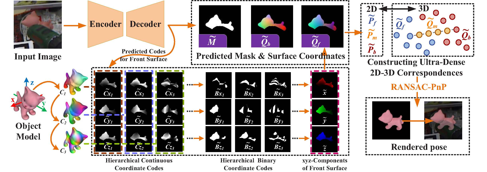
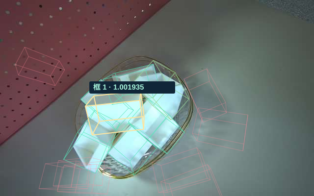
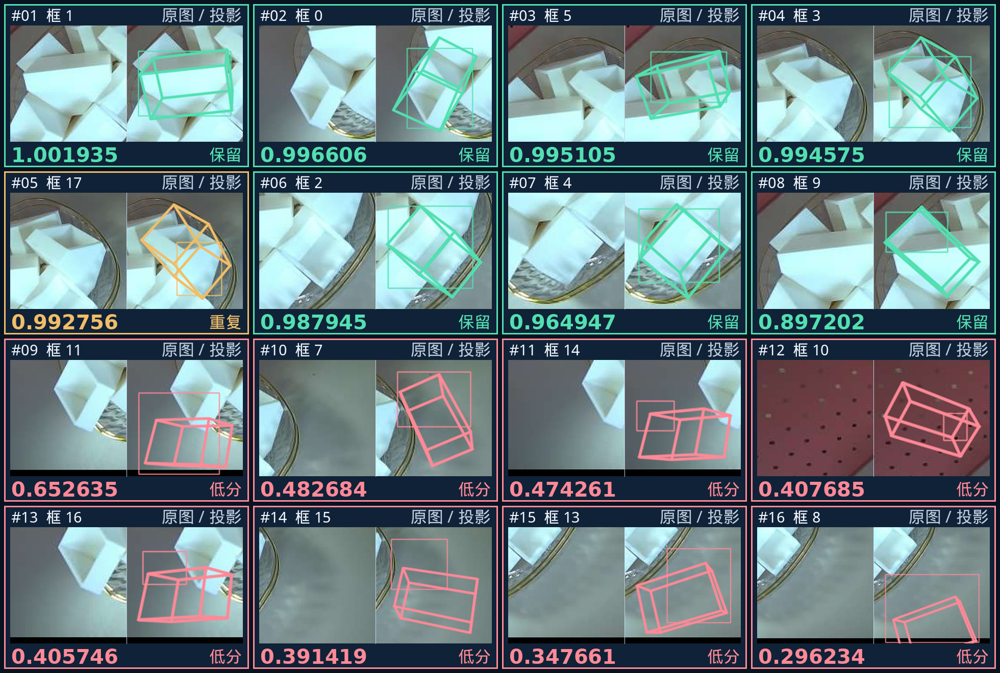
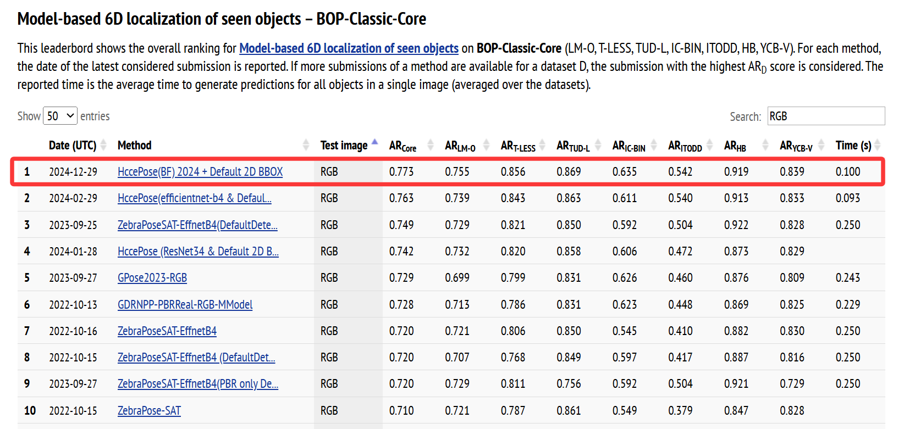
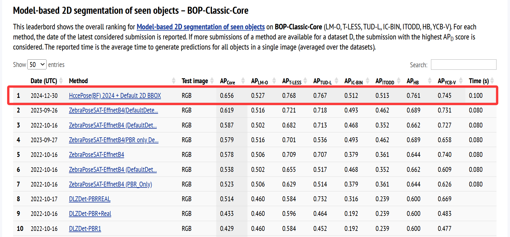

<p align="center">
  
</p>

<p align="center">
  <a href="https://wangyulin-seu.github.io/hccepose/?lang=zh"></a>
  <a href="https://wangyulin-seu.github.io/hccepose/docs/index.html?lang=zh"></a>
  <a href="https://arxiv.org/abs/2510.10177"></a>
  <a href="https://huggingface.co/datasets/SEU-WYL/HccePose"></a>
</p>

<p align="center"><a href="README.md">English</a> · 中文</p>

<h3 align="center">从一张 RGB 图像，估计已知物体的 6D 位姿</h3>
<p align="center">联合预测物体前、后表面坐标，通过超密集 2D–3D 对应求解位姿。</p>

<p align="center">
  <a href="https://arxiv.org/abs/2510.10177"></a>
</p>
<p align="center"><sub>HccePose(BF) 论文方法图</sub> · <a href="docs/zh/method.md">方法详解 →</a></p>

## 模型与示例数据

预训练权重、物体模型及示例输入均可从 **[Hugging Face](https://huggingface.co/datasets/SEU-WYL/HccePose)** 获取。

<table align="center">
  <thead>
    <tr><th align="center">资源</th><th align="center">下载与说明</th></tr>
  </thead>
  <tbody>
    <tr><td align="center">料箱物体模型、检测器与位姿权重</td><td align="center"><a href="https://huggingface.co/datasets/SEU-WYL/HccePose/tree/4e482e540314622981ccd4fce5beddac7f9d3e1d/demo-bin-picking">Hugging Face 文件</a></td></tr>
    <tr><td align="center">RGB-D 彩色图、深度图及相机内参</td><td align="center"><a href="https://huggingface.co/datasets/SEU-WYL/HccePose/tree/4e482e540314622981ccd4fce5beddac7f9d3e1d/test_imgs_RGBD">RGB-D 示例帧</a></td></tr>
    <tr><td align="center">RGB 图片与输入视频</td><td align="center"><a href="https://huggingface.co/datasets/SEU-WYL/HccePose/tree/4e482e540314622981ccd4fce5beddac7f9d3e1d/test_imgs">图片</a> · <a href="https://huggingface.co/datasets/SEU-WYL/HccePose/tree/4e482e540314622981ccd4fce5beddac7f9d3e1d/test_videos">视频</a></td></tr>
    <tr><td align="center">七个核心 BOP 数据集的位姿预训练权重</td><td align="center"><a href="docs/zh/bop-evaluation.md#预训练权重">权重与评测说明</a></td></tr>
  </tbody>
</table>

第一次运行建议按[模型与输入](docs/zh/assets.md#下载一个-rgb-d-示例)下载匹配的最小资源集并生成相机矩阵。完整资源库还包含训练数据，运行这个示例不需要全部下载。

## 从这里开始

<table align="center">
  <thead>
    <tr><th align="center">你的目标</th><th align="center">对应文档</th></tr>
  </thead>
  <tbody>
    <tr><td align="center">跑通预训练示例</td><td align="center"><a href="docs/zh/installation.md">环境安装</a> → <a href="docs/zh/assets.md">模型与输入</a> → <a href="docs/zh/quickstart.md">第一次预测</a></td></tr>
    <tr><td align="center">处理图片或视频</td><td align="center"><a href="docs/zh/rgb-inference.md">RGB 图片</a> · <a href="docs/zh/video.md">视频逐帧</a></td></tr>
    <tr><td align="center">使用深度估计或精修</td><td align="center"><a href="docs/zh/rgbd-wapr.md">WAPR</a> · <a href="docs/zh/rgbd-megapose.md">MegaPose</a> · <a href="docs/zh/depth-comparison.md">深度对比</a></td></tr>
    <tr><td align="center">为新物体训练</td><td align="center"><a href="docs/zh/object-preparation.md">网格与对称性</a> → <a href="docs/zh/rendering.md">PBR 渲染</a> → <a href="docs/zh/detector-training.md">检测器</a> → <a href="docs/zh/coordinate-labels.md">表面标签</a> → <a href="docs/zh/pose-training.md">位姿训练</a></td></tr>
    <tr><td align="center">在程序中接入</td><td align="center"><a href="docs/zh/tester-api.md">Tester</a> · <a href="docs/zh/results-api.md">结果与坐标</a> · <a href="docs/zh/refinement-api.md">精修接口</a> · <a href="docs/zh/data-api.md">数据加载</a> · <a href="docs/zh/utilities-api.md">工具</a></td></tr>
    <tr><td align="center">加速、评测和查阅</td><td align="center"><a href="docs/zh/acceleration.md">ONNX/TensorRT</a> · <a href="docs/zh/bop-evaluation.md">BOP 评测</a> · <a href="docs/zh/changelog.md">公开更新</a> · <a href="docs/zh/project-structure.md">项目结构</a></td></tr>
  </tbody>
</table>

## 开始使用

项目提供 RGB 推理、WAPR 接入，以及可选的外部 MegaPose 接口。先准备匹配的检测器与物体位姿权重、物体网格、相机内参和输入图像，再运行推理示例。具体步骤见[安装说明](docs/zh/installation.md)、[资源约定](docs/zh/assets.md)和[第一次预测](docs/zh/quickstart.md)。

```bash
python examples/inference/predict_image.py
```

修改入口末尾的资源路径与物体编号后，在项目根目录运行上述命令。输出保存于 `outputs/rgb/`。

## WAPR 接入

[WAPR](https://github.com/WangYuLin-SEU/WAPR/tree/4e591be318a828c91980c58ef8bbdc34e6599881) 需单独安装。示例将 HccePose 从当前图像预测的实例掩码映射回原图，结合配准深度、相机内参及各物体的米制网格和直径估计位姿。每个实例输出 `pose_4x4_m`（物体到相机，平移单位为米）和针对本次输入计算的 `score_6d`，保持输入实例顺序。该接口从掩码估计位姿，无需 HccePose 位姿初值。详见 [WAPR 使用说明](docs/zh/rgbd-wapr.md)。

可选的分数筛选与同类 CAD 渲染掩码 NMS 见[后处理教程](docs/zh/wapr-postprocessing.md)及 `examples/inference/postprocess_wapr.py`，原始推理 JSON 单独保留。

<p align="center"><strong>三角块 RGB-D 保存场景 · WBPS ≥ 0.75 · 🟢 保留 7 · 🟠 重复 1 · 🔴 低分 8</strong></p>

<table align="center">
<tr><th align="center">RGB · 已保存的位姿投影</th><th align="center">深度散点、CAD 与空间线框</th></tr>
<tr><td align="center" width="50%"><a href="https://wangyulin-seu.github.io/hccepose/docs/rgbd-wapr.html?lang=zh"></a></td><td align="center" width="50%">

```stl
solid hccepose_retained_with_depth_samples
facet normal -0.993968 -0.103567 -0.036063
outer loop
vertex -0.128282 0.135053 -0.336622
vertex -0.128034 0.131467 -0.333146
vertex -0.129991 0.145252 -0.318788
endloop
endfacet
facet normal 0.993969 0.103562 0.0360662
outer loop
vertex -0.0686434 0.141267 -0.334458
vertex -0.064729 0.113697 -0.363174
vertex -0.0695929 0.155024 -0.347796
endloop
endfacet
facet normal 0.0978607 -0.689227 -0.717906
outer loop
vertex -0.0672035 0.149553 -0.397935
vertex -0.0873303 0.151067 -0.402132
vertex -0.0674509 0.153138 -0.401411
endloop
endfacet
facet normal 0.993969 0.103562 0.0360657
outer loop
vertex -0.0288846 0.145409 -0.333015
vertex -0.0305944 0.155608 -0.315181
vertex -0.0286372 0.141824 -0.329539
endloop
endfacet
facet normal -0.0494901 0.717105 -0.695206
outer loop
vertex -0.0335638 0.198634 -0.356894
vertex -0.0674509 0.153138 -0.401411
vertex -0.0610279 0.195773 -0.35789
endloop
endfacet
facet normal 0.049485 -0.71711 0.695201
outer loop
vertex -0.0870829 0.147481 -0.398656
vertex -0.0876857 0.151727 -0.394234
vertex -0.117366 0.163725 -0.379744
endloop
endfacet
facet normal 0.097859 -0.689232 -0.717902
outer loop
vertex -0.0846084 0.111626 -0.363896
vertex -0.0644816 0.110112 -0.359698
vertex -0.0843609 0.108041 -0.36042
endloop
endfacet
facet normal 0.993969 0.103563 0.0360638
outer loop
vertex -0.0313591 0.181264 -0.367776
vertex -0.0316066 0.18485 -0.371252
vertex -0.0335638 0.198634 -0.356894
endloop
endfacet
facet normal -0.993969 -0.103562 -0.0360661
outer loop
vertex -0.0858631 0.120463 -0.354691
vertex -0.0909973 0.175051 -0.36994
vertex -0.0876857 0.151727 -0.394234
endloop
endfacet
facet normal 0.0494895 -0.717105 0.695206
outer loop
vertex -0.0672035 0.149553 -0.397935
vertex -0.0313591 0.181264 -0.367776
vertex -0.0711179 0.177122 -0.369218
endloop
endfacet
facet normal 0.0494901 -0.717105 0.695206
outer loop
vertex -0.117366 0.163725 -0.379744
vertex -0.0909973 0.175051 -0.36994
vertex -0.130756 0.170908 -0.371382
endloop
endfacet
facet normal -0.633645 -0.560586 -0.533139
outer loop
vertex -0.0843609 0.108041 -0.36042
vertex -0.128034 0.131467 -0.333146
vertex -0.114075 0.127432 -0.345494
endloop
endfacet
facet normal 0.993969 0.103564 0.036067
outer loop
vertex -0.031966 0.175483 -0.334449
vertex -0.0305944 0.155608 -0.315181
vertex -0.0313591 0.181264 -0.367776
endloop
endfacet
facet normal -0.0978599 0.689228 0.717905
outer loop
vertex -0.129991 0.145252 -0.318788
vertex -0.0305944 0.155608 -0.315181
vertex -0.031966 0.175483 -0.334449
endloop
endfacet
facet normal 0.09786 -0.689229 -0.717905
outer loop
vertex -0.128282 0.135053 -0.336622
vertex -0.0909973 0.175051 -0.36994
vertex -0.0887709 0.14279 -0.338665
endloop
endfacet
facet normal 0.0494898 -0.717105 0.695206
outer loop
vertex -0.0286372 0.141824 -0.329539
vertex -0.0305944 0.155608 -0.315181
vertex -0.129991 0.145252 -0.318788
endloop
endfacet
facet normal -0.993969 -0.103562 -0.036065
outer loop
vertex -0.130756 0.170908 -0.371382
vertex -0.132961 0.188278 -0.3605
vertex -0.131003 0.174494 -0.374858
endloop
endfacet
facet normal 0.0978606 -0.689228 -0.717905
outer loop
vertex -0.0873303 0.151067 -0.402132
vertex -0.0672035 0.149553 -0.397935
vertex -0.0870829 0.147481 -0.398656
endloop
endfacet
facet normal 0.09786 -0.689229 -0.717905
outer loop
vertex -0.0658106 0.129369 -0.378368
vertex -0.0846084 0.111626 -0.363896
vertex -0.0870829 0.147481 -0.398656
endloop
endfacet
facet normal 0.0494896 -0.717105 0.695206
outer loop
vertex -0.0909973 0.175051 -0.36994
vertex -0.117366 0.163725 -0.379744
vertex -0.0876857 0.151727 -0.394234
endloop
endfacet
facet normal -0.0494898 0.717105 -0.695206
outer loop
vertex -0.0885228 0.139195 -0.335179
vertex -0.0858631 0.120463 -0.354691
vertex -0.114075 0.127432 -0.345494
endloop
endfacet
facet normal -0.0494897 0.717105 -0.695206
outer loop
vertex -0.0610279 0.195773 -0.35789
vertex -0.131003 0.174494 -0.374858
vertex -0.132961 0.188278 -0.3605
endloop
endfacet
facet normal 0.993969 0.103562 0.0360659
outer loop
vertex -0.0711179 0.177122 -0.369218
vertex -0.0695929 0.155024 -0.347796
vertex -0.0658106 0.129369 -0.378368
endloop
endfacet
facet normal 0.0494894 -0.717105 0.695206
outer loop
vertex -0.0534583 0.119864 -0.350424
vertex -0.129991 0.145252 -0.318788
vertex -0.0644816 0.110112 -0.359698
endloop
endfacet
facet normal -0.993969 -0.103562 -0.0360661
outer loop
vertex -0.0885228 0.139195 -0.335179
vertex -0.0887709 0.14279 -0.338665
vertex -0.0858631 0.120463 -0.354691
endloop
endfacet
facet normal 0.09786 -0.689228 -0.717906
outer loop
vertex -0.0846084 0.111626 -0.363896
vertex -0.064729 0.113697 -0.363174
vertex -0.0644816 0.110112 -0.359698
endloop
endfacet
facet normal 0.77204 -0.41413 -0.482132
outer loop
vertex -0.064729 0.113697 -0.363174
vertex -0.0534583 0.119864 -0.350424
vertex -0.0644816 0.110112 -0.359698
endloop
endfacet
facet normal -0.993969 -0.103562 -0.0360661
outer loop
vertex -0.0909973 0.175051 -0.36994
vertex -0.0858631 0.120463 -0.354691
vertex -0.0887709 0.14279 -0.338665
endloop
endfacet
facet normal -0.633645 -0.560588 -0.533137
outer loop
vertex -0.117366 0.163725 -0.379744
vertex -0.131003 0.174494 -0.374858
vertex -0.0873303 0.151067 -0.402132
endloop
endfacet
facet normal -0.0494899 0.717105 -0.695206
outer loop
vertex -0.0674509 0.153138 -0.401411
vertex -0.0335638 0.198634 -0.356894
vertex -0.0316066 0.18485 -0.371252
endloop
endfacet
facet normal -0.0494901 0.717104 -0.695207
outer loop
vertex -0.0858631 0.120463 -0.354691
vertex -0.0846084 0.111626 -0.363896
vertex -0.114075 0.127432 -0.345494
endloop
endfacet
facet normal -0.633644 -0.560587 -0.533139
outer loop
vertex -0.114075 0.127432 -0.345494
vertex -0.128034 0.131467 -0.333146
vertex -0.128282 0.135053 -0.336622
endloop
endfacet
facet normal 0.097859 -0.689225 -0.717909
outer loop
vertex -0.128282 0.135053 -0.336622
vertex -0.0887709 0.14279 -0.338665
vertex -0.0885228 0.139195 -0.335179
endloop
endfacet
facet normal 0.77204 -0.414129 -0.482133
outer loop
vertex -0.0286372 0.141824 -0.329539
vertex -0.0534583 0.119864 -0.350424
vertex -0.0288846 0.145409 -0.333015
endloop
endfacet
facet normal 0.993969 0.103562 0.0360661
outer loop
vertex -0.0658106 0.129369 -0.378368
vertex -0.0672035 0.149553 -0.397935
vertex -0.0711179 0.177122 -0.369218
endloop
endfacet
facet normal 0.0494904 -0.717104 0.695207
outer loop
vertex -0.0644816 0.110112 -0.359698
vertex -0.129991 0.145252 -0.318788
vertex -0.0843609 0.108041 -0.36042
endloop
endfacet
facet normal -0.993969 -0.103562 -0.036066
outer loop
vertex -0.128282 0.135053 -0.336622
vertex -0.129991 0.145252 -0.318788
vertex -0.130756 0.170908 -0.371382
endloop
endfacet
facet normal -0.0494898 0.717105 -0.695206
outer loop
vertex -0.131003 0.174494 -0.374858
vertex -0.0674509 0.153138 -0.401411
vertex -0.0873303 0.151067 -0.402132
endloop
endfacet
facet normal 0.0978606 -0.689228 -0.717905
outer loop
vertex -0.0658106 0.129369 -0.378368
vertex -0.0870829 0.147481 -0.398656
vertex -0.0672035 0.149553 -0.397935
endloop
endfacet
facet normal 0.0978601 -0.689229 -0.717905
outer loop
vertex -0.0658106 0.129369 -0.378368
vertex -0.064729 0.113697 -0.363174
vertex -0.0846084 0.111626 -0.363896
endloop
endfacet
facet normal -0.633645 -0.560589 -0.533136
outer loop
vertex -0.114075 0.127432 -0.345494
vertex -0.0846084 0.111626 -0.363896
vertex -0.0843609 0.108041 -0.36042
endloop
endfacet
facet normal -0.0978599 0.689229 0.717905
outer loop
vertex -0.132961 0.188278 -0.3605
vertex -0.129991 0.145252 -0.318788
vertex -0.0610279 0.195773 -0.35789
endloop
endfacet
facet normal 0.77204 -0.41413 -0.482132
outer loop
vertex -0.0534583 0.119864 -0.350424
vertex -0.064729 0.113697 -0.363174
vertex -0.0288846 0.145409 -0.333015
endloop
endfacet
facet normal 0.0978602 -0.689228 -0.717905
outer loop
vertex -0.0288846 0.145409 -0.333015
vertex -0.0686434 0.141267 -0.334458
vertex -0.0695929 0.155024 -0.347796
endloop
endfacet
facet normal 0.0978602 -0.689229 -0.717905
outer loop
vertex -0.0711179 0.177122 -0.369218
vertex -0.0313591 0.181264 -0.367776
vertex -0.0695929 0.155024 -0.347796
endloop
endfacet
facet normal 0.993969 0.103562 0.036066
outer loop
vertex -0.0313591 0.181264 -0.367776
vertex -0.0305944 0.155608 -0.315181
vertex -0.0288846 0.145409 -0.333015
endloop
endfacet
facet normal 0.09786 -0.689229 -0.717905
outer loop
vertex -0.0313591 0.181264 -0.367776
vertex -0.0288846 0.145409 -0.333015
vertex -0.0695929 0.155024 -0.347796
endloop
endfacet
facet normal 0.993969 0.103562 0.0360659
outer loop
vertex -0.064729 0.113697 -0.363174
vertex -0.0658106 0.129369 -0.378368
vertex -0.0695929 0.155024 -0.347796
endloop
endfacet
facet normal 0.993969 0.103561 0.0360666
outer loop
vertex -0.0313591 0.181264 -0.367776
vertex -0.0335638 0.198634 -0.356894
vertex -0.031966 0.175483 -0.334449
endloop
endfacet
facet normal 0.0494898 -0.717105 0.695206
outer loop
vertex -0.0534583 0.119864 -0.350424
vertex -0.0286372 0.141824 -0.329539
vertex -0.129991 0.145252 -0.318788
endloop
endfacet
facet normal -0.0494897 0.717105 -0.695206
outer loop
vertex -0.131003 0.174494 -0.374858
vertex -0.0610279 0.195773 -0.35789
vertex -0.0674509 0.153138 -0.401411
endloop
endfacet
facet normal -0.0494906 0.717105 -0.695205
outer loop
vertex -0.0885228 0.139195 -0.335179
vertex -0.114075 0.127432 -0.345494
vertex -0.128282 0.135053 -0.336622
endloop
endfacet
facet normal 0.0978598 -0.689229 -0.717905
outer loop
vertex -0.0909973 0.175051 -0.36994
vertex -0.128282 0.135053 -0.336622
vertex -0.130756 0.170908 -0.371382
endloop
endfacet
facet normal -0.993969 -0.103563 -0.0360678
outer loop
vertex -0.0876857 0.151727 -0.394234
vertex -0.0870829 0.147481 -0.398656
vertex -0.0846084 0.111626 -0.363896
endloop
endfacet
facet normal -0.993969 -0.103562 -0.0360663
outer loop
vertex -0.0876857 0.151727 -0.394234
vertex -0.0846084 0.111626 -0.363896
vertex -0.0858631 0.120463 -0.354691
endloop
endfacet
facet normal 0.0494898 -0.717105 0.695206
outer loop
vertex -0.0843609 0.108041 -0.36042
vertex -0.129991 0.145252 -0.318788
vertex -0.128034 0.131467 -0.333146
endloop
endfacet
facet normal -0.993969 -0.103562 -0.036066
outer loop
vertex -0.132961 0.188278 -0.3605
vertex -0.130756 0.170908 -0.371382
vertex -0.129991 0.145252 -0.318788
endloop
endfacet
facet normal -0.0978599 0.689229 0.717905
outer loop
vertex -0.0610279 0.195773 -0.35789
vertex -0.129991 0.145252 -0.318788
vertex -0.0335638 0.198634 -0.356894
endloop
endfacet
facet normal -0.09786 0.689229 0.717905
outer loop
vertex -0.0335638 0.198634 -0.356894
vertex -0.129991 0.145252 -0.318788
vertex -0.031966 0.175483 -0.334449
endloop
endfacet
facet normal -0.0494903 0.717105 -0.695206
outer loop
vertex -0.0288846 0.145409 -0.333015
vertex -0.064729 0.113697 -0.363174
vertex -0.0686434 0.141267 -0.334458
endloop
endfacet
facet normal 0.77204 -0.41413 -0.482132
outer loop
vertex -0.0316066 0.18485 -0.371252
vertex -0.0313591 0.181264 -0.367776
vertex -0.0672035 0.149553 -0.397935
endloop
endfacet
facet normal 0.77204 -0.41413 -0.482132
outer loop
vertex -0.0674509 0.153138 -0.401411
vertex -0.0316066 0.18485 -0.371252
vertex -0.0672035 0.149553 -0.397935
endloop
endfacet
facet normal -0.633645 -0.560589 -0.533137
outer loop
vertex -0.0873303 0.151067 -0.402132
vertex -0.0870829 0.147481 -0.398656
vertex -0.117366 0.163725 -0.379744
endloop
endfacet
facet normal -0.633645 -0.560587 -0.533139
outer loop
vertex -0.131003 0.174494 -0.374858
vertex -0.117366 0.163725 -0.379744
vertex -0.130756 0.170908 -0.371382
endloop
endfacet
facet normal 0.0183974 -0.702605 0.711343
outer loop
vertex -0.12393 0.0446068 -0.355535
vertex -0.126451 0.0415024 -0.358536
vertex -0.109183 0.0345501 -0.36585
endloop
endfacet
facet normal -0.0184015 0.702601 -0.711346
outer loop
vertex -0.125034 0.0867629 -0.398216
vertex -0.159569 0.100668 -0.383589
vertex -0.115361 0.098675 -0.3867
endloop
endfacet
facet normal -0.86339 0.347617 0.365677
outer loop
vertex -0.134359 0.131712 -0.353577
vertex -0.13147 0.120765 -0.336349
vertex -0.131838 0.134817 -0.350576
endloop
endfacet
facet normal -0.0184011 0.702602 -0.711345
outer loop
vertex -0.12577 0.114867 -0.426669
vertex -0.111023 0.10481 -0.436984
vertex -0.128291 0.111763 -0.429671
endloop
endfacet
facet normal 0.504199 0.620898 0.600224
outer loop
vertex -0.080771 0.142064 -0.400971
vertex -0.131838 0.134817 -0.350576
vertex -0.0802625 0.122651 -0.381316
endloop
endfacet
facet normal -0.504205 -0.6209 -0.600217
outer loop
vertex -0.133991 0.11766 -0.33935
vertex -0.128673 0.115519 -0.341603
vertex -0.109534 0.0885316 -0.329763
endloop
endfacet
facet normal -0.863393 0.347611 0.365675
outer loop
vertex -0.159201 0.0866155 -0.369362
vertex -0.16209 0.097563 -0.38659
vertex -0.161722 0.083511 -0.372363
endloop
endfacet
facet normal -0.0184008 0.702603 -0.711344
outer loop
vertex -0.10056 0.145912 -0.396658
vertex -0.0980388 0.149016 -0.393657
vertex -0.080771 0.142064 -0.400971
endloop
endfacet
facet normal 0.0184015 -0.702602 0.711346
outer loop
vertex -0.148131 0.0821584 -0.37405
vertex -0.0994557 0.103756 -0.353978
vertex -0.128673 0.115519 -0.341603
endloop
endfacet
facet normal -0.504199 -0.620899 -0.600223
outer loop
vertex -0.134359 0.131712 -0.353577
vertex -0.10056 0.145912 -0.396658
vertex -0.0998237 0.117808 -0.368204
endloop
endfacet
facet normal -0.5042 -0.620898 -0.600223
outer loop
vertex -0.109534 0.0885316 -0.329763
vertex -0.0994557 0.103756 -0.353978
vertex -0.0987197 0.0756518 -0.325524
endloop
endfacet
facet normal -0.597497 -0.251012 0.761571
outer loop
vertex -0.161722 0.083511 -0.372363
vertex -0.126451 0.0415024 -0.358536
vertex -0.135403 0.0582719 -0.360033
endloop
endfacet
facet normal -0.0183992 0.702601 -0.711346
outer loop
vertex -0.0970489 0.122019 -0.420349
vertex -0.111023 0.10481 -0.436984
vertex -0.10056 0.145912 -0.396658
endloop
endfacet
facet normal 0.863391 -0.347615 -0.365677
outer loop
vertex -0.109183 0.0345501 -0.36585
vertex -0.111023 0.10481 -0.436984
vertex -0.0970489 0.122019 -0.420349
endloop
endfacet
facet normal -0.863391 0.347615 0.365677
outer loop
vertex -0.12393 0.0446068 -0.355535
vertex -0.0994557 0.103756 -0.353978
vertex -0.122138 0.0758236 -0.38098
endloop
endfacet
facet normal -0.504199 -0.620898 -0.600223
outer loop
vertex -0.128291 0.111763 -0.429671
vertex -0.111023 0.10481 -0.436984
vertex -0.109183 0.0345501 -0.36585
endloop
endfacet
facet normal 0.0184013 -0.702602 0.711345
outer loop
vertex -0.0987197 0.0756518 -0.325524
vertex -0.0789308 0.071804 -0.329836
vertex -0.0961986 0.0787563 -0.322523
endloop
endfacet
facet normal -0.863391 0.347616 0.365677
outer loop
vertex -0.13147 0.120765 -0.336349
vertex -0.134359 0.131712 -0.353577
vertex -0.133991 0.11766 -0.33935
endloop
endfacet
facet normal -0.863391 0.347615 0.365677
outer loop
vertex -0.14855 0.114237 -0.370471
vertex -0.159201 0.0866155 -0.369362
vertex -0.133991 0.11766 -0.33935
endloop
endfacet
facet normal -0.504199 -0.620899 -0.600223
outer loop
vertex -0.0994557 0.103756 -0.353978
vertex -0.109534 0.0885316 -0.329763
vertex -0.128673 0.115519 -0.341603
endloop
endfacet
facet normal 0.504199 0.620898 0.600224
outer loop
vertex -0.124666 0.0727109 -0.383989
vertex -0.148131 0.0821584 -0.37405
vertex -0.135403 0.0582719 -0.360033
endloop
endfacet
facet normal 0.5042 0.620898 0.600223
outer loop
vertex -0.0802625 0.122651 -0.381316
vertex -0.0961986 0.0787563 -0.322523
vertex -0.0789308 0.071804 -0.329836
endloop
endfacet
facet normal -0.0184015 0.702602 -0.711345
outer loop
vertex -0.0998237 0.117808 -0.368204
vertex -0.115361 0.098675 -0.3867
vertex -0.14855 0.114237 -0.370471
endloop
endfacet
facet normal -0.5042 -0.620898 -0.600223
outer loop
vertex -0.151696 0.10193 -0.399838
vertex -0.109183 0.0345501 -0.36585
vertex -0.16209 0.097563 -0.38659
endloop
endfacet
facet normal 0.0184014 -0.702602 0.711346
outer loop
vertex -0.124666 0.0727109 -0.383989
vertex -0.122138 0.0758236 -0.38098
vertex -0.148131 0.0821584 -0.37405
endloop
endfacet
facet normal -0.863391 0.347616 0.365677
outer loop
vertex -0.159201 0.0866155 -0.369362
vertex -0.159569 0.100668 -0.383589
vertex -0.16209 0.097563 -0.38659
endloop
endfacet
facet normal -0.623522 0.742615 -0.244425
outer loop
vertex -0.159569 0.100668 -0.383589
vertex -0.151696 0.10193 -0.399838
vertex -0.16209 0.097563 -0.38659
endloop
endfacet
facet normal 0.0184015 -0.702602 0.711346
outer loop
vertex -0.0994557 0.103756 -0.353978
vertex -0.148131 0.0821584 -0.37405
vertex -0.122138 0.0758236 -0.38098
endloop
endfacet
facet normal -0.597498 -0.251014 0.761569
outer loop
vertex -0.109534 0.0885316 -0.329763
vertex -0.0961986 0.0787563 -0.322523
vertex -0.13147 0.120765 -0.336349
endloop
endfacet
facet normal 0.504199 0.620898 0.600224
outer loop
vertex -0.131838 0.134817 -0.350576
vertex -0.080771 0.142064 -0.400971
vertex -0.0980388 0.149016 -0.393657
endloop
endfacet
facet normal 0.504199 0.620898 0.600224
outer loop
vertex -0.148131 0.0821584 -0.37405
vertex -0.159201 0.0866155 -0.369362
vertex -0.135403 0.0582719 -0.360033
endloop
endfacet
facet normal -0.597498 -0.251013 0.76157
outer loop
vertex -0.135403 0.0582719 -0.360033
vertex -0.126451 0.0415024 -0.358536
vertex -0.12393 0.0446068 -0.355535
endloop
endfacet
facet normal -0.863389 0.347618 0.36568
outer loop
vertex -0.12393 0.0446068 -0.355535
vertex -0.122138 0.0758236 -0.38098
vertex -0.124666 0.0727109 -0.383989
endloop
endfacet
facet normal -0.623522 0.742615 -0.244425
outer loop
vertex -0.128291 0.111763 -0.429671
vertex -0.151696 0.10193 -0.399838
vertex -0.12577 0.114867 -0.426669
endloop
endfacet
facet normal -0.0184015 0.702601 -0.711346
outer loop
vertex -0.14855 0.114237 -0.370471
vertex -0.134359 0.131712 -0.353577
vertex -0.0998237 0.117808 -0.368204
endloop
endfacet
facet normal -0.504199 -0.620898 -0.600224
outer loop
vertex -0.16209 0.097563 -0.38659
vertex -0.109183 0.0345501 -0.36585
vertex -0.161722 0.083511 -0.372363
endloop
endfacet
facet normal 0.0184016 -0.702602 0.711346
outer loop
vertex -0.12393 0.0446068 -0.355535
vertex -0.109183 0.0345501 -0.36585
vertex -0.0987197 0.0756518 -0.325524
endloop
endfacet
facet normal 0.504199 0.620898 0.600224
outer loop
vertex -0.0961986 0.0787563 -0.322523
vertex -0.131838 0.134817 -0.350576
vertex -0.13147 0.120765 -0.336349
endloop
endfacet
facet normal -0.863391 0.347616 0.365676
outer loop
vertex -0.14855 0.114237 -0.370471
vertex -0.133991 0.11766 -0.33935
vertex -0.134359 0.131712 -0.353577
endloop
endfacet
facet normal -0.863391 0.347615 0.365676
outer loop
vertex -0.14855 0.114237 -0.370471
vertex -0.159569 0.100668 -0.383589
vertex -0.159201 0.0866155 -0.369362
endloop
endfacet
facet normal -0.597499 -0.251015 0.761568
outer loop
vertex -0.135403 0.0582719 -0.360033
vertex -0.159201 0.0866155 -0.369362
vertex -0.161722 0.083511 -0.372363
endloop
endfacet
facet normal 0.863391 -0.347615 -0.365677
outer loop
vertex -0.0789308 0.071804 -0.329836
vertex -0.109183 0.0345501 -0.36585
vertex -0.0802625 0.122651 -0.381316
endloop
endfacet
facet normal -0.623522 0.742615 -0.244425
outer loop
vertex -0.151696 0.10193 -0.399838
vertex -0.159569 0.100668 -0.383589
vertex -0.12577 0.114867 -0.426669
endloop
endfacet
facet normal -0.863391 0.347615 0.365677
outer loop
vertex -0.12577 0.114867 -0.426669
vertex -0.125034 0.0867629 -0.398216
vertex -0.115361 0.098675 -0.3867
endloop
endfacet
facet normal -0.863391 0.347615 0.365676
outer loop
vertex -0.0998237 0.117808 -0.368204
vertex -0.10056 0.145912 -0.396658
vertex -0.115361 0.098675 -0.3867
endloop
endfacet
facet normal -0.0184015 0.702602 -0.711345
outer loop
vertex -0.10056 0.145912 -0.396658
vertex -0.111023 0.10481 -0.436984
vertex -0.12577 0.114867 -0.426669
endloop
endfacet
facet normal -0.863391 0.347615 0.365677
outer loop
vertex -0.10056 0.145912 -0.396658
vertex -0.12577 0.114867 -0.426669
vertex -0.115361 0.098675 -0.3867
endloop
endfacet
facet normal -0.0184015 0.702602 -0.711345
outer loop
vertex -0.159569 0.100668 -0.383589
vertex -0.14855 0.114237 -0.370471
vertex -0.115361 0.098675 -0.3867
endloop
endfacet
facet normal -0.0184017 0.702601 -0.711346
outer loop
vertex -0.10056 0.145912 -0.396658
vertex -0.080771 0.142064 -0.400971
vertex -0.0970489 0.122019 -0.420349
endloop
endfacet
facet normal -0.504199 -0.620898 -0.600224
outer loop
vertex -0.151696 0.10193 -0.399838
vertex -0.128291 0.111763 -0.429671
vertex -0.109183 0.0345501 -0.36585
endloop
endfacet
facet normal 0.504199 0.620898 0.600223
outer loop
vertex -0.0961986 0.0787563 -0.322523
vertex -0.0802625 0.122651 -0.381316
vertex -0.131838 0.134817 -0.350576
endloop
endfacet
facet normal 0.5042 0.620897 0.600223
outer loop
vertex -0.124666 0.0727109 -0.383989
vertex -0.135403 0.0582719 -0.360033
vertex -0.12393 0.0446068 -0.355535
endloop
endfacet
facet normal -0.863391 0.347615 0.365677
outer loop
vertex -0.0994557 0.103756 -0.353978
vertex -0.12393 0.0446068 -0.355535
vertex -0.0987197 0.0756518 -0.325524
endloop
endfacet
facet normal 0.0183996 -0.702601 0.711346
outer loop
vertex -0.128673 0.115519 -0.341603
vertex -0.133991 0.11766 -0.33935
vertex -0.159201 0.0866155 -0.369362
endloop
endfacet
facet normal 0.0184012 -0.702601 0.711346
outer loop
vertex -0.128673 0.115519 -0.341603
vertex -0.159201 0.0866155 -0.369362
vertex -0.148131 0.0821584 -0.37405
endloop
endfacet
facet normal -0.504199 -0.620898 -0.600224
outer loop
vertex -0.161722 0.083511 -0.372363
vertex -0.109183 0.0345501 -0.36585
vertex -0.126451 0.0415024 -0.358536
endloop
endfacet
facet normal 0.0184016 -0.702602 0.711346
outer loop
vertex -0.0789308 0.071804 -0.329836
vertex -0.0987197 0.0756518 -0.325524
vertex -0.109183 0.0345501 -0.36585
endloop
endfacet
facet normal 0.863391 -0.347615 -0.365677
outer loop
vertex -0.0802625 0.122651 -0.381316
vertex -0.109183 0.0345501 -0.36585
vertex -0.080771 0.142064 -0.400971
endloop
endfacet
facet normal 0.863391 -0.347615 -0.365677
outer loop
vertex -0.080771 0.142064 -0.400971
vertex -0.109183 0.0345501 -0.36585
vertex -0.0970489 0.122019 -0.420349
endloop
endfacet
facet normal 0.504199 0.620898 0.600224
outer loop
vertex -0.12577 0.114867 -0.426669
vertex -0.159569 0.100668 -0.383589
vertex -0.125034 0.0867629 -0.398216
endloop
endfacet
facet normal -0.623522 0.742614 -0.244426
outer loop
vertex -0.0980388 0.149016 -0.393657
vertex -0.10056 0.145912 -0.396658
vertex -0.134359 0.131712 -0.353577
endloop
endfacet
facet normal -0.623523 0.742614 -0.244426
outer loop
vertex -0.131838 0.134817 -0.350576
vertex -0.0980388 0.149016 -0.393657
vertex -0.134359 0.131712 -0.353577
endloop
endfacet
facet normal -0.597499 -0.251015 0.761568
outer loop
vertex -0.13147 0.120765 -0.336349
vertex -0.133991 0.11766 -0.33935
vertex -0.109534 0.0885316 -0.329763
endloop
endfacet
facet normal -0.597498 -0.251013 0.76157
outer loop
vertex -0.0961986 0.0787563 -0.322523
vertex -0.109534 0.0885316 -0.329763
vertex -0.0987197 0.0756518 -0.325524
endloop
endfacet
facet normal 0.937979 0.0041826 0.346666
outer loop
vertex 0.00160398 0.215859 -0.38076
vertex 0.00287104 0.212406 -0.384146
vertex 0.00760289 0.226869 -0.397124
endloop
endfacet
facet normal -0.937978 -0.0041877 -0.346669
outer loop
vertex -0.0546747 0.215608 -0.40156
vertex -0.0641383 0.186681 -0.375605
vertex -0.0595366 0.228858 -0.388565
endloop
endfacet
facet normal -0.236592 -0.723174 0.648878
outer loop
vertex -0.0768093 0.221213 -0.341738
vertex -0.0593168 0.22475 -0.331418
vertex -0.0780764 0.224666 -0.338351
endloop
endfacet
facet normal -0.937978 -0.00418718 -0.346668
outer loop
vertex -0.0921938 0.21544 -0.415427
vertex -0.0861949 0.22645 -0.431791
vertex -0.0909267 0.211987 -0.418813
endloop
endfacet
facet normal -0.253419 0.690652 0.677332
outer loop
vertex -0.1014 0.267889 -0.391151
vertex -0.0780764 0.224666 -0.338351
vertex -0.0754831 0.268005 -0.381572
endloop
endfacet
facet normal 0.253423 -0.690657 -0.677326
outer loop
vertex -0.0580498 0.221297 -0.334805
vertex -0.0565924 0.225752 -0.338802
vertex -0.0254719 0.241471 -0.343187
endloop
endfacet
facet normal -0.236589 -0.723178 0.648875
outer loop
vertex -0.0453788 0.186764 -0.368671
vertex -0.0628712 0.183227 -0.378991
vertex -0.0441117 0.183311 -0.372058
endloop
endfacet
facet normal -0.937979 -0.00418633 -0.346666
outer loop
vertex -0.104865 0.249973 -0.38156
vertex -0.106132 0.253426 -0.378173
vertex -0.1014 0.267889 -0.391151
endloop
endfacet
facet normal 0.937978 0.00418761 0.346669
outer loop
vertex -0.0423452 0.196037 -0.376991
vertex -0.0485861 0.250224 -0.36076
vertex -0.0565924 0.225752 -0.338802
endloop
endfacet
facet normal 0.25342 -0.690652 -0.677332
outer loop
vertex -0.0768093 0.221213 -0.341738
vertex -0.104865 0.249973 -0.38156
vertex -0.0673457 0.25014 -0.367693
endloop
endfacet
facet normal 0.253419 -0.690652 -0.677332
outer loop
vertex -0.0254719 0.241471 -0.343187
vertex -0.0485861 0.250224 -0.36076
vertex -0.011067 0.250391 -0.346893
endloop
endfacet
facet normal 0.495955 -0.5084 0.703959
outer loop
vertex -0.0441117 0.183311 -0.372058
vertex 0.00287104 0.212406 -0.384146
vertex -0.0136791 0.206395 -0.376827
endloop
endfacet
facet normal -0.937978 -0.00418544 -0.346669
outer loop
vertex -0.0932185 0.245592 -0.413018
vertex -0.0861949 0.22645 -0.431791
vertex -0.104865 0.249973 -0.38156
endloop
endfacet
facet normal 0.236591 0.723175 -0.648878
outer loop
vertex 0.00760289 0.226869 -0.397124
vertex -0.0861949 0.22645 -0.431791
vertex -0.0932185 0.245592 -0.413018
endloop
endfacet
facet normal -0.236591 -0.723176 0.648877
outer loop
vertex 0.00160398 0.215859 -0.38076
vertex -0.0485861 0.250224 -0.36076
vertex -0.0371856 0.219154 -0.391231
endloop
endfacet
facet normal 0.253419 -0.690652 -0.677332
outer loop
vertex -0.0909267 0.211987 -0.418813
vertex -0.0861949 0.22645 -0.431791
vertex 0.00760289 0.226869 -0.397124
endloop
endfacet
facet normal 0.937979 0.00418713 0.346668
outer loop
vertex -0.011067 0.250391 -0.346893
vertex -0.00760228 0.268308 -0.356484
vertex -0.0123341 0.253845 -0.343506
endloop
endfacet
facet normal -0.236592 -0.723175 0.648878
outer loop
vertex -0.0593168 0.22475 -0.331418
vertex -0.0768093 0.221213 -0.341738
vertex -0.0580498 0.221297 -0.334805
endloop
endfacet
facet normal -0.236591 -0.723176 0.648877
outer loop
vertex -0.0696766 0.201774 -0.360802
vertex -0.0453788 0.186764 -0.368671
vertex -0.0580498 0.221297 -0.334805
endloop
endfacet
facet normal 0.25342 -0.690652 -0.677332
outer loop
vertex -0.0485861 0.250224 -0.36076
vertex -0.0254719 0.241471 -0.343187
vertex -0.0565924 0.225752 -0.338802
endloop
endfacet
facet normal -0.253419 0.690652 0.677332
outer loop
vertex -0.0359152 0.215691 -0.394626
vertex -0.0423452 0.196037 -0.376991
vertex -0.0136791 0.206395 -0.376827
endloop
endfacet
facet normal -0.25342 0.690652 0.677332
outer loop
vertex -0.0754831 0.268005 -0.381572
vertex -0.0123341 0.253845 -0.343506
vertex -0.00760228 0.268308 -0.356484
endloop
endfacet
facet normal -0.937978 -0.00418765 -0.346669
outer loop
vertex -0.0673457 0.25014 -0.367693
vertex -0.0595366 0.228858 -0.388565
vertex -0.0696766 0.201774 -0.360802
endloop
endfacet
facet normal 0.25342 -0.690652 -0.677332
outer loop
vertex -0.0714992 0.192072 -0.391238
vertex 0.00760289 0.226869 -0.397124
vertex -0.0628712 0.183227 -0.378991
endloop
endfacet
facet normal 0.937978 0.00418757 0.346669
outer loop
vertex -0.0359152 0.215691 -0.394626
vertex -0.0371856 0.219154 -0.391231
vertex -0.0423452 0.196037 -0.376991
endloop
endfacet
facet normal -0.236591 -0.723175 0.648878
outer loop
vertex -0.0453788 0.186764 -0.368671
vertex -0.0641383 0.186681 -0.375605
vertex -0.0628712 0.183227 -0.378991
endloop
endfacet
facet normal -0.830546 -0.514324 0.213693
outer loop
vertex -0.0641383 0.186681 -0.375605
vertex -0.0714992 0.192072 -0.391238
vertex -0.0628712 0.183227 -0.378991
endloop
endfacet
facet normal 0.937978 0.0041876 0.346669
outer loop
vertex -0.0485861 0.250224 -0.36076
vertex -0.0423452 0.196037 -0.376991
vertex -0.0371856 0.219154 -0.391231
endloop
endfacet
facet normal 0.495956 -0.508402 0.703957
outer loop
vertex -0.0254719 0.241471 -0.343187
vertex -0.0123341 0.253845 -0.343506
vertex -0.0593168 0.22475 -0.331418
endloop
endfacet
facet normal -0.253419 0.690652 0.677332
outer loop
vertex -0.0780764 0.224666 -0.338351
vertex -0.1014 0.267889 -0.391151
vertex -0.106132 0.253426 -0.378173
endloop
endfacet
facet normal -0.253419 0.690651 0.677333
outer loop
vertex -0.0423452 0.196037 -0.376991
vertex -0.0453788 0.186764 -0.368671
vertex -0.0136791 0.206395 -0.376827
endloop
endfacet
facet normal 0.495955 -0.508401 0.703958
outer loop
vertex -0.0136791 0.206395 -0.376827
vertex 0.00287104 0.212406 -0.384146
vertex 0.00160398 0.215859 -0.38076
endloop
endfacet
facet normal -0.236592 -0.723172 0.648881
outer loop
vertex 0.00160398 0.215859 -0.38076
vertex -0.0371856 0.219154 -0.391231
vertex -0.0359152 0.215691 -0.394626
endloop
endfacet
facet normal -0.830546 -0.514324 0.213694
outer loop
vertex -0.0909267 0.211987 -0.418813
vertex -0.0714992 0.192072 -0.391238
vertex -0.0921938 0.21544 -0.415427
endloop
endfacet
facet normal -0.937978 -0.00418768 -0.346669
outer loop
vertex -0.0696766 0.201774 -0.360802
vertex -0.0768093 0.221213 -0.341738
vertex -0.0673457 0.25014 -0.367693
endloop
endfacet
facet normal 0.253419 -0.690651 -0.677333
outer loop
vertex -0.0628712 0.183227 -0.378991
vertex 0.00760289 0.226869 -0.397124
vertex -0.0441117 0.183311 -0.372058
endloop
endfacet
facet normal 0.937978 0.00418769 0.346669
outer loop
vertex 0.00160398 0.215859 -0.38076
vertex 0.00760289 0.226869 -0.397124
vertex -0.011067 0.250391 -0.346893
endloop
endfacet
facet normal -0.25342 0.690652 0.677332
outer loop
vertex -0.0123341 0.253845 -0.343506
vertex -0.0780764 0.224666 -0.338351
vertex -0.0593168 0.22475 -0.331418
endloop
endfacet
facet normal -0.236592 -0.723175 0.648877
outer loop
vertex -0.0696766 0.201774 -0.360802
vertex -0.0580498 0.221297 -0.334805
vertex -0.0768093 0.221213 -0.341738
endloop
endfacet
facet normal -0.236591 -0.723176 0.648877
outer loop
vertex -0.0696766 0.201774 -0.360802
vertex -0.0641383 0.186681 -0.375605
vertex -0.0453788 0.186764 -0.368671
endloop
endfacet
facet normal 0.495957 -0.508402 0.703956
outer loop
vertex -0.0136791 0.206395 -0.376827
vertex -0.0453788 0.186764 -0.368671
vertex -0.0441117 0.183311 -0.372058
endloop
endfacet
facet normal 0.236591 0.723175 -0.648877
outer loop
vertex -0.00760228 0.268308 -0.356484
vertex 0.00760289 0.226869 -0.397124
vertex -0.0754831 0.268005 -0.381572
endloop
endfacet
facet normal -0.830546 -0.514324 0.213693
outer loop
vertex -0.0714992 0.192072 -0.391238
vertex -0.0641383 0.186681 -0.375605
vertex -0.0921938 0.21544 -0.415427
endloop
endfacet
facet normal -0.236591 -0.723175 0.648878
outer loop
vertex -0.0921938 0.21544 -0.415427
vertex -0.0546747 0.215608 -0.40156
vertex -0.0595366 0.228858 -0.388565
endloop
endfacet
facet normal -0.236591 -0.723176 0.648877
outer loop
vertex -0.0673457 0.25014 -0.367693
vertex -0.104865 0.249973 -0.38156
vertex -0.0595366 0.228858 -0.388565
endloop
endfacet
facet normal -0.937978 -0.0041876 -0.346669
outer loop
vertex -0.104865 0.249973 -0.38156
vertex -0.0861949 0.22645 -0.431791
vertex -0.0921938 0.21544 -0.415427
endloop
endfacet
facet normal -0.236591 -0.723176 0.648877
outer loop
vertex -0.104865 0.249973 -0.38156
vertex -0.0921938 0.21544 -0.415427
vertex -0.0595366 0.228858 -0.388565
endloop
endfacet
facet normal -0.937978 -0.0041876 -0.346668
outer loop
vertex -0.0641383 0.186681 -0.375605
vertex -0.0696766 0.201774 -0.360802
vertex -0.0595366 0.228858 -0.388565
endloop
endfacet
facet normal -0.937978 -0.00418798 -0.346669
outer loop
vertex -0.104865 0.249973 -0.38156
vertex -0.1014 0.267889 -0.391151
vertex -0.0932185 0.245592 -0.413018
endloop
endfacet
facet normal 0.253419 -0.690652 -0.677332
outer loop
vertex -0.0714992 0.192072 -0.391238
vertex -0.0909267 0.211987 -0.418813
vertex 0.00760289 0.226869 -0.397124
endloop
endfacet
facet normal -0.25342 0.690652 0.677332
outer loop
vertex -0.0123341 0.253845 -0.343506
vertex -0.0754831 0.268005 -0.381572
vertex -0.0780764 0.224666 -0.338351
endloop
endfacet
facet normal -0.253419 0.690653 0.677332
outer loop
vertex -0.0359152 0.215691 -0.394626
vertex -0.0136791 0.206395 -0.376827
vertex 0.00160398 0.215859 -0.38076
endloop
endfacet
facet normal -0.236591 -0.723175 0.648877
outer loop
vertex -0.0485861 0.250224 -0.36076
vertex 0.00160398 0.215859 -0.38076
vertex -0.011067 0.250391 -0.346893
endloop
endfacet
facet normal 0.937978 0.0041861 0.34667
outer loop
vertex -0.0565924 0.225752 -0.338802
vertex -0.0580498 0.221297 -0.334805
vertex -0.0453788 0.186764 -0.368671
endloop
endfacet
facet normal 0.937978 0.00418736 0.346669
outer loop
vertex -0.0565924 0.225752 -0.338802
vertex -0.0453788 0.186764 -0.368671
vertex -0.0423452 0.196037 -0.376991
endloop
endfacet
facet normal 0.253419 -0.690652 -0.677332
outer loop
vertex -0.0441117 0.183311 -0.372058
vertex 0.00760289 0.226869 -0.397124
vertex 0.00287104 0.212406 -0.384146
endloop
endfacet
facet normal 0.937978 0.00418774 0.346669
outer loop
vertex -0.00760228 0.268308 -0.356484
vertex -0.011067 0.250391 -0.346893
vertex 0.00760289 0.226869 -0.397124
endloop
endfacet
facet normal 0.236591 0.723175 -0.648877
outer loop
vertex -0.0754831 0.268005 -0.381572
vertex 0.00760289 0.226869 -0.397124
vertex -0.1014 0.267889 -0.391151
endloop
endfacet
facet normal 0.236591 0.723176 -0.648877
outer loop
vertex -0.1014 0.267889 -0.391151
vertex 0.00760289 0.226869 -0.397124
vertex -0.0932185 0.245592 -0.413018
endloop
endfacet
facet normal -0.253419 0.690652 0.677332
outer loop
vertex -0.0921938 0.21544 -0.415427
vertex -0.0641383 0.186681 -0.375605
vertex -0.0546747 0.215608 -0.40156
endloop
endfacet
facet normal -0.830546 -0.514324 0.213693
outer loop
vertex -0.106132 0.253426 -0.378173
vertex -0.104865 0.249973 -0.38156
vertex -0.0768093 0.221213 -0.341738
endloop
endfacet
facet normal -0.830545 -0.514325 0.213693
outer loop
vertex -0.0780764 0.224666 -0.338351
vertex -0.106132 0.253426 -0.378173
vertex -0.0768093 0.221213 -0.341738
endloop
endfacet
facet normal 0.495956 -0.508403 0.703956
outer loop
vertex -0.0593168 0.22475 -0.331418
vertex -0.0580498 0.221297 -0.334805
vertex -0.0254719 0.241471 -0.343187
endloop
endfacet
facet normal 0.495955 -0.508401 0.703958
outer loop
vertex -0.0123341 0.253845 -0.343506
vertex -0.0254719 0.241471 -0.343187
vertex -0.011067 0.250391 -0.346893
endloop
endfacet
facet normal -0.37623 0.0578118 0.924721
outer loop
vertex -0.0293924 0.202128 -0.306593
vertex -0.0326592 0.205583 -0.308138
vertex -0.0457976 0.191174 -0.312583
endloop
endfacet
facet normal 0.376227 -0.0578067 -0.924722
outer loop
vertex -0.00681868 0.198659 -0.362076
vertex 0.0194579 0.227478 -0.353187
vertex 0.0057167 0.185401 -0.356147
endloop
endfacet
facet normal 0.656917 0.720468 0.22223
outer loop
vertex 0.0521273 0.192924 -0.337735
vertex 0.0478697 0.190625 -0.317696
vertex 0.0553942 0.189469 -0.33619
endloop
endfacet
facet normal 0.376228 -0.0578073 -0.924722
outer loop
vertex 0.00823042 0.196347 -0.399065
vertex -0.00817483 0.185393 -0.405055
vertex 0.00496347 0.199802 -0.40061
endloop
endfacet
facet normal 0.653387 -0.691074 0.309035
outer loop
vertex 0.0310284 0.143929 -0.386513
vertex 0.0553942 0.189469 -0.33619
vertex 0.020633 0.145526 -0.360962
endloop
endfacet
facet normal -0.653385 0.691079 -0.309028
outer loop
vertex 0.0446028 0.19408 -0.319241
vertex 0.0405562 0.189642 -0.32061
vertex 0.0159475 0.175701 -0.299756
endloop
endfacet
facet normal 0.656912 0.720472 0.22223
outer loop
vertex 0.0119334 0.228634 -0.334692
vertex 0.016191 0.230933 -0.354732
vertex 0.00866642 0.232089 -0.336238
endloop
endfacet
facet normal 0.37623 -0.0578081 -0.924721
outer loop
vertex 0.0408998 0.161793 -0.383613
vertex 0.0441667 0.158338 -0.382068
vertex 0.0310284 0.143929 -0.386513
endloop
endfacet
facet normal -0.376227 0.0578068 0.924722
outer loop
vertex 0.00351044 0.219396 -0.337542
vertex 0.0183261 0.165262 -0.32813
vertex 0.0405562 0.189642 -0.32061
endloop
endfacet
facet normal -0.653387 0.691074 -0.309034
outer loop
vertex 0.0521273 0.192924 -0.337735
vertex 0.0408998 0.161793 -0.383613
vertex 0.0258507 0.164106 -0.346624
endloop
endfacet
facet normal -0.653387 0.691074 -0.309034
outer loop
vertex 0.0159475 0.175701 -0.299756
vertex 0.0183261 0.165262 -0.32813
vertex 0.00327703 0.167574 -0.291141
endloop
endfacet
facet normal 0.198478 0.550323 0.811019
outer loop
vertex 0.00866642 0.232089 -0.336238
vertex -0.0326592 0.205583 -0.308138
vertex -0.0159495 0.21075 -0.315733
endloop
endfacet
facet normal 0.376227 -0.057809 -0.924723
outer loop
vertex 0.00993396 0.16624 -0.39649
vertex -0.00817483 0.185393 -0.405055
vertex 0.0408998 0.161793 -0.383613
endloop
endfacet
facet normal -0.656915 -0.720469 -0.222231
outer loop
vertex -0.0457976 0.191174 -0.312583
vertex -0.00817483 0.185393 -0.405055
vertex 0.00993396 0.16624 -0.39649
endloop
endfacet
facet normal 0.656915 0.720469 0.222231
outer loop
vertex -0.0293924 0.202128 -0.306593
vertex 0.0183261 0.165262 -0.32813
vertex -0.0110677 0.196351 -0.342032
endloop
endfacet
facet normal -0.653387 0.691074 -0.309034
outer loop
vertex 0.00496347 0.199802 -0.40061
vertex -0.00817483 0.185393 -0.405055
vertex -0.0457976 0.191174 -0.312583
endloop
endfacet
facet normal -0.376228 0.0578073 0.924722
outer loop
vertex 0.00327703 0.167574 -0.291141
vertex -0.00659434 0.149709 -0.29404
vertex 0.00654396 0.164119 -0.289596
endloop
endfacet
facet normal 0.656916 0.720468 0.22223
outer loop
vertex 0.0478697 0.190625 -0.317696
vertex 0.0521273 0.192924 -0.337735
vertex 0.0446028 0.19408 -0.319241
endloop
endfacet
facet normal 0.656915 0.720469 0.222231
outer loop
vertex 0.0337372 0.212375 -0.346433
vertex 0.0119334 0.228634 -0.334692
vertex 0.0446028 0.19408 -0.319241
endloop
endfacet
facet normal -0.653387 0.691074 -0.309034
outer loop
vertex 0.0183261 0.165262 -0.32813
vertex 0.0159475 0.175701 -0.299756
vertex 0.0405562 0.189642 -0.32061
endloop
endfacet
facet normal 0.653387 -0.691074 0.309034
outer loop
vertex -0.0143432 0.199815 -0.343582
vertex 0.00351044 0.219396 -0.337542
vertex -0.0159495 0.21075 -0.315733
endloop
endfacet
facet normal 0.653387 -0.691074 0.309034
outer loop
vertex 0.020633 0.145526 -0.360962
vertex 0.00654396 0.164119 -0.289596
vertex -0.00659434 0.149709 -0.29404
endloop
endfacet
facet normal 0.376228 -0.0578068 -0.924722
outer loop
vertex 0.0258507 0.164106 -0.346624
vertex 0.0057167 0.185401 -0.356147
vertex 0.0337372 0.212375 -0.346433
endloop
endfacet
facet normal -0.653387 0.691074 -0.309034
outer loop
vertex 0.0127382 0.22136 -0.368841
vertex -0.0457976 0.191174 -0.312583
vertex 0.016191 0.230933 -0.354732
endloop
endfacet
facet normal -0.376227 0.0578069 0.924722
outer loop
vertex -0.0143432 0.199815 -0.343582
vertex -0.0110677 0.196351 -0.342032
vertex 0.00351044 0.219396 -0.337542
endloop
endfacet
facet normal 0.656916 0.720468 0.222231
outer loop
vertex 0.0119334 0.228634 -0.334692
vertex 0.0194579 0.227478 -0.353187
vertex 0.016191 0.230933 -0.354732
endloop
endfacet
facet normal 0.730542 0.468574 -0.496737
outer loop
vertex 0.0194579 0.227478 -0.353187
vertex 0.0127382 0.22136 -0.368841
vertex 0.016191 0.230933 -0.354732
endloop
endfacet
facet normal -0.376227 0.0578068 0.924722
outer loop
vertex 0.0183261 0.165262 -0.32813
vertex 0.00351044 0.219396 -0.337542
vertex -0.0110677 0.196351 -0.342032
endloop
endfacet
facet normal 0.198476 0.550325 0.811018
outer loop
vertex 0.0159475 0.175701 -0.299756
vertex 0.00654396 0.164119 -0.289596
vertex 0.0478697 0.190625 -0.317696
endloop
endfacet
facet normal 0.653387 -0.691074 0.309035
outer loop
vertex 0.0553942 0.189469 -0.33619
vertex 0.0310284 0.143929 -0.386513
vertex 0.0441667 0.158338 -0.382068
endloop
endfacet
facet normal 0.653388 -0.691073 0.309035
outer loop
vertex 0.00351044 0.219396 -0.337542
vertex 0.0119334 0.228634 -0.334692
vertex -0.0159495 0.21075 -0.315733
endloop
endfacet
facet normal 0.198477 0.550324 0.811018
outer loop
vertex -0.0159495 0.21075 -0.315733
vertex -0.0326592 0.205583 -0.308138
vertex -0.0293924 0.202128 -0.306593
endloop
endfacet
facet normal 0.656919 0.720466 0.222233
outer loop
vertex -0.0293924 0.202128 -0.306593
vertex -0.0110677 0.196351 -0.342032
vertex -0.0143432 0.199815 -0.343582
endloop
endfacet
facet normal 0.730542 0.468573 -0.496737
outer loop
vertex 0.00496347 0.199802 -0.40061
vertex 0.0127382 0.22136 -0.368841
vertex 0.00823042 0.196347 -0.399065
endloop
endfacet
facet normal 0.376227 -0.0578068 -0.924722
outer loop
vertex 0.0337372 0.212375 -0.346433
vertex 0.0521273 0.192924 -0.337735
vertex 0.0258507 0.164106 -0.346624
endloop
endfacet
facet normal -0.653387 0.691073 -0.309035
outer loop
vertex 0.016191 0.230933 -0.354732
vertex -0.0457976 0.191174 -0.312583
vertex 0.00866642 0.232089 -0.336238
endloop
endfacet
facet normal -0.376227 0.0578067 0.924722
outer loop
vertex -0.0293924 0.202128 -0.306593
vertex -0.0457976 0.191174 -0.312583
vertex 0.00327703 0.167574 -0.291141
endloop
endfacet
facet normal 0.653387 -0.691073 0.309034
outer loop
vertex 0.00654396 0.164119 -0.289596
vertex 0.0553942 0.189469 -0.33619
vertex 0.0478697 0.190625 -0.317696
endloop
endfacet
facet normal 0.656916 0.720469 0.22223
outer loop
vertex 0.0337372 0.212375 -0.346433
vertex 0.0446028 0.19408 -0.319241
vertex 0.0521273 0.192924 -0.337735
endloop
endfacet
facet normal 0.656915 0.720469 0.22223
outer loop
vertex 0.0337372 0.212375 -0.346433
vertex 0.0194579 0.227478 -0.353187
vertex 0.0119334 0.228634 -0.334692
endloop
endfacet
facet normal 0.198475 0.550326 0.811018
outer loop
vertex -0.0159495 0.21075 -0.315733
vertex 0.0119334 0.228634 -0.334692
vertex 0.00866642 0.232089 -0.336238
endloop
endfacet
facet normal -0.656915 -0.720469 -0.222231
outer loop
vertex -0.00659434 0.149709 -0.29404
vertex -0.0457976 0.191174 -0.312583
vertex 0.020633 0.145526 -0.360962
endloop
endfacet
facet normal 0.730542 0.468574 -0.496737
outer loop
vertex 0.0127382 0.22136 -0.368841
vertex 0.0194579 0.227478 -0.353187
vertex 0.00823042 0.196347 -0.399065
endloop
endfacet
facet normal 0.656916 0.720469 0.22223
outer loop
vertex 0.00823042 0.196347 -0.399065
vertex -0.00681868 0.198659 -0.362076
vertex 0.0057167 0.185401 -0.356147
endloop
endfacet
facet normal 0.656915 0.720469 0.22223
outer loop
vertex 0.0258507 0.164106 -0.346624
vertex 0.0408998 0.161793 -0.383613
vertex 0.0057167 0.185401 -0.356147
endloop
endfacet
facet normal 0.376227 -0.0578068 -0.924722
outer loop
vertex 0.0408998 0.161793 -0.383613
vertex -0.00817483 0.185393 -0.405055
vertex 0.00823042 0.196347 -0.399065
endloop
endfacet
facet normal 0.656915 0.720469 0.222231
outer loop
vertex 0.0408998 0.161793 -0.383613
vertex 0.00823042 0.196347 -0.399065
vertex 0.0057167 0.185401 -0.356147
endloop
endfacet
facet normal 0.376228 -0.0578068 -0.924722
outer loop
vertex 0.0194579 0.227478 -0.353187
vertex 0.0337372 0.212375 -0.346433
vertex 0.0057167 0.185401 -0.356147
endloop
endfacet
facet normal 0.376227 -0.0578065 -0.924723
outer loop
vertex 0.0408998 0.161793 -0.383613
vertex 0.0310284 0.143929 -0.386513
vertex 0.00993396 0.16624 -0.39649
endloop
endfacet
facet normal -0.653387 0.691073 -0.309035
outer loop
vertex 0.0127382 0.22136 -0.368841
vertex 0.00496347 0.199802 -0.40061
vertex -0.0457976 0.191174 -0.312583
endloop
endfacet
facet normal 0.653387 -0.691074 0.309034
outer loop
vertex 0.00654396 0.164119 -0.289596
vertex 0.020633 0.145526 -0.360962
vertex 0.0553942 0.189469 -0.33619
endloop
endfacet
facet normal 0.653386 -0.691074 0.309035
outer loop
vertex -0.0143432 0.199815 -0.343582
vertex -0.0159495 0.21075 -0.315733
vertex -0.0293924 0.202128 -0.306593
endloop
endfacet
facet normal 0.656915 0.720469 0.222231
outer loop
vertex 0.0183261 0.165262 -0.32813
vertex -0.0293924 0.202128 -0.306593
vertex 0.00327703 0.167574 -0.291141
endloop
endfacet
facet normal -0.376226 0.0578083 0.924723
outer loop
vertex 0.0405562 0.189642 -0.32061
vertex 0.0446028 0.19408 -0.319241
vertex 0.0119334 0.228634 -0.334692
endloop
endfacet
facet normal -0.376227 0.0578071 0.924722
outer loop
vertex 0.0405562 0.189642 -0.32061
vertex 0.0119334 0.228634 -0.334692
vertex 0.00351044 0.219396 -0.337542
endloop
endfacet
facet normal -0.653387 0.691073 -0.309035
outer loop
vertex 0.00866642 0.232089 -0.336238
vertex -0.0457976 0.191174 -0.312583
vertex -0.0326592 0.205583 -0.308138
endloop
endfacet
facet normal -0.376227 0.0578067 0.924722
outer loop
vertex -0.00659434 0.149709 -0.29404
vertex 0.00327703 0.167574 -0.291141
vertex -0.0457976 0.191174 -0.312583
endloop
endfacet
facet normal -0.656915 -0.720469 -0.222231
outer loop
vertex 0.020633 0.145526 -0.360962
vertex -0.0457976 0.191174 -0.312583
vertex 0.0310284 0.143929 -0.386513
endloop
endfacet
facet normal -0.656915 -0.720469 -0.222231
outer loop
vertex 0.0310284 0.143929 -0.386513
vertex -0.0457976 0.191174 -0.312583
vertex 0.00993396 0.16624 -0.39649
endloop
endfacet
facet normal 0.653387 -0.691074 0.309035
outer loop
vertex 0.00823042 0.196347 -0.399065
vertex 0.0194579 0.227478 -0.353187
vertex -0.00681868 0.198659 -0.362076
endloop
endfacet
facet normal 0.730541 0.468574 -0.496737
outer loop
vertex 0.0441667 0.158338 -0.382068
vertex 0.0408998 0.161793 -0.383613
vertex 0.0521273 0.192924 -0.337735
endloop
endfacet
facet normal 0.730541 0.468574 -0.496737
outer loop
vertex 0.0553942 0.189469 -0.33619
vertex 0.0441667 0.158338 -0.382068
vertex 0.0521273 0.192924 -0.337735
endloop
endfacet
facet normal 0.198475 0.550326 0.811018
outer loop
vertex 0.0478697 0.190625 -0.317696
vertex 0.0446028 0.19408 -0.319241
vertex 0.0159475 0.175701 -0.299756
endloop
endfacet
facet normal 0.198477 0.550324 0.811018
outer loop
vertex 0.00654396 0.164119 -0.289596
vertex 0.0159475 0.175701 -0.299756
vertex 0.00327703 0.167574 -0.291141
endloop
endfacet
facet normal 0.399829 -0.0642066 -0.914338
outer loop
vertex 0.0007178 0.111665 -0.43883
vertex -0.00253143 0.108049 -0.439997
vertex -0.0154594 0.121799 -0.446616
endloop
endfacet
facet normal -0.399832 0.0642014 0.914337
outer loop
vertex -0.0232721 0.115517 -0.38397
vertex 0.0025838 0.0880176 -0.370732
vertex -0.0108045 0.129395 -0.379492
endloop
endfacet
facet normal 0.646398 -0.687495 0.330938
outer loop
vertex 0.0350763 0.124185 -0.359063
vertex 0.0463222 0.126517 -0.376183
vertex 0.0383256 0.127802 -0.357896
endloop
endfacet
facet normal -0.399831 0.0642019 0.914338
outer loop
vertex -0.0392653 0.118086 -0.347396
vertex -0.0554425 0.128219 -0.355182
vertex -0.0425146 0.114469 -0.348563
endloop
endfacet
facet normal 0.649851 0.723344 0.233383
outer loop
vertex -0.0164515 0.171619 -0.341179
vertex 0.0383256 0.127802 -0.357896
vertex -0.00540385 0.169845 -0.366443
endloop
endfacet
facet normal -0.649844 -0.723349 -0.233386
outer loop
vertex 0.043073 0.122901 -0.37735
vertex 0.0390912 0.127136 -0.379389
vertex 0.0362342 0.140188 -0.411889
endloop
endfacet
facet normal 0.646395 -0.6875 0.330935
outer loop
vertex 0.0105804 0.0867335 -0.389019
vertex -0.000665439 0.0844009 -0.371899
vertex 0.00733116 0.0831168 -0.390186
endloop
endfacet
facet normal -0.399829 0.0642029 0.914338
outer loop
vertex -0.0067728 0.154253 -0.335727
vertex -0.00352353 0.157869 -0.33456
vertex -0.0164515 0.171619 -0.341179
endloop
endfacet
facet normal 0.399831 -0.0642015 -0.914337
outer loop
vertex 0.00229236 0.0955486 -0.393262
vertex 0.0172171 0.150401 -0.390587
vertex 0.0390912 0.127136 -0.379389
endloop
endfacet
facet normal -0.649851 -0.723344 -0.233383
outer loop
vertex 0.0350763 0.124185 -0.359063
vertex -0.0067728 0.154253 -0.335727
vertex 0.00922047 0.151685 -0.372301
endloop
endfacet
facet normal -0.64985 -0.723345 -0.233383
outer loop
vertex 0.0362342 0.140188 -0.411889
vertex 0.0172171 0.150401 -0.390587
vertex 0.0332103 0.147833 -0.427161
endloop
endfacet
facet normal 0.739796 -0.53153 -0.412526
outer loop
vertex 0.00733116 0.0831168 -0.390186
vertex -0.00253143 0.108049 -0.439997
vertex 0.00392603 0.103555 -0.422627
endloop
endfacet
facet normal -0.399832 0.0642036 0.914337
outer loop
vertex -0.0374317 0.148266 -0.348714
vertex -0.0554425 0.128219 -0.355182
vertex -0.0067728 0.154253 -0.335727
endloop
endfacet
facet normal -0.646397 0.687497 -0.330937
outer loop
vertex -0.0154594 0.121799 -0.446616
vertex -0.0554425 0.128219 -0.355182
vertex -0.0374317 0.148266 -0.348714
endloop
endfacet
facet normal 0.646397 -0.687497 0.330937
outer loop
vertex 0.0007178 0.111665 -0.43883
vertex 0.0172171 0.150401 -0.390587
vertex -0.0120176 0.11786 -0.401087
endloop
endfacet
facet normal -0.649851 -0.723344 -0.233383
outer loop
vertex -0.0425146 0.114469 -0.348563
vertex -0.0554425 0.128219 -0.355182
vertex -0.0154594 0.121799 -0.446616
endloop
endfacet
facet normal 0.39983 -0.064202 -0.914338
outer loop
vertex 0.0332103 0.147833 -0.427161
vertex 0.0235317 0.165199 -0.432613
vertex 0.0364596 0.151449 -0.425994
endloop
endfacet
facet normal 0.646397 -0.687496 0.330938
outer loop
vertex 0.0463222 0.126517 -0.376183
vertex 0.0350763 0.124185 -0.359063
vertex 0.043073 0.122901 -0.37735
endloop
endfacet
facet normal 0.646397 -0.687497 0.330937
outer loop
vertex 0.0167858 0.103826 -0.365632
vertex 0.0105804 0.0867335 -0.389019
vertex 0.043073 0.122901 -0.37735
endloop
endfacet
facet normal -0.649851 -0.723344 -0.233383
outer loop
vertex 0.0172171 0.150401 -0.390587
vertex 0.0362342 0.140188 -0.411889
vertex 0.0390912 0.127136 -0.379389
endloop
endfacet
facet normal 0.649851 0.723344 0.233383
outer loop
vertex -0.0152754 0.114233 -0.402257
vertex 0.00229236 0.0955486 -0.393262
vertex 0.00392603 0.103555 -0.422627
endloop
endfacet
facet normal 0.649851 0.723344 0.233383
outer loop
vertex -0.00540385 0.169845 -0.366443
vertex 0.0364596 0.151449 -0.425994
vertex 0.0235317 0.165199 -0.432613
endloop
endfacet
facet normal -0.399831 0.0642015 0.914338
outer loop
vertex 0.00922047 0.151685 -0.372301
vertex -0.0108045 0.129395 -0.379492
vertex 0.0167858 0.103826 -0.365632
endloop
endfacet
facet normal -0.64985 -0.723344 -0.233383
outer loop
vertex -0.0135353 0.0936477 -0.364723
vertex -0.0154594 0.121799 -0.446616
vertex -0.000665439 0.0844009 -0.371899
endloop
endfacet
facet normal 0.399831 -0.0642015 -0.914337
outer loop
vertex -0.0152754 0.114233 -0.402257
vertex -0.0120176 0.11786 -0.401087
vertex 0.00229236 0.0955486 -0.393262
endloop
endfacet
facet normal 0.646397 -0.687496 0.330937
outer loop
vertex 0.0105804 0.0867335 -0.389019
vertex 0.0025838 0.0880176 -0.370732
vertex -0.000665439 0.0844009 -0.371899
endloop
endfacet
facet normal 0.174348 -0.440737 0.880542
outer loop
vertex 0.0025838 0.0880176 -0.370732
vertex -0.0135353 0.0936477 -0.364723
vertex -0.000665439 0.0844009 -0.371899
endloop
endfacet
facet normal 0.399831 -0.0642015 -0.914337
outer loop
vertex 0.0172171 0.150401 -0.390587
vertex 0.00229236 0.0955486 -0.393262
vertex -0.0120176 0.11786 -0.401087
endloop
endfacet
facet normal 0.739795 -0.531531 -0.412527
outer loop
vertex 0.0362342 0.140188 -0.411889
vertex 0.0364596 0.151449 -0.425994
vertex 0.0463222 0.126517 -0.376183
endloop
endfacet
facet normal 0.649851 0.723344 0.233383
outer loop
vertex 0.0383256 0.127802 -0.357896
vertex -0.0164515 0.171619 -0.341179
vertex -0.00352353 0.157869 -0.33456
endloop
endfacet
facet normal 0.649851 0.723343 0.233383
outer loop
vertex 0.00229236 0.0955486 -0.393262
vertex 0.0105804 0.0867335 -0.389019
vertex 0.00392603 0.103555 -0.422627
endloop
endfacet
facet normal 0.739796 -0.531531 -0.412526
outer loop
vertex 0.00392603 0.103555 -0.422627
vertex -0.00253143 0.108049 -0.439997
vertex 0.0007178 0.111665 -0.43883
endloop
endfacet
facet normal 0.646401 -0.687493 0.330938
outer loop
vertex 0.0007178 0.111665 -0.43883
vertex -0.0120176 0.11786 -0.401087
vertex -0.0152754 0.114233 -0.402257
endloop
endfacet
facet normal 0.174348 -0.440737 0.880542
outer loop
vertex -0.0425146 0.114469 -0.348563
vertex -0.0135353 0.0936477 -0.364723
vertex -0.0392653 0.118086 -0.347396
endloop
endfacet
facet normal -0.399831 0.0642014 0.914337
outer loop
vertex 0.0167858 0.103826 -0.365632
vertex 0.0350763 0.124185 -0.359063
vertex 0.00922047 0.151685 -0.372301
endloop
endfacet
facet normal -0.649851 -0.723343 -0.233383
outer loop
vertex -0.000665439 0.0844009 -0.371899
vertex -0.0154594 0.121799 -0.446616
vertex 0.00733116 0.0831168 -0.390186
endloop
endfacet
facet normal 0.399831 -0.0642014 -0.914337
outer loop
vertex 0.0007178 0.111665 -0.43883
vertex -0.0154594 0.121799 -0.446616
vertex 0.0332103 0.147833 -0.427161
endloop
endfacet
facet normal 0.649851 0.723344 0.233383
outer loop
vertex 0.0364596 0.151449 -0.425994
vertex 0.0383256 0.127802 -0.357896
vertex 0.0463222 0.126517 -0.376183
endloop
endfacet
facet normal 0.646397 -0.687496 0.330938
outer loop
vertex 0.0167858 0.103826 -0.365632
vertex 0.043073 0.122901 -0.37735
vertex 0.0350763 0.124185 -0.359063
endloop
endfacet
facet normal 0.646397 -0.687497 0.330937
outer loop
vertex 0.0167858 0.103826 -0.365632
vertex 0.0025838 0.0880176 -0.370732
vertex 0.0105804 0.0867335 -0.389019
endloop
endfacet
facet normal 0.739794 -0.531532 -0.412527
outer loop
vertex 0.00392603 0.103555 -0.422627
vertex 0.0105804 0.0867335 -0.389019
vertex 0.00733116 0.0831168 -0.390186
endloop
endfacet
facet normal -0.646397 0.687497 -0.330937
outer loop
vertex 0.0235317 0.165199 -0.432613
vertex -0.0154594 0.121799 -0.446616
vertex -0.00540385 0.169845 -0.366443
endloop
endfacet
facet normal 0.174348 -0.440737 0.880542
outer loop
vertex -0.0135353 0.0936477 -0.364723
vertex 0.0025838 0.0880176 -0.370732
vertex -0.0392653 0.118086 -0.347396
endloop
endfacet
facet normal 0.646397 -0.687496 0.330938
outer loop
vertex -0.0392653 0.118086 -0.347396
vertex -0.0232721 0.115517 -0.38397
vertex -0.0108045 0.129395 -0.379492
endloop
endfacet
facet normal 0.646397 -0.687497 0.330937
outer loop
vertex 0.00922047 0.151685 -0.372301
vertex -0.0067728 0.154253 -0.335727
vertex -0.0108045 0.129395 -0.379492
endloop
endfacet
facet normal -0.399831 0.0642015 0.914337
outer loop
vertex -0.0067728 0.154253 -0.335727
vertex -0.0554425 0.128219 -0.355182
vertex -0.0392653 0.118086 -0.347396
endloop
endfacet
facet normal 0.646397 -0.687497 0.330937
outer loop
vertex -0.0067728 0.154253 -0.335727
vertex -0.0392653 0.118086 -0.347396
vertex -0.0108045 0.129395 -0.379492
endloop
endfacet
facet normal -0.399831 0.0642015 0.914338
outer loop
vertex 0.0025838 0.0880176 -0.370732
vertex 0.0167858 0.103826 -0.365632
vertex -0.0108045 0.129395 -0.379492
endloop
endfacet
facet normal -0.399832 0.0642011 0.914337
outer loop
vertex -0.0067728 0.154253 -0.335727
vertex -0.0164515 0.171619 -0.341179
vertex -0.0374317 0.148266 -0.348714
endloop
endfacet
facet normal -0.649851 -0.723344 -0.233383
outer loop
vertex -0.0135353 0.0936477 -0.364723
vertex -0.0425146 0.114469 -0.348563
vertex -0.0154594 0.121799 -0.446616
endloop
endfacet
facet normal 0.649851 0.723344 0.233383
outer loop
vertex 0.0364596 0.151449 -0.425994
vertex -0.00540385 0.169845 -0.366443
vertex 0.0383256 0.127802 -0.357896
endloop
endfacet
facet normal 0.64985 0.723345 0.233382
outer loop
vertex -0.0152754 0.114233 -0.402257
vertex 0.00392603 0.103555 -0.422627
vertex 0.0007178 0.111665 -0.43883
endloop
endfacet
facet normal 0.646397 -0.687497 0.330937
outer loop
vertex 0.0172171 0.150401 -0.390587
vertex 0.0007178 0.111665 -0.43883
vertex 0.0332103 0.147833 -0.427161
endloop
endfacet
facet normal 0.399833 -0.0642029 -0.914337
outer loop
vertex 0.0390912 0.127136 -0.379389
vertex 0.043073 0.122901 -0.37735
vertex 0.0105804 0.0867335 -0.389019
endloop
endfacet
facet normal 0.399832 -0.0642017 -0.914337
outer loop
vertex 0.0390912 0.127136 -0.379389
vertex 0.0105804 0.0867335 -0.389019
vertex 0.00229236 0.0955486 -0.393262
endloop
endfacet
facet normal -0.649851 -0.723344 -0.233383
outer loop
vertex 0.00733116 0.0831168 -0.390186
vertex -0.0154594 0.121799 -0.446616
vertex -0.00253143 0.108049 -0.439997
endloop
endfacet
facet normal 0.399831 -0.0642014 -0.914337
outer loop
vertex 0.0235317 0.165199 -0.432613
vertex 0.0332103 0.147833 -0.427161
vertex -0.0154594 0.121799 -0.446616
endloop
endfacet
facet normal -0.646397 0.687497 -0.330937
outer loop
vertex -0.00540385 0.169845 -0.366443
vertex -0.0154594 0.121799 -0.446616
vertex -0.0164515 0.171619 -0.341179
endloop
endfacet
facet normal -0.646397 0.687497 -0.330937
outer loop
vertex -0.0164515 0.171619 -0.341179
vertex -0.0154594 0.121799 -0.446616
vertex -0.0374317 0.148266 -0.348714
endloop
endfacet
facet normal 0.649851 0.723344 0.233383
outer loop
vertex -0.0392653 0.118086 -0.347396
vertex 0.0025838 0.0880176 -0.370732
vertex -0.0232721 0.115517 -0.38397
endloop
endfacet
facet normal 0.174347 -0.440737 0.880542
outer loop
vertex -0.00352353 0.157869 -0.33456
vertex -0.0067728 0.154253 -0.335727
vertex 0.0350763 0.124185 -0.359063
endloop
endfacet
facet normal 0.174347 -0.440738 0.880542
outer loop
vertex 0.0383256 0.127802 -0.357896
vertex -0.00352353 0.157869 -0.33456
vertex 0.0350763 0.124185 -0.359063
endloop
endfacet
facet normal 0.739794 -0.531532 -0.412527
outer loop
vertex 0.0463222 0.126517 -0.376183
vertex 0.043073 0.122901 -0.37735
vertex 0.0362342 0.140188 -0.411889
endloop
endfacet
facet normal 0.739796 -0.531531 -0.412526
outer loop
vertex 0.0364596 0.151449 -0.425994
vertex 0.0362342 0.140188 -0.411889
vertex 0.0332103 0.147833 -0.427161
endloop
endfacet
facet normal -0.207869 0.374559 -0.903601
outer loop
vertex -0.085364 0.0940517 -0.429342
vertex -0.0886171 0.090338 -0.430133
vertex -0.103225 0.101438 -0.422171
endloop
endfacet
facet normal 0.207866 -0.374565 0.9036
outer loop
vertex -0.072892 0.0715778 -0.375126
vertex -0.043676 0.0493773 -0.391049
vertex -0.0604097 0.0858275 -0.37209
endloop
endfacet
facet normal 0.730402 -0.555013 -0.398089
outer loop
vertex -0.011145 0.0865143 -0.383138
vertex -0.0120492 0.0977192 -0.400419
vertex -0.00789193 0.090228 -0.382347
endloop
endfacet
facet normal 0.207867 -0.374564 0.9036
outer loop
vertex -0.0645774 0.0565953 -0.338982
vertex -0.0824385 0.0639818 -0.331811
vertex -0.0678305 0.0528816 -0.339773
endloop
endfacet
facet normal 0.650621 0.742739 0.158213
outer loop
vertex -0.0434013 0.108546 -0.322318
vertex -0.00789193 0.090228 -0.382347
vertex -0.0491448 0.118896 -0.347285
endloop
endfacet
facet normal -0.650617 -0.742741 -0.158221
outer loop
vertex -0.0153023 0.0940056 -0.40121
vertex -0.0198016 0.0974244 -0.398758
vertex -0.0413261 0.119788 -0.415231
endloop
endfacet
facet normal 0.730397 -0.555016 -0.398092
outer loop
vertex -0.0478334 0.0568686 -0.409121
vertex -0.0469291 0.0456636 -0.39184
vertex -0.0510865 0.0531549 -0.409912
endloop
endfacet
facet normal 0.207869 -0.374563 0.9036
outer loop
vertex -0.0320464 0.0937322 -0.331071
vertex -0.0287932 0.0974459 -0.33028
vertex -0.0434013 0.108546 -0.322318
endloop
endfacet
facet normal -0.207866 0.374565 -0.9036
outer loop
vertex -0.0571985 0.063985 -0.404017
vertex -0.0445183 0.116206 -0.385287
vertex -0.0198016 0.0974244 -0.398758
endloop
endfacet
facet normal -0.650621 -0.742739 -0.158213
outer loop
vertex -0.011145 0.0865143 -0.383138
vertex -0.0320464 0.0937322 -0.331071
vertex -0.040361 0.108715 -0.367215
endloop
endfacet
facet normal -0.65062 -0.74274 -0.158213
outer loop
vertex -0.0413261 0.119788 -0.415231
vertex -0.0445183 0.116206 -0.385287
vertex -0.052833 0.131189 -0.421431
endloop
endfacet
facet normal 0.369489 -0.127596 -0.920433
outer loop
vertex -0.0510865 0.0531549 -0.409912
vertex -0.0886171 0.090338 -0.430133
vertex -0.0731556 0.0819564 -0.422764
endloop
endfacet
facet normal 0.207865 -0.374563 0.903601
outer loop
vertex -0.0644064 0.0845671 -0.327426
vertex -0.0824385 0.0639818 -0.331811
vertex -0.0320464 0.0937322 -0.331071
endloop
endfacet
facet normal -0.7304 0.555013 0.39809
outer loop
vertex -0.103225 0.101438 -0.422171
vertex -0.0824385 0.0639818 -0.331811
vertex -0.0644064 0.0845671 -0.327426
endloop
endfacet
facet normal 0.7304 -0.555014 -0.39809
outer loop
vertex -0.085364 0.0940517 -0.429342
vertex -0.0445183 0.116206 -0.385287
vertex -0.0737877 0.0827926 -0.392404
endloop
endfacet
facet normal -0.650621 -0.742739 -0.158213
outer loop
vertex -0.0678305 0.0528816 -0.339773
vertex -0.0824385 0.0639818 -0.331811
vertex -0.103225 0.101438 -0.422171
endloop
endfacet
facet normal -0.207867 0.374564 -0.9036
outer loop
vertex -0.052833 0.131189 -0.421431
vertex -0.0641879 0.146003 -0.412678
vertex -0.0495799 0.134902 -0.42064
endloop
endfacet
facet normal 0.730401 -0.555013 -0.398089
outer loop
vertex -0.0120492 0.0977192 -0.400419
vertex -0.011145 0.0865143 -0.383138
vertex -0.0153023 0.0940056 -0.40121
endloop
endfacet
facet normal 0.7304 -0.555014 -0.39809
outer loop
vertex -0.0294572 0.0656093 -0.387591
vertex -0.0478334 0.0568686 -0.409121
vertex -0.0153023 0.0940056 -0.40121
endloop
endfacet
facet normal -0.650621 -0.742739 -0.158213
outer loop
vertex -0.0445183 0.116206 -0.385287
vertex -0.0413261 0.119788 -0.415231
vertex -0.0198016 0.0974244 -0.398758
endloop
endfacet
facet normal 0.650621 0.742739 0.158213
outer loop
vertex -0.0770494 0.0790691 -0.393198
vertex -0.0571985 0.063985 -0.404017
vertex -0.0731556 0.0819564 -0.422764
endloop
endfacet
facet normal 0.650621 0.742739 0.158213
outer loop
vertex -0.0491448 0.118896 -0.347285
vertex -0.0495799 0.134902 -0.42064
vertex -0.0641879 0.146003 -0.412678
endloop
endfacet
facet normal 0.207867 -0.374565 0.9036
outer loop
vertex -0.040361 0.108715 -0.367215
vertex -0.0604097 0.0858275 -0.37209
vertex -0.0294572 0.0656093 -0.387591
endloop
endfacet
facet normal -0.65062 -0.742739 -0.158214
outer loop
vertex -0.0533569 0.0478834 -0.375828
vertex -0.103225 0.101438 -0.422171
vertex -0.0469291 0.0456636 -0.39184
endloop
endfacet
facet normal -0.207866 0.374565 -0.9036
outer loop
vertex -0.0770494 0.0790691 -0.393198
vertex -0.0737877 0.0827926 -0.392404
vertex -0.0571985 0.063985 -0.404017
endloop
endfacet
facet normal 0.730401 -0.555013 -0.39809
outer loop
vertex -0.0478334 0.0568686 -0.409121
vertex -0.043676 0.0493773 -0.391049
vertex -0.0469291 0.0456636 -0.39184
endloop
endfacet
facet normal 0.663454 -0.657312 0.357449
outer loop
vertex -0.043676 0.0493773 -0.391049
vertex -0.0533569 0.0478834 -0.375828
vertex -0.0469291 0.0456636 -0.39184
endloop
endfacet
facet normal -0.207866 0.374565 -0.9036
outer loop
vertex -0.0445183 0.116206 -0.385287
vertex -0.0571985 0.063985 -0.404017
vertex -0.0737877 0.0827926 -0.392404
endloop
endfacet
facet normal 0.369487 -0.127597 -0.920434
outer loop
vertex -0.0413261 0.119788 -0.415231
vertex -0.0495799 0.134902 -0.42064
vertex -0.0120492 0.0977192 -0.400419
endloop
endfacet
facet normal 0.650621 0.742739 0.158213
outer loop
vertex -0.00789193 0.090228 -0.382347
vertex -0.0434013 0.108546 -0.322318
vertex -0.0287932 0.0974459 -0.33028
endloop
endfacet
facet normal 0.650621 0.742739 0.158213
outer loop
vertex -0.0571985 0.063985 -0.404017
vertex -0.0478334 0.0568686 -0.409121
vertex -0.0731556 0.0819564 -0.422764
endloop
endfacet
facet normal 0.369488 -0.127597 -0.920433
outer loop
vertex -0.0731556 0.0819564 -0.422764
vertex -0.0886171 0.090338 -0.430133
vertex -0.085364 0.0940517 -0.429342
endloop
endfacet
facet normal 0.730403 -0.555009 -0.39809
outer loop
vertex -0.085364 0.0940517 -0.429342
vertex -0.0737877 0.0827926 -0.392404
vertex -0.0770494 0.0790691 -0.393198
endloop
endfacet
facet normal 0.663454 -0.657311 0.35745
outer loop
vertex -0.0678305 0.0528816 -0.339773
vertex -0.0533569 0.0478834 -0.375828
vertex -0.0645774 0.0565953 -0.338982
endloop
endfacet
facet normal 0.207866 -0.374565 0.9036
outer loop
vertex -0.0294572 0.0656093 -0.387591
vertex -0.011145 0.0865143 -0.383138
vertex -0.040361 0.108715 -0.367215
endloop
endfacet
facet normal -0.650621 -0.742739 -0.158212
outer loop
vertex -0.0469291 0.0456636 -0.39184
vertex -0.103225 0.101438 -0.422171
vertex -0.0510865 0.0531549 -0.409912
endloop
endfacet
facet normal -0.207866 0.374565 -0.9036
outer loop
vertex -0.085364 0.0940517 -0.429342
vertex -0.103225 0.101438 -0.422171
vertex -0.052833 0.131189 -0.421431
endloop
endfacet
facet normal 0.650621 0.742739 0.158213
outer loop
vertex -0.0495799 0.134902 -0.42064
vertex -0.00789193 0.090228 -0.382347
vertex -0.0120492 0.0977192 -0.400419
endloop
endfacet
facet normal 0.730401 -0.555014 -0.398089
outer loop
vertex -0.0294572 0.0656093 -0.387591
vertex -0.0153023 0.0940056 -0.40121
vertex -0.011145 0.0865143 -0.383138
endloop
endfacet
facet normal 0.7304 -0.555014 -0.39809
outer loop
vertex -0.0294572 0.0656093 -0.387591
vertex -0.043676 0.0493773 -0.391049
vertex -0.0478334 0.0568686 -0.409121
endloop
endfacet
facet normal 0.369486 -0.127598 -0.920434
outer loop
vertex -0.0731556 0.0819564 -0.422764
vertex -0.0478334 0.0568686 -0.409121
vertex -0.0510865 0.0531549 -0.409912
endloop
endfacet
facet normal -0.7304 0.555014 0.39809
outer loop
vertex -0.0641879 0.146003 -0.412678
vertex -0.103225 0.101438 -0.422171
vertex -0.0491448 0.118896 -0.347285
endloop
endfacet
facet normal 0.663454 -0.657312 0.357449
outer loop
vertex -0.0533569 0.0478834 -0.375828
vertex -0.043676 0.0493773 -0.391049
vertex -0.0645774 0.0565953 -0.338982
endloop
endfacet
facet normal 0.730401 -0.555013 -0.398089
outer loop
vertex -0.0645774 0.0565953 -0.338982
vertex -0.072892 0.0715778 -0.375126
vertex -0.0604097 0.0858275 -0.37209
endloop
endfacet
facet normal 0.7304 -0.555014 -0.39809
outer loop
vertex -0.040361 0.108715 -0.367215
vertex -0.0320464 0.0937322 -0.331071
vertex -0.0604097 0.0858275 -0.37209
endloop
endfacet
facet normal 0.207866 -0.374565 0.9036
outer loop
vertex -0.0320464 0.0937322 -0.331071
vertex -0.0824385 0.0639818 -0.331811
vertex -0.0645774 0.0565953 -0.338982
endloop
endfacet
facet normal 0.7304 -0.555014 -0.39809
outer loop
vertex -0.0320464 0.0937322 -0.331071
vertex -0.0645774 0.0565953 -0.338982
vertex -0.0604097 0.0858275 -0.37209
endloop
endfacet
facet normal 0.207867 -0.374565 0.9036
outer loop
vertex -0.043676 0.0493773 -0.391049
vertex -0.0294572 0.0656093 -0.387591
vertex -0.0604097 0.0858275 -0.37209
endloop
endfacet
facet normal 0.207866 -0.374565 0.9036
outer loop
vertex -0.0320464 0.0937322 -0.331071
vertex -0.0434013 0.108546 -0.322318
vertex -0.0644064 0.0845671 -0.327426
endloop
endfacet
facet normal -0.650621 -0.742739 -0.158213
outer loop
vertex -0.0533569 0.0478834 -0.375828
vertex -0.0678305 0.0528816 -0.339773
vertex -0.103225 0.101438 -0.422171
endloop
endfacet
facet normal 0.650621 0.742739 0.158213
outer loop
vertex -0.0495799 0.134902 -0.42064
vertex -0.0491448 0.118896 -0.347285
vertex -0.00789193 0.090228 -0.382347
endloop
endfacet
facet normal 0.65062 0.74274 0.158213
outer loop
vertex -0.0770494 0.0790691 -0.393198
vertex -0.0731556 0.0819564 -0.422764
vertex -0.085364 0.0940517 -0.429342
endloop
endfacet
facet normal 0.7304 -0.555014 -0.39809
outer loop
vertex -0.0445183 0.116206 -0.385287
vertex -0.085364 0.0940517 -0.429342
vertex -0.052833 0.131189 -0.421431
endloop
endfacet
facet normal -0.207865 0.374563 -0.903601
outer loop
vertex -0.0198016 0.0974244 -0.398758
vertex -0.0153023 0.0940056 -0.40121
vertex -0.0478334 0.0568686 -0.409121
endloop
endfacet
facet normal -0.207866 0.374564 -0.9036
outer loop
vertex -0.0198016 0.0974244 -0.398758
vertex -0.0478334 0.0568686 -0.409121
vertex -0.0571985 0.063985 -0.404017
endloop
endfacet
facet normal -0.650621 -0.742739 -0.158213
outer loop
vertex -0.0510865 0.0531549 -0.409912
vertex -0.103225 0.101438 -0.422171
vertex -0.0886171 0.090338 -0.430133
endloop
endfacet
facet normal -0.207866 0.374565 -0.9036
outer loop
vertex -0.0641879 0.146003 -0.412678
vertex -0.052833 0.131189 -0.421431
vertex -0.103225 0.101438 -0.422171
endloop
endfacet
facet normal -0.7304 0.555014 0.39809
outer loop
vertex -0.0491448 0.118896 -0.347285
vertex -0.103225 0.101438 -0.422171
vertex -0.0434013 0.108546 -0.322318
endloop
endfacet
facet normal -0.7304 0.555014 0.39809
outer loop
vertex -0.0434013 0.108546 -0.322318
vertex -0.103225 0.101438 -0.422171
vertex -0.0644064 0.0845671 -0.327426
endloop
endfacet
facet normal 0.650621 0.742739 0.158213
outer loop
vertex -0.0645774 0.0565953 -0.338982
vertex -0.043676 0.0493773 -0.391049
vertex -0.072892 0.0715778 -0.375126
endloop
endfacet
facet normal 0.663454 -0.657312 0.357449
outer loop
vertex -0.0287932 0.0974459 -0.33028
vertex -0.0320464 0.0937322 -0.331071
vertex -0.011145 0.0865143 -0.383138
endloop
endfacet
facet normal 0.663453 -0.657312 0.357449
outer loop
vertex -0.00789193 0.090228 -0.382347
vertex -0.0287932 0.0974459 -0.33028
vertex -0.011145 0.0865143 -0.383138
endloop
endfacet
facet normal 0.369486 -0.127598 -0.920434
outer loop
vertex -0.0120492 0.0977192 -0.400419
vertex -0.0153023 0.0940056 -0.40121
vertex -0.0413261 0.119788 -0.415231
endloop
endfacet
facet normal 0.369488 -0.127596 -0.920434
outer loop
vertex -0.0495799 0.134902 -0.42064
vertex -0.0413261 0.119788 -0.415231
vertex -0.052833 0.131189 -0.421431
endloop
endfacet
facet normal -0.675181 0.493942 0.547861
outer loop
vertex -0.163209 0.193526 -0.377492
vertex -0.1665 0.189833 -0.378219
vertex -0.159846 0.180655 -0.361743
endloop
endfacet
facet normal 0.675176 -0.493946 -0.547863
outer loop
vertex -0.122698 0.163889 -0.410364
vertex -0.136007 0.182246 -0.443316
vertex -0.110067 0.178058 -0.407572
endloop
endfacet
facet normal -0.332732 0.458927 -0.823817
outer loop
vertex -0.10309 0.219172 -0.436041
vertex -0.113302 0.232743 -0.424356
vertex -0.0997982 0.222864 -0.435314
endloop
endfacet
facet normal 0.675177 -0.493946 -0.547863
outer loop
vertex -0.095691 0.144131 -0.432278
vertex -0.0923281 0.13126 -0.416529
vertex -0.0989828 0.140439 -0.433006
endloop
endfacet
facet normal 0.65835 0.738515 0.145504
outer loop
vertex -0.0528271 0.175571 -0.407799
vertex -0.0997982 0.222864 -0.435314
vertex -0.0714827 0.189219 -0.392661
endloop
endfacet
facet normal -0.658356 -0.738509 -0.145506
outer loop
vertex -0.116593 0.229051 -0.425084
vertex -0.114544 0.226224 -0.420009
vertex -0.126091 0.230022 -0.387039
endloop
endfacet
facet normal -0.332737 0.458924 -0.823817
outer loop
vertex -0.149511 0.192125 -0.432359
vertex -0.139299 0.178554 -0.444044
vertex -0.152803 0.188433 -0.433086
endloop
endfacet
facet normal 0.675178 -0.493944 -0.547863
outer loop
vertex -0.0627735 0.181057 -0.425003
vertex -0.0594818 0.18475 -0.424275
vertex -0.0528271 0.175571 -0.407799
endloop
endfacet
facet normal -0.675176 0.493946 0.547863
outer loop
vertex -0.145245 0.186241 -0.421796
vertex -0.103284 0.210694 -0.392131
vertex -0.114544 0.226224 -0.420009
endloop
endfacet
facet normal -0.65835 -0.738515 -0.145504
outer loop
vertex -0.10309 0.219172 -0.436041
vertex -0.0627735 0.181057 -0.425003
vertex -0.0897806 0.200815 -0.403088
endloop
endfacet
facet normal -0.65835 -0.738514 -0.145505
outer loop
vertex -0.126091 0.230022 -0.387039
vertex -0.103284 0.210694 -0.392131
vertex -0.130291 0.230452 -0.370217
endloop
endfacet
facet normal -0.712699 0.673784 -0.195129
outer loop
vertex -0.152803 0.188433 -0.433086
vertex -0.1665 0.189833 -0.378219
vertex -0.158753 0.19307 -0.39534
endloop
endfacet
facet normal 0.675178 -0.493946 -0.547861
outer loop
vertex -0.0740818 0.151728 -0.412497
vertex -0.0923281 0.13126 -0.416529
vertex -0.0627735 0.181057 -0.425003
endloop
endfacet
facet normal 0.332734 -0.458927 0.823817
outer loop
vertex -0.159846 0.180655 -0.361743
vertex -0.0923281 0.13126 -0.416529
vertex -0.0740818 0.151728 -0.412497
endloop
endfacet
facet normal -0.332734 0.458926 -0.823817
outer loop
vertex -0.163209 0.193526 -0.377492
vertex -0.103284 0.210694 -0.392131
vertex -0.132901 0.17747 -0.398677
endloop
endfacet
facet normal -0.65835 -0.738515 -0.145504
outer loop
vertex -0.0989828 0.140439 -0.433006
vertex -0.0923281 0.13126 -0.416529
vertex -0.159846 0.180655 -0.361743
endloop
endfacet
facet normal -0.675177 0.493945 0.547863
outer loop
vertex -0.130291 0.230452 -0.370217
vertex -0.120345 0.224966 -0.353013
vertex -0.126999 0.234144 -0.369489
endloop
endfacet
facet normal -0.332733 0.458927 -0.823817
outer loop
vertex -0.113302 0.232743 -0.424356
vertex -0.10309 0.219172 -0.436041
vertex -0.116593 0.229051 -0.425084
endloop
endfacet
facet normal -0.332734 0.458926 -0.823817
outer loop
vertex -0.12162 0.198386 -0.440136
vertex -0.149511 0.192125 -0.432359
vertex -0.116593 0.229051 -0.425084
endloop
endfacet
facet normal -0.65835 -0.738515 -0.145504
outer loop
vertex -0.103284 0.210694 -0.392131
vertex -0.126091 0.230022 -0.387039
vertex -0.114544 0.226224 -0.420009
endloop
endfacet
facet normal 0.65835 0.738515 0.145504
outer loop
vertex -0.136202 0.173768 -0.399406
vertex -0.145245 0.186241 -0.421796
vertex -0.158753 0.19307 -0.39534
endloop
endfacet
facet normal 0.65835 0.738514 0.145504
outer loop
vertex -0.0714827 0.189219 -0.392661
vertex -0.126999 0.234144 -0.369489
vertex -0.120345 0.224966 -0.353013
endloop
endfacet
facet normal 0.675176 -0.493946 -0.547863
outer loop
vertex -0.0897806 0.200815 -0.403088
vertex -0.110067 0.178058 -0.407572
vertex -0.12162 0.198386 -0.440136
endloop
endfacet
facet normal -0.658351 -0.738514 -0.145504
outer loop
vertex -0.126901 0.166832 -0.440649
vertex -0.159846 0.180655 -0.361743
vertex -0.139299 0.178554 -0.444044
endloop
endfacet
facet normal -0.675177 0.493946 0.547863
outer loop
vertex -0.136202 0.173768 -0.399406
vertex -0.132901 0.17747 -0.398677
vertex -0.145245 0.186241 -0.421796
endloop
endfacet
facet normal -0.332733 0.458927 -0.823817
outer loop
vertex -0.149511 0.192125 -0.432359
vertex -0.136007 0.182246 -0.443316
vertex -0.139299 0.178554 -0.444044
endloop
endfacet
facet normal 0.242143 -0.0247633 -0.969925
outer loop
vertex -0.136007 0.182246 -0.443316
vertex -0.126901 0.166832 -0.440649
vertex -0.139299 0.178554 -0.444044
endloop
endfacet
facet normal -0.675176 0.493946 0.547863
outer loop
vertex -0.103284 0.210694 -0.392131
vertex -0.145245 0.186241 -0.421796
vertex -0.132901 0.17747 -0.398677
endloop
endfacet
facet normal -0.712701 0.673782 -0.195129
outer loop
vertex -0.126091 0.230022 -0.387039
vertex -0.126999 0.234144 -0.369489
vertex -0.113302 0.232743 -0.424356
endloop
endfacet
facet normal 0.65835 0.738515 0.145504
outer loop
vertex -0.0997982 0.222864 -0.435314
vertex -0.0528271 0.175571 -0.407799
vertex -0.0594818 0.18475 -0.424275
endloop
endfacet
facet normal 0.65835 0.738515 0.145503
outer loop
vertex -0.145245 0.186241 -0.421796
vertex -0.149511 0.192125 -0.432359
vertex -0.158753 0.19307 -0.39534
endloop
endfacet
facet normal -0.7127 0.673783 -0.195129
outer loop
vertex -0.158753 0.19307 -0.39534
vertex -0.1665 0.189833 -0.378219
vertex -0.163209 0.193526 -0.377492
endloop
endfacet
facet normal -0.332731 0.458931 -0.823816
outer loop
vertex -0.163209 0.193526 -0.377492
vertex -0.132901 0.17747 -0.398677
vertex -0.136202 0.173768 -0.399406
endloop
endfacet
facet normal 0.242143 -0.0247629 -0.969924
outer loop
vertex -0.0989828 0.140439 -0.433006
vertex -0.126901 0.166832 -0.440649
vertex -0.095691 0.144131 -0.432278
endloop
endfacet
facet normal 0.675176 -0.493946 -0.547863
outer loop
vertex -0.12162 0.198386 -0.440136
vertex -0.10309 0.219172 -0.436041
vertex -0.0897806 0.200815 -0.403088
endloop
endfacet
facet normal -0.658349 -0.738515 -0.145504
outer loop
vertex -0.139299 0.178554 -0.444044
vertex -0.159846 0.180655 -0.361743
vertex -0.152803 0.188433 -0.433086
endloop
endfacet
facet normal -0.675176 0.493946 0.547863
outer loop
vertex -0.163209 0.193526 -0.377492
vertex -0.159846 0.180655 -0.361743
vertex -0.130291 0.230452 -0.370217
endloop
endfacet
facet normal 0.65835 0.738515 0.145504
outer loop
vertex -0.126999 0.234144 -0.369489
vertex -0.0997982 0.222864 -0.435314
vertex -0.113302 0.232743 -0.424356
endloop
endfacet
facet normal -0.332733 0.458926 -0.823817
outer loop
vertex -0.12162 0.198386 -0.440136
vertex -0.116593 0.229051 -0.425084
vertex -0.10309 0.219172 -0.436041
endloop
endfacet
facet normal -0.332734 0.458926 -0.823817
outer loop
vertex -0.12162 0.198386 -0.440136
vertex -0.136007 0.182246 -0.443316
vertex -0.149511 0.192125 -0.432359
endloop
endfacet
facet normal -0.712702 0.673781 -0.195129
outer loop
vertex -0.158753 0.19307 -0.39534
vertex -0.149511 0.192125 -0.432359
vertex -0.152803 0.188433 -0.433086
endloop
endfacet
facet normal 0.332734 -0.458926 0.823817
outer loop
vertex -0.120345 0.224966 -0.353013
vertex -0.159846 0.180655 -0.361743
vertex -0.0714827 0.189219 -0.392661
endloop
endfacet
facet normal 0.242143 -0.0247633 -0.969925
outer loop
vertex -0.126901 0.166832 -0.440649
vertex -0.136007 0.182246 -0.443316
vertex -0.095691 0.144131 -0.432278
endloop
endfacet
facet normal -0.332733 0.458927 -0.823817
outer loop
vertex -0.095691 0.144131 -0.432278
vertex -0.122698 0.163889 -0.410364
vertex -0.110067 0.178058 -0.407572
endloop
endfacet
facet normal -0.332734 0.458926 -0.823817
outer loop
vertex -0.0897806 0.200815 -0.403088
vertex -0.0627735 0.181057 -0.425003
vertex -0.110067 0.178058 -0.407572
endloop
endfacet
facet normal 0.675177 -0.493946 -0.547863
outer loop
vertex -0.0627735 0.181057 -0.425003
vertex -0.0923281 0.13126 -0.416529
vertex -0.095691 0.144131 -0.432278
endloop
endfacet
facet normal -0.332734 0.458926 -0.823817
outer loop
vertex -0.0627735 0.181057 -0.425003
vertex -0.095691 0.144131 -0.432278
vertex -0.110067 0.178058 -0.407572
endloop
endfacet
facet normal 0.675177 -0.493946 -0.547863
outer loop
vertex -0.136007 0.182246 -0.443316
vertex -0.12162 0.198386 -0.440136
vertex -0.110067 0.178058 -0.407572
endloop
endfacet
facet normal 0.675176 -0.493947 -0.547863
outer loop
vertex -0.0627735 0.181057 -0.425003
vertex -0.0528271 0.175571 -0.407799
vertex -0.0740818 0.151728 -0.412497
endloop
endfacet
facet normal -0.65835 -0.738515 -0.145504
outer loop
vertex -0.126901 0.166832 -0.440649
vertex -0.0989828 0.140439 -0.433006
vertex -0.159846 0.180655 -0.361743
endloop
endfacet
facet normal 0.65835 0.738515 0.145504
outer loop
vertex -0.126999 0.234144 -0.369489
vertex -0.0714827 0.189219 -0.392661
vertex -0.0997982 0.222864 -0.435314
endloop
endfacet
facet normal 0.65835 0.738514 0.145505
outer loop
vertex -0.136202 0.173768 -0.399406
vertex -0.158753 0.19307 -0.39534
vertex -0.163209 0.193526 -0.377492
endloop
endfacet
facet normal -0.332734 0.458926 -0.823817
outer loop
vertex -0.103284 0.210694 -0.392131
vertex -0.163209 0.193526 -0.377492
vertex -0.130291 0.230452 -0.370217
endloop
endfacet
facet normal -0.675177 0.493947 0.547861
outer loop
vertex -0.114544 0.226224 -0.420009
vertex -0.116593 0.229051 -0.425084
vertex -0.149511 0.192125 -0.432359
endloop
endfacet
facet normal -0.675177 0.493946 0.547863
outer loop
vertex -0.114544 0.226224 -0.420009
vertex -0.149511 0.192125 -0.432359
vertex -0.145245 0.186241 -0.421796
endloop
endfacet
facet normal -0.65835 -0.738515 -0.145504
outer loop
vertex -0.152803 0.188433 -0.433086
vertex -0.159846 0.180655 -0.361743
vertex -0.1665 0.189833 -0.378219
endloop
endfacet
facet normal -0.675176 0.493946 0.547863
outer loop
vertex -0.120345 0.224966 -0.353013
vertex -0.130291 0.230452 -0.370217
vertex -0.159846 0.180655 -0.361743
endloop
endfacet
facet normal 0.332734 -0.458926 0.823817
outer loop
vertex -0.0714827 0.189219 -0.392661
vertex -0.159846 0.180655 -0.361743
vertex -0.0528271 0.175571 -0.407799
endloop
endfacet
facet normal 0.332734 -0.458926 0.823817
outer loop
vertex -0.0528271 0.175571 -0.407799
vertex -0.159846 0.180655 -0.361743
vertex -0.0740818 0.151728 -0.412497
endloop
endfacet
facet normal 0.65835 0.738515 0.145504
outer loop
vertex -0.095691 0.144131 -0.432278
vertex -0.136007 0.182246 -0.443316
vertex -0.122698 0.163889 -0.410364
endloop
endfacet
facet normal 0.242143 -0.0247636 -0.969925
outer loop
vertex -0.0594818 0.18475 -0.424275
vertex -0.0627735 0.181057 -0.425003
vertex -0.10309 0.219172 -0.436041
endloop
endfacet
facet normal 0.242142 -0.024764 -0.969925
outer loop
vertex -0.0997982 0.222864 -0.435314
vertex -0.0594818 0.18475 -0.424275
vertex -0.10309 0.219172 -0.436041
endloop
endfacet
facet normal -0.712702 0.673781 -0.195129
outer loop
vertex -0.113302 0.232743 -0.424356
vertex -0.116593 0.229051 -0.425084
vertex -0.126091 0.230022 -0.387039
endloop
endfacet
facet normal -0.7127 0.673783 -0.195129
outer loop
vertex -0.126999 0.234144 -0.369489
vertex -0.126091 0.230022 -0.387039
vertex -0.130291 0.230452 -0.370217
endloop
endfacet
facet normal -0.57735 -0.258199 -0.774597
outer loop
vertex 0.0715003 0.310009 -0.397155
vertex 0.0697682 0.309234 -0.395606
vertex 0.0697682 0.311558 -0.39638
endloop
endfacet
facet normal 0.57735 0.774597 -0.258199
outer loop
vertex 0.0715003 0.310009 -0.397155
vertex 0.0697682 0.311558 -0.39638
vertex 0.0715003 0.310783 -0.394831
endloop
endfacet
facet normal 0.57735 -0.774597 0.258199
outer loop
vertex 0.0715003 0.310009 -0.397155
vertex 0.0715003 0.310783 -0.394831
vertex 0.0697682 0.309234 -0.395606
endloop
endfacet
facet normal -0.57735 0.258199 0.774597
outer loop
vertex 0.0697682 0.311558 -0.39638
vertex 0.0697682 0.309234 -0.395606
vertex 0.0715003 0.310783 -0.394831
endloop
endfacet
facet normal -0.57735 -0.258199 -0.774597
outer loop
vertex 0.0345313 0.311247 -0.41107
vertex 0.0327992 0.310472 -0.409521
vertex 0.0327992 0.312796 -0.410295
endloop
endfacet
facet normal 0.57735 0.774597 -0.258199
outer loop
vertex 0.0345313 0.311247 -0.41107
vertex 0.0327992 0.312796 -0.410295
vertex 0.0345313 0.312022 -0.408746
endloop
endfacet
facet normal 0.57735 -0.774597 0.258199
outer loop
vertex 0.0345313 0.311247 -0.41107
vertex 0.0345313 0.312022 -0.408746
vertex 0.0327992 0.310472 -0.409521
endloop
endfacet
facet normal -0.57735 0.258199 0.774597
outer loop
vertex 0.0327992 0.312796 -0.410295
vertex 0.0327992 0.310472 -0.409521
vertex 0.0345313 0.312022 -0.408746
endloop
endfacet
facet normal -0.57735 -0.258199 -0.774597
outer loop
vertex 0.0306481 0.307774 -0.412807
vertex 0.028916 0.306999 -0.411257
vertex 0.028916 0.309323 -0.412032
endloop
endfacet
facet normal 0.57735 0.774597 -0.258199
outer loop
vertex 0.0306481 0.307774 -0.412807
vertex 0.028916 0.309323 -0.412032
vertex 0.0306481 0.308548 -0.410483
endloop
endfacet
facet normal 0.57735 -0.774597 0.258199
outer loop
vertex 0.0306481 0.307774 -0.412807
vertex 0.0306481 0.308548 -0.410483
vertex 0.028916 0.306999 -0.411257
endloop
endfacet
facet normal -0.57735 0.258199 0.774597
outer loop
vertex 0.028916 0.309323 -0.412032
vertex 0.028916 0.306999 -0.411257
vertex 0.0306481 0.308548 -0.410483
endloop
endfacet
facet normal -0.57735 -0.258199 -0.774597
outer loop
vertex -0.0100731 0.257333 -0.35082
vertex -0.0118051 0.256558 -0.349271
vertex -0.0118051 0.258882 -0.350046
endloop
endfacet
facet normal 0.57735 0.774597 -0.258199
outer loop
vertex -0.0100731 0.257333 -0.35082
vertex -0.0118051 0.258882 -0.350046
vertex -0.0100731 0.258107 -0.348497
endloop
endfacet
facet normal 0.57735 -0.774597 0.258199
outer loop
vertex -0.0100731 0.257333 -0.35082
vertex -0.0100731 0.258107 -0.348497
vertex -0.0118051 0.256558 -0.349271
endloop
endfacet
facet normal -0.57735 0.258199 0.774597
outer loop
vertex -0.0118051 0.258882 -0.350046
vertex -0.0118051 0.256558 -0.349271
vertex -0.0100731 0.258107 -0.348497
endloop
endfacet
facet normal -0.57735 -0.258199 -0.774597
outer loop
vertex -0.0195381 0.249633 -0.345726
vertex -0.0212702 0.248858 -0.344177
vertex -0.0212702 0.251182 -0.344952
endloop
endfacet
facet normal 0.57735 0.774597 -0.258199
outer loop
vertex -0.0195381 0.249633 -0.345726
vertex -0.0212702 0.251182 -0.344952
vertex -0.0195381 0.250407 -0.343402
endloop
endfacet
facet normal 0.57735 -0.774597 0.258199
outer loop
vertex -0.0195381 0.249633 -0.345726
vertex -0.0195381 0.250407 -0.343402
vertex -0.0212702 0.248858 -0.344177
endloop
endfacet
facet normal -0.57735 0.258199 0.774597
outer loop
vertex -0.0212702 0.251182 -0.344952
vertex -0.0212702 0.248858 -0.344177
vertex -0.0195381 0.250407 -0.343402
endloop
endfacet
facet normal -0.57735 -0.258199 -0.774597
outer loop
vertex 0.0733213 0.28535 -0.39495
vertex 0.0715893 0.284575 -0.3934
vertex 0.0715893 0.286899 -0.394175
endloop
endfacet
facet normal 0.57735 0.774597 -0.258199
outer loop
vertex 0.0733213 0.28535 -0.39495
vertex 0.0715893 0.286899 -0.394175
vertex 0.0733213 0.286125 -0.392626
endloop
endfacet
facet normal 0.57735 -0.774597 0.258199
outer loop
vertex 0.0733213 0.28535 -0.39495
vertex 0.0733213 0.286125 -0.392626
vertex 0.0715893 0.284575 -0.3934
endloop
endfacet
facet normal -0.57735 0.258199 0.774597
outer loop
vertex 0.0715893 0.286899 -0.394175
vertex 0.0715893 0.284575 -0.3934
vertex 0.0733213 0.286125 -0.392626
endloop
endfacet
facet normal -0.57735 -0.258199 -0.774597
outer loop
vertex 0.044927 0.289116 -0.406483
vertex 0.0431949 0.288342 -0.404934
vertex 0.0431949 0.290665 -0.405708
endloop
endfacet
facet normal 0.57735 0.774597 -0.258199
outer loop
vertex 0.044927 0.289116 -0.406483
vertex 0.0431949 0.290665 -0.405708
vertex 0.044927 0.289891 -0.404159
endloop
endfacet
facet normal 0.57735 -0.774597 0.258199
outer loop
vertex 0.044927 0.289116 -0.406483
vertex 0.044927 0.289891 -0.404159
vertex 0.0431949 0.288342 -0.404934
endloop
endfacet
facet normal -0.57735 0.258199 0.774597
outer loop
vertex 0.0431949 0.290665 -0.405708
vertex 0.0431949 0.288342 -0.404934
vertex 0.044927 0.289891 -0.404159
endloop
endfacet
facet normal -0.57735 -0.258199 -0.774597
outer loop
vertex -0.0299237 0.249683 -0.356882
vertex -0.0316558 0.248908 -0.355332
vertex -0.0316558 0.251232 -0.356107
endloop
endfacet
facet normal 0.57735 0.774597 -0.258199
outer loop
vertex -0.0299237 0.249683 -0.356882
vertex -0.0316558 0.251232 -0.356107
vertex -0.0299237 0.250457 -0.354558
endloop
endfacet
facet normal 0.57735 -0.774597 0.258199
outer loop
vertex -0.0299237 0.249683 -0.356882
vertex -0.0299237 0.250457 -0.354558
vertex -0.0316558 0.248908 -0.355332
endloop
endfacet
facet normal -0.57735 0.258199 0.774597
outer loop
vertex -0.0316558 0.251232 -0.356107
vertex -0.0316558 0.248908 -0.355332
vertex -0.0299237 0.250457 -0.354558
endloop
endfacet
facet normal -0.57735 -0.258199 -0.774597
outer loop
vertex 0.0693512 0.277597 -0.39659
vertex 0.0676191 0.276823 -0.395041
vertex 0.0676191 0.279147 -0.395815
endloop
endfacet
facet normal 0.57735 0.774597 -0.258199
outer loop
vertex 0.0693512 0.277597 -0.39659
vertex 0.0676191 0.279147 -0.395815
vertex 0.0693512 0.278372 -0.394266
endloop
endfacet
facet normal 0.57735 -0.774597 0.258199
outer loop
vertex 0.0693512 0.277597 -0.39659
vertex 0.0693512 0.278372 -0.394266
vertex 0.0676191 0.276823 -0.395041
endloop
endfacet
facet normal -0.57735 0.258199 0.774597
outer loop
vertex 0.0676191 0.279147 -0.395815
vertex 0.0676191 0.276823 -0.395041
vertex 0.0693512 0.278372 -0.394266
endloop
endfacet
facet normal -0.57735 -0.258199 -0.774597
outer loop
vertex -0.0166422 0.245582 -0.356696
vertex -0.0183743 0.244807 -0.355147
vertex -0.0183743 0.247131 -0.355921
endloop
endfacet
facet normal 0.57735 0.774597 -0.258199
outer loop
vertex -0.0166422 0.245582 -0.356696
vertex -0.0183743 0.247131 -0.355921
vertex -0.0166422 0.246356 -0.354372
endloop
endfacet
facet normal 0.57735 -0.774597 0.258199
outer loop
vertex -0.0166422 0.245582 -0.356696
vertex -0.0166422 0.246356 -0.354372
vertex -0.0183743 0.244807 -0.355147
endloop
endfacet
facet normal -0.57735 0.258199 0.774597
outer loop
vertex -0.0183743 0.247131 -0.355921
vertex -0.0183743 0.244807 -0.355147
vertex -0.0166422 0.246356 -0.354372
endloop
endfacet
facet normal -0.57735 -0.258199 -0.774597
outer loop
vertex -0.0615422 0.226745 -0.33481
vertex -0.0632742 0.22597 -0.33326
vertex -0.0632742 0.228294 -0.334035
endloop
endfacet
facet normal 0.57735 0.774597 -0.258199
outer loop
vertex -0.0615422 0.226745 -0.33481
vertex -0.0632742 0.228294 -0.334035
vertex -0.0615422 0.227519 -0.332486
endloop
endfacet
facet normal 0.57735 -0.774597 0.258199
outer loop
vertex -0.0615422 0.226745 -0.33481
vertex -0.0615422 0.227519 -0.332486
vertex -0.0632742 0.22597 -0.33326
endloop
endfacet
facet normal -0.57735 0.258199 0.774597
outer loop
vertex -0.0632742 0.228294 -0.334035
vertex -0.0632742 0.22597 -0.33326
vertex -0.0615422 0.227519 -0.332486
endloop
endfacet
facet normal -0.57735 -0.258199 -0.774597
outer loop
vertex 0.0059782 0.226177 -0.333975
vertex 0.00424615 0.225402 -0.332426
vertex 0.00424615 0.227726 -0.333201
endloop
endfacet
facet normal 0.57735 0.774597 -0.258199
outer loop
vertex 0.0059782 0.226177 -0.333975
vertex 0.00424615 0.227726 -0.333201
vertex 0.0059782 0.226951 -0.331652
endloop
endfacet
facet normal 0.57735 -0.774597 0.258199
outer loop
vertex 0.0059782 0.226177 -0.333975
vertex 0.0059782 0.226951 -0.331652
vertex 0.00424615 0.225402 -0.332426
endloop
endfacet
facet normal -0.57735 0.258199 0.774597
outer loop
vertex 0.00424615 0.227726 -0.333201
vertex 0.00424615 0.225402 -0.332426
vertex 0.0059782 0.226951 -0.331652
endloop
endfacet
facet normal -0.57735 -0.258199 -0.774597
outer loop
vertex -0.0586209 0.22456 -0.33702
vertex -0.0603529 0.223785 -0.335471
vertex -0.0603529 0.226109 -0.336245
endloop
endfacet
facet normal 0.57735 0.774597 -0.258199
outer loop
vertex -0.0586209 0.22456 -0.33702
vertex -0.0603529 0.226109 -0.336245
vertex -0.0586209 0.225335 -0.334696
endloop
endfacet
facet normal 0.57735 -0.774597 0.258199
outer loop
vertex -0.0586209 0.22456 -0.33702
vertex -0.0586209 0.225335 -0.334696
vertex -0.0603529 0.223785 -0.335471
endloop
endfacet
facet normal -0.57735 0.258199 0.774597
outer loop
vertex -0.0603529 0.226109 -0.336245
vertex -0.0603529 0.223785 -0.335471
vertex -0.0586209 0.225335 -0.334696
endloop
endfacet
facet normal -0.57735 -0.258199 -0.774597
outer loop
vertex 0.0059782 0.223438 -0.335345
vertex 0.00424615 0.222663 -0.333796
vertex 0.00424615 0.224987 -0.33457
endloop
endfacet
facet normal 0.57735 0.774597 -0.258199
outer loop
vertex 0.0059782 0.223438 -0.335345
vertex 0.00424615 0.224987 -0.33457
vertex 0.0059782 0.224213 -0.333021
endloop
endfacet
facet normal 0.57735 -0.774597 0.258199
outer loop
vertex 0.0059782 0.223438 -0.335345
vertex 0.0059782 0.224213 -0.333021
vertex 0.00424615 0.222663 -0.333796
endloop
endfacet
facet normal -0.57735 0.258199 0.774597
outer loop
vertex 0.00424615 0.224987 -0.33457
vertex 0.00424615 0.222663 -0.333796
vertex 0.0059782 0.224213 -0.333021
endloop
endfacet
facet normal -0.57735 -0.258199 -0.774597
outer loop
vertex -0.0647756 0.221807 -0.338396
vertex -0.0665076 0.221033 -0.336847
vertex -0.0665076 0.223357 -0.337622
endloop
endfacet
facet normal 0.57735 0.774597 -0.258199
outer loop
vertex -0.0647756 0.221807 -0.338396
vertex -0.0665076 0.223357 -0.337622
vertex -0.0647756 0.222582 -0.336072
endloop
endfacet
facet normal 0.57735 -0.774597 0.258199
outer loop
vertex -0.0647756 0.221807 -0.338396
vertex -0.0647756 0.222582 -0.336072
vertex -0.0665076 0.221033 -0.336847
endloop
endfacet
facet normal -0.57735 0.258199 0.774597
outer loop
vertex -0.0665076 0.223357 -0.337622
vertex -0.0665076 0.221033 -0.336847
vertex -0.0647756 0.222582 -0.336072
endloop
endfacet
facet normal -0.57735 -0.258199 -0.774597
outer loop
vertex -0.0119286 0.212942 -0.32494
vertex -0.0136607 0.212167 -0.323391
vertex -0.0136607 0.214491 -0.324166
endloop
endfacet
facet normal 0.57735 0.774597 -0.258199
outer loop
vertex -0.0119286 0.212942 -0.32494
vertex -0.0136607 0.214491 -0.324166
vertex -0.0119286 0.213716 -0.322617
endloop
endfacet
facet normal 0.57735 -0.774597 0.258199
outer loop
vertex -0.0119286 0.212942 -0.32494
vertex -0.0119286 0.213716 -0.322617
vertex -0.0136607 0.212167 -0.323391
endloop
endfacet
facet normal -0.57735 0.258199 0.774597
outer loop
vertex -0.0136607 0.214491 -0.324166
vertex -0.0136607 0.212167 -0.323391
vertex -0.0119286 0.213716 -0.322617
endloop
endfacet
facet normal -0.57735 -0.258199 -0.774597
outer loop
vertex 0.0749429 0.258378 -0.393901
vertex 0.0732108 0.257604 -0.392352
vertex 0.0732108 0.259927 -0.393126
endloop
endfacet
facet normal 0.57735 0.774597 -0.258199
outer loop
vertex 0.0749429 0.258378 -0.393901
vertex 0.0732108 0.259927 -0.393126
vertex 0.0749429 0.259153 -0.391577
endloop
endfacet
facet normal 0.57735 -0.774597 0.258199
outer loop
vertex 0.0749429 0.258378 -0.393901
vertex 0.0749429 0.259153 -0.391577
vertex 0.0732108 0.257604 -0.392352
endloop
endfacet
facet normal -0.57735 0.258199 0.774597
outer loop
vertex 0.0732108 0.259927 -0.393126
vertex 0.0732108 0.257604 -0.392352
vertex 0.0749429 0.259153 -0.391577
endloop
endfacet
facet normal -0.57735 -0.258199 -0.774597
outer loop
vertex -0.0278327 0.197713 -0.30684
vertex -0.0295648 0.196938 -0.305291
vertex -0.0295648 0.199262 -0.306066
endloop
endfacet
facet normal 0.57735 0.774597 -0.258199
outer loop
vertex -0.0278327 0.197713 -0.30684
vertex -0.0295648 0.199262 -0.306066
vertex -0.0278327 0.198487 -0.304516
endloop
endfacet
facet normal 0.57735 -0.774597 0.258199
outer loop
vertex -0.0278327 0.197713 -0.30684
vertex -0.0278327 0.198487 -0.304516
vertex -0.0295648 0.196938 -0.305291
endloop
endfacet
facet normal -0.57735 0.258199 0.774597
outer loop
vertex -0.0295648 0.199262 -0.306066
vertex -0.0295648 0.196938 -0.305291
vertex -0.0278327 0.198487 -0.304516
endloop
endfacet
facet normal -0.57735 -0.258199 -0.774597
outer loop
vertex 0.0179652 0.214677 -0.333017
vertex 0.0162332 0.213902 -0.331468
vertex 0.0162332 0.216226 -0.332242
endloop
endfacet
facet normal 0.57735 0.774597 -0.258199
outer loop
vertex 0.0179652 0.214677 -0.333017
vertex 0.0162332 0.216226 -0.332242
vertex 0.0179652 0.215452 -0.330693
endloop
endfacet
facet normal 0.57735 -0.774597 0.258199
outer loop
vertex 0.0179652 0.214677 -0.333017
vertex 0.0179652 0.215452 -0.330693
vertex 0.0162332 0.213902 -0.331468
endloop
endfacet
facet normal -0.57735 0.258199 0.774597
outer loop
vertex 0.0162332 0.216226 -0.332242
vertex 0.0162332 0.213902 -0.331468
vertex 0.0179652 0.215452 -0.330693
endloop
endfacet
facet normal -0.57735 -0.258199 -0.774597
outer loop
vertex -0.0620103 0.217383 -0.342844
vertex -0.0637423 0.216609 -0.341295
vertex -0.0637423 0.218932 -0.34207
endloop
endfacet
facet normal 0.57735 0.774597 -0.258199
outer loop
vertex -0.0620103 0.217383 -0.342844
vertex -0.0637423 0.218932 -0.34207
vertex -0.0620103 0.218158 -0.340521
endloop
endfacet
facet normal 0.57735 -0.774597 0.258199
outer loop
vertex -0.0620103 0.217383 -0.342844
vertex -0.0620103 0.218158 -0.340521
vertex -0.0637423 0.216609 -0.341295
endloop
endfacet
facet normal -0.57735 0.258199 0.774597
outer loop
vertex -0.0637423 0.218932 -0.34207
vertex -0.0637423 0.216609 -0.341295
vertex -0.0620103 0.218158 -0.340521
endloop
endfacet
facet normal -0.57735 -0.258199 -0.774597
outer loop
vertex -0.00912741 0.210899 -0.33267
vertex -0.0108595 0.210124 -0.331121
vertex -0.0108595 0.212448 -0.331896
endloop
endfacet
facet normal 0.57735 0.774597 -0.258199
outer loop
vertex -0.00912741 0.210899 -0.33267
vertex -0.0108595 0.212448 -0.331896
vertex -0.00912741 0.211673 -0.330346
endloop
endfacet
facet normal 0.57735 -0.774597 0.258199
outer loop
vertex -0.00912741 0.210899 -0.33267
vertex -0.00912741 0.211673 -0.330346
vertex -0.0108595 0.210124 -0.331121
endloop
endfacet
facet normal -0.57735 0.258199 0.774597
outer loop
vertex -0.0108595 0.212448 -0.331896
vertex -0.0108595 0.210124 -0.331121
vertex -0.00912741 0.211673 -0.330346
endloop
endfacet
facet normal -0.57735 -0.258199 -0.774597
outer loop
vertex 0.0677751 0.251967 -0.397107
vertex 0.0660431 0.251193 -0.395557
vertex 0.0660431 0.253516 -0.396332
endloop
endfacet
facet normal 0.57735 0.774597 -0.258199
outer loop
vertex 0.0677751 0.251967 -0.397107
vertex 0.0660431 0.253516 -0.396332
vertex 0.0677751 0.252742 -0.394783
endloop
endfacet
facet normal 0.57735 -0.774597 0.258199
outer loop
vertex 0.0677751 0.251967 -0.397107
vertex 0.0677751 0.252742 -0.394783
vertex 0.0660431 0.251193 -0.395557
endloop
endfacet
facet normal -0.57735 0.258199 0.774597
outer loop
vertex 0.0660431 0.253516 -0.396332
vertex 0.0660431 0.251193 -0.395557
vertex 0.0677751 0.252742 -0.394783
endloop
endfacet
facet normal -0.57735 -0.258199 -0.774597
outer loop
vertex -0.0418407 0.193277 -0.310176
vertex -0.0435728 0.192502 -0.308627
vertex -0.0435728 0.194826 -0.309402
endloop
endfacet
facet normal 0.57735 0.774597 -0.258199
outer loop
vertex -0.0418407 0.193277 -0.310176
vertex -0.0435728 0.194826 -0.309402
vertex -0.0418407 0.194051 -0.307852
endloop
endfacet
facet normal 0.57735 -0.774597 0.258199
outer loop
vertex -0.0418407 0.193277 -0.310176
vertex -0.0418407 0.194051 -0.307852
vertex -0.0435728 0.192502 -0.308627
endloop
endfacet
facet normal -0.57735 0.258199 0.774597
outer loop
vertex -0.0435728 0.194826 -0.309402
vertex -0.0435728 0.192502 -0.308627
vertex -0.0418407 0.194051 -0.307852
endloop
endfacet
facet normal -0.57735 -0.258199 -0.774597
outer loop
vertex 0.0089173 0.209282 -0.335715
vertex 0.00718525 0.208507 -0.334165
vertex 0.00718525 0.210831 -0.33494
endloop
endfacet
facet normal 0.57735 0.774597 -0.258199
outer loop
vertex 0.0089173 0.209282 -0.335715
vertex 0.00718525 0.210831 -0.33494
vertex 0.0089173 0.210057 -0.333391
endloop
endfacet
facet normal 0.57735 -0.774597 0.258199
outer loop
vertex 0.0089173 0.209282 -0.335715
vertex 0.0089173 0.210057 -0.333391
vertex 0.00718525 0.208507 -0.334165
endloop
endfacet
facet normal -0.57735 0.258199 0.774597
outer loop
vertex 0.00718525 0.210831 -0.33494
vertex 0.00718525 0.208507 -0.334165
vertex 0.0089173 0.210057 -0.333391
endloop
endfacet
facet normal -0.57735 -0.258199 -0.774597
outer loop
vertex -0.121797 0.219224 -0.357577
vertex -0.123529 0.218449 -0.356027
vertex -0.123529 0.220773 -0.356802
endloop
endfacet
facet normal 0.57735 0.774597 -0.258199
outer loop
vertex -0.121797 0.219224 -0.357577
vertex -0.123529 0.220773 -0.356802
vertex -0.121797 0.219998 -0.355253
endloop
endfacet
facet normal 0.57735 -0.774597 0.258199
outer loop
vertex -0.121797 0.219224 -0.357577
vertex -0.121797 0.219998 -0.355253
vertex -0.123529 0.218449 -0.356027
endloop
endfacet
facet normal -0.57735 0.258199 0.774597
outer loop
vertex -0.123529 0.220773 -0.356802
vertex -0.123529 0.218449 -0.356027
vertex -0.121797 0.219998 -0.355253
endloop
endfacet
facet normal -0.57735 -0.258199 -0.774597
outer loop
vertex -0.0417231 0.190258 -0.310567
vertex -0.0434551 0.189484 -0.309018
vertex -0.0434551 0.191808 -0.309793
endloop
endfacet
facet normal 0.57735 0.774597 -0.258199
outer loop
vertex -0.0417231 0.190258 -0.310567
vertex -0.0434551 0.191808 -0.309793
vertex -0.0417231 0.191033 -0.308244
endloop
endfacet
facet normal 0.57735 -0.774597 0.258199
outer loop
vertex -0.0417231 0.190258 -0.310567
vertex -0.0417231 0.191033 -0.308244
vertex -0.0434551 0.189484 -0.309018
endloop
endfacet
facet normal -0.57735 0.258199 0.774597
outer loop
vertex -0.0434551 0.191808 -0.309793
vertex -0.0434551 0.189484 -0.309018
vertex -0.0417231 0.191033 -0.308244
endloop
endfacet
facet normal -0.57735 -0.258199 -0.774597
outer loop
vertex 0.00887633 0.205531 -0.335354
vertex 0.00714428 0.204757 -0.333805
vertex 0.00714428 0.20708 -0.334579
endloop
endfacet
facet normal 0.57735 0.774597 -0.258199
outer loop
vertex 0.00887633 0.205531 -0.335354
vertex 0.00714428 0.20708 -0.334579
vertex 0.00887633 0.206306 -0.33303
endloop
endfacet
facet normal 0.57735 -0.774597 0.258199
outer loop
vertex 0.00887633 0.205531 -0.335354
vertex 0.00887633 0.206306 -0.33303
vertex 0.00714428 0.204757 -0.333805
endloop
endfacet
facet normal -0.57735 0.258199 0.774597
outer loop
vertex 0.00714428 0.20708 -0.334579
vertex 0.00714428 0.204757 -0.333805
vertex 0.00887633 0.206306 -0.33303
endloop
endfacet
facet normal -0.57735 -0.258199 -0.774597
outer loop
vertex -0.121797 0.216362 -0.359008
vertex -0.123529 0.215587 -0.357458
vertex -0.123529 0.217911 -0.358233
endloop
endfacet
facet normal 0.57735 0.774597 -0.258199
outer loop
vertex -0.121797 0.216362 -0.359008
vertex -0.123529 0.217911 -0.358233
vertex -0.121797 0.217136 -0.356684
endloop
endfacet
facet normal 0.57735 -0.774597 0.258199
outer loop
vertex -0.121797 0.216362 -0.359008
vertex -0.121797 0.217136 -0.356684
vertex -0.123529 0.215587 -0.357458
endloop
endfacet
facet normal -0.57735 0.258199 0.774597
outer loop
vertex -0.123529 0.217911 -0.358233
vertex -0.123529 0.215587 -0.357458
vertex -0.121797 0.217136 -0.356684
endloop
endfacet
facet normal -0.57735 -0.258199 -0.774597
outer loop
vertex -0.0500154 0.210644 -0.349568
vertex -0.0517474 0.209869 -0.348019
vertex -0.0517474 0.212193 -0.348793
endloop
endfacet
facet normal 0.57735 0.774597 -0.258199
outer loop
vertex -0.0500154 0.210644 -0.349568
vertex -0.0517474 0.212193 -0.348793
vertex -0.0500154 0.211419 -0.347244
endloop
endfacet
facet normal 0.57735 -0.774597 0.258199
outer loop
vertex -0.0500154 0.210644 -0.349568
vertex -0.0500154 0.211419 -0.347244
vertex -0.0517474 0.209869 -0.348019
endloop
endfacet
facet normal -0.57735 0.258199 0.774597
outer loop
vertex -0.0517474 0.212193 -0.348793
vertex -0.0517474 0.209869 -0.348019
vertex -0.0500154 0.211419 -0.347244
endloop
endfacet
facet normal -0.57735 -0.258199 -0.774597
outer loop
vertex 0.0058757 0.202847 -0.336696
vertex 0.00414365 0.202073 -0.335147
vertex 0.00414365 0.204396 -0.335921
endloop
endfacet
facet normal 0.57735 0.774597 -0.258199
outer loop
vertex 0.0058757 0.202847 -0.336696
vertex 0.00414365 0.204396 -0.335921
vertex 0.0058757 0.203622 -0.334372
endloop
endfacet
facet normal 0.57735 -0.774597 0.258199
outer loop
vertex 0.0058757 0.202847 -0.336696
vertex 0.0058757 0.203622 -0.334372
vertex 0.00414365 0.202073 -0.335147
endloop
endfacet
facet normal -0.57735 0.258199 0.774597
outer loop
vertex 0.00414365 0.204396 -0.335921
vertex 0.00414365 0.202073 -0.335147
vertex 0.0058757 0.203622 -0.334372
endloop
endfacet
facet normal -0.57735 -0.258199 -0.774597
outer loop
vertex -0.130446 0.211961 -0.357854
vertex -0.132178 0.211186 -0.356305
vertex -0.132178 0.21351 -0.357079
endloop
endfacet
facet normal 0.57735 0.774597 -0.258199
outer loop
vertex -0.130446 0.211961 -0.357854
vertex -0.132178 0.21351 -0.357079
vertex -0.130446 0.212735 -0.35553
endloop
endfacet
facet normal 0.57735 -0.774597 0.258199
outer loop
vertex -0.130446 0.211961 -0.357854
vertex -0.130446 0.212735 -0.35553
vertex -0.132178 0.211186 -0.356305
endloop
endfacet
facet normal -0.57735 0.258199 0.774597
outer loop
vertex -0.132178 0.21351 -0.357079
vertex -0.132178 0.211186 -0.356305
vertex -0.130446 0.212735 -0.35553
endloop
endfacet
facet normal -0.57735 -0.258199 -0.774597
outer loop
vertex -0.0595109 0.20837 -0.351823
vertex -0.061243 0.207596 -0.350274
vertex -0.061243 0.209919 -0.351048
endloop
endfacet
facet normal 0.57735 0.774597 -0.258199
outer loop
vertex -0.0595109 0.20837 -0.351823
vertex -0.061243 0.209919 -0.351048
vertex -0.0595109 0.209145 -0.349499
endloop
endfacet
facet normal 0.57735 -0.774597 0.258199
outer loop
vertex -0.0595109 0.20837 -0.351823
vertex -0.0595109 0.209145 -0.349499
vertex -0.061243 0.207596 -0.350274
endloop
endfacet
facet normal -0.57735 0.258199 0.774597
outer loop
vertex -0.061243 0.209919 -0.351048
vertex -0.061243 0.207596 -0.350274
vertex -0.0595109 0.209145 -0.349499
endloop
endfacet
facet normal -0.57735 -0.258199 -0.774597
outer loop
vertex -0.000130616 0.201189 -0.339761
vertex -0.00186267 0.200415 -0.338212
vertex -0.00186267 0.202738 -0.338986
endloop
endfacet
facet normal 0.57735 0.774597 -0.258199
outer loop
vertex -0.000130616 0.201189 -0.339761
vertex -0.00186267 0.202738 -0.338986
vertex -0.000130616 0.201964 -0.337437
endloop
endfacet
facet normal 0.57735 -0.774597 0.258199
outer loop
vertex -0.000130616 0.201189 -0.339761
vertex -0.000130616 0.201964 -0.337437
vertex -0.00186267 0.200415 -0.338212
endloop
endfacet
facet normal -0.57735 0.258199 0.774597
outer loop
vertex -0.00186267 0.202738 -0.338986
vertex -0.00186267 0.200415 -0.338212
vertex -0.000130616 0.201964 -0.337437
endloop
endfacet
facet normal -0.57735 -0.258199 -0.774597
outer loop
vertex 0.0514449 0.190931 -0.322529
vertex 0.0497128 0.190156 -0.32098
vertex 0.0497128 0.19248 -0.321755
endloop
endfacet
facet normal 0.57735 0.774597 -0.258199
outer loop
vertex 0.0514449 0.190931 -0.322529
vertex 0.0497128 0.19248 -0.321755
vertex 0.0514449 0.191706 -0.320206
endloop
endfacet
facet normal 0.57735 -0.774597 0.258199
outer loop
vertex 0.0514449 0.190931 -0.322529
vertex 0.0514449 0.191706 -0.320206
vertex 0.0497128 0.190156 -0.32098
endloop
endfacet
facet normal -0.57735 0.258199 0.774597
outer loop
vertex 0.0497128 0.19248 -0.321755
vertex 0.0497128 0.190156 -0.32098
vertex 0.0514449 0.191706 -0.320206
endloop
endfacet
facet normal -0.57735 -0.258199 -0.774597
outer loop
vertex -0.0881654 0.231385 -0.397335
vertex -0.0898974 0.230611 -0.395786
vertex -0.0898974 0.232934 -0.396561
endloop
endfacet
facet normal 0.57735 0.774597 -0.258199
outer loop
vertex -0.0881654 0.231385 -0.397335
vertex -0.0898974 0.232934 -0.396561
vertex -0.0881654 0.23216 -0.395011
endloop
endfacet
facet normal 0.57735 -0.774597 0.258199
outer loop
vertex -0.0881654 0.231385 -0.397335
vertex -0.0881654 0.23216 -0.395011
vertex -0.0898974 0.230611 -0.395786
endloop
endfacet
facet normal -0.57735 0.258199 0.774597
outer loop
vertex -0.0898974 0.232934 -0.396561
vertex -0.0898974 0.230611 -0.395786
vertex -0.0881654 0.23216 -0.395011
endloop
endfacet
facet normal -0.57735 -0.258199 -0.774597
outer loop
vertex -0.0132878 0.174707 -0.300454
vertex -0.0150199 0.173933 -0.298905
vertex -0.0150199 0.176256 -0.29968
endloop
endfacet
facet normal 0.57735 0.774597 -0.258199
outer loop
vertex -0.0132878 0.174707 -0.300454
vertex -0.0150199 0.176256 -0.29968
vertex -0.0132878 0.175482 -0.298131
endloop
endfacet
facet normal 0.57735 -0.774597 0.258199
outer loop
vertex -0.0132878 0.174707 -0.300454
vertex -0.0132878 0.175482 -0.298131
vertex -0.0150199 0.173933 -0.298905
endloop
endfacet
facet normal -0.57735 0.258199 0.774597
outer loop
vertex -0.0150199 0.176256 -0.29968
vertex -0.0150199 0.173933 -0.298905
vertex -0.0132878 0.175482 -0.298131
endloop
endfacet
facet normal -0.57735 -0.258199 -0.774597
outer loop
vertex 0.0422945 0.18584 -0.319485
vertex 0.0405625 0.185066 -0.317935
vertex 0.0405625 0.18739 -0.31871
endloop
endfacet
facet normal 0.57735 0.774597 -0.258199
outer loop
vertex 0.0422945 0.18584 -0.319485
vertex 0.0405625 0.18739 -0.31871
vertex 0.0422945 0.186615 -0.317161
endloop
endfacet
facet normal 0.57735 -0.774597 0.258199
outer loop
vertex 0.0422945 0.18584 -0.319485
vertex 0.0422945 0.186615 -0.317161
vertex 0.0405625 0.185066 -0.317935
endloop
endfacet
facet normal -0.57735 0.258199 0.774597
outer loop
vertex 0.0405625 0.18739 -0.31871
vertex 0.0405625 0.185066 -0.317935
vertex 0.0422945 0.186615 -0.317161
endloop
endfacet
facet normal -0.57735 -0.258199 -0.774597
outer loop
vertex -0.107075 0.210271 -0.367643
vertex -0.108808 0.209496 -0.366094
vertex -0.108808 0.21182 -0.366869
endloop
endfacet
facet normal 0.57735 0.774597 -0.258199
outer loop
vertex -0.107075 0.210271 -0.367643
vertex -0.108808 0.21182 -0.366869
vertex -0.107075 0.211045 -0.36532
endloop
endfacet
facet normal 0.57735 -0.774597 0.258199
outer loop
vertex -0.107075 0.210271 -0.367643
vertex -0.107075 0.211045 -0.36532
vertex -0.108808 0.209496 -0.366094
endloop
endfacet
facet normal -0.57735 0.258199 0.774597
outer loop
vertex -0.108808 0.21182 -0.366869
vertex -0.108808 0.209496 -0.366094
vertex -0.107075 0.211045 -0.36532
endloop
endfacet
facet normal -0.57735 -0.258199 -0.774597
outer loop
vertex -0.0213176 0.172831 -0.30251
vertex -0.0230497 0.172057 -0.300961
vertex -0.0230497 0.174381 -0.301736
endloop
endfacet
facet normal 0.57735 0.774597 -0.258199
outer loop
vertex -0.0213176 0.172831 -0.30251
vertex -0.0230497 0.174381 -0.301736
vertex -0.0213176 0.173606 -0.300187
endloop
endfacet
facet normal 0.57735 -0.774597 0.258199
outer loop
vertex -0.0213176 0.172831 -0.30251
vertex -0.0213176 0.173606 -0.300187
vertex -0.0230497 0.172057 -0.300961
endloop
endfacet
facet normal -0.57735 0.258199 0.774597
outer loop
vertex -0.0230497 0.174381 -0.301736
vertex -0.0230497 0.172057 -0.300961
vertex -0.0213176 0.173606 -0.300187
endloop
endfacet
facet normal -0.57735 -0.258199 -0.774597
outer loop
vertex 0.0213486 0.173331 -0.303379
vertex 0.0196165 0.172556 -0.30183
vertex 0.0196165 0.17488 -0.302604
endloop
endfacet
facet normal 0.57735 0.774597 -0.258199
outer loop
vertex 0.0213486 0.173331 -0.303379
vertex 0.0196165 0.17488 -0.302604
vertex 0.0213486 0.174105 -0.301055
endloop
endfacet
facet normal 0.57735 -0.774597 0.258199
outer loop
vertex 0.0213486 0.173331 -0.303379
vertex 0.0213486 0.174105 -0.301055
vertex 0.0196165 0.172556 -0.30183
endloop
endfacet
facet normal -0.57735 0.258199 0.774597
outer loop
vertex 0.0196165 0.17488 -0.302604
vertex 0.0196165 0.172556 -0.30183
vertex 0.0213486 0.174105 -0.301055
endloop
endfacet
facet normal -0.57735 -0.258199 -0.774597
outer loop
vertex -0.130446 0.203435 -0.362117
vertex -0.132178 0.202661 -0.360567
vertex -0.132178 0.204985 -0.361342
endloop
endfacet
facet normal 0.57735 0.774597 -0.258199
outer loop
vertex -0.130446 0.203435 -0.362117
vertex -0.132178 0.204985 -0.361342
vertex -0.130446 0.20421 -0.359793
endloop
endfacet
facet normal 0.57735 -0.774597 0.258199
outer loop
vertex -0.130446 0.203435 -0.362117
vertex -0.130446 0.20421 -0.359793
vertex -0.132178 0.202661 -0.360567
endloop
endfacet
facet normal -0.57735 0.258199 0.774597
outer loop
vertex -0.132178 0.204985 -0.361342
vertex -0.132178 0.202661 -0.360567
vertex -0.130446 0.20421 -0.359793
endloop
endfacet
facet normal -0.57735 -0.258199 -0.774597
outer loop
vertex -0.0632584 0.201958 -0.359501
vertex -0.0649905 0.201184 -0.357952
vertex -0.0649905 0.203508 -0.358726
endloop
endfacet
facet normal 0.57735 0.774597 -0.258199
outer loop
vertex -0.0632584 0.201958 -0.359501
vertex -0.0649905 0.203508 -0.358726
vertex -0.0632584 0.202733 -0.357177
endloop
endfacet
facet normal 0.57735 -0.774597 0.258199
outer loop
vertex -0.0632584 0.201958 -0.359501
vertex -0.0632584 0.202733 -0.357177
vertex -0.0649905 0.201184 -0.357952
endloop
endfacet
facet normal -0.57735 0.258199 0.774597
outer loop
vertex -0.0649905 0.203508 -0.358726
vertex -0.0649905 0.201184 -0.357952
vertex -0.0632584 0.202733 -0.357177
endloop
endfacet
facet normal -0.57735 -0.258199 -0.774597
outer loop
vertex 0.0051582 0.164542 -0.293239
vertex 0.00342615 0.163767 -0.29169
vertex 0.00342615 0.166091 -0.292464
endloop
endfacet
facet normal 0.57735 0.774597 -0.258199
outer loop
vertex 0.0051582 0.164542 -0.293239
vertex 0.00342615 0.166091 -0.292464
vertex 0.0051582 0.165316 -0.290915
endloop
endfacet
facet normal 0.57735 -0.774597 0.258199
outer loop
vertex 0.0051582 0.164542 -0.293239
vertex 0.0051582 0.165316 -0.290915
vertex 0.00342615 0.163767 -0.29169
endloop
endfacet
facet normal -0.57735 0.258199 0.774597
outer loop
vertex 0.00342615 0.166091 -0.292464
vertex 0.00342615 0.163767 -0.29169
vertex 0.0051582 0.165316 -0.290915
endloop
endfacet
facet normal -0.57735 -0.258199 -0.774597
outer loop
vertex 0.0526653 0.187681 -0.334217
vertex 0.0509332 0.186906 -0.332668
vertex 0.0509332 0.18923 -0.333442
endloop
endfacet
facet normal 0.57735 0.774597 -0.258199
outer loop
vertex 0.0526653 0.187681 -0.334217
vertex 0.0509332 0.18923 -0.333442
vertex 0.0526653 0.188456 -0.331893
endloop
endfacet
facet normal 0.57735 -0.774597 0.258199
outer loop
vertex 0.0526653 0.187681 -0.334217
vertex 0.0526653 0.188456 -0.331893
vertex 0.0509332 0.186906 -0.332668
endloop
endfacet
facet normal -0.57735 0.258199 0.774597
outer loop
vertex 0.0509332 0.18923 -0.333442
vertex 0.0509332 0.186906 -0.332668
vertex 0.0526653 0.188456 -0.331893
endloop
endfacet
facet normal -0.57735 -0.258199 -0.774597
outer loop
vertex -0.100839 0.204963 -0.371415
vertex -0.102571 0.204188 -0.369866
vertex -0.102571 0.206512 -0.370641
endloop
endfacet
facet normal 0.57735 0.774597 -0.258199
outer loop
vertex -0.100839 0.204963 -0.371415
vertex -0.102571 0.206512 -0.370641
vertex -0.100839 0.205737 -0.369091
endloop
endfacet
facet normal 0.57735 -0.774597 0.258199
outer loop
vertex -0.100839 0.204963 -0.371415
vertex -0.100839 0.205737 -0.369091
vertex -0.102571 0.204188 -0.369866
endloop
endfacet
facet normal -0.57735 0.258199 0.774597
outer loop
vertex -0.102571 0.206512 -0.370641
vertex -0.102571 0.204188 -0.369866
vertex -0.100839 0.205737 -0.369091
endloop
endfacet
facet normal -0.57735 -0.258199 -0.774597
outer loop
vertex -0.00777281 0.163699 -0.297014
vertex -0.00950486 0.162924 -0.295465
vertex -0.00950486 0.165248 -0.29624
endloop
endfacet
facet normal 0.57735 0.774597 -0.258199
outer loop
vertex -0.00777281 0.163699 -0.297014
vertex -0.00950486 0.165248 -0.29624
vertex -0.00777281 0.164473 -0.294691
endloop
endfacet
facet normal 0.57735 -0.774597 0.258199
outer loop
vertex -0.00777281 0.163699 -0.297014
vertex -0.00777281 0.164473 -0.294691
vertex -0.00950486 0.162924 -0.295465
endloop
endfacet
facet normal -0.57735 0.258199 0.774597
outer loop
vertex -0.00950486 0.165248 -0.29624
vertex -0.00950486 0.162924 -0.295465
vertex -0.00777281 0.164473 -0.294691
endloop
endfacet
facet normal -0.57735 -0.258199 -0.774597
outer loop
vertex 0.0366463 0.178262 -0.323274
vertex 0.0349142 0.177488 -0.321724
vertex 0.0349142 0.179812 -0.322499
endloop
endfacet
facet normal 0.57735 0.774597 -0.258199
outer loop
vertex 0.0366463 0.178262 -0.323274
vertex 0.0349142 0.179812 -0.322499
vertex 0.0366463 0.179037 -0.32095
endloop
endfacet
facet normal 0.57735 -0.774597 0.258199
outer loop
vertex 0.0366463 0.178262 -0.323274
vertex 0.0366463 0.179037 -0.32095
vertex 0.0349142 0.177488 -0.321724
endloop
endfacet
facet normal -0.57735 0.258199 0.774597
outer loop
vertex 0.0349142 0.179812 -0.322499
vertex 0.0349142 0.177488 -0.321724
vertex 0.0366463 0.179037 -0.32095
endloop
endfacet
facet normal -0.57735 -0.258199 -0.774597
outer loop
vertex -0.118884 0.199666 -0.368473
vertex -0.120616 0.198892 -0.366924
vertex -0.120616 0.201216 -0.367699
endloop
endfacet
facet normal 0.57735 0.774597 -0.258199
outer loop
vertex -0.118884 0.199666 -0.368473
vertex -0.120616 0.201216 -0.367699
vertex -0.118884 0.200441 -0.366149
endloop
endfacet
facet normal 0.57735 -0.774597 0.258199
outer loop
vertex -0.118884 0.199666 -0.368473
vertex -0.118884 0.200441 -0.366149
vertex -0.120616 0.198892 -0.366924
endloop
endfacet
facet normal -0.57735 0.258199 0.774597
outer loop
vertex -0.120616 0.201216 -0.367699
vertex -0.120616 0.198892 -0.366924
vertex -0.118884 0.200441 -0.366149
endloop
endfacet
facet normal -0.57735 -0.258199 -0.774597
outer loop
vertex -0.0459584 0.190094 -0.350899
vertex -0.0476905 0.18932 -0.349349
vertex -0.0476905 0.191644 -0.350124
endloop
endfacet
facet normal 0.57735 0.774597 -0.258199
outer loop
vertex -0.0459584 0.190094 -0.350899
vertex -0.0476905 0.191644 -0.350124
vertex -0.0459584 0.190869 -0.348575
endloop
endfacet
facet normal 0.57735 -0.774597 0.258199
outer loop
vertex -0.0459584 0.190094 -0.350899
vertex -0.0459584 0.190869 -0.348575
vertex -0.0476905 0.18932 -0.349349
endloop
endfacet
facet normal -0.57735 0.258199 0.774597
outer loop
vertex -0.0476905 0.191644 -0.350124
vertex -0.0476905 0.18932 -0.349349
vertex -0.0459584 0.190869 -0.348575
endloop
endfacet
facet normal -0.57735 -0.258199 -0.774597
outer loop
vertex 0.0216428 0.168558 -0.311355
vertex 0.0199108 0.167783 -0.309806
vertex 0.0199108 0.170107 -0.310581
endloop
endfacet
facet normal 0.57735 0.774597 -0.258199
outer loop
vertex 0.0216428 0.168558 -0.311355
vertex 0.0199108 0.170107 -0.310581
vertex 0.0216428 0.169332 -0.309032
endloop
endfacet
facet normal 0.57735 -0.774597 0.258199
outer loop
vertex 0.0216428 0.168558 -0.311355
vertex 0.0216428 0.169332 -0.309032
vertex 0.0199108 0.167783 -0.309806
endloop
endfacet
facet normal -0.57735 0.258199 0.774597
outer loop
vertex 0.0199108 0.170107 -0.310581
vertex 0.0199108 0.167783 -0.309806
vertex 0.0216428 0.169332 -0.309032
endloop
endfacet
facet normal -0.57735 -0.258199 -0.774597
outer loop
vertex -0.133299 0.194439 -0.365497
vertex -0.135031 0.193664 -0.363948
vertex -0.135031 0.195988 -0.364722
endloop
endfacet
facet normal 0.57735 0.774597 -0.258199
outer loop
vertex -0.133299 0.194439 -0.365497
vertex -0.135031 0.195988 -0.364722
vertex -0.133299 0.195213 -0.363173
endloop
endfacet
facet normal 0.57735 -0.774597 0.258199
outer loop
vertex -0.133299 0.194439 -0.365497
vertex -0.133299 0.195213 -0.363173
vertex -0.135031 0.193664 -0.363948
endloop
endfacet
facet normal -0.57735 0.258199 0.774597
outer loop
vertex -0.135031 0.195988 -0.364722
vertex -0.135031 0.193664 -0.363948
vertex -0.133299 0.195213 -0.363173
endloop
endfacet
facet normal -0.57735 -0.258199 -0.774597
outer loop
vertex -0.0544181 0.185004 -0.347854
vertex -0.0561502 0.184229 -0.346304
vertex -0.0561502 0.186553 -0.347079
endloop
endfacet
facet normal 0.57735 0.774597 -0.258199
outer loop
vertex -0.0544181 0.185004 -0.347854
vertex -0.0561502 0.186553 -0.347079
vertex -0.0544181 0.185778 -0.34553
endloop
endfacet
facet normal 0.57735 -0.774597 0.258199
outer loop
vertex -0.0544181 0.185004 -0.347854
vertex -0.0544181 0.185778 -0.34553
vertex -0.0561502 0.184229 -0.346304
endloop
endfacet
facet normal -0.57735 0.258199 0.774597
outer loop
vertex -0.0561502 0.186553 -0.347079
vertex -0.0561502 0.184229 -0.346304
vertex -0.0544181 0.185778 -0.34553
endloop
endfacet
facet normal -0.57735 -0.258199 -0.774597
outer loop
vertex 0.0161378 0.165191 -0.310803
vertex 0.0144058 0.164416 -0.309253
vertex 0.0144058 0.16674 -0.310028
endloop
endfacet
facet normal 0.57735 0.774597 -0.258199
outer loop
vertex 0.0161378 0.165191 -0.310803
vertex 0.0144058 0.16674 -0.310028
vertex 0.0161378 0.165966 -0.308479
endloop
endfacet
facet normal 0.57735 -0.774597 0.258199
outer loop
vertex 0.0161378 0.165191 -0.310803
vertex 0.0161378 0.165966 -0.308479
vertex 0.0144058 0.164416 -0.309253
endloop
endfacet
facet normal -0.57735 0.258199 0.774597
outer loop
vertex 0.0144058 0.16674 -0.310028
vertex 0.0144058 0.164416 -0.309253
vertex 0.0161378 0.165966 -0.308479
endloop
endfacet
facet normal -0.57735 -0.258199 -0.774597
outer loop
vertex -0.142111 0.190674 -0.365143
vertex -0.143843 0.189899 -0.363594
vertex -0.143843 0.192223 -0.364369
endloop
endfacet
facet normal 0.57735 0.774597 -0.258199
outer loop
vertex -0.142111 0.190674 -0.365143
vertex -0.143843 0.192223 -0.364369
vertex -0.142111 0.191449 -0.362819
endloop
endfacet
facet normal 0.57735 -0.774597 0.258199
outer loop
vertex -0.142111 0.190674 -0.365143
vertex -0.142111 0.191449 -0.362819
vertex -0.143843 0.189899 -0.363594
endloop
endfacet
facet normal -0.57735 0.258199 0.774597
outer loop
vertex -0.143843 0.192223 -0.364369
vertex -0.143843 0.189899 -0.363594
vertex -0.142111 0.191449 -0.362819
endloop
endfacet
facet normal -0.57735 -0.258199 -0.774597
outer loop
vertex -0.0749467 0.180912 -0.346546
vertex -0.0766788 0.180137 -0.344996
vertex -0.0766788 0.182461 -0.345771
endloop
endfacet
facet normal 0.57735 0.774597 -0.258199
outer loop
vertex -0.0749467 0.180912 -0.346546
vertex -0.0766788 0.182461 -0.345771
vertex -0.0749467 0.181686 -0.344222
endloop
endfacet
facet normal 0.57735 -0.774597 0.258199
outer loop
vertex -0.0749467 0.180912 -0.346546
vertex -0.0749467 0.181686 -0.344222
vertex -0.0766788 0.180137 -0.344996
endloop
endfacet
facet normal -0.57735 0.258199 0.774597
outer loop
vertex -0.0766788 0.182461 -0.345771
vertex -0.0766788 0.180137 -0.344996
vertex -0.0749467 0.181686 -0.344222
endloop
endfacet
facet normal -0.57735 -0.258199 -0.774597
outer loop
vertex 0.00789296 0.159063 -0.304923
vertex 0.00616091 0.158288 -0.303373
vertex 0.00616091 0.160612 -0.304148
endloop
endfacet
facet normal 0.57735 0.774597 -0.258199
outer loop
vertex 0.00789296 0.159063 -0.304923
vertex 0.00616091 0.160612 -0.304148
vertex 0.00789296 0.159837 -0.302599
endloop
endfacet
facet normal 0.57735 -0.774597 0.258199
outer loop
vertex 0.00789296 0.159063 -0.304923
vertex 0.00789296 0.159837 -0.302599
vertex 0.00616091 0.158288 -0.303373
endloop
endfacet
facet normal -0.57735 0.258199 0.774597
outer loop
vertex 0.00616091 0.160612 -0.304148
vertex 0.00616091 0.158288 -0.303373
vertex 0.00789296 0.159837 -0.302599
endloop
endfacet
facet normal -0.57735 -0.258199 -0.774597
outer loop
vertex -0.153213 0.186021 -0.362998
vertex -0.154945 0.185246 -0.361448
vertex -0.154945 0.18757 -0.362223
endloop
endfacet
facet normal 0.57735 0.774597 -0.258199
outer loop
vertex -0.153213 0.186021 -0.362998
vertex -0.154945 0.18757 -0.362223
vertex -0.153213 0.186795 -0.360674
endloop
endfacet
facet normal 0.57735 -0.774597 0.258199
outer loop
vertex -0.153213 0.186021 -0.362998
vertex -0.153213 0.186795 -0.360674
vertex -0.154945 0.185246 -0.361448
endloop
endfacet
facet normal -0.57735 0.258199 0.774597
outer loop
vertex -0.154945 0.18757 -0.362223
vertex -0.154945 0.185246 -0.361448
vertex -0.153213 0.186795 -0.360674
endloop
endfacet
facet normal -0.57735 -0.258199 -0.774597
outer loop
vertex -0.0644256 0.174113 -0.339883
vertex -0.0661576 0.173338 -0.338334
vertex -0.0661576 0.175662 -0.339108
endloop
endfacet
facet normal 0.57735 0.774597 -0.258199
outer loop
vertex -0.0644256 0.174113 -0.339883
vertex -0.0661576 0.175662 -0.339108
vertex -0.0644256 0.174887 -0.337559
endloop
endfacet
facet normal 0.57735 -0.774597 0.258199
outer loop
vertex -0.0644256 0.174113 -0.339883
vertex -0.0644256 0.174887 -0.337559
vertex -0.0661576 0.173338 -0.338334
endloop
endfacet
facet normal -0.57735 0.258199 0.774597
outer loop
vertex -0.0661576 0.175662 -0.339108
vertex -0.0661576 0.173338 -0.338334
vertex -0.0644256 0.174887 -0.337559
endloop
endfacet
facet normal -0.57735 -0.258199 -0.774597
outer loop
vertex 0.0162248 0.161289 -0.31499
vertex 0.0144928 0.160514 -0.313441
vertex 0.0144928 0.162838 -0.314215
endloop
endfacet
facet normal 0.57735 0.774597 -0.258199
outer loop
vertex 0.0162248 0.161289 -0.31499
vertex 0.0144928 0.162838 -0.314215
vertex 0.0162248 0.162063 -0.312666
endloop
endfacet
facet normal 0.57735 -0.774597 0.258199
outer loop
vertex 0.0162248 0.161289 -0.31499
vertex 0.0162248 0.162063 -0.312666
vertex 0.0144928 0.160514 -0.313441
endloop
endfacet
facet normal -0.57735 0.258199 0.774597
outer loop
vertex 0.0144928 0.162838 -0.314215
vertex 0.0144928 0.160514 -0.313441
vertex 0.0162248 0.162063 -0.312666
endloop
endfacet
facet normal -0.57735 -0.258199 -0.774597
outer loop
vertex -0.144199 0.183678 -0.365287
vertex -0.145931 0.182904 -0.363738
vertex -0.145931 0.185227 -0.364512
endloop
endfacet
facet normal 0.57735 0.774597 -0.258199
outer loop
vertex -0.144199 0.183678 -0.365287
vertex -0.145931 0.185227 -0.364512
vertex -0.144199 0.184453 -0.362963
endloop
endfacet
facet normal 0.57735 -0.774597 0.258199
outer loop
vertex -0.144199 0.183678 -0.365287
vertex -0.144199 0.184453 -0.362963
vertex -0.145931 0.182904 -0.363738
endloop
endfacet
facet normal -0.57735 0.258199 0.774597
outer loop
vertex -0.145931 0.185227 -0.364512
vertex -0.145931 0.182904 -0.363738
vertex -0.144199 0.184453 -0.362963
endloop
endfacet
facet normal -0.57735 -0.258199 -0.774597
outer loop
vertex -0.0559255 0.163828 -0.326019
vertex -0.0576575 0.163053 -0.324469
vertex -0.0576575 0.165377 -0.325244
endloop
endfacet
facet normal 0.57735 0.774597 -0.258199
outer loop
vertex -0.0559255 0.163828 -0.326019
vertex -0.0576575 0.165377 -0.325244
vertex -0.0559255 0.164603 -0.323695
endloop
endfacet
facet normal 0.57735 -0.774597 0.258199
outer loop
vertex -0.0559255 0.163828 -0.326019
vertex -0.0559255 0.164603 -0.323695
vertex -0.0576575 0.163053 -0.324469
endloop
endfacet
facet normal -0.57735 0.258199 0.774597
outer loop
vertex -0.0576575 0.165377 -0.325244
vertex -0.0576575 0.163053 -0.324469
vertex -0.0559255 0.164603 -0.323695
endloop
endfacet
facet normal -0.57735 -0.258199 -0.774597
outer loop
vertex 0.0163989 0.16067 -0.319771
vertex 0.0146668 0.159895 -0.318222
vertex 0.0146668 0.162219 -0.318997
endloop
endfacet
facet normal 0.57735 0.774597 -0.258199
outer loop
vertex 0.0163989 0.16067 -0.319771
vertex 0.0146668 0.162219 -0.318997
vertex 0.0163989 0.161445 -0.317448
endloop
endfacet
facet normal 0.57735 -0.774597 0.258199
outer loop
vertex 0.0163989 0.16067 -0.319771
vertex 0.0163989 0.161445 -0.317448
vertex 0.0146668 0.159895 -0.318222
endloop
endfacet
facet normal -0.57735 0.258199 0.774597
outer loop
vertex 0.0146668 0.162219 -0.318997
vertex 0.0146668 0.159895 -0.318222
vertex 0.0163989 0.161445 -0.317448
endloop
endfacet
facet normal -0.57735 -0.258199 -0.774597
outer loop
vertex -0.128544 0.164884 -0.334435
vertex -0.130276 0.164109 -0.332886
vertex -0.130276 0.166433 -0.33366
endloop
endfacet
facet normal 0.57735 0.774597 -0.258199
outer loop
vertex -0.128544 0.164884 -0.334435
vertex -0.130276 0.166433 -0.33366
vertex -0.128544 0.165658 -0.332111
endloop
endfacet
facet normal 0.57735 -0.774597 0.258199
outer loop
vertex -0.128544 0.164884 -0.334435
vertex -0.128544 0.165658 -0.332111
vertex -0.130276 0.164109 -0.332886
endloop
endfacet
facet normal -0.57735 0.258199 0.774597
outer loop
vertex -0.130276 0.166433 -0.33366
vertex -0.130276 0.164109 -0.332886
vertex -0.128544 0.165658 -0.332111
endloop
endfacet
facet normal -0.57735 -0.258199 -0.774597
outer loop
vertex -0.0604841 0.158664 -0.321892
vertex -0.0622161 0.157889 -0.320343
vertex -0.0622161 0.160213 -0.321118
endloop
endfacet
facet normal 0.57735 0.774597 -0.258199
outer loop
vertex -0.0604841 0.158664 -0.321892
vertex -0.0622161 0.160213 -0.321118
vertex -0.0604841 0.159438 -0.319569
endloop
endfacet
facet normal 0.57735 -0.774597 0.258199
outer loop
vertex -0.0604841 0.158664 -0.321892
vertex -0.0604841 0.159438 -0.319569
vertex -0.0622161 0.157889 -0.320343
endloop
endfacet
facet normal -0.57735 0.258199 0.774597
outer loop
vertex -0.0622161 0.160213 -0.321118
vertex -0.0622161 0.157889 -0.320343
vertex -0.0604841 0.159438 -0.319569
endloop
endfacet
facet normal -0.57735 -0.258199 -0.774597
outer loop
vertex 0.00262844 0.152 -0.308454
vertex 0.000896393 0.151225 -0.306905
vertex 0.000896393 0.153549 -0.307679
endloop
endfacet
facet normal 0.57735 0.774597 -0.258199
outer loop
vertex 0.00262844 0.152 -0.308454
vertex 0.000896393 0.153549 -0.307679
vertex 0.00262844 0.152774 -0.30613
endloop
endfacet
facet normal 0.57735 -0.774597 0.258199
outer loop
vertex 0.00262844 0.152 -0.308454
vertex 0.00262844 0.152774 -0.30613
vertex 0.000896393 0.151225 -0.306905
endloop
endfacet
facet normal -0.57735 0.258199 0.774597
outer loop
vertex 0.000896393 0.153549 -0.307679
vertex 0.000896393 0.151225 -0.306905
vertex 0.00262844 0.152774 -0.30613
endloop
endfacet
facet normal -0.57735 -0.258199 -0.774597
outer loop
vertex -0.156337 0.17764 -0.367188
vertex -0.158069 0.176865 -0.365639
vertex -0.158069 0.179189 -0.366414
endloop
endfacet
facet normal 0.57735 0.774597 -0.258199
outer loop
vertex -0.156337 0.17764 -0.367188
vertex -0.158069 0.179189 -0.366414
vertex -0.156337 0.178414 -0.364864
endloop
endfacet
facet normal 0.57735 -0.774597 0.258199
outer loop
vertex -0.156337 0.17764 -0.367188
vertex -0.156337 0.178414 -0.364864
vertex -0.158069 0.176865 -0.365639
endloop
endfacet
facet normal -0.57735 0.258199 0.774597
outer loop
vertex -0.158069 0.179189 -0.366414
vertex -0.158069 0.176865 -0.365639
vertex -0.156337 0.178414 -0.364864
endloop
endfacet
facet normal -0.57735 -0.258199 -0.774597
outer loop
vertex -0.0792655 0.155332 -0.321322
vertex -0.0809976 0.154557 -0.319773
vertex -0.0809976 0.156881 -0.320548
endloop
endfacet
facet normal 0.57735 0.774597 -0.258199
outer loop
vertex -0.0792655 0.155332 -0.321322
vertex -0.0809976 0.156881 -0.320548
vertex -0.0792655 0.156106 -0.318999
endloop
endfacet
facet normal 0.57735 -0.774597 0.258199
outer loop
vertex -0.0792655 0.155332 -0.321322
vertex -0.0792655 0.156106 -0.318999
vertex -0.0809976 0.154557 -0.319773
endloop
endfacet
facet normal -0.57735 0.258199 0.774597
outer loop
vertex -0.0809976 0.156881 -0.320548
vertex -0.0809976 0.154557 -0.319773
vertex -0.0792655 0.156106 -0.318999
endloop
endfacet
facet normal -0.57735 -0.258199 -0.774597
outer loop
vertex -0.0325372 0.15402 -0.318625
vertex -0.0342693 0.153245 -0.317075
vertex -0.0342693 0.155569 -0.31785
endloop
endfacet
facet normal 0.57735 0.774597 -0.258199
outer loop
vertex -0.0325372 0.15402 -0.318625
vertex -0.0342693 0.155569 -0.31785
vertex -0.0325372 0.154794 -0.316301
endloop
endfacet
facet normal 0.57735 -0.774597 0.258199
outer loop
vertex -0.0325372 0.15402 -0.318625
vertex -0.0325372 0.154794 -0.316301
vertex -0.0342693 0.153245 -0.317075
endloop
endfacet
facet normal -0.57735 0.258199 0.774597
outer loop
vertex -0.0342693 0.155569 -0.31785
vertex -0.0342693 0.153245 -0.317075
vertex -0.0325372 0.154794 -0.316301
endloop
endfacet
facet normal -0.57735 -0.258199 -0.774597
outer loop
vertex 0.0287676 0.16408 -0.339309
vertex 0.0270355 0.163305 -0.33776
vertex 0.0270355 0.165629 -0.338534
endloop
endfacet
facet normal 0.57735 0.774597 -0.258199
outer loop
vertex 0.0287676 0.16408 -0.339309
vertex 0.0270355 0.165629 -0.338534
vertex 0.0287676 0.164855 -0.336985
endloop
endfacet
facet normal 0.57735 -0.774597 0.258199
outer loop
vertex 0.0287676 0.16408 -0.339309
vertex 0.0287676 0.164855 -0.336985
vertex 0.0270355 0.163305 -0.33776
endloop
endfacet
facet normal -0.57735 0.258199 0.774597
outer loop
vertex 0.0270355 0.165629 -0.338534
vertex 0.0270355 0.163305 -0.33776
vertex 0.0287676 0.164855 -0.336985
endloop
endfacet
facet normal -0.57735 -0.258199 -0.774597
outer loop
vertex -0.106284 0.152458 -0.321642
vertex -0.108016 0.151683 -0.320092
vertex -0.108016 0.154007 -0.320867
endloop
endfacet
facet normal 0.57735 0.774597 -0.258199
outer loop
vertex -0.106284 0.152458 -0.321642
vertex -0.108016 0.154007 -0.320867
vertex -0.106284 0.153232 -0.319318
endloop
endfacet
facet normal 0.57735 -0.774597 0.258199
outer loop
vertex -0.106284 0.152458 -0.321642
vertex -0.106284 0.153232 -0.319318
vertex -0.108016 0.151683 -0.320092
endloop
endfacet
facet normal -0.57735 0.258199 0.774597
outer loop
vertex -0.108016 0.154007 -0.320867
vertex -0.108016 0.151683 -0.320092
vertex -0.106284 0.153232 -0.319318
endloop
endfacet
facet normal -0.57735 -0.258199 -0.774597
outer loop
vertex -0.0596272 0.151596 -0.319836
vertex -0.0613593 0.150822 -0.318287
vertex -0.0613593 0.153146 -0.319061
endloop
endfacet
facet normal 0.57735 0.774597 -0.258199
outer loop
vertex -0.0596272 0.151596 -0.319836
vertex -0.0613593 0.153146 -0.319061
vertex -0.0596272 0.152371 -0.317512
endloop
endfacet
facet normal 0.57735 -0.774597 0.258199
outer loop
vertex -0.0596272 0.151596 -0.319836
vertex -0.0596272 0.152371 -0.317512
vertex -0.0613593 0.150822 -0.318287
endloop
endfacet
facet normal -0.57735 0.258199 0.774597
outer loop
vertex -0.0613593 0.153146 -0.319061
vertex -0.0613593 0.150822 -0.318287
vertex -0.0596272 0.152371 -0.317512
endloop
endfacet
facet normal -0.57735 -0.258199 -0.774597
outer loop
vertex -0.0115963 0.161069 -0.339697
vertex -0.0133284 0.160294 -0.338148
vertex -0.0133284 0.162618 -0.338922
endloop
endfacet
facet normal 0.57735 0.774597 -0.258199
outer loop
vertex -0.0115963 0.161069 -0.339697
vertex -0.0133284 0.162618 -0.338922
vertex -0.0115963 0.161843 -0.337373
endloop
endfacet
facet normal 0.57735 -0.774597 0.258199
outer loop
vertex -0.0115963 0.161069 -0.339697
vertex -0.0115963 0.161843 -0.337373
vertex -0.0133284 0.160294 -0.338148
endloop
endfacet
facet normal -0.57735 0.258199 0.774597
outer loop
vertex -0.0133284 0.162618 -0.338922
vertex -0.0133284 0.160294 -0.338148
vertex -0.0115963 0.161843 -0.337373
endloop
endfacet
facet normal -0.57735 -0.258199 -0.774597
outer loop
vertex 0.0386881 0.167096 -0.352335
vertex 0.036956 0.166322 -0.350786
vertex 0.036956 0.168645 -0.351561
endloop
endfacet
facet normal 0.57735 0.774597 -0.258199
outer loop
vertex 0.0386881 0.167096 -0.352335
vertex 0.036956 0.168645 -0.351561
vertex 0.0386881 0.167871 -0.350012
endloop
endfacet
facet normal 0.57735 -0.774597 0.258199
outer loop
vertex 0.0386881 0.167096 -0.352335
vertex 0.0386881 0.167871 -0.350012
vertex 0.036956 0.166322 -0.350786
endloop
endfacet
facet normal -0.57735 0.258199 0.774597
outer loop
vertex 0.036956 0.168645 -0.351561
vertex 0.036956 0.166322 -0.350786
vertex 0.0386881 0.167871 -0.350012
endloop
endfacet
facet normal -0.57735 -0.258199 -0.774597
outer loop
vertex -0.0921353 0.149173 -0.321048
vertex -0.0938673 0.148399 -0.319498
vertex -0.0938673 0.150723 -0.320273
endloop
endfacet
facet normal 0.57735 0.774597 -0.258199
outer loop
vertex -0.0921353 0.149173 -0.321048
vertex -0.0938673 0.150723 -0.320273
vertex -0.0921353 0.149948 -0.318724
endloop
endfacet
facet normal 0.57735 -0.774597 0.258199
outer loop
vertex -0.0921353 0.149173 -0.321048
vertex -0.0921353 0.149948 -0.318724
vertex -0.0938673 0.148399 -0.319498
endloop
endfacet
facet normal -0.57735 0.258199 0.774597
outer loop
vertex -0.0938673 0.150723 -0.320273
vertex -0.0938673 0.148399 -0.319498
vertex -0.0921353 0.149948 -0.318724
endloop
endfacet
facet normal -0.57735 -0.258199 -0.774597
outer loop
vertex -0.0489319 0.149597 -0.321954
vertex -0.0506639 0.148823 -0.320405
vertex -0.0506639 0.151146 -0.321179
endloop
endfacet
facet normal 0.57735 0.774597 -0.258199
outer loop
vertex -0.0489319 0.149597 -0.321954
vertex -0.0506639 0.151146 -0.321179
vertex -0.0489319 0.150372 -0.31963
endloop
endfacet
facet normal 0.57735 -0.774597 0.258199
outer loop
vertex -0.0489319 0.149597 -0.321954
vertex -0.0489319 0.150372 -0.31963
vertex -0.0506639 0.148823 -0.320405
endloop
endfacet
facet normal -0.57735 0.258199 0.774597
outer loop
vertex -0.0506639 0.151146 -0.321179
vertex -0.0506639 0.148823 -0.320405
vertex -0.0489319 0.150372 -0.31963
endloop
endfacet
facet normal -0.57735 -0.258199 -0.774597
outer loop
vertex -0.00293217 0.157224 -0.338265
vertex -0.00466422 0.156449 -0.336716
vertex -0.00466422 0.158773 -0.337491
endloop
endfacet
facet normal 0.57735 0.774597 -0.258199
outer loop
vertex -0.00293217 0.157224 -0.338265
vertex -0.00466422 0.158773 -0.337491
vertex -0.00293217 0.157998 -0.335941
endloop
endfacet
facet normal 0.57735 -0.774597 0.258199
outer loop
vertex -0.00293217 0.157224 -0.338265
vertex -0.00293217 0.157998 -0.335941
vertex -0.00466422 0.156449 -0.336716
endloop
endfacet
facet normal -0.57735 0.258199 0.774597
outer loop
vertex -0.00466422 0.158773 -0.337491
vertex -0.00466422 0.156449 -0.336716
vertex -0.00293217 0.157998 -0.335941
endloop
endfacet
facet normal -0.57735 -0.258199 -0.774597
outer loop
vertex -0.126989 0.146334 -0.321349
vertex -0.128721 0.145559 -0.3198
vertex -0.128721 0.147883 -0.320575
endloop
endfacet
facet normal 0.57735 0.774597 -0.258199
outer loop
vertex -0.126989 0.146334 -0.321349
vertex -0.128721 0.147883 -0.320575
vertex -0.126989 0.147108 -0.319026
endloop
endfacet
facet normal 0.57735 -0.774597 0.258199
outer loop
vertex -0.126989 0.146334 -0.321349
vertex -0.126989 0.147108 -0.319026
vertex -0.128721 0.145559 -0.3198
endloop
endfacet
facet normal -0.57735 0.258199 0.774597
outer loop
vertex -0.128721 0.147883 -0.320575
vertex -0.128721 0.145559 -0.3198
vertex -0.126989 0.147108 -0.319026
endloop
endfacet
facet normal -0.57735 -0.258199 -0.774597
outer loop
vertex -0.0842487 0.147167 -0.323169
vertex -0.0859807 0.146393 -0.321619
vertex -0.0859807 0.148716 -0.322394
endloop
endfacet
facet normal 0.57735 0.774597 -0.258199
outer loop
vertex -0.0842487 0.147167 -0.323169
vertex -0.0859807 0.148716 -0.322394
vertex -0.0842487 0.147942 -0.320845
endloop
endfacet
facet normal 0.57735 -0.774597 0.258199
outer loop
vertex -0.0842487 0.147167 -0.323169
vertex -0.0842487 0.147942 -0.320845
vertex -0.0859807 0.146393 -0.321619
endloop
endfacet
facet normal -0.57735 0.258199 0.774597
outer loop
vertex -0.0859807 0.148716 -0.322394
vertex -0.0859807 0.146393 -0.321619
vertex -0.0842487 0.147942 -0.320845
endloop
endfacet
facet normal -0.57735 -0.258199 -0.774597
outer loop
vertex -0.0410172 0.148001 -0.324988
vertex -0.0427492 0.147226 -0.323439
vertex -0.0427492 0.14955 -0.324213
endloop
endfacet
facet normal 0.57735 0.774597 -0.258199
outer loop
vertex -0.0410172 0.148001 -0.324988
vertex -0.0427492 0.14955 -0.324213
vertex -0.0410172 0.148776 -0.322664
endloop
endfacet
facet normal 0.57735 -0.774597 0.258199
outer loop
vertex -0.0410172 0.148001 -0.324988
vertex -0.0410172 0.148776 -0.322664
vertex -0.0427492 0.147226 -0.323439
endloop
endfacet
facet normal -0.57735 0.258199 0.774597
outer loop
vertex -0.0427492 0.14955 -0.324213
vertex -0.0427492 0.147226 -0.323439
vertex -0.0410172 0.148776 -0.322664
endloop
endfacet
facet normal -0.57735 -0.258199 -0.774597
outer loop
vertex 0.00541445 0.147584 -0.324078
vertex 0.0036824 0.14681 -0.322529
vertex 0.0036824 0.149133 -0.323304
endloop
endfacet
facet normal 0.57735 0.774597 -0.258199
outer loop
vertex 0.00541445 0.147584 -0.324078
vertex 0.0036824 0.149133 -0.323304
vertex 0.00541445 0.148359 -0.321754
endloop
endfacet
facet normal 0.57735 -0.774597 0.258199
outer loop
vertex 0.00541445 0.147584 -0.324078
vertex 0.00541445 0.148359 -0.321754
vertex 0.0036824 0.14681 -0.322529
endloop
endfacet
facet normal -0.57735 0.258199 0.774597
outer loop
vertex 0.0036824 0.149133 -0.323304
vertex 0.0036824 0.14681 -0.322529
vertex 0.00541445 0.148359 -0.321754
endloop
endfacet
facet normal -0.57735 -0.258199 -0.774597
outer loop
vertex -0.124288 0.143918 -0.322557
vertex -0.12602 0.143143 -0.321008
vertex -0.12602 0.145467 -0.321783
endloop
endfacet
facet normal 0.57735 0.774597 -0.258199
outer loop
vertex -0.124288 0.143918 -0.322557
vertex -0.12602 0.145467 -0.321783
vertex -0.124288 0.144692 -0.320234
endloop
endfacet
facet normal 0.57735 -0.774597 0.258199
outer loop
vertex -0.124288 0.143918 -0.322557
vertex -0.124288 0.144692 -0.320234
vertex -0.12602 0.143143 -0.321008
endloop
endfacet
facet normal -0.57735 0.258199 0.774597
outer loop
vertex -0.12602 0.145467 -0.321783
vertex -0.12602 0.143143 -0.321008
vertex -0.124288 0.144692 -0.320234
endloop
endfacet
facet normal -0.57735 -0.258199 -0.774597
outer loop
vertex -0.0817648 0.145147 -0.325297
vertex -0.0834968 0.144373 -0.323747
vertex -0.0834968 0.146697 -0.324522
endloop
endfacet
facet normal 0.57735 0.774597 -0.258199
outer loop
vertex -0.0817648 0.145147 -0.325297
vertex -0.0834968 0.146697 -0.324522
vertex -0.0817648 0.145922 -0.322973
endloop
endfacet
facet normal 0.57735 -0.774597 0.258199
outer loop
vertex -0.0817648 0.145147 -0.325297
vertex -0.0817648 0.145922 -0.322973
vertex -0.0834968 0.144373 -0.323747
endloop
endfacet
facet normal -0.57735 0.258199 0.774597
outer loop
vertex -0.0834968 0.146697 -0.324522
vertex -0.0834968 0.144373 -0.323747
vertex -0.0817648 0.145922 -0.322973
endloop
endfacet
facet normal -0.57735 -0.258199 -0.774597
outer loop
vertex -0.0356554 0.145967 -0.327123
vertex -0.0373875 0.145193 -0.325574
vertex -0.0373875 0.147517 -0.326348
endloop
endfacet
facet normal 0.57735 0.774597 -0.258199
outer loop
vertex -0.0356554 0.145967 -0.327123
vertex -0.0373875 0.147517 -0.326348
vertex -0.0356554 0.146742 -0.324799
endloop
endfacet
facet normal 0.57735 -0.774597 0.258199
outer loop
vertex -0.0356554 0.145967 -0.327123
vertex -0.0356554 0.146742 -0.324799
vertex -0.0373875 0.145193 -0.325574
endloop
endfacet
facet normal -0.57735 0.258199 0.774597
outer loop
vertex -0.0373875 0.147517 -0.326348
vertex -0.0373875 0.145193 -0.325574
vertex -0.0356554 0.146742 -0.324799
endloop
endfacet
facet normal -0.57735 -0.258199 -0.774597
outer loop
vertex 0.00842562 0.150887 -0.338079
vertex 0.00669357 0.150112 -0.33653
vertex 0.00669357 0.152436 -0.337305
endloop
endfacet
facet normal 0.57735 0.774597 -0.258199
outer loop
vertex 0.00842562 0.150887 -0.338079
vertex 0.00669357 0.152436 -0.337305
vertex 0.00842562 0.151661 -0.335756
endloop
endfacet
facet normal 0.57735 -0.774597 0.258199
outer loop
vertex 0.00842562 0.150887 -0.338079
vertex 0.00842562 0.151661 -0.335756
vertex 0.00669357 0.150112 -0.33653
endloop
endfacet
facet normal -0.57735 0.258199 0.774597
outer loop
vertex 0.00669357 0.152436 -0.337305
vertex 0.00669357 0.150112 -0.33653
vertex 0.00842562 0.151661 -0.335756
endloop
endfacet
facet normal -0.57735 -0.258199 -0.774597
outer loop
vertex -0.119565 0.142308 -0.325598
vertex -0.121298 0.141533 -0.324049
vertex -0.121298 0.143857 -0.324824
endloop
endfacet
facet normal 0.57735 0.774597 -0.258199
outer loop
vertex -0.119565 0.142308 -0.325598
vertex -0.121298 0.143857 -0.324824
vertex -0.119565 0.143082 -0.323275
endloop
endfacet
facet normal 0.57735 -0.774597 0.258199
outer loop
vertex -0.119565 0.142308 -0.325598
vertex -0.119565 0.143082 -0.323275
vertex -0.121298 0.141533 -0.324049
endloop
endfacet
facet normal -0.57735 0.258199 0.774597
outer loop
vertex -0.121298 0.143857 -0.324824
vertex -0.121298 0.141533 -0.324049
vertex -0.119565 0.143082 -0.323275
endloop
endfacet
facet normal -0.57735 -0.258199 -0.774597
outer loop
vertex -0.0738015 0.143114 -0.327431
vertex -0.0755335 0.142339 -0.325882
vertex -0.0755335 0.144663 -0.326657
endloop
endfacet
facet normal 0.57735 0.774597 -0.258199
outer loop
vertex -0.0738015 0.143114 -0.327431
vertex -0.0755335 0.144663 -0.326657
vertex -0.0738015 0.143888 -0.325108
endloop
endfacet
facet normal 0.57735 -0.774597 0.258199
outer loop
vertex -0.0738015 0.143114 -0.327431
vertex -0.0738015 0.143888 -0.325108
vertex -0.0755335 0.142339 -0.325882
endloop
endfacet
facet normal -0.57735 0.258199 0.774597
outer loop
vertex -0.0755335 0.144663 -0.326657
vertex -0.0755335 0.142339 -0.325882
vertex -0.0738015 0.143888 -0.325108
endloop
endfacet
facet normal -0.57735 -0.258199 -0.774597
outer loop
vertex -0.030176 0.143517 -0.328348
vertex -0.0319081 0.142742 -0.326799
vertex -0.0319081 0.145066 -0.327573
endloop
endfacet
facet normal 0.57735 0.774597 -0.258199
outer loop
vertex -0.030176 0.143517 -0.328348
vertex -0.0319081 0.145066 -0.327573
vertex -0.030176 0.144291 -0.326024
endloop
endfacet
facet normal 0.57735 -0.774597 0.258199
outer loop
vertex -0.030176 0.143517 -0.328348
vertex -0.030176 0.144291 -0.326024
vertex -0.0319081 0.142742 -0.326799
endloop
endfacet
facet normal -0.57735 0.258199 0.774597
outer loop
vertex -0.0319081 0.145066 -0.327573
vertex -0.0319081 0.142742 -0.326799
vertex -0.030176 0.144291 -0.326024
endloop
endfacet
facet normal -0.57735 -0.258199 -0.774597
outer loop
vertex 0.0141967 0.149563 -0.342095
vertex 0.0124647 0.148789 -0.340546
vertex 0.0124647 0.151112 -0.341321
endloop
endfacet
facet normal 0.57735 0.774597 -0.258199
outer loop
vertex 0.0141967 0.149563 -0.342095
vertex 0.0124647 0.151112 -0.341321
vertex 0.0141967 0.150338 -0.339771
endloop
endfacet
facet normal 0.57735 -0.774597 0.258199
outer loop
vertex 0.0141967 0.149563 -0.342095
vertex 0.0141967 0.150338 -0.339771
vertex 0.0124647 0.148789 -0.340546
endloop
endfacet
facet normal -0.57735 0.258199 0.774597
outer loop
vertex 0.0124647 0.151112 -0.341321
vertex 0.0124647 0.148789 -0.340546
vertex 0.0141967 0.150338 -0.339771
endloop
endfacet
facet normal -0.57735 -0.258199 -0.774597
outer loop
vertex -0.117181 0.140274 -0.327733
vertex -0.118913 0.139499 -0.326184
vertex -0.118913 0.141823 -0.326959
endloop
endfacet
facet normal 0.57735 0.774597 -0.258199
outer loop
vertex -0.117181 0.140274 -0.327733
vertex -0.118913 0.141823 -0.326959
vertex -0.117181 0.141049 -0.32541
endloop
endfacet
facet normal 0.57735 -0.774597 0.258199
outer loop
vertex -0.117181 0.140274 -0.327733
vertex -0.117181 0.141049 -0.32541
vertex -0.118913 0.139499 -0.326184
endloop
endfacet
facet normal -0.57735 0.258199 0.774597
outer loop
vertex -0.118913 0.141823 -0.326959
vertex -0.118913 0.139499 -0.326184
vertex -0.117181 0.141049 -0.32541
endloop
endfacet
facet normal -0.57735 -0.258199 -0.774597
outer loop
vertex -0.0712715 0.141066 -0.329573
vertex -0.0730036 0.140292 -0.328024
vertex -0.0730036 0.142616 -0.328799
endloop
endfacet
facet normal 0.57735 0.774597 -0.258199
outer loop
vertex -0.0712715 0.141066 -0.329573
vertex -0.0730036 0.142616 -0.328799
vertex -0.0712715 0.141841 -0.327249
endloop
endfacet
facet normal 0.57735 -0.774597 0.258199
outer loop
vertex -0.0712715 0.141066 -0.329573
vertex -0.0712715 0.141841 -0.327249
vertex -0.0730036 0.140292 -0.328024
endloop
endfacet
facet normal -0.57735 0.258199 0.774597
outer loop
vertex -0.0730036 0.142616 -0.328799
vertex -0.0730036 0.140292 -0.328024
vertex -0.0712715 0.141841 -0.327249
endloop
endfacet
facet normal -0.57735 -0.258199 -0.774597
outer loop
vertex -0.028784 0.147802 -0.345212
vertex -0.0305161 0.147028 -0.343663
vertex -0.0305161 0.149351 -0.344437
endloop
endfacet
facet normal 0.57735 0.774597 -0.258199
outer loop
vertex -0.028784 0.147802 -0.345212
vertex -0.0305161 0.149351 -0.344437
vertex -0.028784 0.148577 -0.342888
endloop
endfacet
facet normal 0.57735 -0.774597 0.258199
outer loop
vertex -0.028784 0.147802 -0.345212
vertex -0.028784 0.148577 -0.342888
vertex -0.0305161 0.147028 -0.343663
endloop
endfacet
facet normal -0.57735 0.258199 0.774597
outer loop
vertex -0.0305161 0.149351 -0.344437
vertex -0.0305161 0.147028 -0.343663
vertex -0.028784 0.148577 -0.342888
endloop
endfacet
facet normal -0.57735 -0.258199 -0.774597
outer loop
vertex 0.0234674 0.151765 -0.354411
vertex 0.0217354 0.15099 -0.352862
vertex 0.0217354 0.153314 -0.353636
endloop
endfacet
facet normal 0.57735 0.774597 -0.258199
outer loop
vertex 0.0234674 0.151765 -0.354411
vertex 0.0217354 0.153314 -0.353636
vertex 0.0234674 0.152539 -0.352087
endloop
endfacet
facet normal 0.57735 -0.774597 0.258199
outer loop
vertex 0.0234674 0.151765 -0.354411
vertex 0.0234674 0.152539 -0.352087
vertex 0.0217354 0.15099 -0.352862
endloop
endfacet
facet normal -0.57735 0.258199 0.774597
outer loop
vertex 0.0217354 0.153314 -0.353636
vertex 0.0217354 0.15099 -0.352862
vertex 0.0234674 0.152539 -0.352087
endloop
endfacet
facet normal -0.57735 -0.258199 -0.774597
outer loop
vertex -0.101122 0.138227 -0.329875
vertex -0.102854 0.137452 -0.328326
vertex -0.102854 0.139776 -0.3291
endloop
endfacet
facet normal 0.57735 0.774597 -0.258199
outer loop
vertex -0.101122 0.138227 -0.329875
vertex -0.102854 0.139776 -0.3291
vertex -0.101122 0.139001 -0.327551
endloop
endfacet
facet normal 0.57735 -0.774597 0.258199
outer loop
vertex -0.101122 0.138227 -0.329875
vertex -0.101122 0.139001 -0.327551
vertex -0.102854 0.137452 -0.328326
endloop
endfacet
facet normal -0.57735 0.258199 0.774597
outer loop
vertex -0.102854 0.139776 -0.3291
vertex -0.102854 0.137452 -0.328326
vertex -0.101122 0.139001 -0.327551
endloop
endfacet
facet normal -0.57735 -0.258199 -0.774597
outer loop
vertex -0.0579004 0.139395 -0.332645
vertex -0.0596325 0.13862 -0.331096
vertex -0.0596325 0.140944 -0.331871
endloop
endfacet
facet normal 0.57735 0.774597 -0.258199
outer loop
vertex -0.0579004 0.139395 -0.332645
vertex -0.0596325 0.140944 -0.331871
vertex -0.0579004 0.140169 -0.330321
endloop
endfacet
facet normal 0.57735 -0.774597 0.258199
outer loop
vertex -0.0579004 0.139395 -0.332645
vertex -0.0579004 0.140169 -0.330321
vertex -0.0596325 0.13862 -0.331096
endloop
endfacet
facet normal -0.57735 0.258199 0.774597
outer loop
vertex -0.0596325 0.140944 -0.331871
vertex -0.0596325 0.13862 -0.331096
vertex -0.0579004 0.140169 -0.330321
endloop
endfacet
facet normal -0.57735 -0.258199 -0.774597
outer loop
vertex -0.0143514 0.144456 -0.344649
vertex -0.0160835 0.143682 -0.3431
vertex -0.0160835 0.146006 -0.343874
endloop
endfacet
facet normal 0.57735 0.774597 -0.258199
outer loop
vertex -0.0143514 0.144456 -0.344649
vertex -0.0160835 0.146006 -0.343874
vertex -0.0143514 0.145231 -0.342325
endloop
endfacet
facet normal 0.57735 -0.774597 0.258199
outer loop
vertex -0.0143514 0.144456 -0.344649
vertex -0.0143514 0.145231 -0.342325
vertex -0.0160835 0.143682 -0.3431
endloop
endfacet
facet normal -0.57735 0.258199 0.774597
outer loop
vertex -0.0160835 0.146006 -0.343874
vertex -0.0160835 0.143682 -0.3431
vertex -0.0143514 0.145231 -0.342325
endloop
endfacet
facet normal -0.57735 -0.258199 -0.774597
outer loop
vertex 0.0436665 0.158474 -0.377889
vertex 0.0419345 0.157699 -0.37634
vertex 0.0419345 0.160023 -0.377115
endloop
endfacet
facet normal 0.57735 0.774597 -0.258199
outer loop
vertex 0.0436665 0.158474 -0.377889
vertex 0.0419345 0.160023 -0.377115
vertex 0.0436665 0.159248 -0.375566
endloop
endfacet
facet normal 0.57735 -0.774597 0.258199
outer loop
vertex 0.0436665 0.158474 -0.377889
vertex 0.0436665 0.159248 -0.375566
vertex 0.0419345 0.157699 -0.37634
endloop
endfacet
facet normal -0.57735 0.258199 0.774597
outer loop
vertex 0.0419345 0.160023 -0.377115
vertex 0.0419345 0.157699 -0.37634
vertex 0.0436665 0.159248 -0.375566
endloop
endfacet
facet normal -0.57735 -0.258199 -0.774597
outer loop
vertex -0.0882059 0.13693 -0.333877
vertex -0.089938 0.136156 -0.332328
vertex -0.089938 0.13848 -0.333103
endloop
endfacet
facet normal 0.57735 0.774597 -0.258199
outer loop
vertex -0.0882059 0.13693 -0.333877
vertex -0.089938 0.13848 -0.333103
vertex -0.0882059 0.137705 -0.331553
endloop
endfacet
facet normal 0.57735 -0.774597 0.258199
outer loop
vertex -0.0882059 0.13693 -0.333877
vertex -0.0882059 0.137705 -0.331553
vertex -0.089938 0.136156 -0.332328
endloop
endfacet
facet normal -0.57735 0.258199 0.774597
outer loop
vertex -0.089938 0.13848 -0.333103
vertex -0.089938 0.136156 -0.332328
vertex -0.0882059 0.137705 -0.331553
endloop
endfacet
facet normal -0.57735 -0.258199 -0.774597
outer loop
vertex -0.0442505 0.137313 -0.334804
vertex -0.0459825 0.136538 -0.333255
vertex -0.0459825 0.138862 -0.334029
endloop
endfacet
facet normal 0.57735 0.774597 -0.258199
outer loop
vertex -0.0442505 0.137313 -0.334804
vertex -0.0459825 0.138862 -0.334029
vertex -0.0442505 0.138088 -0.33248
endloop
endfacet
facet normal 0.57735 -0.774597 0.258199
outer loop
vertex -0.0442505 0.137313 -0.334804
vertex -0.0442505 0.138088 -0.33248
vertex -0.0459825 0.136538 -0.333255
endloop
endfacet
facet normal -0.57735 0.258199 0.774597
outer loop
vertex -0.0459825 0.138862 -0.334029
vertex -0.0459825 0.136538 -0.333255
vertex -0.0442505 0.138088 -0.33248
endloop
endfacet
facet normal -0.57735 -0.258199 -0.774597
outer loop
vertex 0.00596539 0.151848 -0.370022
vertex 0.00423334 0.151073 -0.368473
vertex 0.00423334 0.153397 -0.369247
endloop
endfacet
facet normal 0.57735 0.774597 -0.258199
outer loop
vertex 0.00596539 0.151848 -0.370022
vertex 0.00423334 0.153397 -0.369247
vertex 0.00596539 0.152623 -0.367698
endloop
endfacet
facet normal 0.57735 -0.774597 0.258199
outer loop
vertex 0.00596539 0.151848 -0.370022
vertex 0.00596539 0.152623 -0.367698
vertex 0.00423334 0.151073 -0.368473
endloop
endfacet
facet normal -0.57735 0.258199 0.774597
outer loop
vertex 0.00423334 0.153397 -0.369247
vertex 0.00423334 0.151073 -0.368473
vertex 0.00596539 0.152623 -0.367698
endloop
endfacet
facet normal -0.57735 -0.258199 -0.774597
outer loop
vertex -0.118179 0.134091 -0.334179
vertex -0.119911 0.133316 -0.33263
vertex -0.119911 0.13564 -0.333405
endloop
endfacet
facet normal 0.57735 0.774597 -0.258199
outer loop
vertex -0.118179 0.134091 -0.334179
vertex -0.119911 0.13564 -0.333405
vertex -0.118179 0.134865 -0.331855
endloop
endfacet
facet normal 0.57735 -0.774597 0.258199
outer loop
vertex -0.118179 0.134091 -0.334179
vertex -0.118179 0.134865 -0.331855
vertex -0.119911 0.133316 -0.33263
endloop
endfacet
facet normal -0.57735 0.258199 0.774597
outer loop
vertex -0.119911 0.13564 -0.333405
vertex -0.119911 0.133316 -0.33263
vertex -0.118179 0.134865 -0.331855
endloop
endfacet
facet normal -0.57735 -0.258199 -0.774597
outer loop
vertex -0.0746404 0.134842 -0.33604
vertex -0.0763725 0.134067 -0.33449
vertex -0.0763725 0.136391 -0.335265
endloop
endfacet
facet normal 0.57735 0.774597 -0.258199
outer loop
vertex -0.0746404 0.134842 -0.33604
vertex -0.0763725 0.136391 -0.335265
vertex -0.0746404 0.135617 -0.333716
endloop
endfacet
facet normal 0.57735 -0.774597 0.258199
outer loop
vertex -0.0746404 0.134842 -0.33604
vertex -0.0746404 0.135617 -0.333716
vertex -0.0763725 0.134067 -0.33449
endloop
endfacet
facet normal -0.57735 0.258199 0.774597
outer loop
vertex -0.0763725 0.136391 -0.335265
vertex -0.0763725 0.134067 -0.33449
vertex -0.0746404 0.135617 -0.333716
endloop
endfacet
facet normal -0.57735 -0.258199 -0.774597
outer loop
vertex -0.0255559 0.138223 -0.344411
vertex -0.0272879 0.137448 -0.342862
vertex -0.0272879 0.139772 -0.343637
endloop
endfacet
facet normal 0.57735 0.774597 -0.258199
outer loop
vertex -0.0255559 0.138223 -0.344411
vertex -0.0272879 0.139772 -0.343637
vertex -0.0255559 0.138997 -0.342088
endloop
endfacet
facet normal 0.57735 -0.774597 0.258199
outer loop
vertex -0.0255559 0.138223 -0.344411
vertex -0.0255559 0.138997 -0.342088
vertex -0.0272879 0.137448 -0.342862
endloop
endfacet
facet normal -0.57735 0.258199 0.774597
outer loop
vertex -0.0272879 0.139772 -0.343637
vertex -0.0272879 0.137448 -0.342862
vertex -0.0255559 0.138997 -0.342088
endloop
endfacet
facet normal -0.57735 -0.258199 -0.774597
outer loop
vertex 0.0229966 0.140852 -0.350923
vertex 0.0212645 0.140077 -0.349374
vertex 0.0212645 0.142401 -0.350148
endloop
endfacet
facet normal 0.57735 0.774597 -0.258199
outer loop
vertex 0.0229966 0.140852 -0.350923
vertex 0.0212645 0.142401 -0.350148
vertex 0.0229966 0.141627 -0.348599
endloop
endfacet
facet normal 0.57735 -0.774597 0.258199
outer loop
vertex 0.0229966 0.140852 -0.350923
vertex 0.0229966 0.141627 -0.348599
vertex 0.0212645 0.140077 -0.349374
endloop
endfacet
facet normal -0.57735 0.258199 0.774597
outer loop
vertex 0.0212645 0.142401 -0.350148
vertex 0.0212645 0.140077 -0.349374
vertex 0.0229966 0.141627 -0.348599
endloop
endfacet
facet normal -0.57735 -0.258199 -0.774597
outer loop
vertex -0.110246 0.132002 -0.336341
vertex -0.111978 0.131227 -0.334792
vertex -0.111978 0.133551 -0.335567
endloop
endfacet
facet normal 0.57735 0.774597 -0.258199
outer loop
vertex -0.110246 0.132002 -0.336341
vertex -0.111978 0.133551 -0.335567
vertex -0.110246 0.132777 -0.334018
endloop
endfacet
facet normal 0.57735 -0.774597 0.258199
outer loop
vertex -0.110246 0.132002 -0.336341
vertex -0.110246 0.132777 -0.334018
vertex -0.111978 0.131227 -0.334792
endloop
endfacet
facet normal -0.57735 0.258199 0.774597
outer loop
vertex -0.111978 0.133551 -0.335567
vertex -0.111978 0.131227 -0.334792
vertex -0.110246 0.132777 -0.334018
endloop
endfacet
facet normal -0.57735 -0.258199 -0.774597
outer loop
vertex -0.0637686 0.13274 -0.338209
vertex -0.0655006 0.131965 -0.33666
vertex -0.0655006 0.134289 -0.337434
endloop
endfacet
facet normal 0.57735 0.774597 -0.258199
outer loop
vertex -0.0637686 0.13274 -0.338209
vertex -0.0655006 0.134289 -0.337434
vertex -0.0637686 0.133514 -0.335885
endloop
endfacet
facet normal 0.57735 -0.774597 0.258199
outer loop
vertex -0.0637686 0.13274 -0.338209
vertex -0.0637686 0.133514 -0.335885
vertex -0.0655006 0.131965 -0.33666
endloop
endfacet
facet normal -0.57735 0.258199 0.774597
outer loop
vertex -0.0655006 0.134289 -0.337434
vertex -0.0655006 0.131965 -0.33666
vertex -0.0637686 0.133514 -0.335885
endloop
endfacet
facet normal -0.57735 -0.258199 -0.774597
outer loop
vertex -0.0200611 0.136796 -0.348479
vertex -0.0217931 0.136022 -0.34693
vertex -0.0217931 0.138345 -0.347704
endloop
endfacet
facet normal 0.57735 0.774597 -0.258199
outer loop
vertex -0.0200611 0.136796 -0.348479
vertex -0.0217931 0.138345 -0.347704
vertex -0.0200611 0.137571 -0.346155
endloop
endfacet
facet normal 0.57735 -0.774597 0.258199
outer loop
vertex -0.0200611 0.136796 -0.348479
vertex -0.0200611 0.137571 -0.346155
vertex -0.0217931 0.136022 -0.34693
endloop
endfacet
facet normal -0.57735 0.258199 0.774597
outer loop
vertex -0.0217931 0.138345 -0.347704
vertex -0.0217931 0.136022 -0.34693
vertex -0.0200611 0.137571 -0.346155
endloop
endfacet
facet normal -0.57735 -0.258199 -0.774597
outer loop
vertex 0.0308454 0.148597 -0.378356
vertex 0.0291133 0.147822 -0.376806
vertex 0.0291133 0.150146 -0.377581
endloop
endfacet
facet normal 0.57735 0.774597 -0.258199
outer loop
vertex 0.0308454 0.148597 -0.378356
vertex 0.0291133 0.150146 -0.377581
vertex 0.0308454 0.149371 -0.376032
endloop
endfacet
facet normal 0.57735 -0.774597 0.258199
outer loop
vertex 0.0308454 0.148597 -0.378356
vertex 0.0308454 0.149371 -0.376032
vertex 0.0291133 0.147822 -0.376806
endloop
endfacet
facet normal -0.57735 0.258199 0.774597
outer loop
vertex 0.0291133 0.150146 -0.377581
vertex 0.0291133 0.147822 -0.376806
vertex 0.0308454 0.149371 -0.376032
endloop
endfacet
facet normal -0.57735 -0.258199 -0.774597
outer loop
vertex -0.0967422 0.1299 -0.338511
vertex -0.0984743 0.129125 -0.336961
vertex -0.0984743 0.131449 -0.337736
endloop
endfacet
facet normal 0.57735 0.774597 -0.258199
outer loop
vertex -0.0967422 0.1299 -0.338511
vertex -0.0984743 0.131449 -0.337736
vertex -0.0967422 0.130674 -0.336187
endloop
endfacet
facet normal 0.57735 -0.774597 0.258199
outer loop
vertex -0.0967422 0.1299 -0.338511
vertex -0.0967422 0.130674 -0.336187
vertex -0.0984743 0.129125 -0.336961
endloop
endfacet
facet normal -0.57735 0.258199 0.774597
outer loop
vertex -0.0984743 0.131449 -0.337736
vertex -0.0984743 0.129125 -0.336961
vertex -0.0967422 0.130674 -0.336187
endloop
endfacet
facet normal -0.57735 -0.258199 -0.774597
outer loop
vertex -0.0501979 0.130986 -0.341322
vertex -0.05193 0.130211 -0.339773
vertex -0.05193 0.132535 -0.340547
endloop
endfacet
facet normal 0.57735 0.774597 -0.258199
outer loop
vertex -0.0501979 0.130986 -0.341322
vertex -0.05193 0.132535 -0.340547
vertex -0.0501979 0.13176 -0.338998
endloop
endfacet
facet normal 0.57735 -0.774597 0.258199
outer loop
vertex -0.0501979 0.130986 -0.341322
vertex -0.0501979 0.13176 -0.338998
vertex -0.05193 0.130211 -0.339773
endloop
endfacet
facet normal -0.57735 0.258199 0.774597
outer loop
vertex -0.05193 0.132535 -0.340547
vertex -0.05193 0.130211 -0.339773
vertex -0.0501979 0.13176 -0.338998
endloop
endfacet
facet normal -0.57735 -0.258199 -0.774597
outer loop
vertex -0.00612679 0.141119 -0.36756
vertex -0.00785884 0.140344 -0.366011
vertex -0.00785884 0.142668 -0.366785
endloop
endfacet
facet normal 0.57735 0.774597 -0.258199
outer loop
vertex -0.00612679 0.141119 -0.36756
vertex -0.00785884 0.142668 -0.366785
vertex -0.00612679 0.141894 -0.365236
endloop
endfacet
facet normal 0.57735 -0.774597 0.258199
outer loop
vertex -0.00612679 0.141119 -0.36756
vertex -0.00612679 0.141894 -0.365236
vertex -0.00785884 0.140344 -0.366011
endloop
endfacet
facet normal -0.57735 0.258199 0.774597
outer loop
vertex -0.00785884 0.142668 -0.366785
vertex -0.00785884 0.140344 -0.366011
vertex -0.00612679 0.141894 -0.365236
endloop
endfacet
facet normal -0.57735 -0.258199 -0.774597
outer loop
vertex -0.126805 0.129914 -0.34633
vertex -0.128537 0.129139 -0.344781
vertex -0.128537 0.131463 -0.345555
endloop
endfacet
facet normal 0.57735 0.774597 -0.258199
outer loop
vertex -0.126805 0.129914 -0.34633
vertex -0.128537 0.131463 -0.345555
vertex -0.126805 0.130689 -0.344006
endloop
endfacet
facet normal 0.57735 -0.774597 0.258199
outer loop
vertex -0.126805 0.129914 -0.34633
vertex -0.126805 0.130689 -0.344006
vertex -0.128537 0.129139 -0.344781
endloop
endfacet
facet normal -0.57735 0.258199 0.774597
outer loop
vertex -0.128537 0.131463 -0.345555
vertex -0.128537 0.129139 -0.344781
vertex -0.126805 0.130689 -0.344006
endloop
endfacet
facet normal -0.57735 -0.258199 -0.774597
outer loop
vertex -0.0780554 0.128494 -0.342568
vertex -0.0797874 0.127719 -0.341018
vertex -0.0797874 0.130043 -0.341793
endloop
endfacet
facet normal 0.57735 0.774597 -0.258199
outer loop
vertex -0.0780554 0.128494 -0.342568
vertex -0.0797874 0.130043 -0.341793
vertex -0.0780554 0.129268 -0.340244
endloop
endfacet
facet normal 0.57735 -0.774597 0.258199
outer loop
vertex -0.0780554 0.128494 -0.342568
vertex -0.0780554 0.129268 -0.340244
vertex -0.0797874 0.127719 -0.341018
endloop
endfacet
facet normal -0.57735 0.258199 0.774597
outer loop
vertex -0.0797874 0.130043 -0.341793
vertex -0.0797874 0.127719 -0.341018
vertex -0.0780554 0.129268 -0.340244
endloop
endfacet
facet normal -0.57735 -0.258199 -0.774597
outer loop
vertex -0.0339566 0.130269 -0.34727
vertex -0.0356887 0.129495 -0.345721
vertex -0.0356887 0.131818 -0.346496
endloop
endfacet
facet normal 0.57735 0.774597 -0.258199
outer loop
vertex -0.0339566 0.130269 -0.34727
vertex -0.0356887 0.131818 -0.346496
vertex -0.0339566 0.131044 -0.344946
endloop
endfacet
facet normal 0.57735 -0.774597 0.258199
outer loop
vertex -0.0339566 0.130269 -0.34727
vertex -0.0339566 0.131044 -0.344946
vertex -0.0356887 0.129495 -0.345721
endloop
endfacet
facet normal -0.57735 0.258199 0.774597
outer loop
vertex -0.0356887 0.131818 -0.346496
vertex -0.0356887 0.129495 -0.345721
vertex -0.0339566 0.131044 -0.344946
endloop
endfacet
facet normal -0.57735 -0.258199 -0.774597
outer loop
vertex 0.0119614 0.1395 -0.371724
vertex 0.0102294 0.138726 -0.370174
vertex 0.0102294 0.141049 -0.370949
endloop
endfacet
facet normal 0.57735 0.774597 -0.258199
outer loop
vertex 0.0119614 0.1395 -0.371724
vertex 0.0102294 0.141049 -0.370949
vertex 0.0119614 0.140275 -0.3694
endloop
endfacet
facet normal 0.57735 -0.774597 0.258199
outer loop
vertex 0.0119614 0.1395 -0.371724
vertex 0.0119614 0.140275 -0.3694
vertex 0.0102294 0.138726 -0.370174
endloop
endfacet
facet normal -0.57735 0.258199 0.774597
outer loop
vertex 0.0102294 0.141049 -0.370949
vertex 0.0102294 0.138726 -0.370174
vertex 0.0119614 0.140275 -0.3694
endloop
endfacet
facet normal -0.57735 -0.258199 -0.774597
outer loop
vertex -0.108095 0.125306 -0.341926
vertex -0.109827 0.124531 -0.340376
vertex -0.109827 0.126855 -0.341151
endloop
endfacet
facet normal 0.57735 0.774597 -0.258199
outer loop
vertex -0.108095 0.125306 -0.341926
vertex -0.109827 0.126855 -0.341151
vertex -0.108095 0.12608 -0.339602
endloop
endfacet
facet normal 0.57735 -0.774597 0.258199
outer loop
vertex -0.108095 0.125306 -0.341926
vertex -0.108095 0.12608 -0.339602
vertex -0.109827 0.124531 -0.340376
endloop
endfacet
facet normal -0.57735 0.258199 0.774597
outer loop
vertex -0.109827 0.126855 -0.341151
vertex -0.109827 0.124531 -0.340376
vertex -0.108095 0.12608 -0.339602
endloop
endfacet
facet normal -0.57735 -0.258199 -0.774597
outer loop
vertex -0.0643057 0.12635 -0.344757
vertex -0.0660378 0.125576 -0.343208
vertex -0.0660378 0.1279 -0.343983
endloop
endfacet
facet normal 0.57735 0.774597 -0.258199
outer loop
vertex -0.0643057 0.12635 -0.344757
vertex -0.0660378 0.1279 -0.343983
vertex -0.0643057 0.127125 -0.342434
endloop
endfacet
facet normal 0.57735 -0.774597 0.258199
outer loop
vertex -0.0643057 0.12635 -0.344757
vertex -0.0643057 0.127125 -0.342434
vertex -0.0660378 0.125576 -0.343208
endloop
endfacet
facet normal -0.57735 0.258199 0.774597
outer loop
vertex -0.0660378 0.1279 -0.343983
vertex -0.0660378 0.125576 -0.343208
vertex -0.0643057 0.127125 -0.342434
endloop
endfacet
facet normal -0.57735 -0.258199 -0.774597
outer loop
vertex -0.0204548 0.131573 -0.358917
vertex -0.0221869 0.130799 -0.357367
vertex -0.0221869 0.133122 -0.358142
endloop
endfacet
facet normal 0.57735 0.774597 -0.258199
outer loop
vertex -0.0204548 0.131573 -0.358917
vertex -0.0221869 0.133122 -0.358142
vertex -0.0204548 0.132348 -0.356593
endloop
endfacet
facet normal 0.57735 -0.774597 0.258199
outer loop
vertex -0.0204548 0.131573 -0.358917
vertex -0.0204548 0.132348 -0.356593
vertex -0.0221869 0.130799 -0.357367
endloop
endfacet
facet normal -0.57735 0.258199 0.774597
outer loop
vertex -0.0221869 0.133122 -0.358142
vertex -0.0221869 0.130799 -0.357367
vertex -0.0204548 0.132348 -0.356593
endloop
endfacet
facet normal -0.57735 -0.258199 -0.774597
outer loop
vertex 0.0289902 0.131573 -0.358917
vertex 0.0272582 0.130799 -0.357367
vertex 0.0272582 0.133122 -0.358142
endloop
endfacet
facet normal 0.57735 0.774597 -0.258199
outer loop
vertex 0.0289902 0.131573 -0.358917
vertex 0.0272582 0.133122 -0.358142
vertex 0.0289902 0.132348 -0.356593
endloop
endfacet
facet normal 0.57735 -0.774597 0.258199
outer loop
vertex 0.0289902 0.131573 -0.358917
vertex 0.0289902 0.132348 -0.356593
vertex 0.0272582 0.130799 -0.357367
endloop
endfacet
facet normal -0.57735 0.258199 0.774597
outer loop
vertex 0.0272582 0.133122 -0.358142
vertex 0.0272582 0.130799 -0.357367
vertex 0.0289902 0.132348 -0.356593
endloop
endfacet
facet normal -0.57735 -0.258199 -0.774597
outer loop
vertex -0.100341 0.123511 -0.345059
vertex -0.102073 0.122736 -0.34351
vertex -0.102073 0.12506 -0.344285
endloop
endfacet
facet normal 0.57735 0.774597 -0.258199
outer loop
vertex -0.100341 0.123511 -0.345059
vertex -0.102073 0.12506 -0.344285
vertex -0.100341 0.124285 -0.342736
endloop
endfacet
facet normal 0.57735 -0.774597 0.258199
outer loop
vertex -0.100341 0.123511 -0.345059
vertex -0.100341 0.124285 -0.342736
vertex -0.102073 0.122736 -0.34351
endloop
endfacet
facet normal -0.57735 0.258199 0.774597
outer loop
vertex -0.102073 0.12506 -0.344285
vertex -0.102073 0.122736 -0.34351
vertex -0.100341 0.124285 -0.342736
endloop
endfacet
facet normal -0.57735 -0.258199 -0.774597
outer loop
vertex -0.0560815 0.124193 -0.346954
vertex -0.0578135 0.123419 -0.345405
vertex -0.0578135 0.125742 -0.346179
endloop
endfacet
facet normal 0.57735 0.774597 -0.258199
outer loop
vertex -0.0560815 0.124193 -0.346954
vertex -0.0578135 0.125742 -0.346179
vertex -0.0560815 0.124968 -0.34463
endloop
endfacet
facet normal 0.57735 -0.774597 0.258199
outer loop
vertex -0.0560815 0.124193 -0.346954
vertex -0.0560815 0.124968 -0.34463
vertex -0.0578135 0.123419 -0.345405
endloop
endfacet
facet normal -0.57735 0.258199 0.774597
outer loop
vertex -0.0578135 0.125742 -0.346179
vertex -0.0578135 0.123419 -0.345405
vertex -0.0560815 0.124968 -0.34463
endloop
endfacet
facet normal -0.57735 -0.258199 -0.774597
outer loop
vertex -0.00920409 0.134091 -0.374428
vertex -0.0109361 0.133317 -0.372879
vertex -0.0109361 0.135641 -0.373653
endloop
endfacet
facet normal 0.57735 0.774597 -0.258199
outer loop
vertex -0.00920409 0.134091 -0.374428
vertex -0.0109361 0.135641 -0.373653
vertex -0.00920409 0.134866 -0.372104
endloop
endfacet
facet normal 0.57735 -0.774597 0.258199
outer loop
vertex -0.00920409 0.134091 -0.374428
vertex -0.00920409 0.134866 -0.372104
vertex -0.0109361 0.133317 -0.372879
endloop
endfacet
facet normal -0.57735 0.258199 0.774597
outer loop
vertex -0.0109361 0.135641 -0.373653
vertex -0.0109361 0.133317 -0.372879
vertex -0.00920409 0.134866 -0.372104
endloop
endfacet
facet normal -0.57735 -0.258199 -0.774597
outer loop
vertex 0.0377158 0.128972 -0.360217
vertex 0.0359838 0.128197 -0.358668
vertex 0.0359838 0.130521 -0.359443
endloop
endfacet
facet normal 0.57735 0.774597 -0.258199
outer loop
vertex 0.0377158 0.128972 -0.360217
vertex 0.0359838 0.130521 -0.359443
vertex 0.0377158 0.129746 -0.357894
endloop
endfacet
facet normal 0.57735 -0.774597 0.258199
outer loop
vertex 0.0377158 0.128972 -0.360217
vertex 0.0377158 0.129746 -0.357894
vertex 0.0359838 0.128197 -0.358668
endloop
endfacet
facet normal -0.57735 0.258199 0.774597
outer loop
vertex 0.0359838 0.130521 -0.359443
vertex 0.0359838 0.128197 -0.358668
vertex 0.0377158 0.129746 -0.357894
endloop
endfacet
facet normal -0.57735 -0.258199 -0.774597
outer loop
vertex -0.0978267 0.121353 -0.347256
vertex -0.0995588 0.120579 -0.345707
vertex -0.0995588 0.122903 -0.346481
endloop
endfacet
facet normal 0.57735 0.774597 -0.258199
outer loop
vertex -0.0978267 0.121353 -0.347256
vertex -0.0995588 0.122903 -0.346481
vertex -0.0978267 0.122128 -0.344932
endloop
endfacet
facet normal 0.57735 -0.774597 0.258199
outer loop
vertex -0.0978267 0.121353 -0.347256
vertex -0.0978267 0.122128 -0.344932
vertex -0.0995588 0.120579 -0.345707
endloop
endfacet
facet normal -0.57735 0.258199 0.774597
outer loop
vertex -0.0995588 0.122903 -0.346481
vertex -0.0995588 0.120579 -0.345707
vertex -0.0978267 0.122128 -0.344932
endloop
endfacet
facet normal -0.57735 -0.258199 -0.774597
outer loop
vertex -0.0509013 0.122691 -0.351059
vertex -0.0526334 0.121917 -0.34951
vertex -0.0526334 0.12424 -0.350285
endloop
endfacet
facet normal 0.57735 0.774597 -0.258199
outer loop
vertex -0.0509013 0.122691 -0.351059
vertex -0.0526334 0.12424 -0.350285
vertex -0.0509013 0.123466 -0.348735
endloop
endfacet
facet normal 0.57735 -0.774597 0.258199
outer loop
vertex -0.0509013 0.122691 -0.351059
vertex -0.0509013 0.123466 -0.348735
vertex -0.0526334 0.121917 -0.34951
endloop
endfacet
facet normal -0.57735 0.258199 0.774597
outer loop
vertex -0.0526334 0.12424 -0.350285
vertex -0.0526334 0.121917 -0.34951
vertex -0.0509013 0.123466 -0.348735
endloop
endfacet
facet normal -0.57735 -0.258199 -0.774597
outer loop
vertex -0.0062341 0.13239 -0.378633
vertex -0.00796615 0.131616 -0.377083
vertex -0.00796615 0.13394 -0.377858
endloop
endfacet
facet normal 0.57735 0.774597 -0.258199
outer loop
vertex -0.0062341 0.13239 -0.378633
vertex -0.00796615 0.13394 -0.377858
vertex -0.0062341 0.133165 -0.376309
endloop
endfacet
facet normal 0.57735 -0.774597 0.258199
outer loop
vertex -0.0062341 0.13239 -0.378633
vertex -0.0062341 0.133165 -0.376309
vertex -0.00796615 0.131616 -0.377083
endloop
endfacet
facet normal -0.57735 0.258199 0.774597
outer loop
vertex -0.00796615 0.13394 -0.377858
vertex -0.00796615 0.131616 -0.377083
vertex -0.0062341 0.133165 -0.376309
endloop
endfacet
facet normal -0.57735 -0.258199 -0.774597
outer loop
vertex 0.0409391 0.127374 -0.36437
vertex 0.039207 0.126599 -0.362821
vertex 0.039207 0.128923 -0.363596
endloop
endfacet
facet normal 0.57735 0.774597 -0.258199
outer loop
vertex 0.0409391 0.127374 -0.36437
vertex 0.039207 0.128923 -0.363596
vertex 0.0409391 0.128148 -0.362047
endloop
endfacet
facet normal 0.57735 -0.774597 0.258199
outer loop
vertex 0.0409391 0.127374 -0.36437
vertex 0.0409391 0.128148 -0.362047
vertex 0.039207 0.126599 -0.362821
endloop
endfacet
facet normal -0.57735 0.258199 0.774597
outer loop
vertex 0.039207 0.128923 -0.363596
vertex 0.039207 0.126599 -0.362821
vertex 0.0409391 0.128148 -0.362047
endloop
endfacet
facet normal -0.57735 -0.258199 -0.774597
outer loop
vertex -0.0980979 0.119182 -0.349459
vertex -0.0998299 0.118408 -0.34791
vertex -0.0998299 0.120732 -0.348685
endloop
endfacet
facet normal 0.57735 0.774597 -0.258199
outer loop
vertex -0.0980979 0.119182 -0.349459
vertex -0.0998299 0.120732 -0.348685
vertex -0.0980979 0.119957 -0.347136
endloop
endfacet
facet normal 0.57735 -0.774597 0.258199
outer loop
vertex -0.0980979 0.119182 -0.349459
vertex -0.0980979 0.119957 -0.347136
vertex -0.0998299 0.118408 -0.34791
endloop
endfacet
facet normal -0.57735 0.258199 0.774597
outer loop
vertex -0.0998299 0.120732 -0.348685
vertex -0.0998299 0.118408 -0.34791
vertex -0.0980979 0.119957 -0.347136
endloop
endfacet
facet normal -0.57735 -0.258199 -0.774597
outer loop
vertex -0.0535771 0.119838 -0.351368
vertex -0.0553091 0.119063 -0.349819
vertex -0.0553091 0.121387 -0.350593
endloop
endfacet
facet normal 0.57735 0.774597 -0.258199
outer loop
vertex -0.0535771 0.119838 -0.351368
vertex -0.0553091 0.121387 -0.350593
vertex -0.0535771 0.120612 -0.349044
endloop
endfacet
facet normal 0.57735 -0.774597 0.258199
outer loop
vertex -0.0535771 0.119838 -0.351368
vertex -0.0535771 0.120612 -0.349044
vertex -0.0553091 0.119063 -0.349819
endloop
endfacet
facet normal -0.57735 0.258199 0.774597
outer loop
vertex -0.0553091 0.121387 -0.350593
vertex -0.0553091 0.119063 -0.349819
vertex -0.0535771 0.120612 -0.349044
endloop
endfacet
facet normal -0.57735 -0.258199 -0.774597
outer loop
vertex -0.00925521 0.129338 -0.379041
vertex -0.0109873 0.128563 -0.377492
vertex -0.0109873 0.130887 -0.378266
endloop
endfacet
facet normal 0.57735 0.774597 -0.258199
outer loop
vertex -0.00925521 0.129338 -0.379041
vertex -0.0109873 0.130887 -0.378266
vertex -0.00925521 0.130112 -0.376717
endloop
endfacet
facet normal 0.57735 -0.774597 0.258199
outer loop
vertex -0.00925521 0.129338 -0.379041
vertex -0.00925521 0.130112 -0.376717
vertex -0.0109873 0.128563 -0.377492
endloop
endfacet
facet normal -0.57735 0.258199 0.774597
outer loop
vertex -0.0109873 0.130887 -0.378266
vertex -0.0109873 0.128563 -0.377492
vertex -0.00925521 0.130112 -0.376717
endloop
endfacet
facet normal -0.57735 -0.258199 -0.774597
outer loop
vertex 0.038202 0.125407 -0.36759
vertex 0.0364699 0.124632 -0.366041
vertex 0.0364699 0.126956 -0.366815
endloop
endfacet
facet normal 0.57735 0.774597 -0.258199
outer loop
vertex 0.038202 0.125407 -0.36759
vertex 0.0364699 0.126956 -0.366815
vertex 0.038202 0.126181 -0.365266
endloop
endfacet
facet normal 0.57735 -0.774597 0.258199
outer loop
vertex 0.038202 0.125407 -0.36759
vertex 0.038202 0.126181 -0.365266
vertex 0.0364699 0.124632 -0.366041
endloop
endfacet
facet normal -0.57735 0.258199 0.774597
outer loop
vertex 0.0364699 0.126956 -0.366815
vertex 0.0364699 0.124632 -0.366041
vertex 0.038202 0.126181 -0.365266
endloop
endfacet
facet normal -0.57735 -0.258199 -0.774597
outer loop
vertex -0.106501 0.116677 -0.350712
vertex -0.108233 0.115903 -0.349163
vertex -0.108233 0.118226 -0.349938
endloop
endfacet
facet normal 0.57735 0.774597 -0.258199
outer loop
vertex -0.106501 0.116677 -0.350712
vertex -0.108233 0.118226 -0.349938
vertex -0.106501 0.117452 -0.348388
endloop
endfacet
facet normal 0.57735 -0.774597 0.258199
outer loop
vertex -0.106501 0.116677 -0.350712
vertex -0.106501 0.117452 -0.348388
vertex -0.108233 0.115903 -0.349163
endloop
endfacet
facet normal -0.57735 0.258199 0.774597
outer loop
vertex -0.108233 0.118226 -0.349938
vertex -0.108233 0.115903 -0.349163
vertex -0.106501 0.117452 -0.348388
endloop
endfacet
facet normal -0.57735 -0.258199 -0.774597
outer loop
vertex -0.0621978 0.117639 -0.353585
vertex -0.0639298 0.116865 -0.352036
vertex -0.0639298 0.119188 -0.352811
endloop
endfacet
facet normal 0.57735 0.774597 -0.258199
outer loop
vertex -0.0621978 0.117639 -0.353585
vertex -0.0639298 0.119188 -0.352811
vertex -0.0621978 0.118414 -0.351261
endloop
endfacet
facet normal 0.57735 -0.774597 0.258199
outer loop
vertex -0.0621978 0.117639 -0.353585
vertex -0.0621978 0.118414 -0.351261
vertex -0.0639298 0.116865 -0.352036
endloop
endfacet
facet normal -0.57735 0.258199 0.774597
outer loop
vertex -0.0639298 0.119188 -0.352811
vertex -0.0639298 0.116865 -0.352036
vertex -0.0621978 0.118414 -0.351261
endloop
endfacet
facet normal -0.57735 -0.258199 -0.774597
outer loop
vertex -0.012261 0.126299 -0.379442
vertex -0.013993 0.125524 -0.377893
vertex -0.013993 0.127848 -0.378668
endloop
endfacet
facet normal 0.57735 0.774597 -0.258199
outer loop
vertex -0.012261 0.126299 -0.379442
vertex -0.013993 0.127848 -0.378668
vertex -0.012261 0.127073 -0.377118
endloop
endfacet
facet normal 0.57735 -0.774597 0.258199
outer loop
vertex -0.012261 0.126299 -0.379442
vertex -0.012261 0.127073 -0.377118
vertex -0.013993 0.125524 -0.377893
endloop
endfacet
facet normal -0.57735 0.258199 0.774597
outer loop
vertex -0.013993 0.127848 -0.378668
vertex -0.013993 0.125524 -0.377893
vertex -0.012261 0.127073 -0.377118
endloop
endfacet
facet normal -0.57735 -0.258199 -0.774597
outer loop
vertex 0.0383964 0.123412 -0.370823
vertex 0.0366644 0.122638 -0.369274
vertex 0.0366644 0.124962 -0.370049
endloop
endfacet
facet normal 0.57735 0.774597 -0.258199
outer loop
vertex 0.0383964 0.123412 -0.370823
vertex 0.0366644 0.124962 -0.370049
vertex 0.0383964 0.124187 -0.368499
endloop
endfacet
facet normal 0.57735 -0.774597 0.258199
outer loop
vertex 0.0383964 0.123412 -0.370823
vertex 0.0383964 0.124187 -0.368499
vertex 0.0366644 0.122638 -0.369274
endloop
endfacet
facet normal -0.57735 0.258199 0.774597
outer loop
vertex 0.0366644 0.124962 -0.370049
vertex 0.0366644 0.122638 -0.369274
vertex 0.0383964 0.124187 -0.368499
endloop
endfacet
facet normal -0.57735 -0.258199 -0.774597
outer loop
vertex -0.109937 0.111975 -0.345237
vertex -0.111669 0.1112 -0.343688
vertex -0.111669 0.113524 -0.344462
endloop
endfacet
facet normal 0.57735 0.774597 -0.258199
outer loop
vertex -0.109937 0.111975 -0.345237
vertex -0.111669 0.113524 -0.344462
vertex -0.109937 0.112749 -0.342913
endloop
endfacet
facet normal 0.57735 -0.774597 0.258199
outer loop
vertex -0.109937 0.111975 -0.345237
vertex -0.109937 0.112749 -0.342913
vertex -0.111669 0.1112 -0.343688
endloop
endfacet
facet normal -0.57735 0.258199 0.774597
outer loop
vertex -0.111669 0.113524 -0.344462
vertex -0.111669 0.1112 -0.343688
vertex -0.109937 0.112749 -0.342913
endloop
endfacet
facet normal -0.57735 -0.258199 -0.774597
outer loop
vertex -0.067846 0.115113 -0.354848
vertex -0.0695781 0.114339 -0.353299
vertex -0.0695781 0.116663 -0.354074
endloop
endfacet
facet normal 0.57735 0.774597 -0.258199
outer loop
vertex -0.067846 0.115113 -0.354848
vertex -0.0695781 0.116663 -0.354074
vertex -0.067846 0.115888 -0.352524
endloop
endfacet
facet normal 0.57735 -0.774597 0.258199
outer loop
vertex -0.067846 0.115113 -0.354848
vertex -0.067846 0.115888 -0.352524
vertex -0.0695781 0.114339 -0.353299
endloop
endfacet
facet normal -0.57735 0.258199 0.774597
outer loop
vertex -0.0695781 0.116663 -0.354074
vertex -0.0695781 0.114339 -0.353299
vertex -0.067846 0.115888 -0.352524
endloop
endfacet
facet normal -0.57735 -0.258199 -0.774597
outer loop
vertex -0.0152923 0.123588 -0.380798
vertex -0.0170243 0.122813 -0.379249
vertex -0.0170243 0.125137 -0.380023
endloop
endfacet
facet normal 0.57735 0.774597 -0.258199
outer loop
vertex -0.0152923 0.123588 -0.380798
vertex -0.0170243 0.125137 -0.380023
vertex -0.0152923 0.124362 -0.378474
endloop
endfacet
facet normal 0.57735 -0.774597 0.258199
outer loop
vertex -0.0152923 0.123588 -0.380798
vertex -0.0152923 0.124362 -0.378474
vertex -0.0170243 0.122813 -0.379249
endloop
endfacet
facet normal -0.57735 0.258199 0.774597
outer loop
vertex -0.0170243 0.125137 -0.380023
vertex -0.0170243 0.122813 -0.379249
vertex -0.0152923 0.124362 -0.378474
endloop
endfacet
facet normal -0.57735 -0.258199 -0.774597
outer loop
vertex 0.0320625 0.119193 -0.367342
vertex 0.0303305 0.118419 -0.365793
vertex 0.0303305 0.120743 -0.366568
endloop
endfacet
facet normal 0.57735 0.774597 -0.258199
outer loop
vertex 0.0320625 0.119193 -0.367342
vertex 0.0303305 0.120743 -0.366568
vertex 0.0320625 0.119968 -0.365019
endloop
endfacet
facet normal 0.57735 -0.774597 0.258199
outer loop
vertex 0.0320625 0.119193 -0.367342
vertex 0.0320625 0.119968 -0.365019
vertex 0.0303305 0.118419 -0.365793
endloop
endfacet
facet normal -0.57735 0.258199 0.774597
outer loop
vertex 0.0303305 0.120743 -0.366568
vertex 0.0303305 0.118419 -0.365793
vertex 0.0320625 0.119968 -0.365019
endloop
endfacet
facet normal -0.57735 -0.258199 -0.774597
outer loop
vertex -0.110464 0.107368 -0.339714
vertex -0.112196 0.106594 -0.338165
vertex -0.112196 0.108918 -0.338939
endloop
endfacet
facet normal 0.57735 0.774597 -0.258199
outer loop
vertex -0.110464 0.107368 -0.339714
vertex -0.112196 0.108918 -0.338939
vertex -0.110464 0.108143 -0.33739
endloop
endfacet
facet normal 0.57735 -0.774597 0.258199
outer loop
vertex -0.110464 0.107368 -0.339714
vertex -0.110464 0.108143 -0.33739
vertex -0.112196 0.106594 -0.338165
endloop
endfacet
facet normal -0.57735 0.258199 0.774597
outer loop
vertex -0.112196 0.108918 -0.338939
vertex -0.112196 0.106594 -0.338165
vertex -0.110464 0.108143 -0.33739
endloop
endfacet
facet normal -0.57735 -0.258199 -0.774597
outer loop
vertex -0.0680327 0.112894 -0.357076
vertex -0.0697648 0.11212 -0.355526
vertex -0.0697648 0.114444 -0.356301
endloop
endfacet
facet normal 0.57735 0.774597 -0.258199
outer loop
vertex -0.0680327 0.112894 -0.357076
vertex -0.0697648 0.114444 -0.356301
vertex -0.0680327 0.113669 -0.354752
endloop
endfacet
facet normal 0.57735 -0.774597 0.258199
outer loop
vertex -0.0680327 0.112894 -0.357076
vertex -0.0680327 0.113669 -0.354752
vertex -0.0697648 0.11212 -0.355526
endloop
endfacet
facet normal -0.57735 0.258199 0.774597
outer loop
vertex -0.0697648 0.114444 -0.356301
vertex -0.0697648 0.11212 -0.355526
vertex -0.0680327 0.113669 -0.354752
endloop
endfacet
facet normal -0.57735 -0.258199 -0.774597
outer loop
vertex -0.00915297 0.119955 -0.37926
vertex -0.010885 0.119181 -0.377711
vertex -0.010885 0.121504 -0.378485
endloop
endfacet
facet normal 0.57735 0.774597 -0.258199
outer loop
vertex -0.00915297 0.119955 -0.37926
vertex -0.010885 0.121504 -0.378485
vertex -0.00915297 0.12073 -0.376936
endloop
endfacet
facet normal 0.57735 -0.774597 0.258199
outer loop
vertex -0.00915297 0.119955 -0.37926
vertex -0.00915297 0.12073 -0.376936
vertex -0.010885 0.119181 -0.377711
endloop
endfacet
facet normal -0.57735 0.258199 0.774597
outer loop
vertex -0.010885 0.121504 -0.378485
vertex -0.010885 0.119181 -0.377711
vertex -0.00915297 0.12073 -0.376936
endloop
endfacet
facet normal -0.57735 -0.258199 -0.774597
outer loop
vertex 0.0386881 0.119034 -0.376366
vertex 0.036956 0.11826 -0.374817
vertex 0.036956 0.120583 -0.375592
endloop
endfacet
facet normal 0.57735 0.774597 -0.258199
outer loop
vertex 0.0386881 0.119034 -0.376366
vertex 0.036956 0.120583 -0.375592
vertex 0.0386881 0.119809 -0.374043
endloop
endfacet
facet normal 0.57735 -0.774597 0.258199
outer loop
vertex 0.0386881 0.119034 -0.376366
vertex 0.0386881 0.119809 -0.374043
vertex 0.036956 0.11826 -0.374817
endloop
endfacet
facet normal -0.57735 0.258199 0.774597
outer loop
vertex 0.036956 0.120583 -0.375592
vertex 0.036956 0.11826 -0.374817
vertex 0.0386881 0.119809 -0.374043
endloop
endfacet
facet normal -0.57735 -0.258199 -0.774597
outer loop
vertex -0.10568 0.105559 -0.342855
vertex -0.107412 0.104785 -0.341305
vertex -0.107412 0.107109 -0.34208
endloop
endfacet
facet normal 0.57735 0.774597 -0.258199
outer loop
vertex -0.10568 0.105559 -0.342855
vertex -0.107412 0.107109 -0.34208
vertex -0.10568 0.106334 -0.340531
endloop
endfacet
facet normal 0.57735 -0.774597 0.258199
outer loop
vertex -0.10568 0.105559 -0.342855
vertex -0.10568 0.106334 -0.340531
vertex -0.107412 0.104785 -0.341305
endloop
endfacet
facet normal -0.57735 0.258199 0.774597
outer loop
vertex -0.107412 0.107109 -0.34208
vertex -0.107412 0.104785 -0.341305
vertex -0.10568 0.106334 -0.340531
endloop
endfacet
facet normal -0.57735 -0.258199 -0.774597
outer loop
vertex -0.0652009 0.110362 -0.358342
vertex -0.066933 0.109587 -0.356793
vertex -0.066933 0.111911 -0.357567
endloop
endfacet
facet normal 0.57735 0.774597 -0.258199
outer loop
vertex -0.0652009 0.110362 -0.358342
vertex -0.066933 0.111911 -0.357567
vertex -0.0652009 0.111136 -0.356018
endloop
endfacet
facet normal 0.57735 -0.774597 0.258199
outer loop
vertex -0.0652009 0.110362 -0.358342
vertex -0.0652009 0.111136 -0.356018
vertex -0.066933 0.109587 -0.356793
endloop
endfacet
facet normal -0.57735 0.258199 0.774597
outer loop
vertex -0.066933 0.111911 -0.357567
vertex -0.066933 0.109587 -0.356793
vertex -0.0652009 0.111136 -0.356018
endloop
endfacet
facet normal -0.57735 -0.258199 -0.774597
outer loop
vertex -0.018275 0.117865 -0.382541
vertex -0.0200071 0.11709 -0.380992
vertex -0.0200071 0.119414 -0.381767
endloop
endfacet
facet normal 0.57735 0.774597 -0.258199
outer loop
vertex -0.018275 0.117865 -0.382541
vertex -0.0200071 0.119414 -0.381767
vertex -0.018275 0.118639 -0.380217
endloop
endfacet
facet normal 0.57735 -0.774597 0.258199
outer loop
vertex -0.018275 0.117865 -0.382541
vertex -0.018275 0.118639 -0.380217
vertex -0.0200071 0.11709 -0.380992
endloop
endfacet
facet normal -0.57735 0.258199 0.774597
outer loop
vertex -0.0200071 0.119414 -0.381767
vertex -0.0200071 0.11709 -0.380992
vertex -0.018275 0.118639 -0.380217
endloop
endfacet
facet normal -0.57735 -0.258199 -0.774597
outer loop
vertex 0.03239 0.115164 -0.37383
vertex 0.030658 0.114389 -0.37228
vertex 0.030658 0.116713 -0.373055
endloop
endfacet
facet normal 0.57735 0.774597 -0.258199
outer loop
vertex 0.03239 0.115164 -0.37383
vertex 0.030658 0.116713 -0.373055
vertex 0.03239 0.115938 -0.371506
endloop
endfacet
facet normal 0.57735 -0.774597 0.258199
outer loop
vertex 0.03239 0.115164 -0.37383
vertex 0.03239 0.115938 -0.371506
vertex 0.030658 0.114389 -0.37228
endloop
endfacet
facet normal -0.57735 0.258199 0.774597
outer loop
vertex 0.030658 0.116713 -0.373055
vertex 0.030658 0.114389 -0.37228
vertex 0.03239 0.115938 -0.371506
endloop
endfacet
facet normal -0.57735 -0.258199 -0.774597
outer loop
vertex -0.108244 0.100497 -0.335323
vertex -0.109976 0.0997224 -0.333774
vertex -0.109976 0.102046 -0.334549
endloop
endfacet
facet normal 0.57735 0.774597 -0.258199
outer loop
vertex -0.108244 0.100497 -0.335323
vertex -0.109976 0.102046 -0.334549
vertex -0.108244 0.101272 -0.333
endloop
endfacet
facet normal 0.57735 -0.774597 0.258199
outer loop
vertex -0.108244 0.100497 -0.335323
vertex -0.108244 0.101272 -0.333
vertex -0.109976 0.0997224 -0.333774
endloop
endfacet
facet normal -0.57735 0.258199 0.774597
outer loop
vertex -0.109976 0.102046 -0.334549
vertex -0.109976 0.0997224 -0.333774
vertex -0.108244 0.101272 -0.333
endloop
endfacet
facet normal -0.57735 -0.258199 -0.774597
outer loop
vertex -0.0712533 0.108415 -0.361551
vertex -0.0729853 0.107641 -0.360002
vertex -0.0729853 0.109964 -0.360777
endloop
endfacet
facet normal 0.57735 0.774597 -0.258199
outer loop
vertex -0.0712533 0.108415 -0.361551
vertex -0.0729853 0.109964 -0.360777
vertex -0.0712533 0.10919 -0.359227
endloop
endfacet
facet normal 0.57735 -0.774597 0.258199
outer loop
vertex -0.0712533 0.108415 -0.361551
vertex -0.0712533 0.10919 -0.359227
vertex -0.0729853 0.107641 -0.360002
endloop
endfacet
facet normal -0.57735 0.258199 0.774597
outer loop
vertex -0.0729853 0.109964 -0.360777
vertex -0.0729853 0.107641 -0.360002
vertex -0.0712533 0.10919 -0.359227
endloop
endfacet
facet normal -0.57735 -0.258199 -0.774597
outer loop
vertex -0.0120948 0.113987 -0.380008
vertex -0.0138269 0.113213 -0.378459
vertex -0.0138269 0.115536 -0.379233
endloop
endfacet
facet normal 0.57735 0.774597 -0.258199
outer loop
vertex -0.0120948 0.113987 -0.380008
vertex -0.0138269 0.115536 -0.379233
vertex -0.0120948 0.114762 -0.377684
endloop
endfacet
facet normal 0.57735 -0.774597 0.258199
outer loop
vertex -0.0120948 0.113987 -0.380008
vertex -0.0120948 0.114762 -0.377684
vertex -0.0138269 0.113213 -0.378459
endloop
endfacet
facet normal -0.57735 0.258199 0.774597
outer loop
vertex -0.0138269 0.115536 -0.379233
vertex -0.0138269 0.113213 -0.378459
vertex -0.0120948 0.114762 -0.377684
endloop
endfacet
facet normal -0.57735 -0.258199 -0.774597
outer loop
vertex 0.0356133 0.113401 -0.378065
vertex 0.0338812 0.112626 -0.376516
vertex 0.0338812 0.11495 -0.37729
endloop
endfacet
facet normal 0.57735 0.774597 -0.258199
outer loop
vertex 0.0356133 0.113401 -0.378065
vertex 0.0338812 0.11495 -0.37729
vertex 0.0356133 0.114175 -0.375741
endloop
endfacet
facet normal 0.57735 -0.774597 0.258199
outer loop
vertex 0.0356133 0.113401 -0.378065
vertex 0.0356133 0.114175 -0.375741
vertex 0.0338812 0.112626 -0.376516
endloop
endfacet
facet normal -0.57735 0.258199 0.774597
outer loop
vertex 0.0338812 0.11495 -0.37729
vertex 0.0338812 0.112626 -0.376516
vertex 0.0356133 0.114175 -0.375741
endloop
endfacet
facet normal -0.57735 -0.258199 -0.774597
outer loop
vertex -0.106975 0.0969901 -0.332605
vertex -0.108707 0.0962155 -0.331056
vertex -0.108707 0.0985393 -0.33183
endloop
endfacet
facet normal 0.57735 0.774597 -0.258199
outer loop
vertex -0.106975 0.0969901 -0.332605
vertex -0.108707 0.0985393 -0.33183
vertex -0.106975 0.0977647 -0.330281
endloop
endfacet
facet normal 0.57735 -0.774597 0.258199
outer loop
vertex -0.106975 0.0969901 -0.332605
vertex -0.106975 0.0977647 -0.330281
vertex -0.108707 0.0962155 -0.331056
endloop
endfacet
facet normal -0.57735 0.258199 0.774597
outer loop
vertex -0.108707 0.0985393 -0.33183
vertex -0.108707 0.0962155 -0.331056
vertex -0.106975 0.0977647 -0.330281
endloop
endfacet
facet normal -0.57735 -0.258199 -0.774597
outer loop
vertex -0.0514009 0.0955581 -0.327731
vertex -0.0531329 0.0947835 -0.326181
vertex -0.0531329 0.0971073 -0.326956
endloop
endfacet
facet normal 0.57735 0.774597 -0.258199
outer loop
vertex -0.0514009 0.0955581 -0.327731
vertex -0.0531329 0.0971073 -0.326956
vertex -0.0514009 0.0963327 -0.325407
endloop
endfacet
facet normal 0.57735 -0.774597 0.258199
outer loop
vertex -0.0514009 0.0955581 -0.327731
vertex -0.0514009 0.0963327 -0.325407
vertex -0.0531329 0.0947835 -0.326181
endloop
endfacet
facet normal -0.57735 0.258199 0.774597
outer loop
vertex -0.0531329 0.0971073 -0.326956
vertex -0.0531329 0.0947835 -0.326181
vertex -0.0514009 0.0963327 -0.325407
endloop
endfacet
facet normal -0.57735 -0.258199 -0.774597
outer loop
vertex -0.00603737 0.110165 -0.377447
vertex -0.00776942 0.10939 -0.375898
vertex -0.00776942 0.111714 -0.376672
endloop
endfacet
facet normal 0.57735 0.774597 -0.258199
outer loop
vertex -0.00603737 0.110165 -0.377447
vertex -0.00776942 0.111714 -0.376672
vertex -0.00603737 0.110939 -0.375123
endloop
endfacet
facet normal 0.57735 -0.774597 0.258199
outer loop
vertex -0.00603737 0.110165 -0.377447
vertex -0.00603737 0.110939 -0.375123
vertex -0.00776942 0.10939 -0.375898
endloop
endfacet
facet normal -0.57735 0.258199 0.774597
outer loop
vertex -0.00776942 0.111714 -0.376672
vertex -0.00776942 0.10939 -0.375898
vertex -0.00603737 0.110939 -0.375123
endloop
endfacet
facet normal -0.57735 -0.258199 -0.774597
outer loop
vertex 0.0677174 0.114747 -0.393044
vertex 0.0659854 0.113973 -0.391495
vertex 0.0659854 0.116296 -0.39227
endloop
endfacet
facet normal 0.57735 0.774597 -0.258199
outer loop
vertex 0.0677174 0.114747 -0.393044
vertex 0.0659854 0.116296 -0.39227
vertex 0.0677174 0.115522 -0.390721
endloop
endfacet
facet normal 0.57735 -0.774597 0.258199
outer loop
vertex 0.0677174 0.114747 -0.393044
vertex 0.0677174 0.115522 -0.390721
vertex 0.0659854 0.113973 -0.391495
endloop
endfacet
facet normal -0.57735 0.258199 0.774597
outer loop
vertex 0.0659854 0.116296 -0.39227
vertex 0.0659854 0.113973 -0.391495
vertex 0.0677174 0.115522 -0.390721
endloop
endfacet
facet normal -0.57735 -0.258199 -0.774597
outer loop
vertex -0.102058 0.0949359 -0.33475
vertex -0.10379 0.0941613 -0.333201
vertex -0.10379 0.0964851 -0.333975
endloop
endfacet
facet normal 0.57735 0.774597 -0.258199
outer loop
vertex -0.102058 0.0949359 -0.33475
vertex -0.10379 0.0964851 -0.333975
vertex -0.102058 0.0957105 -0.332426
endloop
endfacet
facet normal 0.57735 -0.774597 0.258199
outer loop
vertex -0.102058 0.0949359 -0.33475
vertex -0.102058 0.0957105 -0.332426
vertex -0.10379 0.0941613 -0.333201
endloop
endfacet
facet normal -0.57735 0.258199 0.774597
outer loop
vertex -0.10379 0.0964851 -0.333975
vertex -0.10379 0.0941613 -0.333201
vertex -0.102058 0.0957105 -0.332426
endloop
endfacet
facet normal -0.57735 -0.258199 -0.774597
outer loop
vertex -0.0462591 0.0932586 -0.32888
vertex -0.0479912 0.0924841 -0.327331
vertex -0.0479912 0.0948078 -0.328106
endloop
endfacet
facet normal 0.57735 0.774597 -0.258199
outer loop
vertex -0.0462591 0.0932586 -0.32888
vertex -0.0479912 0.0948078 -0.328106
vertex -0.0462591 0.0940332 -0.326557
endloop
endfacet
facet normal 0.57735 -0.774597 0.258199
outer loop
vertex -0.0462591 0.0932586 -0.32888
vertex -0.0462591 0.0940332 -0.326557
vertex -0.0479912 0.0924841 -0.327331
endloop
endfacet
facet normal -0.57735 0.258199 0.774597
outer loop
vertex -0.0479912 0.0948078 -0.328106
vertex -0.0479912 0.0924841 -0.327331
vertex -0.0462591 0.0940332 -0.326557
endloop
endfacet
facet normal -0.57735 -0.258199 -0.774597
outer loop
vertex -0.0030547 0.106956 -0.376815
vertex -0.00478675 0.106182 -0.375266
vertex -0.00478675 0.108505 -0.376041
endloop
endfacet
facet normal 0.57735 0.774597 -0.258199
outer loop
vertex -0.0030547 0.106956 -0.376815
vertex -0.00478675 0.108505 -0.376041
vertex -0.0030547 0.107731 -0.374491
endloop
endfacet
facet normal 0.57735 -0.774597 0.258199
outer loop
vertex -0.0030547 0.106956 -0.376815
vertex -0.0030547 0.107731 -0.374491
vertex -0.00478675 0.106182 -0.375266
endloop
endfacet
facet normal -0.57735 0.258199 0.774597
outer loop
vertex -0.00478675 0.108505 -0.376041
vertex -0.00478675 0.106182 -0.375266
vertex -0.0030547 0.107731 -0.374491
endloop
endfacet
facet normal -0.57735 -0.258199 -0.774597
outer loop
vertex 0.0704545 0.111429 -0.392467
vertex 0.0687225 0.110654 -0.390918
vertex 0.0687225 0.112978 -0.391693
endloop
endfacet
facet normal 0.57735 0.774597 -0.258199
outer loop
vertex 0.0704545 0.111429 -0.392467
vertex 0.0687225 0.112978 -0.391693
vertex 0.0704545 0.112203 -0.390144
endloop
endfacet
facet normal 0.57735 -0.774597 0.258199
outer loop
vertex 0.0704545 0.111429 -0.392467
vertex 0.0704545 0.112203 -0.390144
vertex 0.0687225 0.110654 -0.390918
endloop
endfacet
facet normal -0.57735 0.258199 0.774597
outer loop
vertex 0.0687225 0.112978 -0.391693
vertex 0.0687225 0.110654 -0.390918
vertex 0.0704545 0.112203 -0.390144
endloop
endfacet
facet normal -0.57735 -0.258199 -0.774597
outer loop
vertex -0.100851 0.0915045 -0.331993
vertex -0.102583 0.09073 -0.330444
vertex -0.102583 0.0930537 -0.331219
endloop
endfacet
facet normal 0.57735 0.774597 -0.258199
outer loop
vertex -0.100851 0.0915045 -0.331993
vertex -0.102583 0.0930537 -0.331219
vertex -0.100851 0.0922791 -0.32967
endloop
endfacet
facet normal 0.57735 -0.774597 0.258199
outer loop
vertex -0.100851 0.0915045 -0.331993
vertex -0.100851 0.0922791 -0.32967
vertex -0.102583 0.09073 -0.330444
endloop
endfacet
facet normal -0.57735 0.258199 0.774597
outer loop
vertex -0.102583 0.0930537 -0.331219
vertex -0.102583 0.09073 -0.330444
vertex -0.100851 0.0922791 -0.32967
endloop
endfacet
facet normal -0.57735 -0.258199 -0.774597
outer loop
vertex -0.0438213 0.0912319 -0.331012
vertex -0.0455533 0.0904573 -0.329463
vertex -0.0455533 0.0927811 -0.330237
endloop
endfacet
facet normal 0.57735 0.774597 -0.258199
outer loop
vertex -0.0438213 0.0912319 -0.331012
vertex -0.0455533 0.0927811 -0.330237
vertex -0.0438213 0.0920065 -0.328688
endloop
endfacet
facet normal 0.57735 -0.774597 0.258199
outer loop
vertex -0.0438213 0.0912319 -0.331012
vertex -0.0438213 0.0920065 -0.328688
vertex -0.0455533 0.0904573 -0.329463
endloop
endfacet
facet normal -0.57735 0.258199 0.774597
outer loop
vertex -0.0455533 0.0927811 -0.330237
vertex -0.0455533 0.0904573 -0.329463
vertex -0.0438213 0.0920065 -0.328688
endloop
endfacet
facet normal -0.57735 -0.258199 -0.774597
outer loop
vertex 0.00570914 0.102684 -0.372243
vertex 0.00397709 0.10191 -0.370694
vertex 0.00397709 0.104233 -0.371468
endloop
endfacet
facet normal 0.57735 0.774597 -0.258199
outer loop
vertex 0.00570914 0.102684 -0.372243
vertex 0.00397709 0.104233 -0.371468
vertex 0.00570914 0.103459 -0.369919
endloop
endfacet
facet normal 0.57735 -0.774597 0.258199
outer loop
vertex 0.00570914 0.102684 -0.372243
vertex 0.00570914 0.103459 -0.369919
vertex 0.00397709 0.10191 -0.370694
endloop
endfacet
facet normal -0.57735 0.258199 0.774597
outer loop
vertex 0.00397709 0.104233 -0.371468
vertex 0.00397709 0.10191 -0.370694
vertex 0.00570914 0.103459 -0.369919
endloop
endfacet
facet normal -0.57735 -0.258199 -0.774597
outer loop
vertex -0.148927 0.0968999 -0.361719
vertex -0.150659 0.0961253 -0.36017
vertex -0.150659 0.0984491 -0.360944
endloop
endfacet
facet normal 0.57735 0.774597 -0.258199
outer loop
vertex -0.148927 0.0968999 -0.361719
vertex -0.150659 0.0984491 -0.360944
vertex -0.148927 0.0976745 -0.359395
endloop
endfacet
facet normal 0.57735 -0.774597 0.258199
outer loop
vertex -0.148927 0.0968999 -0.361719
vertex -0.148927 0.0976745 -0.359395
vertex -0.150659 0.0961253 -0.36017
endloop
endfacet
facet normal -0.57735 0.258199 0.774597
outer loop
vertex -0.150659 0.0984491 -0.360944
vertex -0.150659 0.0961253 -0.36017
vertex -0.148927 0.0976745 -0.359395
endloop
endfacet
facet normal -0.57735 -0.258199 -0.774597
outer loop
vertex -0.0921329 0.0907862 -0.339061
vertex -0.093865 0.0900116 -0.337512
vertex -0.093865 0.0923354 -0.338286
endloop
endfacet
facet normal 0.57735 0.774597 -0.258199
outer loop
vertex -0.0921329 0.0907862 -0.339061
vertex -0.093865 0.0923354 -0.338286
vertex -0.0921329 0.0915608 -0.336737
endloop
endfacet
facet normal 0.57735 -0.774597 0.258199
outer loop
vertex -0.0921329 0.0907862 -0.339061
vertex -0.0921329 0.0915608 -0.336737
vertex -0.093865 0.0900116 -0.337512
endloop
endfacet
facet normal -0.57735 0.258199 0.774597
outer loop
vertex -0.093865 0.0923354 -0.338286
vertex -0.093865 0.0900116 -0.337512
vertex -0.0921329 0.0915608 -0.336737
endloop
endfacet
facet normal -0.57735 -0.258199 -0.774597
outer loop
vertex -0.0377014 0.0998238 -0.372555
vertex -0.0394335 0.0990493 -0.371006
vertex -0.0394335 0.101373 -0.371781
endloop
endfacet
facet normal 0.57735 0.774597 -0.258199
outer loop
vertex -0.0377014 0.0998238 -0.372555
vertex -0.0394335 0.101373 -0.371781
vertex -0.0377014 0.100598 -0.370231
endloop
endfacet
facet normal 0.57735 -0.774597 0.258199
outer loop
vertex -0.0377014 0.0998238 -0.372555
vertex -0.0377014 0.100598 -0.370231
vertex -0.0394335 0.0990493 -0.371006
endloop
endfacet
facet normal -0.57735 0.258199 0.774597
outer loop
vertex -0.0394335 0.101373 -0.371781
vertex -0.0394335 0.0990493 -0.371006
vertex -0.0377014 0.100598 -0.370231
endloop
endfacet
facet normal -0.57735 -0.258199 -0.774597
outer loop
vertex 0.0173996 0.100621 -0.375511
vertex 0.0156675 0.0998467 -0.373961
vertex 0.0156675 0.10217 -0.374736
endloop
endfacet
facet normal 0.57735 0.774597 -0.258199
outer loop
vertex 0.0173996 0.100621 -0.375511
vertex 0.0156675 0.10217 -0.374736
vertex 0.0173996 0.101396 -0.373187
endloop
endfacet
facet normal 0.57735 -0.774597 0.258199
outer loop
vertex 0.0173996 0.100621 -0.375511
vertex 0.0173996 0.101396 -0.373187
vertex 0.0156675 0.0998467 -0.373961
endloop
endfacet
facet normal -0.57735 0.258199 0.774597
outer loop
vertex 0.0156675 0.10217 -0.374736
vertex 0.0156675 0.0998467 -0.373961
vertex 0.0173996 0.101396 -0.373187
endloop
endfacet
facet normal -0.57735 -0.258199 -0.774597
outer loop
vertex -0.143703 0.0946466 -0.363963
vertex -0.145435 0.093872 -0.362414
vertex -0.145435 0.0961958 -0.363189
endloop
endfacet
facet normal 0.57735 0.774597 -0.258199
outer loop
vertex -0.143703 0.0946466 -0.363963
vertex -0.145435 0.0961958 -0.363189
vertex -0.143703 0.0954212 -0.36164
endloop
endfacet
facet normal 0.57735 -0.774597 0.258199
outer loop
vertex -0.143703 0.0946466 -0.363963
vertex -0.143703 0.0954212 -0.36164
vertex -0.145435 0.093872 -0.362414
endloop
endfacet
facet normal -0.57735 0.258199 0.774597
outer loop
vertex -0.145435 0.0961958 -0.363189
vertex -0.145435 0.093872 -0.362414
vertex -0.143703 0.0954212 -0.36164
endloop
endfacet
facet normal -0.57735 -0.258199 -0.774597
outer loop
vertex -0.0889738 0.087914 -0.338261
vertex -0.0907058 0.0871394 -0.336712
vertex -0.0907058 0.0894632 -0.337486
endloop
endfacet
facet normal 0.57735 0.774597 -0.258199
outer loop
vertex -0.0889738 0.087914 -0.338261
vertex -0.0907058 0.0894632 -0.337486
vertex -0.0889738 0.0886886 -0.335937
endloop
endfacet
facet normal 0.57735 -0.774597 0.258199
outer loop
vertex -0.0889738 0.087914 -0.338261
vertex -0.0889738 0.0886886 -0.335937
vertex -0.0907058 0.0871394 -0.336712
endloop
endfacet
facet normal -0.57735 0.258199 0.774597
outer loop
vertex -0.0907058 0.0894632 -0.337486
vertex -0.0907058 0.0871394 -0.336712
vertex -0.0889738 0.0886886 -0.335937
endloop
endfacet
facet normal -0.57735 -0.258199 -0.774597
outer loop
vertex -0.0349029 0.0974951 -0.374838
vertex -0.0366349 0.0967205 -0.373288
vertex -0.0366349 0.0990443 -0.374063
endloop
endfacet
facet normal 0.57735 0.774597 -0.258199
outer loop
vertex -0.0349029 0.0974951 -0.374838
vertex -0.0366349 0.0990443 -0.374063
vertex -0.0349029 0.0982697 -0.372514
endloop
endfacet
facet normal 0.57735 -0.774597 0.258199
outer loop
vertex -0.0349029 0.0974951 -0.374838
vertex -0.0349029 0.0982697 -0.372514
vertex -0.0366349 0.0967205 -0.373288
endloop
endfacet
facet normal -0.57735 0.258199 0.774597
outer loop
vertex -0.0366349 0.0990443 -0.374063
vertex -0.0366349 0.0967205 -0.373288
vertex -0.0349029 0.0982697 -0.372514
endloop
endfacet
facet normal -0.57735 -0.258199 -0.774597
outer loop
vertex 0.0144117 0.0974951 -0.374838
vertex 0.0126797 0.0967205 -0.373288
vertex 0.0126797 0.0990443 -0.374063
endloop
endfacet
facet normal 0.57735 0.774597 -0.258199
outer loop
vertex 0.0144117 0.0974951 -0.374838
vertex 0.0126797 0.0990443 -0.374063
vertex 0.0144117 0.0982697 -0.372514
endloop
endfacet
facet normal 0.57735 -0.774597 0.258199
outer loop
vertex 0.0144117 0.0974951 -0.374838
vertex 0.0144117 0.0982697 -0.372514
vertex 0.0126797 0.0967205 -0.373288
endloop
endfacet
facet normal -0.57735 0.258199 0.774597
outer loop
vertex 0.0126797 0.0990443 -0.374063
vertex 0.0126797 0.0967205 -0.373288
vertex 0.0144117 0.0982697 -0.372514
endloop
endfacet
facet normal -0.57735 -0.258199 -0.774597
outer loop
vertex -0.14652 0.0921275 -0.365223
vertex -0.148252 0.0913529 -0.363674
vertex -0.148252 0.0936767 -0.364448
endloop
endfacet
facet normal 0.57735 0.774597 -0.258199
outer loop
vertex -0.14652 0.0921275 -0.365223
vertex -0.148252 0.0936767 -0.364448
vertex -0.14652 0.0929021 -0.362899
endloop
endfacet
facet normal 0.57735 -0.774597 0.258199
outer loop
vertex -0.14652 0.0921275 -0.365223
vertex -0.14652 0.0929021 -0.362899
vertex -0.148252 0.0913529 -0.363674
endloop
endfacet
facet normal -0.57735 0.258199 0.774597
outer loop
vertex -0.148252 0.0936767 -0.364448
vertex -0.148252 0.0913529 -0.363674
vertex -0.14652 0.0929021 -0.362899
endloop
endfacet
facet normal -0.57735 -0.258199 -0.774597
outer loop
vertex -0.0881834 0.0848171 -0.336455
vertex -0.0899154 0.0840425 -0.334906
vertex -0.0899154 0.0863663 -0.335681
endloop
endfacet
facet normal 0.57735 0.774597 -0.258199
outer loop
vertex -0.0881834 0.0848171 -0.336455
vertex -0.0899154 0.0863663 -0.335681
vertex -0.0881834 0.0855917 -0.334131
endloop
endfacet
facet normal 0.57735 -0.774597 0.258199
outer loop
vertex -0.0881834 0.0848171 -0.336455
vertex -0.0881834 0.0855917 -0.334131
vertex -0.0899154 0.0840425 -0.334906
endloop
endfacet
facet normal -0.57735 0.258199 0.774597
outer loop
vertex -0.0899154 0.0863663 -0.335681
vertex -0.0899154 0.0840425 -0.334906
vertex -0.0881834 0.0855917 -0.334131
endloop
endfacet
facet normal -0.57735 -0.258199 -0.774597
outer loop
vertex -0.0412427 0.0843129 -0.334471
vertex -0.0429748 0.0835383 -0.332922
vertex -0.0429748 0.0858621 -0.333697
endloop
endfacet
facet normal 0.57735 0.774597 -0.258199
outer loop
vertex -0.0412427 0.0843129 -0.334471
vertex -0.0429748 0.0858621 -0.333697
vertex -0.0412427 0.0850875 -0.332147
endloop
endfacet
facet normal 0.57735 -0.774597 0.258199
outer loop
vertex -0.0412427 0.0843129 -0.334471
vertex -0.0412427 0.0850875 -0.332147
vertex -0.0429748 0.0835383 -0.332922
endloop
endfacet
facet normal -0.57735 0.258199 0.774597
outer loop
vertex -0.0429748 0.0858621 -0.333697
vertex -0.0429748 0.0835383 -0.332922
vertex -0.0412427 0.0850875 -0.332147
endloop
endfacet
facet normal -0.57735 -0.258199 -0.774597
outer loop
vertex 0.00279287 0.0941442 -0.373159
vertex 0.00106082 0.0933696 -0.37161
vertex 0.00106082 0.0956934 -0.372384
endloop
endfacet
facet normal 0.57735 0.774597 -0.258199
outer loop
vertex 0.00279287 0.0941442 -0.373159
vertex 0.00106082 0.0956934 -0.372384
vertex 0.00279287 0.0949188 -0.370835
endloop
endfacet
facet normal 0.57735 -0.774597 0.258199
outer loop
vertex 0.00279287 0.0941442 -0.373159
vertex 0.00279287 0.0949188 -0.370835
vertex 0.00106082 0.0933696 -0.37161
endloop
endfacet
facet normal -0.57735 0.258199 0.774597
outer loop
vertex 0.00106082 0.0956934 -0.372384
vertex 0.00106082 0.0933696 -0.37161
vertex 0.00279287 0.0949188 -0.370835
endloop
endfacet
facet normal -0.57735 -0.258199 -0.774597
outer loop
vertex -0.15865 0.0900989 -0.368473
vertex -0.160382 0.0893243 -0.366924
vertex -0.160382 0.0916481 -0.367699
endloop
endfacet
facet normal 0.57735 0.774597 -0.258199
outer loop
vertex -0.15865 0.0900989 -0.368473
vertex -0.160382 0.0916481 -0.367699
vertex -0.15865 0.0908735 -0.36615
endloop
endfacet
facet normal 0.57735 -0.774597 0.258199
outer loop
vertex -0.15865 0.0900989 -0.368473
vertex -0.15865 0.0908735 -0.36615
vertex -0.160382 0.0893243 -0.366924
endloop
endfacet
facet normal -0.57735 0.258199 0.774597
outer loop
vertex -0.160382 0.0916481 -0.367699
vertex -0.160382 0.0893243 -0.366924
vertex -0.15865 0.0908735 -0.36615
endloop
endfacet
facet normal -0.57735 -0.258199 -0.774597
outer loop
vertex -0.0978327 0.0797996 -0.326666
vertex -0.0995647 0.079025 -0.325116
vertex -0.0995647 0.0813488 -0.325891
endloop
endfacet
facet normal 0.57735 0.774597 -0.258199
outer loop
vertex -0.0978327 0.0797996 -0.326666
vertex -0.0995647 0.0813488 -0.325891
vertex -0.0978327 0.0805742 -0.324342
endloop
endfacet
facet normal 0.57735 -0.774597 0.258199
outer loop
vertex -0.0978327 0.0797996 -0.326666
vertex -0.0978327 0.0805742 -0.324342
vertex -0.0995647 0.079025 -0.325116
endloop
endfacet
facet normal -0.57735 0.258199 0.774597
outer loop
vertex -0.0995647 0.0813488 -0.325891
vertex -0.0995647 0.079025 -0.325116
vertex -0.0978327 0.0805742 -0.324342
endloop
endfacet
facet normal -0.57735 -0.258199 -0.774597
outer loop
vertex -0.0512448 0.0815162 -0.333634
vertex -0.0529769 0.0807416 -0.332084
vertex -0.0529769 0.0830654 -0.332859
endloop
endfacet
facet normal 0.57735 0.774597 -0.258199
outer loop
vertex -0.0512448 0.0815162 -0.333634
vertex -0.0529769 0.0830654 -0.332859
vertex -0.0512448 0.0822908 -0.33131
endloop
endfacet
facet normal 0.57735 -0.774597 0.258199
outer loop
vertex -0.0512448 0.0815162 -0.333634
vertex -0.0512448 0.0822908 -0.33131
vertex -0.0529769 0.0807416 -0.332084
endloop
endfacet
facet normal -0.57735 0.258199 0.774597
outer loop
vertex -0.0529769 0.0830654 -0.332859
vertex -0.0529769 0.0807416 -0.332084
vertex -0.0512448 0.0822908 -0.33131
endloop
endfacet
facet normal -0.57735 -0.258199 -0.774597
outer loop
vertex -0.0057691 0.0905893 -0.370464
vertex -0.00750115 0.0898147 -0.368915
vertex -0.00750115 0.0921385 -0.36969
endloop
endfacet
facet normal 0.57735 0.774597 -0.258199
outer loop
vertex -0.0057691 0.0905893 -0.370464
vertex -0.00750115 0.0921385 -0.36969
vertex -0.0057691 0.0913639 -0.36814
endloop
endfacet
facet normal 0.57735 -0.774597 0.258199
outer loop
vertex -0.0057691 0.0905893 -0.370464
vertex -0.0057691 0.0913639 -0.36814
vertex -0.00750115 0.0898147 -0.368915
endloop
endfacet
facet normal -0.57735 0.258199 0.774597
outer loop
vertex -0.00750115 0.0921385 -0.36969
vertex -0.00750115 0.0898147 -0.368915
vertex -0.0057691 0.0913639 -0.36814
endloop
endfacet
facet normal -0.57735 -0.258199 -0.774597
outer loop
vertex 0.0692367 0.0959841 -0.392364
vertex 0.0675047 0.0952095 -0.390814
vertex 0.0675047 0.0975333 -0.391589
endloop
endfacet
facet normal 0.57735 0.774597 -0.258199
outer loop
vertex 0.0692367 0.0959841 -0.392364
vertex 0.0675047 0.0975333 -0.391589
vertex 0.0692367 0.0967587 -0.39004
endloop
endfacet
facet normal 0.57735 -0.774597 0.258199
outer loop
vertex 0.0692367 0.0959841 -0.392364
vertex 0.0692367 0.0967587 -0.39004
vertex 0.0675047 0.0952095 -0.390814
endloop
endfacet
facet normal -0.57735 0.258199 0.774597
outer loop
vertex 0.0675047 0.0975333 -0.391589
vertex 0.0675047 0.0952095 -0.390814
vertex 0.0692367 0.0967587 -0.39004
endloop
endfacet
facet normal -0.57735 -0.258199 -0.774597
outer loop
vertex -0.11933 0.0878044 -0.370739
vertex -0.121062 0.0870298 -0.369189
vertex -0.121062 0.0893536 -0.369964
endloop
endfacet
facet normal 0.57735 0.774597 -0.258199
outer loop
vertex -0.11933 0.0878044 -0.370739
vertex -0.121062 0.0893536 -0.369964
vertex -0.11933 0.088579 -0.368415
endloop
endfacet
facet normal 0.57735 -0.774597 0.258199
outer loop
vertex -0.11933 0.0878044 -0.370739
vertex -0.11933 0.088579 -0.368415
vertex -0.121062 0.0870298 -0.369189
endloop
endfacet
facet normal -0.57735 0.258199 0.774597
outer loop
vertex -0.121062 0.0893536 -0.369964
vertex -0.121062 0.0870298 -0.369189
vertex -0.11933 0.088579 -0.368415
endloop
endfacet
facet normal -0.57735 -0.258199 -0.774597
outer loop
vertex -0.0609375 0.0785085 -0.331783
vertex -0.0626695 0.0777339 -0.330234
vertex -0.0626695 0.0800577 -0.331009
endloop
endfacet
facet normal 0.57735 0.774597 -0.258199
outer loop
vertex -0.0609375 0.0785085 -0.331783
vertex -0.0626695 0.0800577 -0.331009
vertex -0.0609375 0.0792831 -0.329459
endloop
endfacet
facet normal 0.57735 -0.774597 0.258199
outer loop
vertex -0.0609375 0.0785085 -0.331783
vertex -0.0609375 0.0792831 -0.329459
vertex -0.0626695 0.0777339 -0.330234
endloop
endfacet
facet normal -0.57735 0.258199 0.774597
outer loop
vertex -0.0626695 0.0800577 -0.331009
vertex -0.0626695 0.0777339 -0.330234
vertex -0.0609375 0.0792831 -0.329459
endloop
endfacet
facet normal -0.57735 -0.258199 -0.774597
outer loop
vertex -0.0175463 0.0899496 -0.379728
vertex -0.0192784 0.089175 -0.378179
vertex -0.0192784 0.0914988 -0.378954
endloop
endfacet
facet normal 0.57735 0.774597 -0.258199
outer loop
vertex -0.0175463 0.0899496 -0.379728
vertex -0.0192784 0.0914988 -0.378954
vertex -0.0175463 0.0907242 -0.377405
endloop
endfacet
facet normal 0.57735 -0.774597 0.258199
outer loop
vertex -0.0175463 0.0899496 -0.379728
vertex -0.0175463 0.0907242 -0.377405
vertex -0.0192784 0.089175 -0.378179
endloop
endfacet
facet normal -0.57735 0.258199 0.774597
outer loop
vertex -0.0192784 0.0914988 -0.378954
vertex -0.0192784 0.089175 -0.378179
vertex -0.0175463 0.0907242 -0.377405
endloop
endfacet
facet normal -0.57735 -0.258199 -0.774597
outer loop
vertex 0.0576027 0.0940016 -0.396709
vertex 0.0558706 0.093227 -0.39516
vertex 0.0558706 0.0955508 -0.395934
endloop
endfacet
facet normal 0.57735 0.774597 -0.258199
outer loop
vertex 0.0576027 0.0940016 -0.396709
vertex 0.0558706 0.0955508 -0.395934
vertex 0.0576027 0.0947762 -0.394385
endloop
endfacet
facet normal 0.57735 -0.774597 0.258199
outer loop
vertex 0.0576027 0.0940016 -0.396709
vertex 0.0576027 0.0947762 -0.394385
vertex 0.0558706 0.093227 -0.39516
endloop
endfacet
facet normal -0.57735 0.258199 0.774597
outer loop
vertex 0.0558706 0.0955508 -0.395934
vertex 0.0558706 0.093227 -0.39516
vertex 0.0576027 0.0947762 -0.394385
endloop
endfacet
facet normal -0.57735 -0.258199 -0.774597
outer loop
vertex -0.13389 0.0854962 -0.373011
vertex -0.135622 0.0847216 -0.371462
vertex -0.135622 0.0870454 -0.372236
endloop
endfacet
facet normal 0.57735 0.774597 -0.258199
outer loop
vertex -0.13389 0.0854962 -0.373011
vertex -0.135622 0.0870454 -0.372236
vertex -0.13389 0.0862708 -0.370687
endloop
endfacet
facet normal 0.57735 -0.774597 0.258199
outer loop
vertex -0.13389 0.0854962 -0.373011
vertex -0.13389 0.0862708 -0.370687
vertex -0.135622 0.0847216 -0.371462
endloop
endfacet
facet normal -0.57735 0.258199 0.774597
outer loop
vertex -0.135622 0.0870454 -0.372236
vertex -0.135622 0.0847216 -0.371462
vertex -0.13389 0.0862708 -0.370687
endloop
endfacet
facet normal -0.57735 -0.258199 -0.774597
outer loop
vertex -0.0731881 0.0757735 -0.330915
vertex -0.0749202 0.0749989 -0.329365
vertex -0.0749202 0.0773227 -0.33014
endloop
endfacet
facet normal 0.57735 0.774597 -0.258199
outer loop
vertex -0.0731881 0.0757735 -0.330915
vertex -0.0749202 0.0773227 -0.33014
vertex -0.0731881 0.0765481 -0.328591
endloop
endfacet
facet normal 0.57735 -0.774597 0.258199
outer loop
vertex -0.0731881 0.0757735 -0.330915
vertex -0.0731881 0.0765481 -0.328591
vertex -0.0749202 0.0749989 -0.329365
endloop
endfacet
facet normal -0.57735 0.258199 0.774597
outer loop
vertex -0.0749202 0.0773227 -0.33014
vertex -0.0749202 0.0749989 -0.329365
vertex -0.0731881 0.0765481 -0.328591
endloop
endfacet
facet normal -0.57735 -0.258199 -0.774597
outer loop
vertex -0.0348082 0.0868851 -0.379024
vertex -0.0365403 0.0861105 -0.377475
vertex -0.0365403 0.0884343 -0.37825
endloop
endfacet
facet normal 0.57735 0.774597 -0.258199
outer loop
vertex -0.0348082 0.0868851 -0.379024
vertex -0.0365403 0.0884343 -0.37825
vertex -0.0348082 0.0876597 -0.376701
endloop
endfacet
facet normal 0.57735 -0.774597 0.258199
outer loop
vertex -0.0348082 0.0868851 -0.379024
vertex -0.0348082 0.0876597 -0.376701
vertex -0.0365403 0.0861105 -0.377475
endloop
endfacet
facet normal -0.57735 0.258199 0.774597
outer loop
vertex -0.0365403 0.0884343 -0.37825
vertex -0.0365403 0.0861105 -0.377475
vertex -0.0348082 0.0876597 -0.376701
endloop
endfacet
facet normal -0.57735 -0.258199 -0.774597
outer loop
vertex 0.0457844 0.091978 -0.401075
vertex 0.0440524 0.0912034 -0.399526
vertex 0.0440524 0.0935272 -0.4003
endloop
endfacet
facet normal 0.57735 0.774597 -0.258199
outer loop
vertex 0.0457844 0.091978 -0.401075
vertex 0.0440524 0.0935272 -0.4003
vertex 0.0457844 0.0927526 -0.398751
endloop
endfacet
facet normal 0.57735 -0.774597 0.258199
outer loop
vertex 0.0457844 0.091978 -0.401075
vertex 0.0457844 0.0927526 -0.398751
vertex 0.0440524 0.0912034 -0.399526
endloop
endfacet
facet normal -0.57735 0.258199 0.774597
outer loop
vertex 0.0440524 0.0935272 -0.4003
vertex 0.0440524 0.0912034 -0.399526
vertex 0.0457844 0.0927526 -0.398751
endloop
endfacet
facet normal -0.57735 -0.258199 -0.774597
outer loop
vertex -0.142432 0.0829496 -0.374284
vertex -0.144164 0.082175 -0.372735
vertex -0.144164 0.0844988 -0.373509
endloop
endfacet
facet normal 0.57735 0.774597 -0.258199
outer loop
vertex -0.142432 0.0829496 -0.374284
vertex -0.144164 0.0844988 -0.373509
vertex -0.142432 0.0837242 -0.37196
endloop
endfacet
facet normal 0.57735 -0.774597 0.258199
outer loop
vertex -0.142432 0.0829496 -0.374284
vertex -0.142432 0.0837242 -0.37196
vertex -0.144164 0.082175 -0.372735
endloop
endfacet
facet normal -0.57735 0.258199 0.774597
outer loop
vertex -0.144164 0.0844988 -0.373509
vertex -0.144164 0.082175 -0.372735
vertex -0.142432 0.0837242 -0.37196
endloop
endfacet
facet normal -0.57735 -0.258199 -0.774597
outer loop
vertex -0.0830316 0.0732906 -0.331038
vertex -0.0847637 0.072516 -0.329489
vertex -0.0847637 0.0748398 -0.330263
endloop
endfacet
facet normal 0.57735 0.774597 -0.258199
outer loop
vertex -0.0830316 0.0732906 -0.331038
vertex -0.0847637 0.0748398 -0.330263
vertex -0.0830316 0.0740652 -0.328714
endloop
endfacet
facet normal 0.57735 -0.774597 0.258199
outer loop
vertex -0.0830316 0.0732906 -0.331038
vertex -0.0830316 0.0740652 -0.328714
vertex -0.0847637 0.072516 -0.329489
endloop
endfacet
facet normal -0.57735 0.258199 0.774597
outer loop
vertex -0.0847637 0.0748398 -0.330263
vertex -0.0847637 0.072516 -0.329489
vertex -0.0830316 0.0740652 -0.328714
endloop
endfacet
facet normal -0.57735 -0.258199 -0.774597
outer loop
vertex -0.0461303 0.0838481 -0.378307
vertex -0.0478624 0.0830735 -0.376758
vertex -0.0478624 0.0853973 -0.377532
endloop
endfacet
facet normal 0.57735 0.774597 -0.258199
outer loop
vertex -0.0461303 0.0838481 -0.378307
vertex -0.0478624 0.0853973 -0.377532
vertex -0.0461303 0.0846227 -0.375983
endloop
endfacet
facet normal 0.57735 -0.774597 0.258199
outer loop
vertex -0.0461303 0.0838481 -0.378307
vertex -0.0461303 0.0846227 -0.375983
vertex -0.0478624 0.0830735 -0.376758
endloop
endfacet
facet normal -0.57735 0.258199 0.774597
outer loop
vertex -0.0478624 0.0853973 -0.377532
vertex -0.0478624 0.0830735 -0.376758
vertex -0.0461303 0.0846227 -0.375983
endloop
endfacet
facet normal -0.57735 -0.258199 -0.774597
outer loop
vertex 0.00871243 0.0856452 -0.386353
vertex 0.00698038 0.0848706 -0.384804
vertex 0.00698038 0.0871944 -0.385578
endloop
endfacet
facet normal 0.57735 0.774597 -0.258199
outer loop
vertex 0.00871243 0.0856452 -0.386353
vertex 0.00698038 0.0871944 -0.385578
vertex 0.00871243 0.0864198 -0.384029
endloop
endfacet
facet normal 0.57735 -0.774597 0.258199
outer loop
vertex 0.00871243 0.0856452 -0.386353
vertex 0.00871243 0.0864198 -0.384029
vertex 0.00698038 0.0848706 -0.384804
endloop
endfacet
facet normal -0.57735 0.258199 0.774597
outer loop
vertex 0.00698038 0.0871944 -0.385578
vertex 0.00698038 0.0848706 -0.384804
vertex 0.00871243 0.0864198 -0.384029
endloop
endfacet
facet normal -0.57735 -0.258199 -0.774597
outer loop
vertex -0.152153 0.079532 -0.371521
vertex -0.153885 0.0787574 -0.369972
vertex -0.153885 0.0810812 -0.370746
endloop
endfacet
facet normal 0.57735 0.774597 -0.258199
outer loop
vertex -0.152153 0.079532 -0.371521
vertex -0.153885 0.0810812 -0.370746
vertex -0.152153 0.0803066 -0.369197
endloop
endfacet
facet normal 0.57735 -0.774597 0.258199
outer loop
vertex -0.152153 0.079532 -0.371521
vertex -0.152153 0.0803066 -0.369197
vertex -0.153885 0.0787574 -0.369972
endloop
endfacet
facet normal -0.57735 0.258199 0.774597
outer loop
vertex -0.153885 0.0810812 -0.370746
vertex -0.153885 0.0787574 -0.369972
vertex -0.152153 0.0803066 -0.369197
endloop
endfacet
facet normal -0.57735 -0.258199 -0.774597
outer loop
vertex -0.0931002 0.0710392 -0.332164
vertex -0.0948323 0.0702646 -0.330615
vertex -0.0948323 0.0725884 -0.331389
endloop
endfacet
facet normal 0.57735 0.774597 -0.258199
outer loop
vertex -0.0931002 0.0710392 -0.332164
vertex -0.0948323 0.0725884 -0.331389
vertex -0.0931002 0.0718138 -0.32984
endloop
endfacet
facet normal 0.57735 -0.774597 0.258199
outer loop
vertex -0.0931002 0.0710392 -0.332164
vertex -0.0931002 0.0718138 -0.32984
vertex -0.0948323 0.0702646 -0.330615
endloop
endfacet
facet normal -0.57735 0.258199 0.774597
outer loop
vertex -0.0948323 0.0725884 -0.331389
vertex -0.0948323 0.0702646 -0.330615
vertex -0.0931002 0.0718138 -0.32984
endloop
endfacet
facet normal -0.57735 -0.258199 -0.774597
outer loop
vertex -0.0534806 0.0719103 -0.3362
vertex -0.0552127 0.0711357 -0.334651
vertex -0.0552127 0.0734595 -0.335426
endloop
endfacet
facet normal 0.57735 0.774597 -0.258199
outer loop
vertex -0.0534806 0.0719103 -0.3362
vertex -0.0552127 0.0734595 -0.335426
vertex -0.0534806 0.0726849 -0.333877
endloop
endfacet
facet normal 0.57735 -0.774597 0.258199
outer loop
vertex -0.0534806 0.0719103 -0.3362
vertex -0.0534806 0.0726849 -0.333877
vertex -0.0552127 0.0711357 -0.334651
endloop
endfacet
facet normal -0.57735 0.258199 0.774597
outer loop
vertex -0.0552127 0.0734595 -0.335426
vertex -0.0552127 0.0711357 -0.334651
vertex -0.0534806 0.0726849 -0.333877
endloop
endfacet
facet normal -0.57735 -0.258199 -0.774597
outer loop
vertex -0.0096897 0.0895492 -0.417942
vertex -0.0114218 0.0887746 -0.416393
vertex -0.0114218 0.0910983 -0.417167
endloop
endfacet
facet normal 0.57735 0.774597 -0.258199
outer loop
vertex -0.0096897 0.0895492 -0.417942
vertex -0.0114218 0.0910983 -0.417167
vertex -0.0096897 0.0903237 -0.415618
endloop
endfacet
facet normal 0.57735 -0.774597 0.258199
outer loop
vertex -0.0096897 0.0895492 -0.417942
vertex -0.0096897 0.0903237 -0.415618
vertex -0.0114218 0.0887746 -0.416393
endloop
endfacet
facet normal -0.57735 0.258199 0.774597
outer loop
vertex -0.0114218 0.0910983 -0.417167
vertex -0.0114218 0.0887746 -0.416393
vertex -0.0096897 0.0903237 -0.415618
endloop
endfacet
facet normal -0.57735 -0.258199 -0.774597
outer loop
vertex 0.0739434 0.0836695 -0.390695
vertex 0.0722114 0.0828949 -0.389145
vertex 0.0722114 0.0852187 -0.38992
endloop
endfacet
facet normal 0.57735 0.774597 -0.258199
outer loop
vertex 0.0739434 0.0836695 -0.390695
vertex 0.0722114 0.0852187 -0.38992
vertex 0.0739434 0.0844441 -0.388371
endloop
endfacet
facet normal 0.57735 -0.774597 0.258199
outer loop
vertex 0.0739434 0.0836695 -0.390695
vertex 0.0739434 0.0844441 -0.388371
vertex 0.0722114 0.0828949 -0.389145
endloop
endfacet
facet normal -0.57735 0.258199 0.774597
outer loop
vertex 0.0722114 0.0852187 -0.38992
vertex 0.0722114 0.0828949 -0.389145
vertex 0.0739434 0.0844441 -0.388371
endloop
endfacet
facet normal -0.57735 -0.258199 -0.774597
outer loop
vertex -0.100961 0.0689987 -0.334302
vertex -0.102693 0.0682241 -0.332753
vertex -0.102693 0.0705479 -0.333527
endloop
endfacet
facet normal 0.57735 0.774597 -0.258199
outer loop
vertex -0.100961 0.0689987 -0.334302
vertex -0.102693 0.0705479 -0.333527
vertex -0.100961 0.0697733 -0.331978
endloop
endfacet
facet normal 0.57735 -0.774597 0.258199
outer loop
vertex -0.100961 0.0689987 -0.334302
vertex -0.100961 0.0697733 -0.331978
vertex -0.102693 0.0682241 -0.332753
endloop
endfacet
facet normal -0.57735 0.258199 0.774597
outer loop
vertex -0.102693 0.0705479 -0.333527
vertex -0.102693 0.0682241 -0.332753
vertex -0.100961 0.0697733 -0.331978
endloop
endfacet
facet normal -0.57735 -0.258199 -0.774597
outer loop
vertex -0.0583973 0.0694205 -0.336327
vertex -0.0601293 0.0686459 -0.334778
vertex -0.0601293 0.0709697 -0.335553
endloop
endfacet
facet normal 0.57735 0.774597 -0.258199
outer loop
vertex -0.0583973 0.0694205 -0.336327
vertex -0.0601293 0.0709697 -0.335553
vertex -0.0583973 0.0701951 -0.334003
endloop
endfacet
facet normal 0.57735 -0.774597 0.258199
outer loop
vertex -0.0583973 0.0694205 -0.336327
vertex -0.0583973 0.0701951 -0.334003
vertex -0.0601293 0.0686459 -0.334778
endloop
endfacet
facet normal -0.57735 0.258199 0.774597
outer loop
vertex -0.0601293 0.0709697 -0.335553
vertex -0.0601293 0.0686459 -0.334778
vertex -0.0583973 0.0701951 -0.334003
endloop
endfacet
facet normal -0.57735 -0.258199 -0.774597
outer loop
vertex -0.0160286 0.0867143 -0.419359
vertex -0.0177607 0.0859397 -0.41781
vertex -0.0177607 0.0882635 -0.418585
endloop
endfacet
facet normal 0.57735 0.774597 -0.258199
outer loop
vertex -0.0160286 0.0867143 -0.419359
vertex -0.0177607 0.0882635 -0.418585
vertex -0.0160286 0.0874889 -0.417035
endloop
endfacet
facet normal 0.57735 -0.774597 0.258199
outer loop
vertex -0.0160286 0.0867143 -0.419359
vertex -0.0160286 0.0874889 -0.417035
vertex -0.0177607 0.0859397 -0.41781
endloop
endfacet
facet normal -0.57735 0.258199 0.774597
outer loop
vertex -0.0177607 0.0882635 -0.418585
vertex -0.0177607 0.0859397 -0.41781
vertex -0.0160286 0.0874889 -0.417035
endloop
endfacet
facet normal -0.57735 -0.258199 -0.774597
outer loop
vertex 0.0680189 0.08102 -0.392019
vertex 0.0662869 0.0802454 -0.39047
vertex 0.0662869 0.0825692 -0.391245
endloop
endfacet
facet normal 0.57735 0.774597 -0.258199
outer loop
vertex 0.0680189 0.08102 -0.392019
vertex 0.0662869 0.0825692 -0.391245
vertex 0.0680189 0.0817946 -0.389696
endloop
endfacet
facet normal 0.57735 -0.774597 0.258199
outer loop
vertex 0.0680189 0.08102 -0.392019
vertex 0.0680189 0.0817946 -0.389696
vertex 0.0662869 0.0802454 -0.39047
endloop
endfacet
facet normal -0.57735 0.258199 0.774597
outer loop
vertex 0.0662869 0.0825692 -0.391245
vertex 0.0662869 0.0802454 -0.39047
vertex 0.0680189 0.0817946 -0.389696
endloop
endfacet
facet normal -0.57735 -0.258199 -0.774597
outer loop
vertex -0.101271 0.0669445 -0.336447
vertex -0.103003 0.0661699 -0.334898
vertex -0.103003 0.0684937 -0.335673
endloop
endfacet
facet normal 0.57735 0.774597 -0.258199
outer loop
vertex -0.101271 0.0669445 -0.336447
vertex -0.103003 0.0684937 -0.335673
vertex -0.101271 0.0677191 -0.334123
endloop
endfacet
facet normal 0.57735 -0.774597 0.258199
outer loop
vertex -0.101271 0.0669445 -0.336447
vertex -0.101271 0.0677191 -0.334123
vertex -0.103003 0.0661699 -0.334898
endloop
endfacet
facet normal -0.57735 0.258199 0.774597
outer loop
vertex -0.103003 0.0684937 -0.335673
vertex -0.103003 0.0661699 -0.334898
vertex -0.101271 0.0677191 -0.334123
endloop
endfacet
facet normal -0.57735 -0.258199 -0.774597
outer loop
vertex -0.0607507 0.0669445 -0.336447
vertex -0.0624828 0.0661699 -0.334898
vertex -0.0624828 0.0684937 -0.335673
endloop
endfacet
facet normal 0.57735 0.774597 -0.258199
outer loop
vertex -0.0607507 0.0669445 -0.336447
vertex -0.0624828 0.0684937 -0.335673
vertex -0.0607507 0.0677191 -0.334123
endloop
endfacet
facet normal 0.57735 -0.774597 0.258199
outer loop
vertex -0.0607507 0.0669445 -0.336447
vertex -0.0607507 0.0677191 -0.334123
vertex -0.0624828 0.0661699 -0.334898
endloop
endfacet
facet normal -0.57735 0.258199 0.774597
outer loop
vertex -0.0624828 0.0684937 -0.335673
vertex -0.0624828 0.0661699 -0.334898
vertex -0.0607507 0.0677191 -0.334123
endloop
endfacet
facet normal -0.57735 -0.258199 -0.774597
outer loop
vertex -0.0128259 0.0836754 -0.419761
vertex -0.014558 0.0829008 -0.418211
vertex -0.014558 0.0852246 -0.418986
endloop
endfacet
facet normal 0.57735 0.774597 -0.258199
outer loop
vertex -0.0128259 0.0836754 -0.419761
vertex -0.014558 0.0852246 -0.418986
vertex -0.0128259 0.08445 -0.417437
endloop
endfacet
facet normal 0.57735 -0.774597 0.258199
outer loop
vertex -0.0128259 0.0836754 -0.419761
vertex -0.0128259 0.08445 -0.417437
vertex -0.014558 0.0829008 -0.418211
endloop
endfacet
facet normal -0.57735 0.258199 0.774597
outer loop
vertex -0.014558 0.0852246 -0.418986
vertex -0.014558 0.0829008 -0.418211
vertex -0.0128259 0.08445 -0.417437
endloop
endfacet
facet normal -0.57735 -0.258199 -0.774597
outer loop
vertex 0.0733755 0.0777584 -0.390296
vertex 0.0716434 0.0769838 -0.388747
vertex 0.0716434 0.0793076 -0.389521
endloop
endfacet
facet normal 0.57735 0.774597 -0.258199
outer loop
vertex 0.0733755 0.0777584 -0.390296
vertex 0.0716434 0.0793076 -0.389521
vertex 0.0733755 0.078533 -0.387972
endloop
endfacet
facet normal 0.57735 -0.774597 0.258199
outer loop
vertex 0.0733755 0.0777584 -0.390296
vertex 0.0733755 0.078533 -0.387972
vertex 0.0716434 0.0769838 -0.388747
endloop
endfacet
facet normal -0.57735 0.258199 0.774597
outer loop
vertex 0.0716434 0.0793076 -0.389521
vertex 0.0716434 0.0769838 -0.388747
vertex 0.0733755 0.078533 -0.387972
endloop
endfacet
facet normal -0.57735 -0.258199 -0.774597
outer loop
vertex -0.09904 0.0648765 -0.338599
vertex -0.100772 0.0641019 -0.33705
vertex -0.100772 0.0664257 -0.337825
endloop
endfacet
facet normal 0.57735 0.774597 -0.258199
outer loop
vertex -0.09904 0.0648765 -0.338599
vertex -0.100772 0.0664257 -0.337825
vertex -0.09904 0.0656511 -0.336275
endloop
endfacet
facet normal 0.57735 -0.774597 0.258199
outer loop
vertex -0.09904 0.0648765 -0.338599
vertex -0.09904 0.0656511 -0.336275
vertex -0.100772 0.0641019 -0.33705
endloop
endfacet
facet normal -0.57735 0.258199 0.774597
outer loop
vertex -0.100772 0.0664257 -0.337825
vertex -0.100772 0.0641019 -0.33705
vertex -0.09904 0.0656511 -0.336275
endloop
endfacet
facet normal -0.57735 -0.258199 -0.774597
outer loop
vertex -0.0598647 0.0727634 -0.379377
vertex -0.0615968 0.0719888 -0.377828
vertex -0.0615968 0.0743126 -0.378603
endloop
endfacet
facet normal 0.57735 0.774597 -0.258199
outer loop
vertex -0.0598647 0.0727634 -0.379377
vertex -0.0615968 0.0743126 -0.378603
vertex -0.0598647 0.073538 -0.377053
endloop
endfacet
facet normal 0.57735 -0.774597 0.258199
outer loop
vertex -0.0598647 0.0727634 -0.379377
vertex -0.0598647 0.073538 -0.377053
vertex -0.0615968 0.0719888 -0.377828
endloop
endfacet
facet normal -0.57735 0.258199 0.774597
outer loop
vertex -0.0615968 0.0743126 -0.378603
vertex -0.0615968 0.0719888 -0.377828
vertex -0.0598647 0.073538 -0.377053
endloop
endfacet
facet normal -0.57735 -0.258199 -0.774597
outer loop
vertex 0.0391742 0.0772983 -0.402824
vertex 0.0374422 0.0765237 -0.401275
vertex 0.0374422 0.0788475 -0.40205
endloop
endfacet
facet normal 0.57735 0.774597 -0.258199
outer loop
vertex 0.0391742 0.0772983 -0.402824
vertex 0.0374422 0.0788475 -0.40205
vertex 0.0391742 0.0780729 -0.400501
endloop
endfacet
facet normal 0.57735 -0.774597 0.258199
outer loop
vertex 0.0391742 0.0772983 -0.402824
vertex 0.0391742 0.0780729 -0.400501
vertex 0.0374422 0.0765237 -0.401275
endloop
endfacet
facet normal -0.57735 0.258199 0.774597
outer loop
vertex 0.0374422 0.0788475 -0.40205
vertex 0.0374422 0.0765237 -0.401275
vertex 0.0391742 0.0780729 -0.400501
endloop
endfacet
facet normal -0.57735 -0.258199 -0.774597
outer loop
vertex -0.142504 0.0675525 -0.36633
vertex -0.144236 0.0667779 -0.364781
vertex -0.144236 0.0691017 -0.365556
endloop
endfacet
facet normal 0.57735 0.774597 -0.258199
outer loop
vertex -0.142504 0.0675525 -0.36633
vertex -0.144236 0.0691017 -0.365556
vertex -0.142504 0.0683271 -0.364006
endloop
endfacet
facet normal 0.57735 -0.774597 0.258199
outer loop
vertex -0.142504 0.0675525 -0.36633
vertex -0.142504 0.0683271 -0.364006
vertex -0.144236 0.0667779 -0.364781
endloop
endfacet
facet normal -0.57735 0.258199 0.774597
outer loop
vertex -0.144236 0.0691017 -0.365556
vertex -0.144236 0.0667779 -0.364781
vertex -0.142504 0.0683271 -0.364006
endloop
endfacet
facet normal -0.57735 -0.258199 -0.774597
outer loop
vertex -0.0891505 0.0627948 -0.340758
vertex -0.0908825 0.0620202 -0.339209
vertex -0.0908825 0.064344 -0.339984
endloop
endfacet
facet normal 0.57735 0.774597 -0.258199
outer loop
vertex -0.0891505 0.0627948 -0.340758
vertex -0.0908825 0.064344 -0.339984
vertex -0.0891505 0.0635694 -0.338434
endloop
endfacet
facet normal 0.57735 -0.774597 0.258199
outer loop
vertex -0.0891505 0.0627948 -0.340758
vertex -0.0891505 0.0635694 -0.338434
vertex -0.0908825 0.0620202 -0.339209
endloop
endfacet
facet normal -0.57735 0.258199 0.774597
outer loop
vertex -0.0908825 0.064344 -0.339984
vertex -0.0908825 0.0620202 -0.339209
vertex -0.0891505 0.0635694 -0.338434
endloop
endfacet
facet normal -0.57735 -0.258199 -0.774597
outer loop
vertex -0.0486092 0.0704071 -0.381673
vertex -0.0503412 0.0696325 -0.380124
vertex -0.0503412 0.0719563 -0.380899
endloop
endfacet
facet normal 0.57735 0.774597 -0.258199
outer loop
vertex -0.0486092 0.0704071 -0.381673
vertex -0.0503412 0.0719563 -0.380899
vertex -0.0486092 0.0711817 -0.37935
endloop
endfacet
facet normal 0.57735 -0.774597 0.258199
outer loop
vertex -0.0486092 0.0704071 -0.381673
vertex -0.0486092 0.0711817 -0.37935
vertex -0.0503412 0.0696325 -0.380124
endloop
endfacet
facet normal -0.57735 0.258199 0.774597
outer loop
vertex -0.0503412 0.0719563 -0.380899
vertex -0.0503412 0.0696325 -0.380124
vertex -0.0486092 0.0711817 -0.37935
endloop
endfacet
facet normal -0.57735 -0.258199 -0.774597
outer loop
vertex 0.039077 0.0744036 -0.403154
vertex 0.037345 0.073629 -0.401605
vertex 0.037345 0.0759528 -0.402379
endloop
endfacet
facet normal 0.57735 0.774597 -0.258199
outer loop
vertex 0.039077 0.0744036 -0.403154
vertex 0.037345 0.0759528 -0.402379
vertex 0.039077 0.0751782 -0.40083
endloop
endfacet
facet normal 0.57735 -0.774597 0.258199
outer loop
vertex 0.039077 0.0744036 -0.403154
vertex 0.039077 0.0751782 -0.40083
vertex 0.037345 0.073629 -0.401605
endloop
endfacet
facet normal -0.57735 0.258199 0.774597
outer loop
vertex 0.037345 0.0759528 -0.402379
vertex 0.037345 0.073629 -0.401605
vertex 0.039077 0.0751782 -0.40083
endloop
endfacet
facet normal -0.57735 -0.258199 -0.774597
outer loop
vertex -0.141701 0.0647352 -0.365503
vertex -0.143433 0.0639606 -0.363954
vertex -0.143433 0.0662844 -0.364728
endloop
endfacet
facet normal 0.57735 0.774597 -0.258199
outer loop
vertex -0.141701 0.0647352 -0.365503
vertex -0.143433 0.0662844 -0.364728
vertex -0.141701 0.0655098 -0.363179
endloop
endfacet
facet normal 0.57735 -0.774597 0.258199
outer loop
vertex -0.141701 0.0647352 -0.365503
vertex -0.141701 0.0655098 -0.363179
vertex -0.143433 0.0639606 -0.363954
endloop
endfacet
facet normal -0.57735 0.258199 0.774597
outer loop
vertex -0.143433 0.0662844 -0.364728
vertex -0.143433 0.0639606 -0.363954
vertex -0.141701 0.0655098 -0.363179
endloop
endfacet
facet normal -0.57735 -0.258199 -0.774597
outer loop
vertex -0.0777569 0.0595988 -0.336766
vertex -0.0794889 0.0588242 -0.335217
vertex -0.0794889 0.061148 -0.335991
endloop
endfacet
facet normal 0.57735 0.774597 -0.258199
outer loop
vertex -0.0777569 0.0595988 -0.336766
vertex -0.0794889 0.061148 -0.335991
vertex -0.0777569 0.0603734 -0.334442
endloop
endfacet
facet normal 0.57735 -0.774597 0.258199
outer loop
vertex -0.0777569 0.0595988 -0.336766
vertex -0.0777569 0.0603734 -0.334442
vertex -0.0794889 0.0588242 -0.335217
endloop
endfacet
facet normal -0.57735 0.258199 0.774597
outer loop
vertex -0.0794889 0.061148 -0.335991
vertex -0.0794889 0.0588242 -0.335217
vertex -0.0777569 0.0603734 -0.334442
endloop
endfacet
facet normal -0.57735 -0.258199 -0.774597
outer loop
vertex -0.0403747 0.0684041 -0.386029
vertex -0.0421067 0.0676295 -0.38448
vertex -0.0421067 0.0699532 -0.385254
endloop
endfacet
facet normal 0.57735 0.774597 -0.258199
outer loop
vertex -0.0403747 0.0684041 -0.386029
vertex -0.0421067 0.0699532 -0.385254
vertex -0.0403747 0.0691787 -0.383705
endloop
endfacet
facet normal 0.57735 -0.774597 0.258199
outer loop
vertex -0.0403747 0.0684041 -0.386029
vertex -0.0403747 0.0691787 -0.383705
vertex -0.0421067 0.0676295 -0.38448
endloop
endfacet
facet normal -0.57735 0.258199 0.774597
outer loop
vertex -0.0421067 0.0699532 -0.385254
vertex -0.0421067 0.0676295 -0.38448
vertex -0.0403747 0.0691787 -0.383705
endloop
endfacet
facet normal -0.57735 -0.258199 -0.774597
outer loop
vertex 0.0446587 0.0709723 -0.400397
vertex 0.0429266 0.0701977 -0.398848
vertex 0.0429266 0.0725215 -0.399623
endloop
endfacet
facet normal 0.57735 0.774597 -0.258199
outer loop
vertex 0.0446587 0.0709723 -0.400397
vertex 0.0429266 0.0725215 -0.399623
vertex 0.0446587 0.0717469 -0.398074
endloop
endfacet
facet normal 0.57735 -0.774597 0.258199
outer loop
vertex 0.0446587 0.0709723 -0.400397
vertex 0.0446587 0.0717469 -0.398074
vertex 0.0429266 0.0701977 -0.398848
endloop
endfacet
facet normal -0.57735 0.258199 0.774597
outer loop
vertex 0.0429266 0.0725215 -0.399623
vertex 0.0429266 0.0701977 -0.398848
vertex 0.0446587 0.0717469 -0.398074
endloop
endfacet
facet normal -0.57735 -0.258199 -0.774597
outer loop
vertex -0.133527 0.0622984 -0.366721
vertex -0.13526 0.0615239 -0.365172
vertex -0.13526 0.0638476 -0.365947
endloop
endfacet
facet normal 0.57735 0.774597 -0.258199
outer loop
vertex -0.133527 0.0622984 -0.366721
vertex -0.13526 0.0638476 -0.365947
vertex -0.133527 0.063073 -0.364397
endloop
endfacet
facet normal 0.57735 -0.774597 0.258199
outer loop
vertex -0.133527 0.0622984 -0.366721
vertex -0.133527 0.063073 -0.364397
vertex -0.13526 0.0615239 -0.365172
endloop
endfacet
facet normal -0.57735 0.258199 0.774597
outer loop
vertex -0.13526 0.0638476 -0.365947
vertex -0.13526 0.0615239 -0.365172
vertex -0.133527 0.063073 -0.364397
endloop
endfacet
facet normal -0.57735 -0.258199 -0.774597
outer loop
vertex -0.0630888 0.0577074 -0.339948
vertex -0.0648209 0.0569328 -0.338399
vertex -0.0648209 0.0592566 -0.339173
endloop
endfacet
facet normal 0.57735 0.774597 -0.258199
outer loop
vertex -0.0630888 0.0577074 -0.339948
vertex -0.0648209 0.0592566 -0.339173
vertex -0.0630888 0.058482 -0.337624
endloop
endfacet
facet normal 0.57735 -0.774597 0.258199
outer loop
vertex -0.0630888 0.0577074 -0.339948
vertex -0.0630888 0.058482 -0.337624
vertex -0.0648209 0.0569328 -0.338399
endloop
endfacet
facet normal -0.57735 0.258199 0.774597
outer loop
vertex -0.0648209 0.0592566 -0.339173
vertex -0.0648209 0.0569328 -0.338399
vertex -0.0630888 0.058482 -0.337624
endloop
endfacet
facet normal -0.57735 -0.258199 -0.774597
outer loop
vertex 0.0181393 0.0697148 -0.40997
vertex 0.0164072 0.0689402 -0.408421
vertex 0.0164072 0.071264 -0.409196
endloop
endfacet
facet normal 0.57735 0.774597 -0.258199
outer loop
vertex 0.0181393 0.0697148 -0.40997
vertex 0.0164072 0.071264 -0.409196
vertex 0.0181393 0.0704894 -0.407647
endloop
endfacet
facet normal 0.57735 -0.774597 0.258199
outer loop
vertex 0.0181393 0.0697148 -0.40997
vertex 0.0181393 0.0704894 -0.407647
vertex 0.0164072 0.0689402 -0.408421
endloop
endfacet
facet normal -0.57735 0.258199 0.774597
outer loop
vertex 0.0164072 0.071264 -0.409196
vertex 0.0164072 0.0689402 -0.408421
vertex 0.0181393 0.0704894 -0.407647
endloop
endfacet
facet normal -0.57735 -0.258199 -0.774597
outer loop
vertex 0.0642252 0.0668895 -0.393494
vertex 0.0624931 0.0661149 -0.391945
vertex 0.0624931 0.0684387 -0.39272
endloop
endfacet
facet normal 0.57735 0.774597 -0.258199
outer loop
vertex 0.0642252 0.0668895 -0.393494
vertex 0.0624931 0.0684387 -0.39272
vertex 0.0642252 0.0676641 -0.391171
endloop
endfacet
facet normal 0.57735 -0.774597 0.258199
outer loop
vertex 0.0642252 0.0668895 -0.393494
vertex 0.0642252 0.0676641 -0.391171
vertex 0.0624931 0.0661149 -0.391945
endloop
endfacet
facet normal -0.57735 0.258199 0.774597
outer loop
vertex 0.0624931 0.0684387 -0.39272
vertex 0.0624931 0.0661149 -0.391945
vertex 0.0642252 0.0676641 -0.391171
endloop
endfacet
facet normal -0.57735 -0.258199 -0.774597
outer loop
vertex -0.105072 0.0562977 -0.346243
vertex -0.106804 0.0555231 -0.344694
vertex -0.106804 0.0578469 -0.345468
endloop
endfacet
facet normal 0.57735 0.774597 -0.258199
outer loop
vertex -0.105072 0.0562977 -0.346243
vertex -0.106804 0.0578469 -0.345468
vertex -0.105072 0.0570723 -0.343919
endloop
endfacet
facet normal 0.57735 -0.774597 0.258199
outer loop
vertex -0.105072 0.0562977 -0.346243
vertex -0.105072 0.0570723 -0.343919
vertex -0.106804 0.0555231 -0.344694
endloop
endfacet
facet normal -0.57735 0.258199 0.774597
outer loop
vertex -0.106804 0.0578469 -0.345468
vertex -0.106804 0.0555231 -0.344694
vertex -0.105072 0.0570723 -0.343919
endloop
endfacet
facet normal -0.57735 -0.258199 -0.774597
outer loop
vertex -0.0403747 0.063256 -0.388603
vertex -0.0421067 0.0624814 -0.387054
vertex -0.0421067 0.0648052 -0.387828
endloop
endfacet
facet normal 0.57735 0.774597 -0.258199
outer loop
vertex -0.0403747 0.063256 -0.388603
vertex -0.0421067 0.0648052 -0.387828
vertex -0.0403747 0.0640306 -0.386279
endloop
endfacet
facet normal 0.57735 -0.774597 0.258199
outer loop
vertex -0.0403747 0.063256 -0.388603
vertex -0.0403747 0.0640306 -0.386279
vertex -0.0421067 0.0624814 -0.387054
endloop
endfacet
facet normal -0.57735 0.258199 0.774597
outer loop
vertex -0.0421067 0.0648052 -0.387828
vertex -0.0421067 0.0624814 -0.387054
vertex -0.0403747 0.0640306 -0.386279
endloop
endfacet
facet normal -0.57735 -0.258199 -0.774597
outer loop
vertex 0.0501175 0.0649532 -0.398935
vertex 0.0483854 0.0641786 -0.397386
vertex 0.0483854 0.0665024 -0.39816
endloop
endfacet
facet normal 0.57735 0.774597 -0.258199
outer loop
vertex 0.0501175 0.0649532 -0.398935
vertex 0.0483854 0.0665024 -0.39816
vertex 0.0501175 0.0657278 -0.396611
endloop
endfacet
facet normal 0.57735 -0.774597 0.258199
outer loop
vertex 0.0501175 0.0649532 -0.398935
vertex 0.0501175 0.0657278 -0.396611
vertex 0.0483854 0.0641786 -0.397386
endloop
endfacet
facet normal -0.57735 0.258199 0.774597
outer loop
vertex 0.0483854 0.0665024 -0.39816
vertex 0.0483854 0.0641786 -0.397386
vertex 0.0501175 0.0657278 -0.396611
endloop
endfacet
facet normal -0.57735 -0.258199 -0.774597
outer loop
vertex -0.112761 0.0540051 -0.347389
vertex -0.114494 0.0532305 -0.34584
vertex -0.114494 0.0555543 -0.346614
endloop
endfacet
facet normal 0.57735 0.774597 -0.258199
outer loop
vertex -0.112761 0.0540051 -0.347389
vertex -0.114494 0.0555543 -0.346614
vertex -0.112761 0.0547797 -0.345065
endloop
endfacet
facet normal 0.57735 -0.774597 0.258199
outer loop
vertex -0.112761 0.0540051 -0.347389
vertex -0.112761 0.0547797 -0.345065
vertex -0.114494 0.0532305 -0.34584
endloop
endfacet
facet normal -0.57735 0.258199 0.774597
outer loop
vertex -0.114494 0.0555543 -0.346614
vertex -0.114494 0.0532305 -0.34584
vertex -0.112761 0.0547797 -0.345065
endloop
endfacet
facet normal -0.57735 -0.258199 -0.774597
outer loop
vertex -0.0486092 0.0601935 -0.38678
vertex -0.0503412 0.0594189 -0.385231
vertex -0.0503412 0.0617427 -0.386006
endloop
endfacet
facet normal 0.57735 0.774597 -0.258199
outer loop
vertex -0.0486092 0.0601935 -0.38678
vertex -0.0503412 0.0617427 -0.386006
vertex -0.0486092 0.0609681 -0.384456
endloop
endfacet
facet normal 0.57735 -0.774597 0.258199
outer loop
vertex -0.0486092 0.0601935 -0.38678
vertex -0.0486092 0.0609681 -0.384456
vertex -0.0503412 0.0594189 -0.385231
endloop
endfacet
facet normal -0.57735 0.258199 0.774597
outer loop
vertex -0.0503412 0.0617427 -0.386006
vertex -0.0503412 0.0594189 -0.385231
vertex -0.0486092 0.0609681 -0.384456
endloop
endfacet
facet normal -0.57735 -0.258199 -0.774597
outer loop
vertex 0.0413587 0.0624734 -0.401293
vertex 0.0396266 0.0616988 -0.399743
vertex 0.0396266 0.0640226 -0.400518
endloop
endfacet
facet normal 0.57735 0.774597 -0.258199
outer loop
vertex 0.0413587 0.0624734 -0.401293
vertex 0.0396266 0.0640226 -0.400518
vertex 0.0413587 0.063248 -0.398969
endloop
endfacet
facet normal 0.57735 -0.774597 0.258199
outer loop
vertex 0.0413587 0.0624734 -0.401293
vertex 0.0413587 0.063248 -0.398969
vertex 0.0396266 0.0616988 -0.399743
endloop
endfacet
facet normal -0.57735 0.258199 0.774597
outer loop
vertex 0.0396266 0.0640226 -0.400518
vertex 0.0396266 0.0616988 -0.399743
vertex 0.0413587 0.063248 -0.398969
endloop
endfacet
facet normal -0.57735 -0.258199 -0.774597
outer loop
vertex -0.126626 0.0543643 -0.366216
vertex -0.128358 0.0535897 -0.364667
vertex -0.128358 0.0559135 -0.365441
endloop
endfacet
facet normal 0.57735 0.774597 -0.258199
outer loop
vertex -0.126626 0.0543643 -0.366216
vertex -0.128358 0.0559135 -0.365441
vertex -0.126626 0.0551389 -0.363892
endloop
endfacet
facet normal 0.57735 -0.774597 0.258199
outer loop
vertex -0.126626 0.0543643 -0.366216
vertex -0.126626 0.0551389 -0.363892
vertex -0.128358 0.0535897 -0.364667
endloop
endfacet
facet normal -0.57735 0.258199 0.774597
outer loop
vertex -0.128358 0.0559135 -0.365441
vertex -0.128358 0.0535897 -0.364667
vertex -0.126626 0.0551389 -0.363892
endloop
endfacet
facet normal -0.57735 -0.258199 -0.774597
outer loop
vertex -0.051464 0.05764 -0.388057
vertex -0.053196 0.0568654 -0.386508
vertex -0.053196 0.0591892 -0.387282
endloop
endfacet
facet normal 0.57735 0.774597 -0.258199
outer loop
vertex -0.051464 0.05764 -0.388057
vertex -0.053196 0.0591892 -0.387282
vertex -0.051464 0.0584146 -0.385733
endloop
endfacet
facet normal 0.57735 -0.774597 0.258199
outer loop
vertex -0.051464 0.05764 -0.388057
vertex -0.051464 0.0584146 -0.385733
vertex -0.053196 0.0568654 -0.386508
endloop
endfacet
facet normal -0.57735 0.258199 0.774597
outer loop
vertex -0.053196 0.0591892 -0.387282
vertex -0.053196 0.0568654 -0.386508
vertex -0.051464 0.0584146 -0.385733
endloop
endfacet
facet normal -0.57735 -0.258199 -0.774597
outer loop
vertex 0.0356133 0.0601358 -0.404698
vertex 0.0338812 0.0593612 -0.403148
vertex 0.0338812 0.061685 -0.403923
endloop
endfacet
facet normal 0.57735 0.774597 -0.258199
outer loop
vertex 0.0356133 0.0601358 -0.404698
vertex 0.0338812 0.061685 -0.403923
vertex 0.0356133 0.0609104 -0.402374
endloop
endfacet
facet normal 0.57735 -0.774597 0.258199
outer loop
vertex 0.0356133 0.0601358 -0.404698
vertex 0.0356133 0.0609104 -0.402374
vertex 0.0338812 0.0593612 -0.403148
endloop
endfacet
facet normal -0.57735 0.258199 0.774597
outer loop
vertex 0.0338812 0.061685 -0.403923
vertex 0.0338812 0.0593612 -0.403148
vertex 0.0356133 0.0609104 -0.402374
endloop
endfacet
facet normal -0.57735 -0.258199 -0.774597
outer loop
vertex -0.129363 0.0509112 -0.360116
vertex -0.131095 0.0501366 -0.358567
vertex -0.131095 0.0524603 -0.359342
endloop
endfacet
facet normal 0.57735 0.774597 -0.258199
outer loop
vertex -0.129363 0.0509112 -0.360116
vertex -0.131095 0.0524603 -0.359342
vertex -0.129363 0.0516858 -0.357793
endloop
endfacet
facet normal 0.57735 -0.774597 0.258199
outer loop
vertex -0.129363 0.0509112 -0.360116
vertex -0.129363 0.0516858 -0.357793
vertex -0.131095 0.0501366 -0.358567
endloop
endfacet
facet normal -0.57735 0.258199 0.774597
outer loop
vertex -0.131095 0.0524603 -0.359342
vertex -0.131095 0.0501366 -0.358567
vertex -0.129363 0.0516858 -0.357793
endloop
endfacet
facet normal -0.57735 -0.258199 -0.774597
outer loop
vertex -0.051464 0.0550866 -0.389334
vertex -0.053196 0.054312 -0.387784
vertex -0.053196 0.0566358 -0.388559
endloop
endfacet
facet normal 0.57735 0.774597 -0.258199
outer loop
vertex -0.051464 0.0550866 -0.389334
vertex -0.053196 0.0566358 -0.388559
vertex -0.051464 0.0558612 -0.38701
endloop
endfacet
facet normal 0.57735 -0.774597 0.258199
outer loop
vertex -0.051464 0.0550866 -0.389334
vertex -0.051464 0.0558612 -0.38701
vertex -0.053196 0.054312 -0.387784
endloop
endfacet
facet normal -0.57735 0.258199 0.774597
outer loop
vertex -0.053196 0.0566358 -0.388559
vertex -0.053196 0.054312 -0.387784
vertex -0.051464 0.0558612 -0.38701
endloop
endfacet
facet normal -0.57735 -0.258199 -0.774597
outer loop
vertex 0.0326357 0.0574726 -0.406029
vertex 0.0309036 0.056698 -0.40448
vertex 0.0309036 0.0590218 -0.405255
endloop
endfacet
facet normal 0.57735 0.774597 -0.258199
outer loop
vertex 0.0326357 0.0574726 -0.406029
vertex 0.0309036 0.0590218 -0.405255
vertex 0.0326357 0.0582472 -0.403705
endloop
endfacet
facet normal 0.57735 -0.774597 0.258199
outer loop
vertex 0.0326357 0.0574726 -0.406029
vertex 0.0326357 0.0582472 -0.403705
vertex 0.0309036 0.056698 -0.40448
endloop
endfacet
facet normal -0.57735 0.258199 0.774597
outer loop
vertex 0.0309036 0.0590218 -0.405255
vertex 0.0309036 0.056698 -0.40448
vertex 0.0326357 0.0582472 -0.403705
endloop
endfacet
facet normal -0.57735 -0.258199 -0.774597
outer loop
vertex -0.131231 0.0482654 -0.359203
vertex -0.132963 0.0474908 -0.357654
vertex -0.132963 0.0498146 -0.358429
endloop
endfacet
facet normal 0.57735 0.774597 -0.258199
outer loop
vertex -0.131231 0.0482654 -0.359203
vertex -0.132963 0.0498146 -0.358429
vertex -0.131231 0.04904 -0.356879
endloop
endfacet
facet normal 0.57735 -0.774597 0.258199
outer loop
vertex -0.131231 0.0482654 -0.359203
vertex -0.131231 0.04904 -0.356879
vertex -0.132963 0.0474908 -0.357654
endloop
endfacet
facet normal -0.57735 0.258199 0.774597
outer loop
vertex -0.132963 0.0498146 -0.358429
vertex -0.132963 0.0474908 -0.357654
vertex -0.131231 0.04904 -0.356879
endloop
endfacet
facet normal -0.57735 -0.258199 -0.774597
outer loop
vertex -0.0484762 0.0523909 -0.389563
vertex -0.0502082 0.0516163 -0.388014
vertex -0.0502082 0.0539401 -0.388789
endloop
endfacet
facet normal 0.57735 0.774597 -0.258199
outer loop
vertex -0.0484762 0.0523909 -0.389563
vertex -0.0502082 0.0539401 -0.388789
vertex -0.0484762 0.0531655 -0.38724
endloop
endfacet
facet normal 0.57735 -0.774597 0.258199
outer loop
vertex -0.0484762 0.0523909 -0.389563
vertex -0.0484762 0.0531655 -0.38724
vertex -0.0502082 0.0516163 -0.388014
endloop
endfacet
facet normal -0.57735 0.258199 0.774597
outer loop
vertex -0.0502082 0.0539401 -0.388789
vertex -0.0502082 0.0516163 -0.388014
vertex -0.0484762 0.0531655 -0.38724
endloop
endfacet
facet normal -0.57735 -0.258199 -0.774597
outer loop
vertex 0.0324719 0.0545248 -0.405267
vertex 0.0307399 0.0537502 -0.403718
vertex 0.0307399 0.056074 -0.404492
endloop
endfacet
facet normal 0.57735 0.774597 -0.258199
outer loop
vertex 0.0324719 0.0545248 -0.405267
vertex 0.0307399 0.056074 -0.404492
vertex 0.0324719 0.0552994 -0.402943
endloop
endfacet
facet normal 0.57735 -0.774597 0.258199
outer loop
vertex 0.0324719 0.0545248 -0.405267
vertex 0.0324719 0.0552994 -0.402943
vertex 0.0307399 0.0537502 -0.403718
endloop
endfacet
facet normal -0.57735 0.258199 0.774597
outer loop
vertex 0.0307399 0.056074 -0.404492
vertex 0.0307399 0.0537502 -0.403718
vertex 0.0324719 0.0552994 -0.402943
endloop
endfacet
facet normal -0.57735 -0.258199 -0.774597
outer loop
vertex -0.128227 0.0457825 -0.359327
vertex -0.129959 0.0450079 -0.357777
vertex -0.129959 0.0473317 -0.358552
endloop
endfacet
facet normal 0.57735 0.774597 -0.258199
outer loop
vertex -0.128227 0.0457825 -0.359327
vertex -0.129959 0.0473317 -0.358552
vertex -0.128227 0.0465571 -0.357003
endloop
endfacet
facet normal 0.57735 -0.774597 0.258199
outer loop
vertex -0.128227 0.0457825 -0.359327
vertex -0.128227 0.0465571 -0.357003
vertex -0.129959 0.0450079 -0.357777
endloop
endfacet
facet normal -0.57735 0.258199 0.774597
outer loop
vertex -0.129959 0.0473317 -0.358552
vertex -0.129959 0.0450079 -0.357777
vertex -0.128227 0.0465571 -0.357003
endloop
endfacet
facet normal -0.57735 -0.258199 -0.774597
outer loop
vertex -0.00014076 0.0533646 -0.418145
vertex -0.00187281 0.0525901 -0.416596
vertex -0.00187281 0.0549138 -0.417371
endloop
endfacet
facet normal 0.57735 0.774597 -0.258199
outer loop
vertex -0.00014076 0.0533646 -0.418145
vertex -0.00187281 0.0549138 -0.417371
vertex -0.00014076 0.0541392 -0.415822
endloop
endfacet
facet normal 0.57735 -0.774597 0.258199
outer loop
vertex -0.00014076 0.0533646 -0.418145
vertex -0.00014076 0.0541392 -0.415822
vertex -0.00187281 0.0525901 -0.416596
endloop
endfacet
facet normal -0.57735 0.258199 0.774597
outer loop
vertex -0.00187281 0.0549138 -0.417371
vertex -0.00187281 0.0525901 -0.416596
vertex -0.00014076 0.0541392 -0.415822
endloop
endfacet
facet normal -0.57735 -0.258199 -0.774597
outer loop
vertex 0.0465617 0.0510629 -0.40029
vertex 0.0448296 0.0502883 -0.398741
vertex 0.0448296 0.0526121 -0.399515
endloop
endfacet
facet normal 0.57735 0.774597 -0.258199
outer loop
vertex 0.0465617 0.0510629 -0.40029
vertex 0.0448296 0.0526121 -0.399515
vertex 0.0465617 0.0518375 -0.397966
endloop
endfacet
facet normal 0.57735 -0.774597 0.258199
outer loop
vertex 0.0465617 0.0510629 -0.40029
vertex 0.0465617 0.0518375 -0.397966
vertex 0.0448296 0.0502883 -0.398741
endloop
endfacet
facet normal -0.57735 0.258199 0.774597
outer loop
vertex 0.0448296 0.0526121 -0.399515
vertex 0.0448296 0.0502883 -0.398741
vertex 0.0465617 0.0518375 -0.397966
endloop
endfacet
facet normal -0.57735 -0.258199 -0.774597
outer loop
vertex -0.117064 0.0431848 -0.358389
vertex -0.118796 0.0424102 -0.35684
vertex -0.118796 0.044734 -0.357615
endloop
endfacet
facet normal 0.57735 0.774597 -0.258199
outer loop
vertex -0.117064 0.0431848 -0.358389
vertex -0.118796 0.044734 -0.357615
vertex -0.117064 0.0439594 -0.356066
endloop
endfacet
facet normal 0.57735 -0.774597 0.258199
outer loop
vertex -0.117064 0.0431848 -0.358389
vertex -0.117064 0.0439594 -0.356066
vertex -0.118796 0.0424102 -0.35684
endloop
endfacet
facet normal -0.57735 0.258199 0.774597
outer loop
vertex -0.118796 0.044734 -0.357615
vertex -0.118796 0.0424102 -0.35684
vertex -0.117064 0.0439594 -0.356066
endloop
endfacet
facet normal -0.57735 -0.258199 -0.774597
outer loop
vertex 0.0148417 0.0497399 -0.412132
vertex 0.0131097 0.0489653 -0.410582
vertex 0.0131097 0.0512891 -0.411357
endloop
endfacet
facet normal 0.57735 0.774597 -0.258199
outer loop
vertex 0.0148417 0.0497399 -0.412132
vertex 0.0131097 0.0512891 -0.411357
vertex 0.0148417 0.0505145 -0.409808
endloop
endfacet
facet normal 0.57735 -0.774597 0.258199
outer loop
vertex 0.0148417 0.0497399 -0.412132
vertex 0.0148417 0.0505145 -0.409808
vertex 0.0131097 0.0489653 -0.410582
endloop
endfacet
facet normal -0.57735 0.258199 0.774597
outer loop
vertex 0.0131097 0.0512891 -0.411357
vertex 0.0131097 0.0489653 -0.410582
vertex 0.0148417 0.0505145 -0.409808
endloop
endfacet
facet normal -0.57735 -0.258199 -0.774597
outer loop
vertex 0.060191 0.0476834 -0.395271
vertex 0.0584589 0.0469088 -0.393722
vertex 0.0584589 0.0492326 -0.394497
endloop
endfacet
facet normal 0.57735 0.774597 -0.258199
outer loop
vertex 0.060191 0.0476834 -0.395271
vertex 0.0584589 0.0492326 -0.394497
vertex 0.060191 0.048458 -0.392947
endloop
endfacet
facet normal 0.57735 -0.774597 0.258199
outer loop
vertex 0.060191 0.0476834 -0.395271
vertex 0.060191 0.048458 -0.392947
vertex 0.0584589 0.0469088 -0.393722
endloop
endfacet
facet normal -0.57735 0.258199 0.774597
outer loop
vertex 0.0584589 0.0492326 -0.394497
vertex 0.0584589 0.0469088 -0.393722
vertex 0.060191 0.048458 -0.392947
endloop
endfacet
facet normal -0.57735 -0.258199 -0.774597
outer loop
vertex -0.015415 0.0480363 -0.421928
vertex -0.0171471 0.0472617 -0.420378
vertex -0.0171471 0.0495855 -0.421153
endloop
endfacet
facet normal 0.57735 0.774597 -0.258199
outer loop
vertex -0.015415 0.0480363 -0.421928
vertex -0.0171471 0.0495855 -0.421153
vertex -0.015415 0.0488109 -0.419604
endloop
endfacet
facet normal 0.57735 -0.774597 0.258199
outer loop
vertex -0.015415 0.0480363 -0.421928
vertex -0.015415 0.0488109 -0.419604
vertex -0.0171471 0.0472617 -0.420378
endloop
endfacet
facet normal -0.57735 0.258199 0.774597
outer loop
vertex -0.0171471 0.0495855 -0.421153
vertex -0.0171471 0.0472617 -0.420378
vertex -0.015415 0.0488109 -0.419604
endloop
endfacet
facet normal -0.57735 -0.258199 -0.774597
outer loop
vertex 0.0348968 0.0458463 -0.402898
vertex 0.0331648 0.0450717 -0.401349
vertex 0.0331648 0.0473954 -0.402123
endloop
endfacet
facet normal 0.57735 0.774597 -0.258199
outer loop
vertex 0.0348968 0.0458463 -0.402898
vertex 0.0331648 0.0473954 -0.402123
vertex 0.0348968 0.0466209 -0.400574
endloop
endfacet
facet normal 0.57735 -0.774597 0.258199
outer loop
vertex 0.0348968 0.0458463 -0.402898
vertex 0.0348968 0.0466209 -0.400574
vertex 0.0331648 0.0450717 -0.401349
endloop
endfacet
facet normal -0.57735 0.258199 0.774597
outer loop
vertex 0.0331648 0.0473954 -0.402123
vertex 0.0331648 0.0450717 -0.401349
vertex 0.0348968 0.0466209 -0.400574
endloop
endfacet
facet normal -0.57735 -0.258199 -0.774597
outer loop
vertex -0.120377 0.0387606 -0.362838
vertex -0.122109 0.037986 -0.361288
vertex -0.122109 0.0403098 -0.362063
endloop
endfacet
facet normal 0.57735 0.774597 -0.258199
outer loop
vertex -0.120377 0.0387606 -0.362838
vertex -0.122109 0.0403098 -0.362063
vertex -0.120377 0.0395352 -0.360514
endloop
endfacet
facet normal 0.57735 -0.774597 0.258199
outer loop
vertex -0.120377 0.0387606 -0.362838
vertex -0.120377 0.0395352 -0.360514
vertex -0.122109 0.037986 -0.361288
endloop
endfacet
facet normal -0.57735 0.258199 0.774597
outer loop
vertex -0.122109 0.0403098 -0.362063
vertex -0.122109 0.037986 -0.361288
vertex -0.120377 0.0395352 -0.360514
endloop
endfacet
facet normal -0.57735 -0.258199 -0.774597
outer loop
vertex 0.0117925 0.0441563 -0.412687
vertex 0.0100604 0.0433817 -0.411138
vertex 0.0100604 0.0457055 -0.411913
endloop
endfacet
facet normal 0.57735 0.774597 -0.258199
outer loop
vertex 0.0117925 0.0441563 -0.412687
vertex 0.0100604 0.0457055 -0.411913
vertex 0.0117925 0.0449309 -0.410363
endloop
endfacet
facet normal 0.57735 -0.774597 0.258199
outer loop
vertex 0.0117925 0.0441563 -0.412687
vertex 0.0117925 0.0449309 -0.410363
vertex 0.0100604 0.0433817 -0.411138
endloop
endfacet
facet normal -0.57735 0.258199 0.774597
outer loop
vertex 0.0100604 0.0457055 -0.411913
vertex 0.0100604 0.0433817 -0.411138
vertex 0.0117925 0.0449309 -0.410363
endloop
endfacet
facet normal -0.57735 -0.258199 -0.774597
outer loop
vertex 0.0598737 0.0423195 -0.395717
vertex 0.0581417 0.0415449 -0.394168
vertex 0.0581417 0.0438687 -0.394943
endloop
endfacet
facet normal 0.57735 0.774597 -0.258199
outer loop
vertex 0.0598737 0.0423195 -0.395717
vertex 0.0581417 0.0438687 -0.394943
vertex 0.0598737 0.0430941 -0.393393
endloop
endfacet
facet normal 0.57735 -0.774597 0.258199
outer loop
vertex 0.0598737 0.0423195 -0.395717
vertex 0.0598737 0.0430941 -0.393393
vertex 0.0581417 0.0415449 -0.394168
endloop
endfacet
facet normal -0.57735 0.258199 0.774597
outer loop
vertex 0.0581417 0.0438687 -0.394943
vertex 0.0581417 0.0415449 -0.394168
vertex 0.0598737 0.0430941 -0.393393
endloop
endfacet
facet normal -0.57735 -0.258199 -0.774597
outer loop
vertex -0.00616256 0.0420328 -0.419339
vertex -0.00789461 0.0412582 -0.41779
vertex -0.00789461 0.043582 -0.418565
endloop
endfacet
facet normal 0.57735 0.774597 -0.258199
outer loop
vertex -0.00616256 0.0420328 -0.419339
vertex -0.00789461 0.043582 -0.418565
vertex -0.00616256 0.0428074 -0.417015
endloop
endfacet
facet normal 0.57735 -0.774597 0.258199
outer loop
vertex -0.00616256 0.0420328 -0.419339
vertex -0.00616256 0.0428074 -0.417015
vertex -0.00789461 0.0412582 -0.41779
endloop
endfacet
facet normal -0.57735 0.258199 0.774597
outer loop
vertex -0.00789461 0.043582 -0.418565
vertex -0.00789461 0.0412582 -0.41779
vertex -0.00616256 0.0428074 -0.417015
endloop
endfacet
facet normal -0.57735 -0.258199 -0.774597
outer loop
vertex 0.0404145 0.0403058 -0.402314
vertex 0.0386825 0.0395312 -0.400765
vertex 0.0386825 0.041855 -0.40154
endloop
endfacet
facet normal 0.57735 0.774597 -0.258199
outer loop
vertex 0.0404145 0.0403058 -0.402314
vertex 0.0386825 0.041855 -0.40154
vertex 0.0404145 0.0410804 -0.39999
endloop
endfacet
facet normal 0.57735 -0.774597 0.258199
outer loop
vertex 0.0404145 0.0403058 -0.402314
vertex 0.0404145 0.0410804 -0.39999
vertex 0.0386825 0.0395312 -0.400765
endloop
endfacet
facet normal -0.57735 0.258199 0.774597
outer loop
vertex 0.0386825 0.041855 -0.40154
vertex 0.0386825 0.0395312 -0.400765
vertex 0.0404145 0.0410804 -0.39999
endloop
endfacet
facet normal -0.57735 -0.258199 -0.774597
outer loop
vertex -0.024578 0.0398406 -0.426026
vertex -0.0263101 0.039066 -0.424476
vertex -0.0263101 0.0413898 -0.425251
endloop
endfacet
facet normal 0.57735 0.774597 -0.258199
outer loop
vertex -0.024578 0.0398406 -0.426026
vertex -0.0263101 0.0413898 -0.425251
vertex -0.024578 0.0406152 -0.423702
endloop
endfacet
facet normal 0.57735 -0.774597 0.258199
outer loop
vertex -0.024578 0.0398406 -0.426026
vertex -0.024578 0.0406152 -0.423702
vertex -0.0263101 0.039066 -0.424476
endloop
endfacet
facet normal -0.57735 0.258199 0.774597
outer loop
vertex -0.0263101 0.0413898 -0.425251
vertex -0.0263101 0.039066 -0.424476
vertex -0.024578 0.0406152 -0.423702
endloop
endfacet
facet normal -0.57735 -0.258199 -0.774597
outer loop
vertex 0.0232909 0.0381223 -0.407878
vertex 0.0215588 0.0373477 -0.406329
vertex 0.0215588 0.0396715 -0.407103
endloop
endfacet
facet normal 0.57735 0.774597 -0.258199
outer loop
vertex 0.0232909 0.0381223 -0.407878
vertex 0.0215588 0.0396715 -0.407103
vertex 0.0232909 0.0388969 -0.405554
endloop
endfacet
facet normal 0.57735 -0.774597 0.258199
outer loop
vertex 0.0232909 0.0381223 -0.407878
vertex 0.0232909 0.0388969 -0.405554
vertex 0.0215588 0.0373477 -0.406329
endloop
endfacet
facet normal -0.57735 0.258199 0.774597
outer loop
vertex 0.0215588 0.0396715 -0.407103
vertex 0.0215588 0.0373477 -0.406329
vertex 0.0232909 0.0388969 -0.405554
endloop
endfacet
facet normal -0.57735 -0.258199 -0.774597
outer loop
vertex 0.0673483 0.0366062 -0.391866
vertex 0.0656162 0.0358316 -0.390316
vertex 0.0656162 0.0381554 -0.391091
endloop
endfacet
facet normal 0.57735 0.774597 -0.258199
outer loop
vertex 0.0673483 0.0366062 -0.391866
vertex 0.0656162 0.0381554 -0.391091
vertex 0.0673483 0.0373808 -0.389542
endloop
endfacet
facet normal 0.57735 -0.774597 0.258199
outer loop
vertex 0.0673483 0.0366062 -0.391866
vertex 0.0673483 0.0373808 -0.389542
vertex 0.0656162 0.0358316 -0.390316
endloop
endfacet
facet normal -0.57735 0.258199 0.774597
outer loop
vertex 0.0656162 0.0381554 -0.391091
vertex 0.0656162 0.0358316 -0.390316
vertex 0.0673483 0.0373808 -0.389542
endloop
endfacet
facet normal -0.57735 -0.258199 -0.774597
outer loop
vertex 0.020367 0.0355071 -0.409186
vertex 0.0186349 0.0347325 -0.407636
vertex 0.0186349 0.0370563 -0.408411
endloop
endfacet
facet normal 0.57735 0.774597 -0.258199
outer loop
vertex 0.020367 0.0355071 -0.409186
vertex 0.0186349 0.0370563 -0.408411
vertex 0.020367 0.0362817 -0.406862
endloop
endfacet
facet normal 0.57735 -0.774597 0.258199
outer loop
vertex 0.020367 0.0355071 -0.409186
vertex 0.020367 0.0362817 -0.406862
vertex 0.0186349 0.0347325 -0.407636
endloop
endfacet
facet normal -0.57735 0.258199 0.774597
outer loop
vertex 0.0186349 0.0370563 -0.408411
vertex 0.0186349 0.0347325 -0.407636
vertex 0.020367 0.0362817 -0.406862
endloop
endfacet
facet normal -0.57735 -0.258199 -0.774597
outer loop
vertex 0.0645395 0.034094 -0.393122
vertex 0.0628075 0.0333194 -0.391573
vertex 0.0628075 0.0356432 -0.392347
endloop
endfacet
facet normal 0.57735 0.774597 -0.258199
outer loop
vertex 0.0645395 0.034094 -0.393122
vertex 0.0628075 0.0356432 -0.392347
vertex 0.0645395 0.0348686 -0.390798
endloop
endfacet
facet normal 0.57735 -0.774597 0.258199
outer loop
vertex 0.0645395 0.034094 -0.393122
vertex 0.0645395 0.0348686 -0.390798
vertex 0.0628075 0.0333194 -0.391573
endloop
endfacet
facet normal -0.57735 0.258199 0.774597
outer loop
vertex 0.0628075 0.0356432 -0.392347
vertex 0.0628075 0.0333194 -0.391573
vertex 0.0645395 0.0348686 -0.390798
endloop
endfacet
facet normal -0.57735 -0.258199 -0.774597
outer loop
vertex 0.0316531 0.0324552 -0.405121
vertex 0.0299211 0.0316806 -0.403572
vertex 0.0299211 0.0340044 -0.404347
endloop
endfacet
facet normal 0.57735 0.774597 -0.258199
outer loop
vertex 0.0316531 0.0324552 -0.405121
vertex 0.0299211 0.0340044 -0.404347
vertex 0.0316531 0.0332298 -0.402798
endloop
endfacet
facet normal 0.57735 -0.774597 0.258199
outer loop
vertex 0.0316531 0.0324552 -0.405121
vertex 0.0316531 0.0332298 -0.402798
vertex 0.0299211 0.0316806 -0.403572
endloop
endfacet
facet normal -0.57735 0.258199 0.774597
outer loop
vertex 0.0299211 0.0340044 -0.404347
vertex 0.0299211 0.0316806 -0.403572
vertex 0.0316531 0.0332298 -0.402798
endloop
endfacet
facet normal -0.57735 -0.258199 -0.774597
outer loop
vertex 0.0202134 0.0300353 -0.408567
vertex 0.0184814 0.0292607 -0.407018
vertex 0.0184814 0.0315845 -0.407793
endloop
endfacet
facet normal 0.57735 0.774597 -0.258199
outer loop
vertex 0.0202134 0.0300353 -0.408567
vertex 0.0184814 0.0315845 -0.407793
vertex 0.0202134 0.0308099 -0.406244
endloop
endfacet
facet normal 0.57735 -0.774597 0.258199
outer loop
vertex 0.0202134 0.0300353 -0.408567
vertex 0.0202134 0.0308099 -0.406244
vertex 0.0184814 0.0292607 -0.407018
endloop
endfacet
facet normal -0.57735 0.258199 0.774597
outer loop
vertex 0.0184814 0.0315845 -0.407793
vertex 0.0184814 0.0292607 -0.407018
vertex 0.0202134 0.0308099 -0.406244
endloop
endfacet
facet normal -0.57735 -0.258199 -0.774597
outer loop
vertex 0.0641916 0.0289085 -0.393478
vertex 0.0624595 0.0281339 -0.391929
vertex 0.0624595 0.0304577 -0.392704
endloop
endfacet
facet normal 0.57735 0.774597 -0.258199
outer loop
vertex 0.0641916 0.0289085 -0.393478
vertex 0.0624595 0.0304577 -0.392704
vertex 0.0641916 0.0296831 -0.391155
endloop
endfacet
facet normal 0.57735 -0.774597 0.258199
outer loop
vertex 0.0641916 0.0289085 -0.393478
vertex 0.0641916 0.0296831 -0.391155
vertex 0.0624595 0.0281339 -0.391929
endloop
endfacet
facet normal -0.57735 0.258199 0.774597
outer loop
vertex 0.0624595 0.0304577 -0.392704
vertex 0.0624595 0.0281339 -0.391929
vertex 0.0641916 0.0296831 -0.391155
endloop
endfacet
facet normal -0.57735 -0.258199 -0.774597
outer loop
vertex 0.0664401 0.0261892 -0.391484
vertex 0.064708 0.0254146 -0.389935
vertex 0.064708 0.0277383 -0.390709
endloop
endfacet
facet normal 0.57735 0.774597 -0.258199
outer loop
vertex 0.0664401 0.0261892 -0.391484
vertex 0.064708 0.0277383 -0.390709
vertex 0.0664401 0.0269638 -0.38916
endloop
endfacet
facet normal 0.57735 -0.774597 0.258199
outer loop
vertex 0.0664401 0.0261892 -0.391484
vertex 0.0664401 0.0269638 -0.38916
vertex 0.064708 0.0254146 -0.389935
endloop
endfacet
facet normal -0.57735 0.258199 0.774597
outer loop
vertex 0.064708 0.0277383 -0.390709
vertex 0.064708 0.0254146 -0.389935
vertex 0.0664401 0.0269638 -0.38916
endloop
endfacet
facet normal -0.57735 -0.258199 -0.774597
outer loop
vertex 0.0739326 0.0209938 -0.38961
vertex 0.0722005 0.0202192 -0.38806
vertex 0.0722005 0.0225429 -0.388835
endloop
endfacet
facet normal 0.57735 0.774597 -0.258199
outer loop
vertex 0.0739326 0.0209938 -0.38961
vertex 0.0722005 0.0225429 -0.388835
vertex 0.0739326 0.0217683 -0.387286
endloop
endfacet
facet normal 0.57735 -0.774597 0.258199
outer loop
vertex 0.0739326 0.0209938 -0.38961
vertex 0.0739326 0.0217683 -0.387286
vertex 0.0722005 0.0202192 -0.38806
endloop
endfacet
facet normal -0.57735 0.258199 0.774597
outer loop
vertex 0.0722005 0.0225429 -0.388835
vertex 0.0722005 0.0202192 -0.38806
vertex 0.0739326 0.0217683 -0.387286
endloop
endfacet
facet normal -0.993969 -0.103562 -0.036066
outer loop
vertex 0.0559787 0.312525 -0.372926
vertex 0.0559342 0.313171 -0.373552
vertex 0.0560222 0.312551 -0.374198
endloop
endfacet
facet normal -0.993969 -0.103562 -0.036066
outer loop
vertex 0.0559787 0.312525 -0.372926
vertex 0.0560222 0.312551 -0.374198
vertex 0.0560668 0.311905 -0.373572
endloop
endfacet
facet normal 0.993969 0.103562 0.036066
outer loop
vertex -0.194586 0.286419 -0.382018
vertex -0.194542 0.286444 -0.383289
vertex -0.19463 0.287064 -0.382643
endloop
endfacet
facet normal 0.993969 0.103562 0.036066
outer loop
vertex -0.194586 0.286419 -0.382018
vertex -0.194498 0.285799 -0.382664
vertex -0.194542 0.286444 -0.383289
endloop
endfacet
facet normal 0.0978599 -0.689229 -0.717905
outer loop
vertex 0.0559787 0.312525 -0.372926
vertex -0.194586 0.286419 -0.382018
vertex -0.19463 0.287064 -0.382643
endloop
endfacet
facet normal 0.0978599 -0.689229 -0.717905
outer loop
vertex 0.0559787 0.312525 -0.372926
vertex -0.19463 0.287064 -0.382643
vertex 0.0559342 0.313171 -0.373552
endloop
endfacet
facet normal 0.0494898 -0.717105 0.695206
outer loop
vertex 0.0559342 0.313171 -0.373552
vertex -0.19463 0.287064 -0.382643
vertex -0.194542 0.286444 -0.383289
endloop
endfacet
facet normal 0.0494898 -0.717105 0.695206
outer loop
vertex 0.0559342 0.313171 -0.373552
vertex -0.194542 0.286444 -0.383289
vertex 0.0560222 0.312551 -0.374198
endloop
endfacet
facet normal -0.0978599 0.689229 0.717905
outer loop
vertex 0.0560222 0.312551 -0.374198
vertex -0.194542 0.286444 -0.383289
vertex -0.194498 0.285799 -0.382664
endloop
endfacet
facet normal -0.0978599 0.689229 0.717905
outer loop
vertex 0.0560222 0.312551 -0.374198
vertex -0.194498 0.285799 -0.382664
vertex 0.0560668 0.311905 -0.373572
endloop
endfacet
facet normal -0.0494898 0.717105 -0.695206
outer loop
vertex 0.0560668 0.311905 -0.373572
vertex -0.194498 0.285799 -0.382664
vertex -0.194586 0.286419 -0.382018
endloop
endfacet
facet normal -0.0494898 0.717105 -0.695206
outer loop
vertex 0.0560668 0.311905 -0.373572
vertex -0.194586 0.286419 -0.382018
vertex 0.0559787 0.312525 -0.372926
endloop
endfacet
facet normal 0.0978599 -0.689229 -0.717905
outer loop
vertex -0.194139 0.286801 -0.38295
vertex -0.194094 0.286156 -0.382325
vertex -0.194989 0.286062 -0.382357
endloop
endfacet
facet normal 0.0978599 -0.689229 -0.717905
outer loop
vertex -0.194139 0.286801 -0.38295
vertex -0.194989 0.286062 -0.382357
vertex -0.195034 0.286708 -0.382983
endloop
endfacet
facet normal -0.0978599 0.689229 0.717905
outer loop
vertex -0.173942 0.144551 -0.531119
vertex -0.174792 0.143812 -0.530526
vertex -0.173897 0.143905 -0.530493
endloop
endfacet
facet normal -0.0978599 0.689229 0.717905
outer loop
vertex -0.173942 0.144551 -0.531119
vertex -0.174836 0.144457 -0.531152
vertex -0.174792 0.143812 -0.530526
endloop
endfacet
facet normal -0.993969 -0.103562 -0.036066
outer loop
vertex -0.194139 0.286801 -0.38295
vertex -0.173942 0.144551 -0.531119
vertex -0.173897 0.143905 -0.530493
endloop
endfacet
facet normal -0.993969 -0.103562 -0.036066
outer loop
vertex -0.194139 0.286801 -0.38295
vertex -0.173897 0.143905 -0.530493
vertex -0.194094 0.286156 -0.382325
endloop
endfacet
facet normal -0.0494898 0.717105 -0.695206
outer loop
vertex -0.194094 0.286156 -0.382325
vertex -0.173897 0.143905 -0.530493
vertex -0.174792 0.143812 -0.530526
endloop
endfacet
facet normal -0.0494898 0.717105 -0.695206
outer loop
vertex -0.194094 0.286156 -0.382325
vertex -0.174792 0.143812 -0.530526
vertex -0.194989 0.286062 -0.382357
endloop
endfacet
facet normal 0.993969 0.103562 0.036066
outer loop
vertex -0.194989 0.286062 -0.382357
vertex -0.174792 0.143812 -0.530526
vertex -0.174836 0.144457 -0.531152
endloop
endfacet
facet normal 0.993969 0.103562 0.036066
outer loop
vertex -0.194989 0.286062 -0.382357
vertex -0.174836 0.144457 -0.531152
vertex -0.195034 0.286708 -0.382983
endloop
endfacet
facet normal 0.0494898 -0.717105 0.695206
outer loop
vertex -0.195034 0.286708 -0.382983
vertex -0.174836 0.144457 -0.531152
vertex -0.173942 0.144551 -0.531119
endloop
endfacet
facet normal 0.0494898 -0.717105 0.695206
outer loop
vertex -0.195034 0.286708 -0.382983
vertex -0.173942 0.144551 -0.531119
vertex -0.194139 0.286801 -0.38295
endloop
endfacet
facet normal 0.993969 0.103562 0.036066
outer loop
vertex -0.174433 0.144814 -0.530812
vertex -0.174388 0.144169 -0.530187
vertex -0.1743 0.143548 -0.530833
endloop
endfacet
facet normal 0.993969 0.103562 0.036066
outer loop
vertex -0.174433 0.144814 -0.530812
vertex -0.1743 0.143548 -0.530833
vertex -0.174345 0.144194 -0.531458
endloop
endfacet
facet normal -0.993969 -0.103562 -0.036066
outer loop
vertex 0.0761316 0.17092 -0.521721
vertex 0.0762642 0.169655 -0.521741
vertex 0.0761761 0.170275 -0.521095
endloop
endfacet
facet normal -0.993969 -0.103562 -0.036066
outer loop
vertex 0.0761316 0.17092 -0.521721
vertex 0.0762196 0.1703 -0.522367
vertex 0.0762642 0.169655 -0.521741
endloop
endfacet
facet normal 0.0978599 -0.689229 -0.717905
outer loop
vertex -0.174433 0.144814 -0.530812
vertex 0.0761316 0.17092 -0.521721
vertex 0.0761761 0.170275 -0.521095
endloop
endfacet
facet normal 0.0978599 -0.689229 -0.717905
outer loop
vertex -0.174433 0.144814 -0.530812
vertex 0.0761761 0.170275 -0.521095
vertex -0.174388 0.144169 -0.530187
endloop
endfacet
facet normal -0.0494898 0.717105 -0.695206
outer loop
vertex -0.174388 0.144169 -0.530187
vertex 0.0761761 0.170275 -0.521095
vertex 0.0762642 0.169655 -0.521741
endloop
endfacet
facet normal -0.0494898 0.717105 -0.695206
outer loop
vertex -0.174388 0.144169 -0.530187
vertex 0.0762642 0.169655 -0.521741
vertex -0.1743 0.143548 -0.530833
endloop
endfacet
facet normal -0.0978599 0.689229 0.717905
outer loop
vertex -0.1743 0.143548 -0.530833
vertex 0.0762642 0.169655 -0.521741
vertex 0.0762196 0.1703 -0.522367
endloop
endfacet
facet normal -0.0978599 0.689229 0.717905
outer loop
vertex -0.1743 0.143548 -0.530833
vertex 0.0762196 0.1703 -0.522367
vertex -0.174345 0.144194 -0.531458
endloop
endfacet
facet normal 0.0494898 -0.717105 0.695206
outer loop
vertex -0.174345 0.144194 -0.531458
vertex 0.0762196 0.1703 -0.522367
vertex 0.0761316 0.17092 -0.521721
endloop
endfacet
facet normal 0.0494898 -0.717105 0.695206
outer loop
vertex -0.174345 0.144194 -0.531458
vertex 0.0761316 0.17092 -0.521721
vertex -0.174433 0.144814 -0.530812
endloop
endfacet
facet normal -0.0978599 0.689229 0.717905
outer loop
vertex 0.0766674 0.170012 -0.521402
vertex 0.0766229 0.170657 -0.522027
vertex 0.0757283 0.170564 -0.52206
endloop
endfacet
facet normal -0.0978599 0.689229 0.717905
outer loop
vertex 0.0766674 0.170012 -0.521402
vertex 0.0757283 0.170564 -0.52206
vertex 0.0757728 0.169918 -0.521434
endloop
endfacet
facet normal 0.0978599 -0.689229 -0.717905
outer loop
vertex 0.05647 0.312262 -0.373233
vertex 0.0555309 0.312814 -0.373891
vertex 0.0564255 0.312907 -0.373858
endloop
endfacet
facet normal 0.0978599 -0.689229 -0.717905
outer loop
vertex 0.05647 0.312262 -0.373233
vertex 0.0555755 0.312169 -0.373265
vertex 0.0555309 0.312814 -0.373891
endloop
endfacet
facet normal -0.993969 -0.103562 -0.036066
outer loop
vertex 0.0766674 0.170012 -0.521402
vertex 0.05647 0.312262 -0.373233
vertex 0.0564255 0.312907 -0.373858
endloop
endfacet
facet normal -0.993969 -0.103562 -0.036066
outer loop
vertex 0.0766674 0.170012 -0.521402
vertex 0.0564255 0.312907 -0.373858
vertex 0.0766229 0.170657 -0.522027
endloop
endfacet
facet normal 0.0494898 -0.717105 0.695206
outer loop
vertex 0.0766229 0.170657 -0.522027
vertex 0.0564255 0.312907 -0.373858
vertex 0.0555309 0.312814 -0.373891
endloop
endfacet
facet normal 0.0494898 -0.717105 0.695206
outer loop
vertex 0.0766229 0.170657 -0.522027
vertex 0.0555309 0.312814 -0.373891
vertex 0.0757283 0.170564 -0.52206
endloop
endfacet
facet normal 0.993969 0.103562 0.036066
outer loop
vertex 0.0757283 0.170564 -0.52206
vertex 0.0555309 0.312814 -0.373891
vertex 0.0555755 0.312169 -0.373265
endloop
endfacet
facet normal 0.993969 0.103562 0.036066
outer loop
vertex 0.0757283 0.170564 -0.52206
vertex 0.0555755 0.312169 -0.373265
vertex 0.0757728 0.169918 -0.521434
endloop
endfacet
facet normal -0.0494898 0.717105 -0.695206
outer loop
vertex 0.0757728 0.169918 -0.521434
vertex 0.0555755 0.312169 -0.373265
vertex 0.05647 0.312262 -0.373233
endloop
endfacet
facet normal -0.0494898 0.717105 -0.695206
outer loop
vertex 0.0757728 0.169918 -0.521434
vertex 0.05647 0.312262 -0.373233
vertex 0.0766674 0.170012 -0.521402
endloop
endfacet
facet normal -0.993969 -0.103562 -0.036066
outer loop
vertex 0.0666469 0.157944 -0.223065
vertex 0.0666023 0.15859 -0.223691
vertex 0.0666904 0.157969 -0.224337
endloop
endfacet
facet normal -0.993969 -0.103562 -0.036066
outer loop
vertex 0.0666469 0.157944 -0.223065
vertex 0.0666904 0.157969 -0.224337
vertex 0.0667349 0.157324 -0.223711
endloop
endfacet
facet normal 0.993969 0.103562 0.036066
outer loop
vertex -0.183918 0.131838 -0.232157
vertex -0.183874 0.131863 -0.233429
vertex -0.183962 0.132483 -0.232783
endloop
endfacet
facet normal 0.993969 0.103562 0.036066
outer loop
vertex -0.183918 0.131838 -0.232157
vertex -0.18383 0.131218 -0.232803
vertex -0.183874 0.131863 -0.233429
endloop
endfacet
facet normal 0.0978599 -0.689229 -0.717905
outer loop
vertex 0.0666469 0.157944 -0.223065
vertex -0.183918 0.131838 -0.232157
vertex -0.183962 0.132483 -0.232783
endloop
endfacet
facet normal 0.0978599 -0.689229 -0.717905
outer loop
vertex 0.0666469 0.157944 -0.223065
vertex -0.183962 0.132483 -0.232783
vertex 0.0666023 0.15859 -0.223691
endloop
endfacet
facet normal 0.0494898 -0.717105 0.695206
outer loop
vertex 0.0666023 0.15859 -0.223691
vertex -0.183962 0.132483 -0.232783
vertex -0.183874 0.131863 -0.233429
endloop
endfacet
facet normal 0.0494898 -0.717105 0.695206
outer loop
vertex 0.0666023 0.15859 -0.223691
vertex -0.183874 0.131863 -0.233429
vertex 0.0666904 0.157969 -0.224337
endloop
endfacet
facet normal -0.0978599 0.689229 0.717905
outer loop
vertex 0.0666904 0.157969 -0.224337
vertex -0.183874 0.131863 -0.233429
vertex -0.18383 0.131218 -0.232803
endloop
endfacet
facet normal -0.0978599 0.689229 0.717905
outer loop
vertex 0.0666904 0.157969 -0.224337
vertex -0.18383 0.131218 -0.232803
vertex 0.0667349 0.157324 -0.223711
endloop
endfacet
facet normal -0.0494898 0.717105 -0.695206
outer loop
vertex 0.0667349 0.157324 -0.223711
vertex -0.18383 0.131218 -0.232803
vertex -0.183918 0.131838 -0.232157
endloop
endfacet
facet normal -0.0494898 0.717105 -0.695206
outer loop
vertex 0.0667349 0.157324 -0.223711
vertex -0.183918 0.131838 -0.232157
vertex 0.0666469 0.157944 -0.223065
endloop
endfacet
facet normal 0.0978599 -0.689229 -0.717905
outer loop
vertex -0.183471 0.13222 -0.233089
vertex -0.183426 0.131574 -0.232464
vertex -0.184321 0.131481 -0.232496
endloop
endfacet
facet normal 0.0978599 -0.689229 -0.717905
outer loop
vertex -0.183471 0.13222 -0.233089
vertex -0.184321 0.131481 -0.232496
vertex -0.184365 0.132127 -0.233122
endloop
endfacet
facet normal -0.0978599 0.689229 0.717905
outer loop
vertex -0.163273 -0.0100306 -0.381258
vertex -0.164123 -0.0107692 -0.380665
vertex -0.163229 -0.010676 -0.380633
endloop
endfacet
facet normal -0.0978599 0.689229 0.717905
outer loop
vertex -0.163273 -0.0100306 -0.381258
vertex -0.164168 -0.0101238 -0.381291
vertex -0.164123 -0.0107692 -0.380665
endloop
endfacet
facet normal -0.993969 -0.103562 -0.036066
outer loop
vertex -0.183471 0.13222 -0.233089
vertex -0.163273 -0.0100306 -0.381258
vertex -0.163229 -0.010676 -0.380633
endloop
endfacet
facet normal -0.993969 -0.103562 -0.036066
outer loop
vertex -0.183471 0.13222 -0.233089
vertex -0.163229 -0.010676 -0.380633
vertex -0.183426 0.131574 -0.232464
endloop
endfacet
facet normal -0.0494898 0.717105 -0.695206
outer loop
vertex -0.183426 0.131574 -0.232464
vertex -0.163229 -0.010676 -0.380633
vertex -0.164123 -0.0107692 -0.380665
endloop
endfacet
facet normal -0.0494898 0.717105 -0.695206
outer loop
vertex -0.183426 0.131574 -0.232464
vertex -0.164123 -0.0107692 -0.380665
vertex -0.184321 0.131481 -0.232496
endloop
endfacet
facet normal 0.993969 0.103562 0.036066
outer loop
vertex -0.184321 0.131481 -0.232496
vertex -0.164123 -0.0107692 -0.380665
vertex -0.164168 -0.0101238 -0.381291
endloop
endfacet
facet normal 0.993969 0.103562 0.036066
outer loop
vertex -0.184321 0.131481 -0.232496
vertex -0.164168 -0.0101238 -0.381291
vertex -0.184365 0.132127 -0.233122
endloop
endfacet
facet normal 0.0494898 -0.717105 0.695206
outer loop
vertex -0.184365 0.132127 -0.233122
vertex -0.164168 -0.0101238 -0.381291
vertex -0.163273 -0.0100306 -0.381258
endloop
endfacet
facet normal 0.0494898 -0.717105 0.695206
outer loop
vertex -0.184365 0.132127 -0.233122
vertex -0.163273 -0.0100306 -0.381258
vertex -0.183471 0.13222 -0.233089
endloop
endfacet
facet normal 0.993969 0.103562 0.036066
outer loop
vertex -0.163765 -0.00976707 -0.380952
vertex -0.16372 -0.0104125 -0.380326
vertex -0.163632 -0.0110328 -0.380972
endloop
endfacet
facet normal 0.993969 0.103562 0.036066
outer loop
vertex -0.163765 -0.00976707 -0.380952
vertex -0.163632 -0.0110328 -0.380972
vertex -0.163677 -0.0103874 -0.381598
endloop
endfacet
facet normal -0.993969 -0.103562 -0.036066
outer loop
vertex 0.0867997 0.0163393 -0.37186
vertex 0.0869323 0.0150736 -0.37188
vertex 0.0868443 0.0156939 -0.371234
endloop
endfacet
facet normal -0.993969 -0.103562 -0.036066
outer loop
vertex 0.0867997 0.0163393 -0.37186
vertex 0.0868878 0.015719 -0.372506
vertex 0.0869323 0.0150736 -0.37188
endloop
endfacet
facet normal 0.0978599 -0.689229 -0.717905
outer loop
vertex -0.163765 -0.00976707 -0.380952
vertex 0.0867997 0.0163393 -0.37186
vertex 0.0868443 0.0156939 -0.371234
endloop
endfacet
facet normal 0.0978599 -0.689229 -0.717905
outer loop
vertex -0.163765 -0.00976707 -0.380952
vertex 0.0868443 0.0156939 -0.371234
vertex -0.16372 -0.0104125 -0.380326
endloop
endfacet
facet normal -0.0494898 0.717105 -0.695206
outer loop
vertex -0.16372 -0.0104125 -0.380326
vertex 0.0868443 0.0156939 -0.371234
vertex 0.0869323 0.0150736 -0.37188
endloop
endfacet
facet normal -0.0494898 0.717105 -0.695206
outer loop
vertex -0.16372 -0.0104125 -0.380326
vertex 0.0869323 0.0150736 -0.37188
vertex -0.163632 -0.0110328 -0.380972
endloop
endfacet
facet normal -0.0978599 0.689229 0.717905
outer loop
vertex -0.163632 -0.0110328 -0.380972
vertex 0.0869323 0.0150736 -0.37188
vertex 0.0868878 0.015719 -0.372506
endloop
endfacet
facet normal -0.0978599 0.689229 0.717905
outer loop
vertex -0.163632 -0.0110328 -0.380972
vertex 0.0868878 0.015719 -0.372506
vertex -0.163677 -0.0103874 -0.381598
endloop
endfacet
facet normal 0.0494898 -0.717105 0.695206
outer loop
vertex -0.163677 -0.0103874 -0.381598
vertex 0.0868878 0.015719 -0.372506
vertex 0.0867997 0.0163393 -0.37186
endloop
endfacet
facet normal 0.0494898 -0.717105 0.695206
outer loop
vertex -0.163677 -0.0103874 -0.381598
vertex 0.0867997 0.0163393 -0.37186
vertex -0.163765 -0.00976707 -0.380952
endloop
endfacet
facet normal -0.0978599 0.689229 0.717905
outer loop
vertex 0.0873356 0.0154303 -0.371541
vertex 0.087291 0.0160757 -0.372167
vertex 0.0863965 0.0159825 -0.372199
endloop
endfacet
facet normal -0.0978599 0.689229 0.717905
outer loop
vertex 0.0873356 0.0154303 -0.371541
vertex 0.0863965 0.0159825 -0.372199
vertex 0.086441 0.0153371 -0.371573
endloop
endfacet
facet normal 0.0978599 -0.689229 -0.717905
outer loop
vertex 0.0671382 0.157681 -0.223372
vertex 0.0661991 0.158233 -0.22403
vertex 0.0670937 0.158326 -0.223998
endloop
endfacet
facet normal 0.0978599 -0.689229 -0.717905
outer loop
vertex 0.0671382 0.157681 -0.223372
vertex 0.0662436 0.157588 -0.223405
vertex 0.0661991 0.158233 -0.22403
endloop
endfacet
facet normal -0.993969 -0.103562 -0.036066
outer loop
vertex 0.0873356 0.0154303 -0.371541
vertex 0.0671382 0.157681 -0.223372
vertex 0.0670937 0.158326 -0.223998
endloop
endfacet
facet normal -0.993969 -0.103562 -0.036066
outer loop
vertex 0.0873356 0.0154303 -0.371541
vertex 0.0670937 0.158326 -0.223998
vertex 0.087291 0.0160757 -0.372167
endloop
endfacet
facet normal 0.0494898 -0.717105 0.695206
outer loop
vertex 0.087291 0.0160757 -0.372167
vertex 0.0670937 0.158326 -0.223998
vertex 0.0661991 0.158233 -0.22403
endloop
endfacet
facet normal 0.0494898 -0.717105 0.695206
outer loop
vertex 0.087291 0.0160757 -0.372167
vertex 0.0661991 0.158233 -0.22403
vertex 0.0863965 0.0159825 -0.372199
endloop
endfacet
facet normal 0.993969 0.103562 0.036066
outer loop
vertex 0.0863965 0.0159825 -0.372199
vertex 0.0661991 0.158233 -0.22403
vertex 0.0662436 0.157588 -0.223405
endloop
endfacet
facet normal 0.993969 0.103562 0.036066
outer loop
vertex 0.0863965 0.0159825 -0.372199
vertex 0.0662436 0.157588 -0.223405
vertex 0.086441 0.0153371 -0.371573
endloop
endfacet
facet normal -0.0494898 0.717105 -0.695206
outer loop
vertex 0.086441 0.0153371 -0.371573
vertex 0.0662436 0.157588 -0.223405
vertex 0.0671382 0.157681 -0.223372
endloop
endfacet
facet normal -0.0494898 0.717105 -0.695206
outer loop
vertex 0.086441 0.0153371 -0.371573
vertex 0.0671382 0.157681 -0.223372
vertex 0.0873356 0.0154303 -0.371541
endloop
endfacet
facet normal 0.0494898 -0.717105 0.695206
outer loop
vertex 0.0564918 0.312274 -0.373869
vertex 0.0564037 0.312895 -0.373223
vertex 0.0555092 0.312802 -0.373255
endloop
endfacet
facet normal 0.0494898 -0.717105 0.695206
outer loop
vertex 0.0564918 0.312274 -0.373869
vertex 0.0555092 0.312802 -0.373255
vertex 0.0555972 0.312181 -0.373901
endloop
endfacet
facet normal -0.0494898 0.717105 -0.695206
outer loop
vertex 0.06716 0.157693 -0.224008
vertex 0.0661773 0.15822 -0.223394
vertex 0.0670719 0.158314 -0.223362
endloop
endfacet
facet normal -0.0494898 0.717105 -0.695206
outer loop
vertex 0.06716 0.157693 -0.224008
vertex 0.0662654 0.1576 -0.22404
vertex 0.0661773 0.15822 -0.223394
endloop
endfacet
facet normal -0.993969 -0.103562 -0.036066
outer loop
vertex 0.0564918 0.312274 -0.373869
vertex 0.06716 0.157693 -0.224008
vertex 0.0670719 0.158314 -0.223362
endloop
endfacet
facet normal -0.993969 -0.103562 -0.036066
outer loop
vertex 0.0564918 0.312274 -0.373869
vertex 0.0670719 0.158314 -0.223362
vertex 0.0564037 0.312895 -0.373223
endloop
endfacet
facet normal 0.0978599 -0.689229 -0.717905
outer loop
vertex 0.0564037 0.312895 -0.373223
vertex 0.0670719 0.158314 -0.223362
vertex 0.0661773 0.15822 -0.223394
endloop
endfacet
facet normal 0.0978599 -0.689229 -0.717905
outer loop
vertex 0.0564037 0.312895 -0.373223
vertex 0.0661773 0.15822 -0.223394
vertex 0.0555092 0.312802 -0.373255
endloop
endfacet
facet normal 0.993969 0.103562 0.036066
outer loop
vertex 0.0555092 0.312802 -0.373255
vertex 0.0661773 0.15822 -0.223394
vertex 0.0662654 0.1576 -0.22404
endloop
endfacet
facet normal 0.993969 0.103562 0.036066
outer loop
vertex 0.0555092 0.312802 -0.373255
vertex 0.0662654 0.1576 -0.22404
vertex 0.0555972 0.312181 -0.373901
endloop
endfacet
facet normal -0.0978599 0.689229 0.717905
outer loop
vertex 0.0555972 0.312181 -0.373901
vertex 0.0662654 0.1576 -0.22404
vertex 0.06716 0.157693 -0.224008
endloop
endfacet
facet normal -0.0978599 0.689229 0.717905
outer loop
vertex 0.0555972 0.312181 -0.373901
vertex 0.06716 0.157693 -0.224008
vertex 0.0564918 0.312274 -0.373869
endloop
endfacet
facet normal 0.0494898 -0.717105 0.695206
outer loop
vertex -0.194073 0.286168 -0.38296
vertex -0.194161 0.286788 -0.382314
vertex -0.195055 0.286695 -0.382347
endloop
endfacet
facet normal 0.0494898 -0.717105 0.695206
outer loop
vertex -0.194073 0.286168 -0.38296
vertex -0.195055 0.286695 -0.382347
vertex -0.194967 0.286075 -0.382993
endloop
endfacet
facet normal -0.0494898 0.717105 -0.695206
outer loop
vertex -0.183405 0.131587 -0.2331
vertex -0.184387 0.132114 -0.232486
vertex -0.183493 0.132207 -0.232454
endloop
endfacet
facet normal -0.0494898 0.717105 -0.695206
outer loop
vertex -0.183405 0.131587 -0.2331
vertex -0.184299 0.131494 -0.233132
vertex -0.184387 0.132114 -0.232486
endloop
endfacet
facet normal -0.993969 -0.103562 -0.036066
outer loop
vertex -0.194073 0.286168 -0.38296
vertex -0.183405 0.131587 -0.2331
vertex -0.183493 0.132207 -0.232454
endloop
endfacet
facet normal -0.993969 -0.103562 -0.036066
outer loop
vertex -0.194073 0.286168 -0.38296
vertex -0.183493 0.132207 -0.232454
vertex -0.194161 0.286788 -0.382314
endloop
endfacet
facet normal 0.0978599 -0.689229 -0.717905
outer loop
vertex -0.194161 0.286788 -0.382314
vertex -0.183493 0.132207 -0.232454
vertex -0.184387 0.132114 -0.232486
endloop
endfacet
facet normal 0.0978599 -0.689229 -0.717905
outer loop
vertex -0.194161 0.286788 -0.382314
vertex -0.184387 0.132114 -0.232486
vertex -0.195055 0.286695 -0.382347
endloop
endfacet
facet normal 0.993969 0.103562 0.036066
outer loop
vertex -0.195055 0.286695 -0.382347
vertex -0.184387 0.132114 -0.232486
vertex -0.184299 0.131494 -0.233132
endloop
endfacet
facet normal 0.993969 0.103562 0.036066
outer loop
vertex -0.195055 0.286695 -0.382347
vertex -0.184299 0.131494 -0.233132
vertex -0.194967 0.286075 -0.382993
endloop
endfacet
facet normal -0.0978599 0.689229 0.717905
outer loop
vertex -0.194967 0.286075 -0.382993
vertex -0.184299 0.131494 -0.233132
vertex -0.183405 0.131587 -0.2331
endloop
endfacet
facet normal -0.0978599 0.689229 0.717905
outer loop
vertex -0.194967 0.286075 -0.382993
vertex -0.183405 0.131587 -0.2331
vertex -0.194073 0.286168 -0.38296
endloop
endfacet
facet normal 0.0494898 -0.717105 0.695206
outer loop
vertex 0.0766892 0.170024 -0.522038
vertex 0.0766011 0.170644 -0.521392
vertex 0.0757065 0.170551 -0.521424
endloop
endfacet
facet normal 0.0494898 -0.717105 0.695206
outer loop
vertex 0.0766892 0.170024 -0.522038
vertex 0.0757065 0.170551 -0.521424
vertex 0.0757946 0.169931 -0.52207
endloop
endfacet
facet normal -0.0494898 0.717105 -0.695206
outer loop
vertex 0.0873573 0.0154429 -0.372177
vertex 0.0863747 0.01597 -0.371563
vertex 0.0872693 0.0160632 -0.371531
endloop
endfacet
facet normal -0.0494898 0.717105 -0.695206
outer loop
vertex 0.0873573 0.0154429 -0.372177
vertex 0.0864628 0.0153497 -0.372209
vertex 0.0863747 0.01597 -0.371563
endloop
endfacet
facet normal -0.993969 -0.103562 -0.036066
outer loop
vertex 0.0766892 0.170024 -0.522038
vertex 0.0873573 0.0154429 -0.372177
vertex 0.0872693 0.0160632 -0.371531
endloop
endfacet
facet normal -0.993969 -0.103562 -0.036066
outer loop
vertex 0.0766892 0.170024 -0.522038
vertex 0.0872693 0.0160632 -0.371531
vertex 0.0766011 0.170644 -0.521392
endloop
endfacet
facet normal 0.0978599 -0.689229 -0.717905
outer loop
vertex 0.0766011 0.170644 -0.521392
vertex 0.0872693 0.0160632 -0.371531
vertex 0.0863747 0.01597 -0.371563
endloop
endfacet
facet normal 0.0978599 -0.689229 -0.717905
outer loop
vertex 0.0766011 0.170644 -0.521392
vertex 0.0863747 0.01597 -0.371563
vertex 0.0757065 0.170551 -0.521424
endloop
endfacet
facet normal 0.993969 0.103562 0.036066
outer loop
vertex 0.0757065 0.170551 -0.521424
vertex 0.0863747 0.01597 -0.371563
vertex 0.0864628 0.0153497 -0.372209
endloop
endfacet
facet normal 0.993969 0.103562 0.036066
outer loop
vertex 0.0757065 0.170551 -0.521424
vertex 0.0864628 0.0153497 -0.372209
vertex 0.0757946 0.169931 -0.52207
endloop
endfacet
facet normal -0.0978599 0.689229 0.717905
outer loop
vertex 0.0757946 0.169931 -0.52207
vertex 0.0864628 0.0153497 -0.372209
vertex 0.0873573 0.0154429 -0.372177
endloop
endfacet
facet normal -0.0978599 0.689229 0.717905
outer loop
vertex 0.0757946 0.169931 -0.52207
vertex 0.0873573 0.0154429 -0.372177
vertex 0.0766892 0.170024 -0.522038
endloop
endfacet
facet normal 0.0494898 -0.717105 0.695206
outer loop
vertex -0.173875 0.143918 -0.531129
vertex -0.173963 0.144538 -0.530483
vertex -0.174858 0.144445 -0.530516
endloop
endfacet
facet normal 0.0494898 -0.717105 0.695206
outer loop
vertex -0.173875 0.143918 -0.531129
vertex -0.174858 0.144445 -0.530516
vertex -0.17477 0.143824 -0.531162
endloop
endfacet
facet normal -0.0494898 0.717105 -0.695206
outer loop
vertex -0.163207 -0.0106635 -0.381269
vertex -0.16419 -0.0101364 -0.380655
vertex -0.163295 -0.0100432 -0.380623
endloop
endfacet
facet normal -0.0494898 0.717105 -0.695206
outer loop
vertex -0.163207 -0.0106635 -0.381269
vertex -0.164102 -0.0107567 -0.381301
vertex -0.16419 -0.0101364 -0.380655
endloop
endfacet
facet normal -0.993969 -0.103562 -0.036066
outer loop
vertex -0.173875 0.143918 -0.531129
vertex -0.163207 -0.0106635 -0.381269
vertex -0.163295 -0.0100432 -0.380623
endloop
endfacet
facet normal -0.993969 -0.103562 -0.036066
outer loop
vertex -0.173875 0.143918 -0.531129
vertex -0.163295 -0.0100432 -0.380623
vertex -0.173963 0.144538 -0.530483
endloop
endfacet
facet normal 0.0978599 -0.689229 -0.717905
outer loop
vertex -0.173963 0.144538 -0.530483
vertex -0.163295 -0.0100432 -0.380623
vertex -0.16419 -0.0101364 -0.380655
endloop
endfacet
facet normal 0.0978599 -0.689229 -0.717905
outer loop
vertex -0.173963 0.144538 -0.530483
vertex -0.16419 -0.0101364 -0.380655
vertex -0.174858 0.144445 -0.530516
endloop
endfacet
facet normal 0.993969 0.103562 0.036066
outer loop
vertex -0.174858 0.144445 -0.530516
vertex -0.16419 -0.0101364 -0.380655
vertex -0.164102 -0.0107567 -0.381301
endloop
endfacet
facet normal 0.993969 0.103562 0.036066
outer loop
vertex -0.174858 0.144445 -0.530516
vertex -0.164102 -0.0107567 -0.381301
vertex -0.17477 0.143824 -0.531162
endloop
endfacet
facet normal -0.0978599 0.689229 0.717905
outer loop
vertex -0.17477 0.143824 -0.531162
vertex -0.164102 -0.0107567 -0.381301
vertex -0.163207 -0.0106635 -0.381269
endloop
endfacet
facet normal -0.0978599 0.689229 0.717905
outer loop
vertex -0.17477 0.143824 -0.531162
vertex -0.163207 -0.0106635 -0.381269
vertex -0.173875 0.143918 -0.531129
endloop
endfacet
facet normal 0.0978599 -0.689229 -0.717905
outer loop
vertex 0.0169808 0.153105 -0.225816
vertex 0.0170253 0.152459 -0.22519
vertex 0.0161307 0.152366 -0.225223
endloop
endfacet
facet normal 0.0978599 -0.689229 -0.717905
outer loop
vertex 0.0169808 0.153105 -0.225816
vertex 0.0161307 0.152366 -0.225223
vertex 0.0160862 0.153012 -0.225849
endloop
endfacet
facet normal -0.0978599 0.689229 0.717905
outer loop
vertex 0.0371781 0.0108545 -0.373985
vertex 0.0363281 0.0101159 -0.373392
vertex 0.0372227 0.0102091 -0.373359
endloop
endfacet
facet normal -0.0978599 0.689229 0.717905
outer loop
vertex 0.0371781 0.0108545 -0.373985
vertex 0.0362836 0.0107613 -0.374017
vertex 0.0363281 0.0101159 -0.373392
endloop
endfacet
facet normal -0.993969 -0.103562 -0.036066
outer loop
vertex 0.0169808 0.153105 -0.225816
vertex 0.0371781 0.0108545 -0.373985
vertex 0.0372227 0.0102091 -0.373359
endloop
endfacet
facet normal -0.993969 -0.103562 -0.036066
outer loop
vertex 0.0169808 0.153105 -0.225816
vertex 0.0372227 0.0102091 -0.373359
vertex 0.0170253 0.152459 -0.22519
endloop
endfacet
facet normal -0.0494898 0.717105 -0.695206
outer loop
vertex 0.0170253 0.152459 -0.22519
vertex 0.0372227 0.0102091 -0.373359
vertex 0.0363281 0.0101159 -0.373392
endloop
endfacet
facet normal -0.0494898 0.717105 -0.695206
outer loop
vertex 0.0170253 0.152459 -0.22519
vertex 0.0363281 0.0101159 -0.373392
vertex 0.0161307 0.152366 -0.225223
endloop
endfacet
facet normal 0.993969 0.103562 0.036066
outer loop
vertex 0.0161307 0.152366 -0.225223
vertex 0.0363281 0.0101159 -0.373392
vertex 0.0362836 0.0107613 -0.374017
endloop
endfacet
facet normal 0.993969 0.103562 0.036066
outer loop
vertex 0.0161307 0.152366 -0.225223
vertex 0.0362836 0.0107613 -0.374017
vertex 0.0160862 0.153012 -0.225849
endloop
endfacet
facet normal 0.0494898 -0.717105 0.695206
outer loop
vertex 0.0160862 0.153012 -0.225849
vertex 0.0362836 0.0107613 -0.374017
vertex 0.0371781 0.0108545 -0.373985
endloop
endfacet
facet normal 0.0494898 -0.717105 0.695206
outer loop
vertex 0.0160862 0.153012 -0.225849
vertex 0.0371781 0.0108545 -0.373985
vertex 0.0169808 0.153105 -0.225816
endloop
endfacet
facet normal -0.993969 -0.103562 -0.036066
outer loop
vertex 0.0706863 0.129494 -0.252699
vertex 0.0706418 0.13014 -0.253325
vertex 0.0707299 0.129519 -0.253971
endloop
endfacet
facet normal -0.993969 -0.103562 -0.036066
outer loop
vertex 0.0706863 0.129494 -0.252699
vertex 0.0707299 0.129519 -0.253971
vertex 0.0707744 0.128874 -0.253345
endloop
endfacet
facet normal 0.993969 0.103562 0.036066
outer loop
vertex -0.179878 0.103388 -0.261791
vertex -0.179835 0.103413 -0.263063
vertex -0.179923 0.104033 -0.262416
endloop
endfacet
facet normal 0.993969 0.103562 0.036066
outer loop
vertex -0.179878 0.103388 -0.261791
vertex -0.17979 0.102768 -0.262437
vertex -0.179835 0.103413 -0.263063
endloop
endfacet
facet normal 0.0978599 -0.689229 -0.717905
outer loop
vertex 0.0706863 0.129494 -0.252699
vertex -0.179878 0.103388 -0.261791
vertex -0.179923 0.104033 -0.262416
endloop
endfacet
facet normal 0.0978599 -0.689229 -0.717905
outer loop
vertex 0.0706863 0.129494 -0.252699
vertex -0.179923 0.104033 -0.262416
vertex 0.0706418 0.13014 -0.253325
endloop
endfacet
facet normal 0.0494898 -0.717105 0.695206
outer loop
vertex 0.0706418 0.13014 -0.253325
vertex -0.179923 0.104033 -0.262416
vertex -0.179835 0.103413 -0.263063
endloop
endfacet
facet normal 0.0494898 -0.717105 0.695206
outer loop
vertex 0.0706418 0.13014 -0.253325
vertex -0.179835 0.103413 -0.263063
vertex 0.0707299 0.129519 -0.253971
endloop
endfacet
facet normal -0.0978599 0.689229 0.717905
outer loop
vertex 0.0707299 0.129519 -0.253971
vertex -0.179835 0.103413 -0.263063
vertex -0.17979 0.102768 -0.262437
endloop
endfacet
facet normal -0.0978599 0.689229 0.717905
outer loop
vertex 0.0707299 0.129519 -0.253971
vertex -0.17979 0.102768 -0.262437
vertex 0.0707744 0.128874 -0.253345
endloop
endfacet
facet normal -0.0494898 0.717105 -0.695206
outer loop
vertex 0.0707744 0.128874 -0.253345
vertex -0.17979 0.102768 -0.262437
vertex -0.179878 0.103388 -0.261791
endloop
endfacet
facet normal -0.0494898 0.717105 -0.695206
outer loop
vertex 0.0707744 0.128874 -0.253345
vertex -0.179878 0.103388 -0.261791
vertex 0.0706863 0.129494 -0.252699
endloop
endfacet
facet normal 0.0978599 -0.689229 -0.717905
outer loop
vertex -0.0331321 0.147884 -0.227634
vertex -0.0330876 0.147238 -0.227009
vertex -0.0339822 0.147145 -0.227041
endloop
endfacet
facet normal 0.0978599 -0.689229 -0.717905
outer loop
vertex -0.0331321 0.147884 -0.227634
vertex -0.0339822 0.147145 -0.227041
vertex -0.0340267 0.14779 -0.227667
endloop
endfacet
facet normal -0.0978599 0.689229 0.717905
outer loop
vertex -0.0129348 0.00563319 -0.375803
vertex -0.0137848 0.00489459 -0.37521
vertex -0.0128902 0.0049878 -0.375178
endloop
endfacet
facet normal -0.0978599 0.689229 0.717905
outer loop
vertex -0.0129348 0.00563319 -0.375803
vertex -0.0138293 0.00553999 -0.375836
vertex -0.0137848 0.00489459 -0.37521
endloop
endfacet
facet normal -0.993969 -0.103562 -0.036066
outer loop
vertex -0.0331321 0.147884 -0.227634
vertex -0.0129348 0.00563319 -0.375803
vertex -0.0128902 0.0049878 -0.375178
endloop
endfacet
facet normal -0.993969 -0.103562 -0.036066
outer loop
vertex -0.0331321 0.147884 -0.227634
vertex -0.0128902 0.0049878 -0.375178
vertex -0.0330876 0.147238 -0.227009
endloop
endfacet
facet normal -0.0494898 0.717105 -0.695206
outer loop
vertex -0.0330876 0.147238 -0.227009
vertex -0.0128902 0.0049878 -0.375178
vertex -0.0137848 0.00489459 -0.37521
endloop
endfacet
facet normal -0.0494898 0.717105 -0.695206
outer loop
vertex -0.0330876 0.147238 -0.227009
vertex -0.0137848 0.00489459 -0.37521
vertex -0.0339822 0.147145 -0.227041
endloop
endfacet
facet normal 0.993969 0.103562 0.036066
outer loop
vertex -0.0339822 0.147145 -0.227041
vertex -0.0137848 0.00489459 -0.37521
vertex -0.0138293 0.00553999 -0.375836
endloop
endfacet
facet normal 0.993969 0.103562 0.036066
outer loop
vertex -0.0339822 0.147145 -0.227041
vertex -0.0138293 0.00553999 -0.375836
vertex -0.0340267 0.14779 -0.227667
endloop
endfacet
facet normal 0.0494898 -0.717105 0.695206
outer loop
vertex -0.0340267 0.14779 -0.227667
vertex -0.0138293 0.00553999 -0.375836
vertex -0.0129348 0.00563319 -0.375803
endloop
endfacet
facet normal 0.0494898 -0.717105 0.695206
outer loop
vertex -0.0340267 0.14779 -0.227667
vertex -0.0129348 0.00563319 -0.375803
vertex -0.0331321 0.147884 -0.227634
endloop
endfacet
facet normal -0.993969 -0.103562 -0.036066
outer loop
vertex 0.0747258 0.101044 -0.282333
vertex 0.0746813 0.10169 -0.282959
vertex 0.0747694 0.101069 -0.283605
endloop
endfacet
facet normal -0.993969 -0.103562 -0.036066
outer loop
vertex 0.0747258 0.101044 -0.282333
vertex 0.0747694 0.101069 -0.283605
vertex 0.0748139 0.100424 -0.282979
endloop
endfacet
facet normal 0.993969 0.103562 0.036066
outer loop
vertex -0.175839 0.0749378 -0.291425
vertex -0.175795 0.0749628 -0.292696
vertex -0.175883 0.0755832 -0.29205
endloop
endfacet
facet normal 0.993969 0.103562 0.036066
outer loop
vertex -0.175839 0.0749378 -0.291425
vertex -0.175751 0.0743175 -0.292071
vertex -0.175795 0.0749628 -0.292696
endloop
endfacet
facet normal 0.0978599 -0.689229 -0.717905
outer loop
vertex 0.0747258 0.101044 -0.282333
vertex -0.175839 0.0749378 -0.291425
vertex -0.175883 0.0755832 -0.29205
endloop
endfacet
facet normal 0.0978599 -0.689229 -0.717905
outer loop
vertex 0.0747258 0.101044 -0.282333
vertex -0.175883 0.0755832 -0.29205
vertex 0.0746813 0.10169 -0.282959
endloop
endfacet
facet normal 0.0494898 -0.717105 0.695206
outer loop
vertex 0.0746813 0.10169 -0.282959
vertex -0.175883 0.0755832 -0.29205
vertex -0.175795 0.0749628 -0.292696
endloop
endfacet
facet normal 0.0494898 -0.717105 0.695206
outer loop
vertex 0.0746813 0.10169 -0.282959
vertex -0.175795 0.0749628 -0.292696
vertex 0.0747694 0.101069 -0.283605
endloop
endfacet
facet normal -0.0978599 0.689229 0.717905
outer loop
vertex 0.0747694 0.101069 -0.283605
vertex -0.175795 0.0749628 -0.292696
vertex -0.175751 0.0743175 -0.292071
endloop
endfacet
facet normal -0.0978599 0.689229 0.717905
outer loop
vertex 0.0747694 0.101069 -0.283605
vertex -0.175751 0.0743175 -0.292071
vertex 0.0748139 0.100424 -0.282979
endloop
endfacet
facet normal -0.0494898 0.717105 -0.695206
outer loop
vertex 0.0748139 0.100424 -0.282979
vertex -0.175751 0.0743175 -0.292071
vertex -0.175839 0.0749378 -0.291425
endloop
endfacet
facet normal -0.0494898 0.717105 -0.695206
outer loop
vertex 0.0748139 0.100424 -0.282979
vertex -0.175839 0.0749378 -0.291425
vertex 0.0747258 0.101044 -0.282333
endloop
endfacet
facet normal 0.0978599 -0.689229 -0.717905
outer loop
vertex -0.083245 0.142662 -0.229453
vertex -0.0832005 0.142017 -0.228827
vertex -0.0840951 0.141924 -0.22886
endloop
endfacet
facet normal 0.0978599 -0.689229 -0.717905
outer loop
vertex -0.083245 0.142662 -0.229453
vertex -0.0840951 0.141924 -0.22886
vertex -0.0841396 0.142569 -0.229485
endloop
endfacet
facet normal -0.0978599 0.689229 0.717905
outer loop
vertex -0.0630477 0.00041192 -0.377622
vertex -0.0638977 -0.000326679 -0.377028
vertex -0.0630031 -0.000233474 -0.376996
endloop
endfacet
facet normal -0.0978599 0.689229 0.717905
outer loop
vertex -0.0630477 0.00041192 -0.377622
vertex -0.0639422 0.000318715 -0.377654
vertex -0.0638977 -0.000326679 -0.377028
endloop
endfacet
facet normal -0.993969 -0.103562 -0.036066
outer loop
vertex -0.083245 0.142662 -0.229453
vertex -0.0630477 0.00041192 -0.377622
vertex -0.0630031 -0.000233474 -0.376996
endloop
endfacet
facet normal -0.993969 -0.103562 -0.036066
outer loop
vertex -0.083245 0.142662 -0.229453
vertex -0.0630031 -0.000233474 -0.376996
vertex -0.0832005 0.142017 -0.228827
endloop
endfacet
facet normal -0.0494898 0.717105 -0.695206
outer loop
vertex -0.0832005 0.142017 -0.228827
vertex -0.0630031 -0.000233474 -0.376996
vertex -0.0638977 -0.000326679 -0.377028
endloop
endfacet
facet normal -0.0494898 0.717105 -0.695206
outer loop
vertex -0.0832005 0.142017 -0.228827
vertex -0.0638977 -0.000326679 -0.377028
vertex -0.0840951 0.141924 -0.22886
endloop
endfacet
facet normal 0.993969 0.103562 0.036066
outer loop
vertex -0.0840951 0.141924 -0.22886
vertex -0.0638977 -0.000326679 -0.377028
vertex -0.0639422 0.000318715 -0.377654
endloop
endfacet
facet normal 0.993969 0.103562 0.036066
outer loop
vertex -0.0840951 0.141924 -0.22886
vertex -0.0639422 0.000318715 -0.377654
vertex -0.0841396 0.142569 -0.229485
endloop
endfacet
facet normal 0.0494898 -0.717105 0.695206
outer loop
vertex -0.0841396 0.142569 -0.229485
vertex -0.0639422 0.000318715 -0.377654
vertex -0.0630477 0.00041192 -0.377622
endloop
endfacet
facet normal 0.0494898 -0.717105 0.695206
outer loop
vertex -0.0841396 0.142569 -0.229485
vertex -0.0630477 0.00041192 -0.377622
vertex -0.083245 0.142662 -0.229453
endloop
endfacet
facet normal -0.993969 -0.103562 -0.036066
outer loop
vertex 0.0787653 0.072594 -0.311967
vertex 0.0787208 0.0732394 -0.312592
vertex 0.0788088 0.0726191 -0.313238
endloop
endfacet
facet normal -0.993969 -0.103562 -0.036066
outer loop
vertex 0.0787653 0.072594 -0.311967
vertex 0.0788088 0.0726191 -0.313238
vertex 0.0788534 0.0719737 -0.312613
endloop
endfacet
facet normal 0.993969 0.103562 0.036066
outer loop
vertex -0.171799 0.0464877 -0.321058
vertex -0.171756 0.0465128 -0.32233
vertex -0.171844 0.0471331 -0.321684
endloop
endfacet
facet normal 0.993969 0.103562 0.036066
outer loop
vertex -0.171799 0.0464877 -0.321058
vertex -0.171711 0.0458674 -0.321704
vertex -0.171756 0.0465128 -0.32233
endloop
endfacet
facet normal 0.0978599 -0.689229 -0.717905
outer loop
vertex 0.0787653 0.072594 -0.311967
vertex -0.171799 0.0464877 -0.321058
vertex -0.171844 0.0471331 -0.321684
endloop
endfacet
facet normal 0.0978599 -0.689229 -0.717905
outer loop
vertex 0.0787653 0.072594 -0.311967
vertex -0.171844 0.0471331 -0.321684
vertex 0.0787208 0.0732394 -0.312592
endloop
endfacet
facet normal 0.0494898 -0.717105 0.695206
outer loop
vertex 0.0787208 0.0732394 -0.312592
vertex -0.171844 0.0471331 -0.321684
vertex -0.171756 0.0465128 -0.32233
endloop
endfacet
facet normal 0.0494898 -0.717105 0.695206
outer loop
vertex 0.0787208 0.0732394 -0.312592
vertex -0.171756 0.0465128 -0.32233
vertex 0.0788088 0.0726191 -0.313238
endloop
endfacet
facet normal -0.0978599 0.689229 0.717905
outer loop
vertex 0.0788088 0.0726191 -0.313238
vertex -0.171756 0.0465128 -0.32233
vertex -0.171711 0.0458674 -0.321704
endloop
endfacet
facet normal -0.0978599 0.689229 0.717905
outer loop
vertex 0.0788088 0.0726191 -0.313238
vertex -0.171711 0.0458674 -0.321704
vertex 0.0788534 0.0719737 -0.312613
endloop
endfacet
facet normal -0.0494898 0.717105 -0.695206
outer loop
vertex 0.0788534 0.0719737 -0.312613
vertex -0.171711 0.0458674 -0.321704
vertex -0.171799 0.0464877 -0.321058
endloop
endfacet
facet normal -0.0494898 0.717105 -0.695206
outer loop
vertex 0.0788534 0.0719737 -0.312613
vertex -0.171799 0.0464877 -0.321058
vertex 0.0787653 0.072594 -0.311967
endloop
endfacet
facet normal 0.0978599 -0.689229 -0.717905
outer loop
vertex -0.133358 0.137441 -0.231271
vertex -0.133313 0.136796 -0.230645
vertex -0.134208 0.136702 -0.230678
endloop
endfacet
facet normal 0.0978599 -0.689229 -0.717905
outer loop
vertex -0.133358 0.137441 -0.231271
vertex -0.134208 0.136702 -0.230678
vertex -0.134253 0.137348 -0.231304
endloop
endfacet
facet normal -0.0978599 0.689229 0.717905
outer loop
vertex -0.113161 -0.00480935 -0.37944
vertex -0.114011 -0.00554795 -0.378847
vertex -0.113116 -0.00545474 -0.378814
endloop
endfacet
facet normal -0.0978599 0.689229 0.717905
outer loop
vertex -0.113161 -0.00480935 -0.37944
vertex -0.114055 -0.00490256 -0.379473
vertex -0.114011 -0.00554795 -0.378847
endloop
endfacet
facet normal -0.993969 -0.103562 -0.036066
outer loop
vertex -0.133358 0.137441 -0.231271
vertex -0.113161 -0.00480935 -0.37944
vertex -0.113116 -0.00545474 -0.378814
endloop
endfacet
facet normal -0.993969 -0.103562 -0.036066
outer loop
vertex -0.133358 0.137441 -0.231271
vertex -0.113116 -0.00545474 -0.378814
vertex -0.133313 0.136796 -0.230645
endloop
endfacet
facet normal -0.0494898 0.717105 -0.695206
outer loop
vertex -0.133313 0.136796 -0.230645
vertex -0.113116 -0.00545474 -0.378814
vertex -0.114011 -0.00554795 -0.378847
endloop
endfacet
facet normal -0.0494898 0.717105 -0.695206
outer loop
vertex -0.133313 0.136796 -0.230645
vertex -0.114011 -0.00554795 -0.378847
vertex -0.134208 0.136702 -0.230678
endloop
endfacet
facet normal 0.993969 0.103562 0.036066
outer loop
vertex -0.134208 0.136702 -0.230678
vertex -0.114011 -0.00554795 -0.378847
vertex -0.114055 -0.00490256 -0.379473
endloop
endfacet
facet normal 0.993969 0.103562 0.036066
outer loop
vertex -0.134208 0.136702 -0.230678
vertex -0.114055 -0.00490256 -0.379473
vertex -0.134253 0.137348 -0.231304
endloop
endfacet
facet normal 0.0494898 -0.717105 0.695206
outer loop
vertex -0.134253 0.137348 -0.231304
vertex -0.114055 -0.00490256 -0.379473
vertex -0.113161 -0.00480935 -0.37944
endloop
endfacet
facet normal 0.0494898 -0.717105 0.695206
outer loop
vertex -0.134253 0.137348 -0.231304
vertex -0.113161 -0.00480935 -0.37944
vertex -0.133358 0.137441 -0.231271
endloop
endfacet
facet normal -0.993969 -0.103562 -0.036066
outer loop
vertex 0.0828048 0.044144 -0.3416
vertex 0.0827602 0.0447894 -0.342226
vertex 0.0828483 0.0441691 -0.342872
endloop
endfacet
facet normal -0.993969 -0.103562 -0.036066
outer loop
vertex 0.0828048 0.044144 -0.3416
vertex 0.0828483 0.0441691 -0.342872
vertex 0.0828928 0.0435237 -0.342247
endloop
endfacet
facet normal 0.993969 0.103562 0.036066
outer loop
vertex -0.16776 0.0180376 -0.350692
vertex -0.167716 0.0180627 -0.351964
vertex -0.167804 0.018683 -0.351318
endloop
endfacet
facet normal 0.993969 0.103562 0.036066
outer loop
vertex -0.16776 0.0180376 -0.350692
vertex -0.167672 0.0174173 -0.351338
vertex -0.167716 0.0180627 -0.351964
endloop
endfacet
facet normal 0.0978599 -0.689229 -0.717905
outer loop
vertex 0.0828048 0.044144 -0.3416
vertex -0.16776 0.0180376 -0.350692
vertex -0.167804 0.018683 -0.351318
endloop
endfacet
facet normal 0.0978599 -0.689229 -0.717905
outer loop
vertex 0.0828048 0.044144 -0.3416
vertex -0.167804 0.018683 -0.351318
vertex 0.0827602 0.0447894 -0.342226
endloop
endfacet
facet normal 0.0494898 -0.717105 0.695206
outer loop
vertex 0.0827602 0.0447894 -0.342226
vertex -0.167804 0.018683 -0.351318
vertex -0.167716 0.0180627 -0.351964
endloop
endfacet
facet normal 0.0494898 -0.717105 0.695206
outer loop
vertex 0.0827602 0.0447894 -0.342226
vertex -0.167716 0.0180627 -0.351964
vertex 0.0828483 0.0441691 -0.342872
endloop
endfacet
facet normal -0.0978599 0.689229 0.717905
outer loop
vertex 0.0828483 0.0441691 -0.342872
vertex -0.167716 0.0180627 -0.351964
vertex -0.167672 0.0174173 -0.351338
endloop
endfacet
facet normal -0.0978599 0.689229 0.717905
outer loop
vertex 0.0828483 0.0441691 -0.342872
vertex -0.167672 0.0174173 -0.351338
vertex 0.0828928 0.0435237 -0.342247
endloop
endfacet
facet normal -0.0494898 0.717105 -0.695206
outer loop
vertex 0.0828928 0.0435237 -0.342247
vertex -0.167672 0.0174173 -0.351338
vertex -0.16776 0.0180376 -0.350692
endloop
endfacet
facet normal -0.0494898 0.717105 -0.695206
outer loop
vertex 0.0828928 0.0435237 -0.342247
vertex -0.16776 0.0180376 -0.350692
vertex 0.0828048 0.044144 -0.3416
endloop
endfacet
endsolid hccepose_retained_with_depth_samples
```

</td></tr>
</table>

<p align="center"><sub>拖动旋转、右键平移、滚轮缩放。原生 STL 为单色轻量预览，包含 256 个深度抽样点与空间参考框；GitHub 自动取景，精确标定对齐与完整点云见官网。</sub></p>
<p align="center"><a href="https://wangyulin-seu.github.io/hccepose/docs/rgbd-wapr.html?lang=zh"><strong>打开完整 RGB ↔ 3D 联动查看器 →</strong></a></p>

<details open>
<summary>分数与原图／效果裁剪对照 · 16 个实例</summary>



</details>

## BOP 基准结果

以下截图保留原项目展示的 BOP 榜单结果，对应论文公开设置，是当时的榜单快照。各数据集权重、预测文件和评测步骤见 [BOP 评测教程](docs/zh/bop-evaluation.md)，当前榜单可访问 [BOP 官网](https://bop.felk.cvut.cz/)。

### 6D 物体定位



### 2D 物体分割



## 新物体与完整训练流程

公开上游提供模型居中、旋转对称标注、BOP 元数据、PBR 渲染、YOLO 训练、前后表面标签、逐物体位姿训练和 BOP 评测脚本。双语 docs 保留逐阶段操作、公开参数、输出目录和示例图；阶段脚本仍位于仓库根目录，复现原始公开版本时参阅[安装说明](docs/zh/installation.md#公开训练与渲染源码)，应用推理使用本项目 `examples/inference/`。

公开 BOP 权重、历史结果和榜单见[BOP 评测](docs/zh/bop-evaluation.md)。这些历史结果对应原公开设置，不应套用于其他数据、模型或配置。

## 本地预览文档

可直接浏览已发布的 **[官网与交互演示](https://wangyulin-seu.github.io/hccepose/?lang=zh)** 和 **[使用文档](https://wangyulin-seu.github.io/hccepose/docs/index.html?lang=zh)**。如需从当前源码本地预览：

```bash
python -m pip install -r docs/requirements.txt
python docs/build.py
python -m http.server 8768 --directory pages
```

首页：`http://127.0.0.1:8768/`；文档：`http://127.0.0.1:8768/docs/index.html?lang=zh`。

源码目录与脚本位置见[项目结构](docs/zh/project-structure.md)。许可见 [LICENSE](LICENSE)，公开来源见 [PUBLIC_SOURCES.md](PUBLIC_SOURCES.md)。第三方组件遵循其各自许可证。

## 引用

```bibtex
@InProceedings{HccePose_BF,
    author    = {Wang, Yulin and Hu, Mengting and Li, Hongli and Luo, Chen},
    title     = {HccePose(BF): Predicting Front \& Back Surfaces to Construct Ultra-Dense 2D-3D Correspondences for Pose Estimation},
    booktitle = {Proceedings of the IEEE/CVF International Conference on Computer Vision (ICCV)},
    month     = {October},
    year      = {2025},
    pages     = {7166-7175}
}
```
