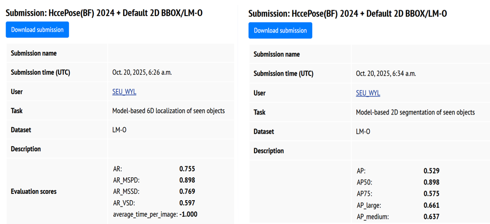
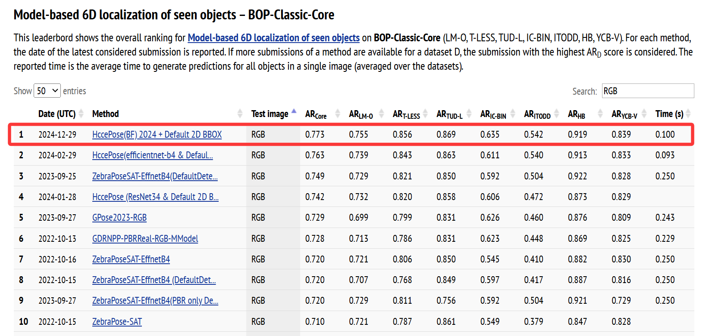
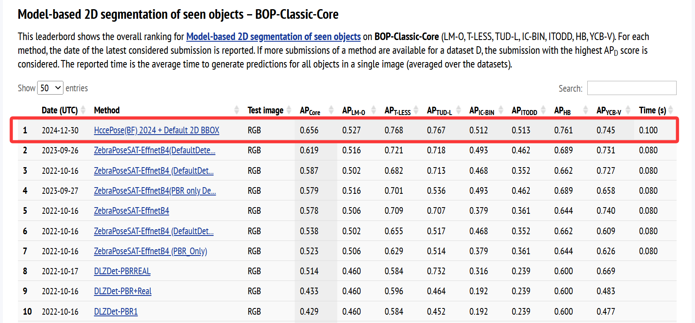

# BOP evaluation

This page uses preparation, training or evaluation scripts from the [public upstream source](https://github.com/WangYuLin-SEU/HCCEPose/tree/f75cc4d5db2fc298fc7b853f8c75273757872382). Obtain that revision as described in [Installation](installation.md#public-training-and-rendering-source), and run these commands from its root. The current project’s `examples/inference/` provides application inference.

The [evaluation script](https://github.com/WangYuLin-SEU/HCCEPose/blob/f75cc4d5db2fc298fc7b853f8c75273757872382/s4_p2_test_bf_pbr_bop_challenge.py) generates segmentation and pose predictions for the seven core BOP datasets. The supplied configuration uses LM-O, object IDs `[1, 5, 6, 8, 9, 10, 11, 12]` and `efficientnet_key=1`. It reads the [GDRNPP detections](https://bop.felk.cvut.cz/media/data/bop_datasets_extra/bop23_default_detections_for_task1.zip) supplied for BOP 2023. To run on another dataset, update the dataset path, detection JSON and weights, and check the backbone setting.

```bash
python s4_p2_test_bf_pbr_bop_challenge.py
```

For LM-O, the script writes two prediction files to the dataset directory. It puts `-1` in the CSV runtime field to indicate that runtime was not measured. To obtain benchmark scores, evaluate the predictions with the official tools or submit them to BOP.

## Pretrained weights

| Dataset | Weights |
|----------|---------------|
| **LM-O** | [Hugging Face - LM-O](https://huggingface.co/datasets/SEU-WYL/HccePose/tree/4e482e540314622981ccd4fce5beddac7f9d3e1d/lmo/HccePose) |
| **YCB-V** | [Hugging Face - YCB-V](https://huggingface.co/datasets/SEU-WYL/HccePose/tree/4e482e540314622981ccd4fce5beddac7f9d3e1d/ycbv/HccePose) |
| **T-LESS** | [Hugging Face - T-LESS](https://huggingface.co/datasets/SEU-WYL/HccePose/tree/4e482e540314622981ccd4fce5beddac7f9d3e1d/tless/HccePose) |
| **TUD-L** | [Hugging Face - TUD-L](https://huggingface.co/datasets/SEU-WYL/HccePose/tree/4e482e540314622981ccd4fce5beddac7f9d3e1d/tudl/HccePose) |
| **HB** | [Hugging Face - HB](https://huggingface.co/datasets/SEU-WYL/HccePose/tree/4e482e540314622981ccd4fce5beddac7f9d3e1d/hb/HccePose) |
| **ITODD** | [Hugging Face - ITODD](https://huggingface.co/datasets/SEU-WYL/HccePose/tree/4e482e540314622981ccd4fce5beddac7f9d3e1d/itodd/HccePose) |
| **IC-BIN** | [Hugging Face - IC-BIN](https://huggingface.co/datasets/SEU-WYL/HccePose/tree/4e482e540314622981ccd4fce5beddac7f9d3e1d/icbin/HccePose) |

Some objects have a best checkpoint labeled iteration `0`. We train a front-surface HccePose model first and use its weights to initialize joint front and back training. Iteration `0` means those starting weights scored highest among the checkpoints evaluated in that run.

## LM-O submission results

We submitted the following two files on October 20, 2025. The 6D localization score matched our 2024 submission. Fixes to the segmentation implementation improved the 2D segmentation score by 0.002.

- 2D segmentation results: [seg2d_lmo.json](https://huggingface.co/datasets/SEU-WYL/HccePose/blob/4e482e540314622981ccd4fce5beddac7f9d3e1d/lmo/seg2d_lmo.json)
- 6D pose results: [det6d_lmo.csv](https://huggingface.co/datasets/SEU-WYL/HccePose/blob/4e482e540314622981ccd4fce5beddac7f9d3e1d/lmo/det6d_lmo.csv)



## Historical leaderboard screenshots



