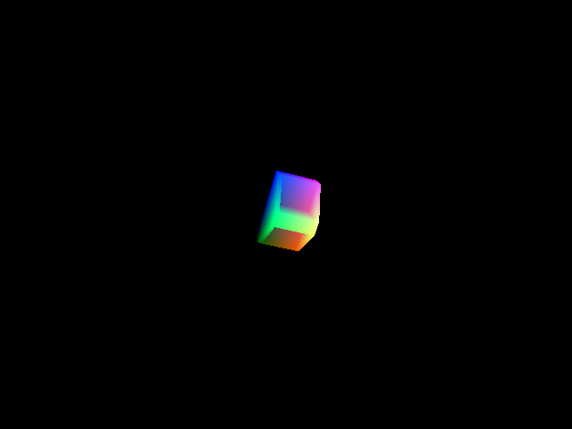
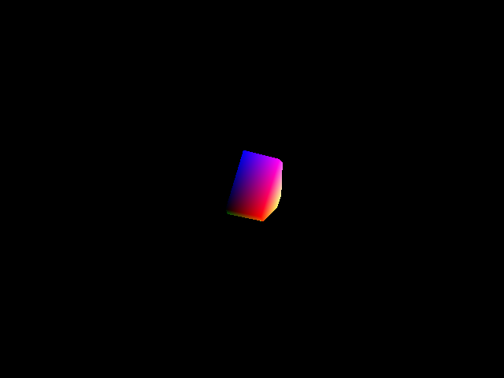

# Generate front and back coordinate labels

This page uses preparation, training or evaluation scripts in this repository’s root. Prepare the dependencies described in [Installation](installation.md#public-training-and-rendering-source), then run the commands from the repository root. Application inference examples are in `examples/inference/`.

A pixel on a rendered object can correspond to two 3D points. Along the camera ray through that pixel, the nearest surface intersection gives the front point and the farthest intersection gives the back point. HccePose(BF) learns both points in object coordinates.

## Render both surfaces from the same view

The label generator renders two depth maps with the same camera and object pose. With `gl.glDepthFunc(gl.GL_LESS)`, the depth test keeps the smallest depth at each pixel. With `gl.glDepthFunc(gl.GL_GREATER)`, it keeps the largest. Back-projecting each depth map and applying the inverse of the ground-truth object-to-camera pose gives two maps of object coordinates. From left to right, the images show the training image, front-surface labels and back-surface labels.





## Choose consistent labels for rotationally symmetric objects

A rotationally symmetric object can have several equivalent poses. The generator builds a set of candidate transformations from the discrete symmetries and samples of any continuous symmetry. Translating an object changes the viewing direction even if its rotation stays fixed. To account for this when choosing a label, the generator recovers 3D points from rendered depth and estimates a corrected rotation, `e_rot`, with RANSAC PnP.

For each candidate rotation `R_sym`, the [selection function](https://github.com/WangYuLin-SEU/HCCEPose/blob/main/HccePose/bop_loader.py) evaluates the Frobenius norm of `e_rot @ R_sym - I`, where `I` is the 3×3 identity. If no corrected rotation is available, it uses `rot_pose @ R_sym - I`. The rotation determines which candidate has the smallest norm. The full symmetry transform then updates both rotation and translation in the label pose.

## Generate labels in batches

Prepare the rendered `train_pbr` scenes and model metadata. Set `dataset_path` and `folder_name` in `s4_p1_gen_bf_labels.py`, then run the script from the repository root:

Each coordinate label must match its RGB image’s full-frame dimensions; training applies the same crop to both. Missing, unreadable or mismatched front/back labels stop training with a path-specific error rather than becoming zero-coordinate targets.

```bash
python s4_p1_gen_bf_labels.py
```

The script processes each object with multiple workers. It writes the two sets of maps to `train_pbr_xyz_GT_front/` and `train_pbr_xyz_GT_back/`. Check both directories before [training the pose network](pose-training.md).

```
demo-bin-picking
|--- models
|--- train_pbr
|--- train_pbr_xyz_GT_back
|--- train_pbr_xyz_GT_front
```

Keep object, instance, scene and image identifiers aligned with the original BOP annotations. File counts alone are insufficient: inspect both surface labels, silhouettes, occlusion boundaries and object-coordinate ranges.
