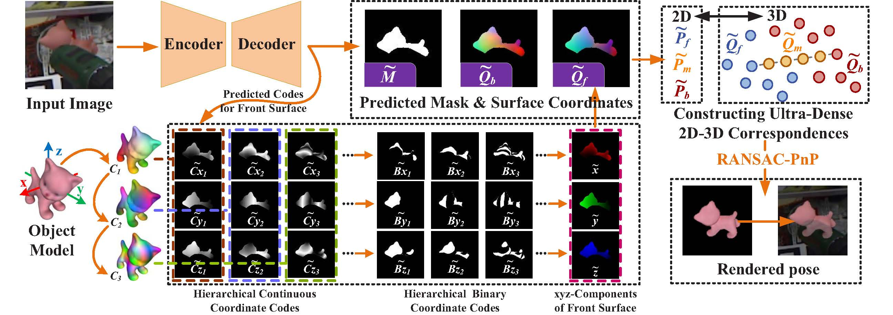

# Method and pipeline

## One pixel, two surface points

The nearest and farthest intersections along a camera ray correspond to the front and back surfaces. HccePose(BF) predicts hierarchical continuous coordinate codes for both surfaces and pairs the decoded 3D points with image pixels.

HccePose(BF) network architecture and pose estimation pipeline, from the published paper.

## From detection to pose

YOLO supplies object regions. HccePose predicts masks and surface coordinates for the corresponding object. PnP uses image-matched intrinsics to recover the object-to-camera pose. One detector can identify multiple categories; pose weights are loaded per object.

See the [paper](https://arxiv.org/abs/2510.10177) and [API contract](tester-api.md).

## Hierarchical coordinates and correspondences

HCCE encodes the three object-coordinate components separately. The network predicts masks and front/back surface codes, which decode to 3D points in the object coordinate system. A foreground pixel corresponds to the nearest and farthest intersections along its camera ray, providing two sets of 2D–3D correspondences.

| Stage | Data flow |
| --- | --- |
| Detect and crop | YOLO proposes instance regions; resizing, padding and crop transforms define pixel mappings. |
| Predict | Per-object networks estimate masks and front/back codes. |
| Match | Decode 3D coordinates and associate them with masked pixel locations. |
| Solve | Use pixel intrinsics and PnP to estimate `X_camera = R @ X_model + t`. |

A detector may recognize several categories and multiple instances per category. HccePose checkpoints are trained and loaded per object. For a new object, follow [mesh preparation](object-preparation.md), [rendering](rendering.md), [detector training](detector-training.md), [coordinate labels](coordinate-labels.md) and [pose training](pose-training.md).

## Depth and optional backends

MegaPose refines HccePose poses using RGB or registered RGB-D. The current public WAPR integration estimates poses and scores from original-image masks, registered depth and meter meshes, without HccePose pose seeds. These are distinct entry points; see [refinement interfaces](refinement-api.md) for inputs and units.

This page explains the published method. The original paper figure is preserved. See [Tester](tester-api.md) and [results](results-api.md) for actual calls and array shapes.
