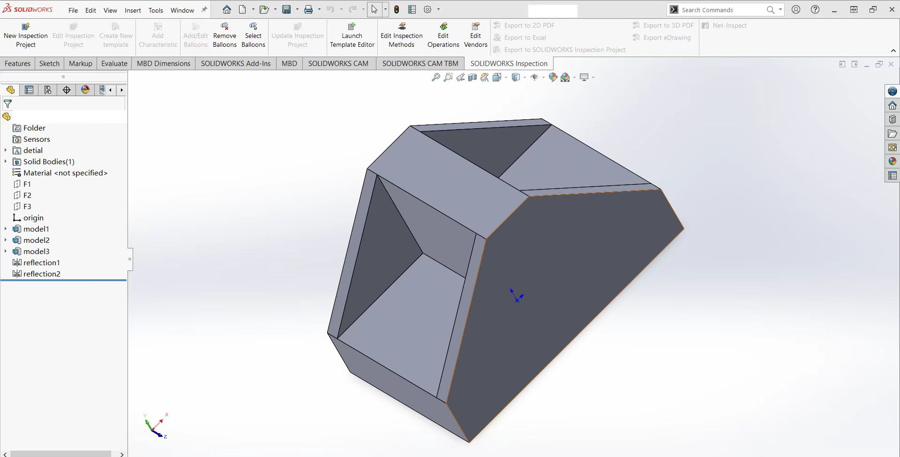
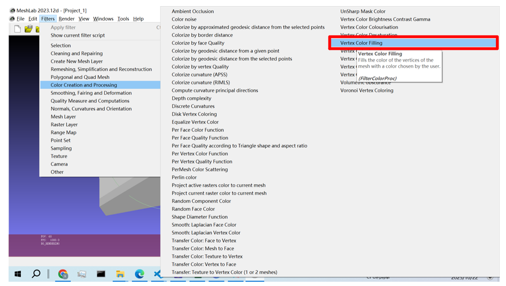
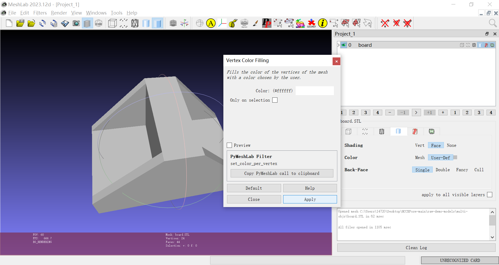
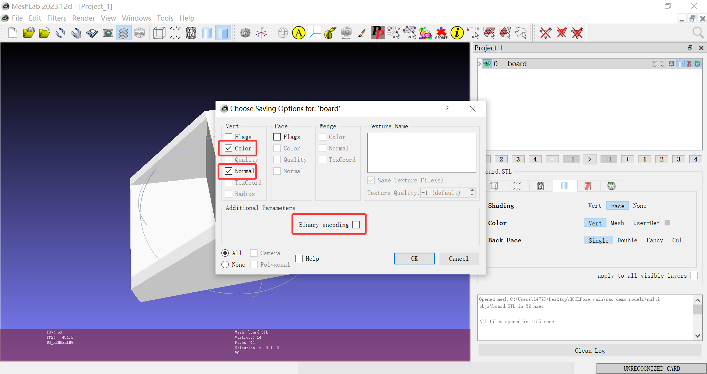
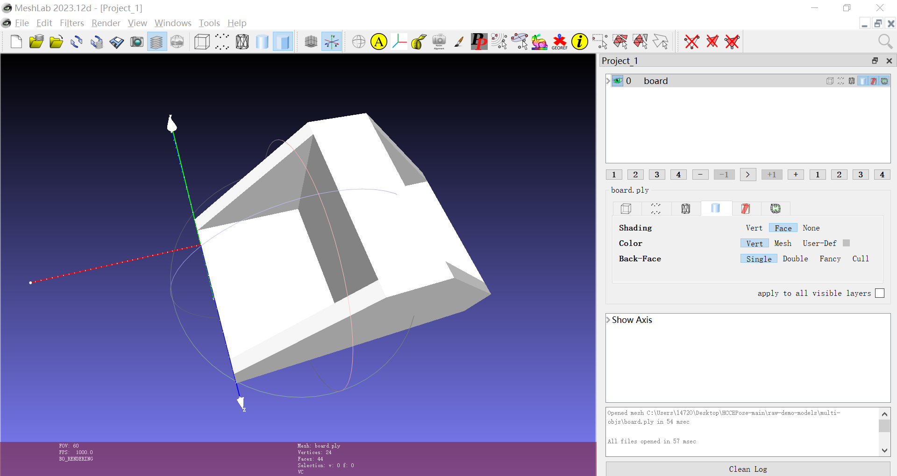
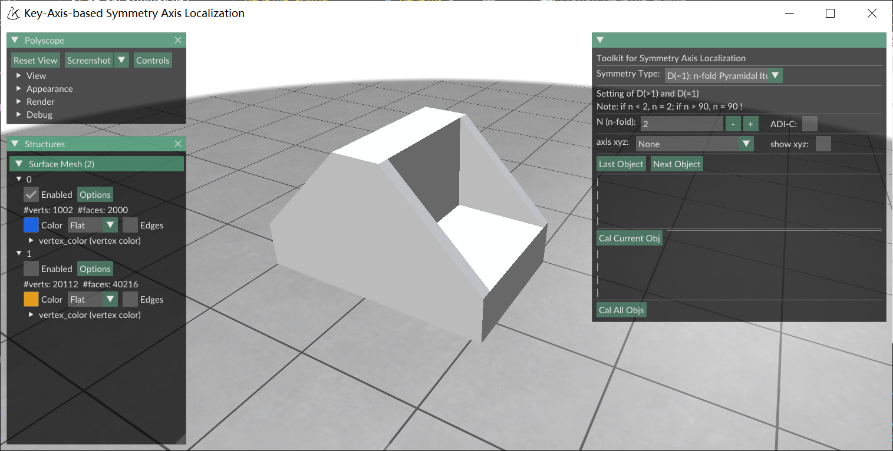
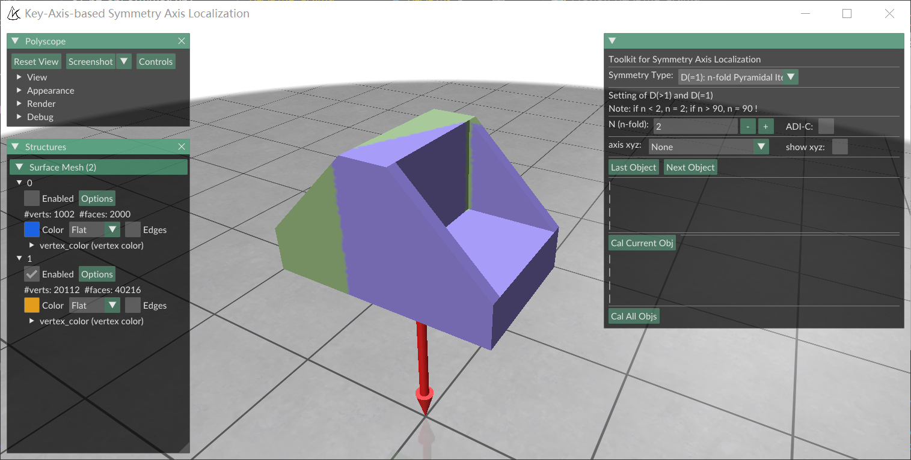

# Prepare meshes, symmetry annotations and model metadata

This page uses preparation, training or evaluation scripts in this repository’s root. Prepare the dependencies described in [Installation](installation.md#public-training-and-rendering-source), then run the commands from the repository root. Application inference examples are in `examples/inference/`.

Start by choosing a coordinate frame, scale and ID for each object. This example follows the [Bin-Picking part](https://huggingface.co/datasets/SEU-WYL/HccePose/tree/4e482e540314622981ccd4fce5beddac7f9d3e1d/demo-bin-picking) from CAD to a training mesh. The rest of the pipeline reads meshes from the dataset’s `models/` directory and uses millimeters for model coordinates.

## Export a mesh from CAD

We designed the sample part in SolidWorks and exported it as [board.STL](https://huggingface.co/datasets/SEU-WYL/HccePose/blob/4e482e540314622981ccd4fce5beddac7f9d3e1d/raw-demo-models/multi-objs/board.STL). You can start with this file or use your own model.



Open the STL in MeshLab and use **Vertex Color Filling** to color the surface.




Export the mesh as an ASCII PLY with vertex colors and normals.



## Center the mesh and assign an object ID

The origin of an exported mesh may lie away from the center of the part.



The centering script, `s1_p1_obj_rename_center.py`, uses PyMeshLab. Install the reference version separately:

```bash
python -m pip install pymeshlab==2023.12.post1
```

Set `input_ply` and `obj_id` in the script, then run it from the repository root. Give each object a unique non-negative integer ID. The script translates the center of the mesh’s bounding box to the origin and saves the renamed BOP file next to the input. Centering preserves scale, so check that the vertex coordinates are already in **millimeters**.

| Input | Object ID | Output |
| --- | --- | --- |
| `board.ply` | `1` | `obj_000001.ply` |
| `board.ply` | `2` | `obj_000002.ply` |

Move the prepared meshes to the dataset’s `models/` directory.

```bash
Dataset_Name
|--- models
      |--- obj_000001.ply
      ...
      |--- obj_000015.ply
```

## Annotate rotational symmetry with KASAL

Cones, cylinders and polyhedra can look identical under different rotations. [KASAL](https://github.com/WangYuLin-SEU/KASAL) supports eight types of rotational symmetry and lets you fit the axes and save the symmetry information needed by BOP.

```bash
pip install kasal-6d
```

Set `mesh_path` to the dataset directory and open the graphical interface:

```python
from kasal.app.polyscope_app import app
mesh_path = 'demo-bin-picking'
app(mesh_path)
```

KASAL reads PLY and OBJ meshes under that directory and skips generated `_sym.ply` visualizations.



1. Choose a **Symmetry Type**. For *n*-fold pyramidal or prismatic symmetry, set **N (n-fold)**.
2. Enable **ADI-C** for objects with rotational texture symmetry.
3. Compare the displayed axes with the mesh. If they do not line up, check the selected symmetry type and use **axis xyz** to fit the axes manually if needed.



Choose **Cal Current Obj** to compute the axes. For object 1, `obj_000001_sym_type.json` stores the symmetry information and `obj_000001_sym.ply` shows the fitted result.

## Generate BOP model metadata

Set `dataset_path` in `s1_p3_obj_infos.py` and run the script. It reads the BOP meshes in `models/`, calculates each object’s diameter and bounding box, and writes these along with any available symmetry information to `models_info.json`. Use the same meshes and metadata for [rendering the training scenes](rendering.md) and generating labels.

```bash
Dataset_Name
|--- models
      |--- models_info.json
      |--- obj_000001.ply
      ...
      |--- obj_000015.ply
```
