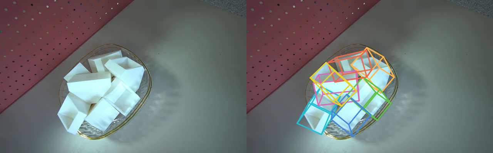

# Your first prediction

Work from the project root. Complete [installation](installation.md) and [resource preparation](assets.md) first.

## RGB example

Use the root RGB example `s4_p3_test_mi10_bin_picking.py`. Set `dataset_path` to the downloaded model directory, such as `data/demo-bin-picking`, then run:

```bash
python s4_p3_test_mi10_bin_picking.py
```

This script reads the bundled JPG inputs under `sample_data/images/` and saves detection/pose images beside them. Its camera matrix matches those JPG captures; do not use it for the 640×400 RGB-D frame. To use that downloaded frame directly in an application:

```python
import cv2
import numpy as np

from HccePose.bop_loader import bop_dataset, inout
from HccePose.tester import Tester

image = cv2.imread("data/test_imgs_RGBD/000003_rgb.png")
camera = np.asarray(inout.load_json("data/test_imgs_RGBD/000003_camera_matrix.json"))
tester = Tester(bop_dataset("data/demo-bin-picking"), hccepose_vis=True)
results = tester.predict(camera, image, [1])
```

This step requires matching weights and a CUDA-capable GPU environment.

## Example result

<figure>
  <a class="image-original" href="../assets/figures/quickstart-rgb-result.png" target="_blank" rel="noopener"></a>
  <figcaption>Frame <code>000003</code>: RGB input on the left; estimated 3D bounding boxes projected onto the same image on the right. Colors distinguish instances.</figcaption>
</figure>

The preview uses the RGB + PnP prediction above. See [RGB image inference](rgb-inference.md#inspect-the-predictions) for saving visualizations and inspecting masks and surface coordinates.
