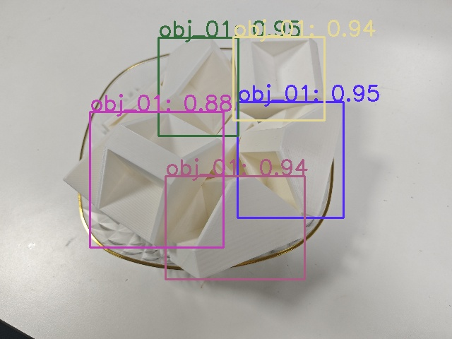
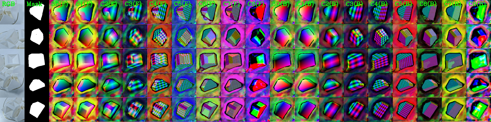
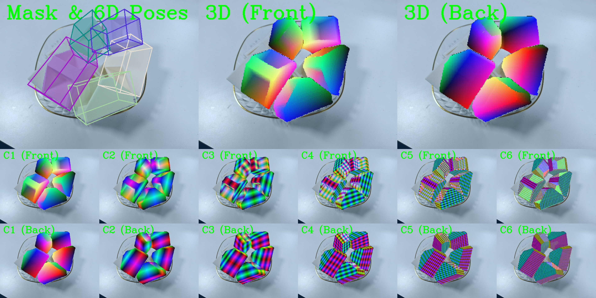

# RGB image inference

HccePose(BF) estimates known-object poses from color images. The detector can recognize multiple target categories, each with multiple instances; pose checkpoints are loaded per object. Download the public models, detector, pose weights and input frame following [Assets](assets.md), then run [Your first prediction](quickstart.md).

## Models and input files

| Resource | Purpose |
| --- | --- |
| `models/models_info.json` and `obj_000001.ply` | Model bounds, diameter and mesh in the BOP millimeter convention. |
| `yolo11/train_obj_s/detection/obj_s/yolo11-detection-obj_s.pt` | Multi-category detector; category order must match the model ID table. |
| `HccePose/obj_01/best_score/` | Per-object pose weights, retaining their original filenames. |
| `test_imgs_RGBD/000003_rgb.png` | Public 640×400 input frame; this page does not require depth. |
| `test_imgs_RGBD/000003_camera_matrix.json` | The 3×3 matrix derived from that frame’s calibration on the assets page. |

Predicting only `[1]` does not reduce the checkpoints loaded during initialization. Prepare resources for every object in the model table. A new object needs a matching detector, pose network and model metadata; replacing only the mesh is insufficient.

## Run a single image

Save this script in the project root. Paths are anchored to the script, so launching from another working directory selects the same resources.

```python
import os
import sys

import cv2
import numpy as np

project_dir = os.path.dirname(os.path.abspath(__file__))
sys.path.insert(0, project_dir)

from HccePose.bop_loader import bop_dataset, inout
from HccePose.test_script_utils import save_visual_artifacts
from HccePose.tester import Tester

if __name__ == '__main__':
    data_root = os.path.join(project_dir, 'data')
    image = cv2.imread(os.path.join(data_root, 'test_imgs_RGBD', '000003_rgb.png'))
    camera = np.asarray(inout.load_json(os.path.join(data_root, 'test_imgs_RGBD', '000003_camera_matrix.json')))
    tester = Tester(bop_dataset(os.path.join(data_root, 'demo-bin-picking')), hccepose_vis=True)
    results = tester.predict(camera, image, [1])
    output_dir = os.path.join(project_dir, 'outputs', 'rgb')
    os.makedirs(output_dir, exist_ok=True)
    save_visual_artifacts([(os.path.join(output_dir, key + '.jpg'), results.get(key))
                           for key in ('show_2D_results', 'show_6D_vis0', 'show_6D_vis1', 'show_6D_vis2')])
```

For the bundled JPG captures, use the existing root example after checking its dataset path and calibration:

```bash
python s4_p3_test_mi10_bin_picking.py
```

The root example reads `sample_data/images/` and saves visualizations beside its inputs. Its JPG camera matrix differs from the downloaded 640×400 frame used above. For many images, initialize one model outside the loop using the [Tester API](tester-api.md).

## Channels, coordinates and valid poses

OpenCV `cv2.imread` returns BGR `uint8`; pass it directly to `predict`. Intrinsics must match the camera and image dimensions. Resize the intrinsics together with any image resizing.

Check `results[obj_id]['pnp_success']` for initial pose-solving success. `Rts` transforms object coordinates to camera coordinates with millimeter translations. `conf` is the YOLO score, not pose accuracy or a WAPR score. See the [result dictionary](results-api.md) for mask, coordinate, logit and transform shapes.

## Inspect the predictions

The images below are from the public upstream bin-picking example and illustrate output formats. Wireframes are 3D bounding boxes projected using estimated poses; they are not ground-truth labels or a count of all objects in the scene.







`show_2D_results` displays detections; `show_6D_vis0` displays instance crops, masks and codes; `show_6D_vis1` and `show_6D_vis2` show full-scene projections. Images may contain several panels, so output dimensions are not interchangeable with original input dimensions.

See [WAPR](rgbd-wapr.md) for depth-assisted estimation, [MegaPose](rgbd-megapose.md) for RGB or RGB-D refinement, and [video inference](video.md) for continuous frames.
