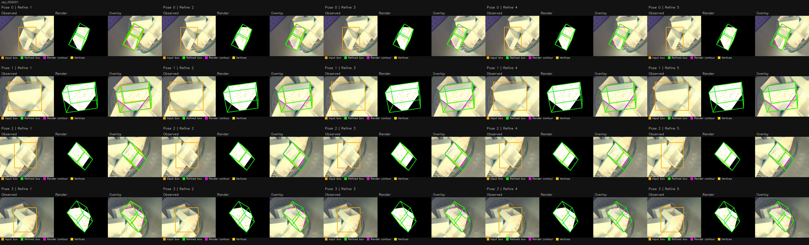
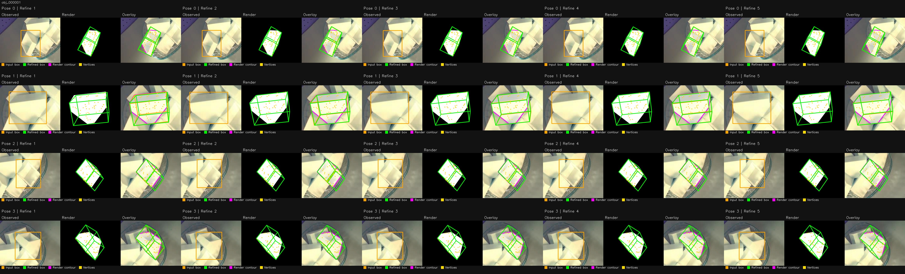

# MegaPose refinement

MegaPose refines HccePose’s initial poses. Its RGB model uses color only; its RGB-D model additionally uses registered depth in meters. Both need object meshes and camera intrinsics.

## Environment and model selection

First registration may clone public MegaPose, create a Python 3.9 environment under `.envs/megapose/`, and download dependencies and models. It requires networking, writable directories and Conda. MegaPose runs separately from the main Python environment; see [Installation](installation.md).

```python
tester.register_megapose(
    megapose_model_name_rgb='megapose-1.0-RGB-multi-hypothesis',
    megapose_model_name_rgbd='megapose-1.0-RGBD',
)
```

Registration can also happen on the first `predict(..., use_megapose=True)` call. Reuse one `Tester` across frames to avoid repeated initialization.

## RGB or RGB-D on the same frame

Prepare the public frame and derived camera matrix from [Assets](assets.md), then save this script in the project root. `use_depth=True` loads depth. Setting it to `False` selects RGB without reading a depth file.

```python
import json
import os
import sys

project_dir = os.path.dirname(os.path.abspath(__file__))
sys.path.insert(0, project_dir)

import cv2
import numpy as np
from HccePose.bop_loader import bop_dataset
from HccePose.tester import Tester
from HccePose.test_script_utils import save_visual_artifacts

if __name__ == '__main__':
    data_root = os.path.join(project_dir, 'data')
    capture_dir = os.path.join(data_root, 'test_imgs_RGBD')
    dataset = bop_dataset(os.path.join(data_root, 'demo-bin-picking'))
    image_bgr = cv2.imread(os.path.join(capture_dir, '000003_rgb.png'))
    with open(os.path.join(capture_dir, '000003_camera_matrix.json'), encoding='utf-8') as handle:
        cam_K = np.asarray(json.load(handle), dtype=np.float32)
    use_depth = True
    depth_m = None
    if use_depth:
        depth_raw = cv2.imread(os.path.join(capture_dir, '000003_depth.png'), cv2.IMREAD_UNCHANGED)
        if depth_raw is None or image_bgr is None or depth_raw.shape != image_bgr.shape[:2]:
            raise ValueError('Expected aligned RGB and depth')
        depth_m = depth_raw.astype(np.float32) * 1e-3
    if image_bgr is None:
        raise ValueError('Cannot decode RGB image')
    tester = Tester(dataset, CUDA_DEVICE='0', hccepose_vis=True)
    results = tester.predict(cam_K, image_bgr, [1], depth=depth_m,
                             use_megapose=True, megapose_vis=True)
    output_dir = os.path.join(project_dir, 'outputs', 'megapose')
    save_visual_artifacts([
        (os.path.join(output_dir, 'poses.jpg'), results.get('show_6D_vis1')),
        (os.path.join(output_dir, 'refinement.jpg'), results.get('show_megapose')),
    ])
```

The millimeter-to-meter conversion applies to this public frame. Check your own sensor units and register depth to color before use. For RGB only, pass `depth=None` without creating dummy depth.

When using `Refinement.refinement_test_utils.load_capture_frame(capture_dir, name, depth_scale_to_m=1e-3)`, keep raw depth units explicit. The default `1e-3` converts the public millimeter frames to meters; use `1` for meters or `1e-4` for tenths of a millimeter. The reader does not infer units from the depth median.

## Outputs and instance alignment

`Rts_hccepose` retains the initial millimeter poses. Successful refinements update rows in `Rts`. `megapose_valid_pose_ids` contains original instance indices, and scores align with that array. Unchanged rows retain the initial pose, so a returned pose alone does not demonstrate successful refinement. `conf` remains the detection score; `pnp_success` describes initial PnP.

Request debug images with `megapose_vis=True`; `megapose_vis_stages` selects intermediate stages. Images are BGR for OpenCV saving. See [results](results-api.md) and [utilities](utilities-api.md).

## Public example images

These public upstream images show the RGB-D and RGB models on the same frame. They are not new performance or accuracy measurements.





See [MegaPose](https://github.com/megapose6d/megapose6d) for code and model terms. See [RGB-D comparison](depth-comparison.md) for comparison procedures and unit conversions.
