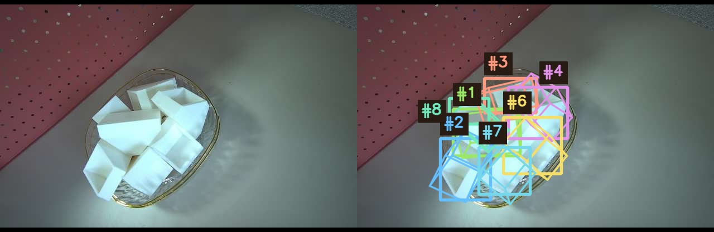
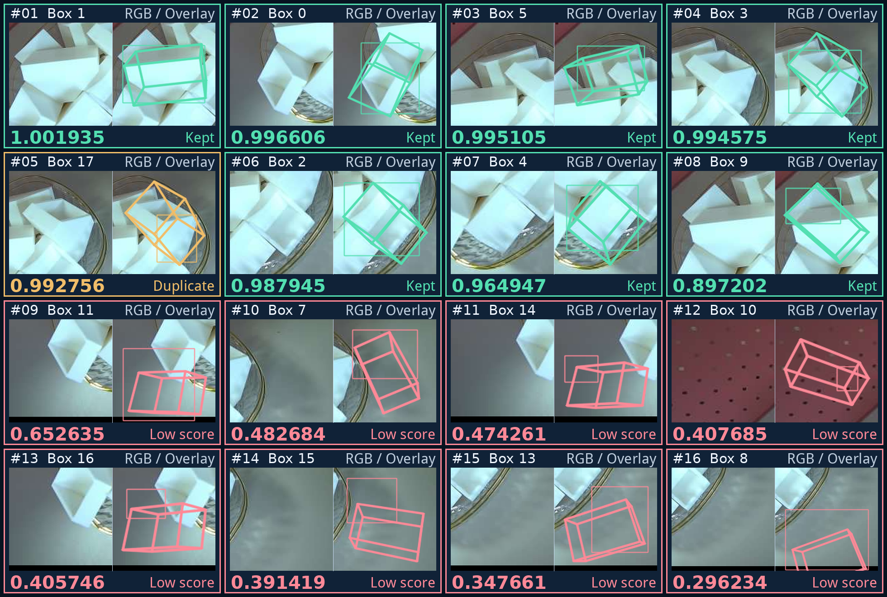

# WAPR integration

## From masks and depth to 3D estimation

Install WAPR [separately](installation.md#optional-wapr). This adapter targets the [published WAPR version](https://github.com/WangYuLin-SEU/WAPR/tree/4e591be318a828c91980c58ef8bbdc34e6599881). The default `estimate` mode restores HccePose instance masks to the original frame and calls `estimate_many_categories_many_instances` without PnP seeds. `hybrid` combines valid PnP seeds with WAPR candidates; `refine` refines PnP seeds without generating global rotation candidates. See [mode selection](refinement-api.md).

The adapter converts the BGR image to RGB and passes it to WAPR with registered depth, intrinsics and instance data.


## Triangular-part RGB-D example

The example below pairs the triangular-part input with pose projections, measured depth points and CAD meshes. It contains 16 saved pose/score records, including 7 accepted entries; low-scoring and duplicate entries remain inspectable. Scores do not indicate ground-truth correctness or object-presence probability.



The right image shows only the seven accepted instances. Different colors distinguish instances, and the labels retain their original score ranks.

## Linked RGB and 3D inspection

Select an image box, an entry below, or a 3D mesh to highlight it in both views. Choose Pan above the canvases and drag a colored axis, or Rotate and drag a graduated ring; scroll to zoom. Orbit retains drag-to-rotate and right/Shift-drag-to-pan. “Align with RGB” restores the calibrated view. On touchscreens, drag axes or rings with one finger and pinch to zoom; Orbit supports one-finger rotation and two-finger pan/zoom. Adding a second finger ends a handle drag and switches to two-finger navigation. These controls adjust only the 3D display; image projections, saved poses and scores remain unchanged. White points represent observed depth; green, red and amber surfaces indicate accepted, low-scoring and duplicate poses. A gold outline marks the selected mesh.

<iframe class="wapr-scene-frame" src="../assets/wapr-viewer/index.html?lang=en&amp;v=english-default-20261118" title="Interactive triangular-part RGB-D poses, scores and measured depth cloud" width="900" height="900" style="display:block;width:100%;max-width:100%;height:900px;box-sizing:border-box;margin:24px 0;border:0;border-radius:18px" loading="lazy" allow="fullscreen" allowfullscreen></iframe>

The viewer loads saved images, points, poses and scores; it does not run model inference. Switch among all scored entries, accepted entries and the selected entry; buttons for low-scoring and duplicate entries are disabled in accepted mode. Depth points and CAD meshes can be toggled independently. With CAD meshes enabled, use “CAD wireframe mode” to display them as wireframes.

## Per-region score comparison

Each tile pairs an original crop on the left with its pose projection on the right. Scores and selection states are drawn directly on the image. The compact four-by-four montage supports horizontal scrolling on narrow screens and click-to-enlarge. Green denotes accepted entries, amber duplicates and red low scores. Retained entries keep their original ranks.

<div class="wapr-montage">

</div>

Scores in this scene are saved display records. Running the interface below computes results for new input; it neither rewrites the website scene automatically nor guarantees the same detection counts or scores.

The root example calls `Tester.predict(..., use_wapr=True)`, which automatically applies WBPS filtering and CAD rendered-mask NMS after mask-based estimation, while preserving raw output. Use `wbps_threshold=0.75` and `wapr_nms_iou_threshold=0.5` to set these gates. See [registration and repeated-frame calls](refinement-api.md) and [score filtering and NMS](wapr-postprocessing.md).

## Inputs and execution

Prepare a BGR image, registered depth, original-image intrinsics, meter meshes and meter diameters. The example explicitly converts published BOP millimeter models to meters.

Edit the paths, object IDs, depth conversion and `wapr_mode` in `s4_p3_test_mi10_bin_picking_RGBD_wapr.py`, then run:

```bash
python s4_p3_test_mi10_bin_picking_RGBD_wapr.py
```

For the [example downloaded on the resource page](assets.md#download-one-rgb-d-example), set these paths in the script's entry block:

```python
dataset_root = os.path.join(current_dir, 'data', 'demo-bin-picking')
capture_dir = os.path.join(current_dir, 'data', 'test_imgs_RGBD')
frame_name = '000003'
image_path = os.path.join(capture_dir, frame_name + '_rgb.png')
depth_path = os.path.join(capture_dir, frame_name + '_depth.png')
intrinsics_path = os.path.join(capture_dir, frame_name + '_camera_matrix.json')
# This frame stores raw depth in millimeters; check sensor units for your own data.
depth_scale_to_m = 1e-3
```

`outputs/wapr.json` preserves raw instance order and contains object IDs, instance indices, `pose_4x4_m` (object to camera, translation in meters), and `score_6d` computed for this input. `outputs/wapr_filtered.json` stores the automatic postprocessing report. Its defaults are score ≥ 0.75 and same-category rendered-mask IoU NMS at 0.5. A score is not a probability or object confirmation; check the thresholds for your application.

Request each object ID once and use IDs listed in the dataset’s `models_info.json`. Multiple detections of the same category produce separate records. If none is detected, the raw JSON is `[]` and the report has no retained records. In `estimate` and `hybrid`, each crop mask needs its own transform and positive observed depth; invalid masks raise. `refine` does not need foreground masks but requires valid PnP seeds. Failed or invalid PnP instances are skipped without fake scores; the report lists them separately in `skipped_instances`.


## Multiple objects, instances and mask order

`object_ids` selects categories; list each ID once. Detections produce all instances for that category. The entry point restores masks in object-group and within-group order, prepares the matching meter mesh and diameter for each entry, then calls the public batch API. Output `object_id` and `instance_index` retain the input association.

Multiple regions do not necessarily represent distinct physical objects. Detections may miss targets, duplicate them or include background. A computable WAPR pose and score do not confirm object presence. Preserve raw results and instance identities, then check, suppress and rank according to application rules. Display count does not measure recall.

## Integrate into your Python application

```python
from Refinement.refinement_group import restore_full_frame_masks, estimate_from_masks

# predictions belongs to this frame; supply each object's own mesh and diameter_m.
masks = restore_full_frame_masks(predictions[obj_id], image_bgr.shape)
instances = [{'mesh': mesh, 'diameter_m': diameter_m, 'mask': mask} for mask in masks]
results_wapr = estimate_from_masks(estimator, image_bgr, depth_m, cam_K, instances)
```

Mesh vertices, diameter and depth must already be in meters. `estimator` is a WAPR object initialized following the public installation guide. This entry point estimates from the supplied masks without HccePose PnP seeds. See the [refinement API](refinement-api.md) for input checks, full-frame restoration and independently supplied masks.

## Output file and errors

| Field | Meaning |
| --- | --- |
| `object_id` | BOP object ID. |
| `instance_index` | Row within that object’s prediction group. |
| `pose_4x4_m` | Object-to-camera homogeneous transform with meter translation. |
| `score_6d` | WAPR score computed from this image, depth and mask. |

The JSON contains no fixed experimental scores and uses no ground-truth labels to generate them. Missing resources, invalid intrinsics and duplicate or unknown IDs raise before model loading. Shape mismatches, nonfinite depth, masks without valid depth and invalid outputs are not treated as successes. See [results](results-api.md) for reading and unit conversions.

The raw and filtered output paths must be separate and must not point to the input image, depth or calibration file. Symbolic-link and hard-link aliases are checked before model loading.

Multi-frame applications can reuse `Tester` and the WAPR estimator. Running the file entry point again initializes the models again; organize high-frequency loops using the [API tutorial](refinement-api.md). Separate first-time resource preparation from inference timing.
