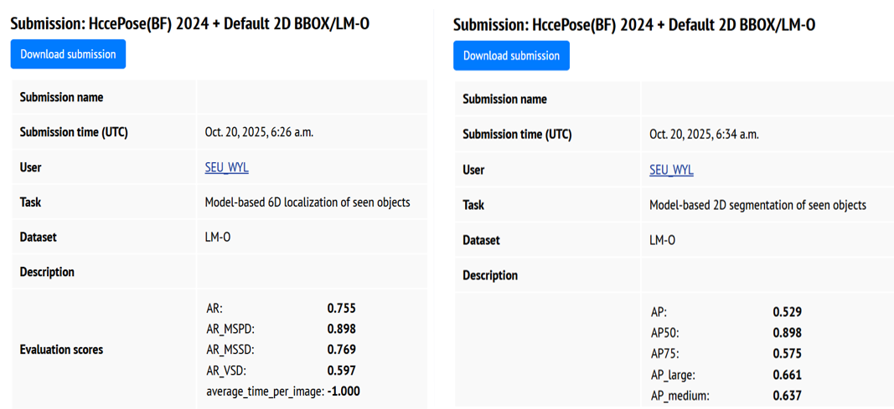
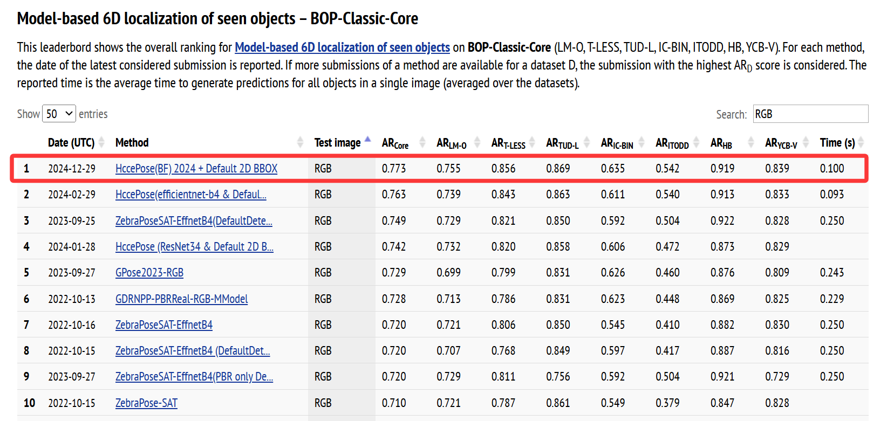
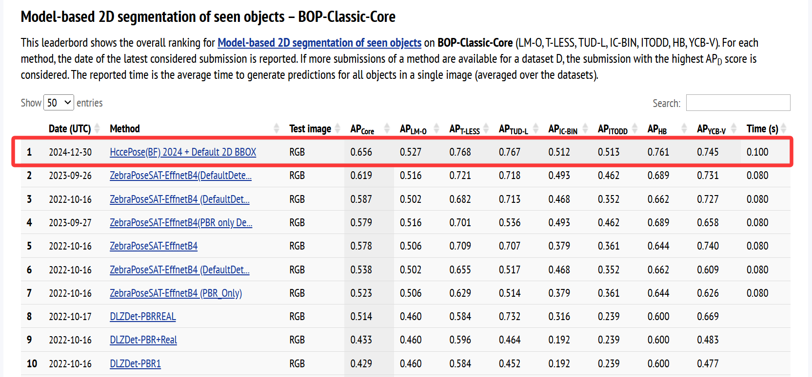

# BOP 评测

本页使用[公开上游源码](https://github.com/WangYuLin-SEU/HCCEPose/tree/f75cc4d5db2fc298fc7b853f8c75273757872382)中的准备、训练或评测脚本。请先按[安装说明](installation.md#公开训练与渲染源码)获取该版本，并在上游源码根目录执行本页命令；当前项目中的 `examples/inference/` 用于应用推理。

[评测脚本](https://github.com/WangYuLin-SEU/HCCEPose/blob/f75cc4d5db2fc298fc7b853f8c75273757872382/s4_p2_test_bf_pbr_bop_challenge.py)为 BOP 的七个核心数据集生成分割和位姿预测。随仓库提供的配置使用 LM-O，物体 ID 为 `[1, 5, 6, 8, 9, 10, 11, 12]`，骨干网络设置为 `efficientnet_key=1`。检测框来自 BOP 2023 提供的 [GDRNPP 检测结果](https://bop.felk.cvut.cz/media/data/bop_datasets_extra/bop23_default_detections_for_task1.zip)。如果换用其他数据集，请同时替换数据集路径、检测 JSON 和模型权重，并检查骨干网络配置。

```bash
python s4_p2_test_bf_pbr_bop_challenge.py
```

LM-O 的两个输出文件位于数据集目录下。CSV 中的运行时间填为 `-1`，表示未记录耗时。要得到基准分数，还需用官方评测工具为这些预测打分或提交到 BOP。

## 预训练权重

| 数据集 | 权重 |
|----------|---------------|
| **LM-O** | [Hugging Face - LM-O](https://huggingface.co/datasets/SEU-WYL/HccePose/tree/4e482e540314622981ccd4fce5beddac7f9d3e1d/lmo/HccePose) |
| **YCB-V** | [Hugging Face - YCB-V](https://huggingface.co/datasets/SEU-WYL/HccePose/tree/4e482e540314622981ccd4fce5beddac7f9d3e1d/ycbv/HccePose) |
| **T-LESS** | [Hugging Face - T-LESS](https://huggingface.co/datasets/SEU-WYL/HccePose/tree/4e482e540314622981ccd4fce5beddac7f9d3e1d/tless/HccePose) |
| **TUD-L** | [Hugging Face - TUD-L](https://huggingface.co/datasets/SEU-WYL/HccePose/tree/4e482e540314622981ccd4fce5beddac7f9d3e1d/tudl/HccePose) |
| **HB** | [Hugging Face - HB](https://huggingface.co/datasets/SEU-WYL/HccePose/tree/4e482e540314622981ccd4fce5beddac7f9d3e1d/hb/HccePose) |
| **ITODD** | [Hugging Face - ITODD](https://huggingface.co/datasets/SEU-WYL/HccePose/tree/4e482e540314622981ccd4fce5beddac7f9d3e1d/itodd/HccePose) |
| **IC-BIN** | [Hugging Face - IC-BIN](https://huggingface.co/datasets/SEU-WYL/HccePose/tree/4e482e540314622981ccd4fce5beddac7f9d3e1d/icbin/HccePose) |

部分物体的最佳检查点标为第 `0` 轮。我们先训练只预测前表面的 HccePose，再从已有权重开始联合训练前后表面。第 `0` 轮表示在这次训练的检查点中，起始权重就取得了最高分。

## LM-O 提交结果

我们在 2025 年 10 月 20 日提交了以下两个文件。6D 定位分数与 2024 年的提交一致。修复分割实现中的问题后，2D 分割分数提高了 0.002。

- 2D 分割结果：[seg2d_lmo.json](https://huggingface.co/datasets/SEU-WYL/HccePose/blob/4e482e540314622981ccd4fce5beddac7f9d3e1d/lmo/seg2d_lmo.json)
- 6D 位姿结果：[det6d_lmo.csv](https://huggingface.co/datasets/SEU-WYL/HccePose/blob/4e482e540314622981ccd4fce5beddac7f9d3e1d/lmo/det6d_lmo.csv)



## 历史榜单截图



