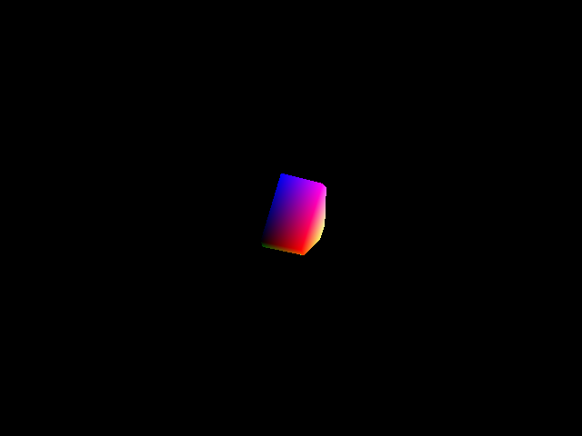

# 生成正背面坐标标签

本页使用本仓库根目录中的准备、训练或评测脚本。请按[安装说明](installation.md#公开训练与渲染源码)准备对应依赖，再从仓库根目录执行命令。`examples/inference/` 中的脚本用于应用推理。

同一张渲染图中的一个物体像素可以对应两个三维点。沿这个像素的相机射线，最近的表面交点是前表面点，最远的交点是后表面点。两者都用物体坐标表示，作为 HccePose(BF) 的训练标签。

## 渲染同一像素的两个表面点

标签脚本在同一相机视角下渲染两张深度图。使用 `gl.glDepthFunc(gl.GL_LESS)` 时保留最小深度，使用 `gl.glDepthFunc(gl.GL_GREATER)` 时保留最大深度。将两组深度反投影，并用物体的真值位姿变换到物体坐标系，就得到两张三维坐标图。从左到右依次为训练图像、前表面标签和后表面标签。




## 为旋转对称物体选择一致的标签

旋转对称的物体可以有多个等价位姿。脚本把离散对称和采样后的连续对称都表示成候选变换。即使物体旋转不变，平移也会改变相机看向物体的方向。为减少视角变化对对称标签选择的影响，脚本用渲染深度恢复三维坐标，并通过 RANSAC PnP 估计用于比较候选的旋转 `e_rot`。

对每个候选旋转 `R_sym`，[选择函数](https://github.com/WangYuLin-SEU/HCCEPose/blob/main/HccePose/bop_loader.py)计算 `e_rot @ R_sym - I` 的 Frobenius 范数，其中 `I` 是 3×3 单位矩阵。若没有校正旋转，就使用 `rot_pose @ R_sym - I`。比较只使用旋转部分，选定候选后再用完整的对称变换更新标签位姿的旋转和平移。

每张标签图应与对应 RGB 图像具有相同的完整画幅，训练时再使用同一检测框裁剪。训练加载器遇到缺失、无法解码或画幅不匹配的前后标签会报出路径并停止，不会以全零坐标替代。

## 批量生成标签

准备好渲染后的 `train_pbr` 和模型元数据，在 `s4_p1_gen_bf_labels.py` 中设置 `dataset_path` 和 `folder_name`。然后从仓库根目录运行：

```bash
python s4_p1_gen_bf_labels.py
```

脚本使用多个进程逐个处理物体，在数据集下生成 `train_pbr_xyz_GT_front/` 和 `train_pbr_xyz_GT_back/`。检查两套标签都已生成后，即可[训练位姿网络](pose-training.md)。

```
demo-bin-picking
|--- models
|--- train_pbr
|--- train_pbr_xyz_GT_back
|--- train_pbr_xyz_GT_front
```

物体编号、实例序号、场景与图像编号必须与原 BOP 标注对应。不要用文件数量代替抽查：同时检查前后标签、物体轮廓、遮挡边缘和物体坐标范围。
