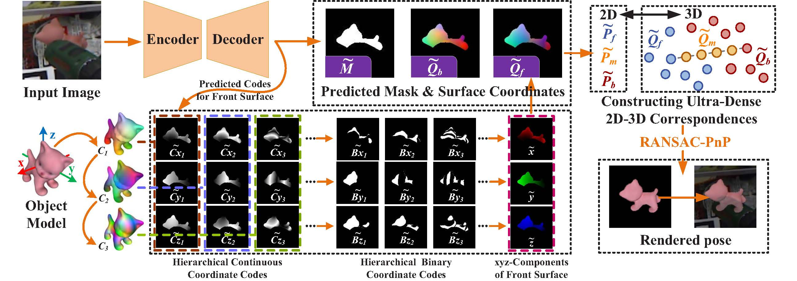

# 方法与流程

## 一个像素，两个表面点

沿相机射线，最近和最远的表面交点分别对应前、后表面。HccePose(BF) 预测两个表面的层次化连续坐标编码，并将解码后的三维点与图像像素配对。

论文中的 HccePose(BF) 网络结构与位姿求解流程。

## 从检测到位姿

YOLO 提供目标区域，HccePose 为对应物体预测掩码及表面坐标。结合匹配分辨率的相机内参，PnP 求解物体到相机的位姿。检测器可以识别多个类别；位姿权重按物体加载。

参阅[论文](https://arxiv.org/abs/2510.10177)和[接口约定](tester-api.md)。

## 层次坐标编码与对应关系

HCCE 分别编码物体坐标的三个分量。网络同时预测掩码和前后表面编码，解码后得到物体坐标系下的三维点。一个前景像素沿相机射线对应最近与最远的两个表面交点，因而可以构建两组 2D–3D 对应。

| 阶段 | 数据流 |
| --- | --- |
| 检测与裁剪 | YOLO 提供实例区域；图像缩放、补边及裁剪变换决定像素坐标的映射。 |
| 网络预测 | 逐物体网络预测掩码与前后表面编码。 |
| 建立对应 | 解码三维坐标，与掩码中的像素位置配对。 |
| 求解位姿 | 结合相机内参用 PnP 求解 `X_camera = R @ X_model + t`。 |

检测器可包含多个物体类别，每类可检测多个实例；HccePose 权重按物体分别训练和加载。换新物体的完整流程见[物体准备](object-preparation.md)、[场景渲染](rendering.md)、[检测器](detector-training.md)、[坐标标签](coordinate-labels.md)与[位姿训练](pose-training.md)。

## 深度与可选后端

MegaPose 从 HccePose 位姿继续精修，支持纯 RGB 或配准 RGB-D。WAPR 的当前公开接入从原图掩码、配准深度和米制网格估计位姿并评分，不依赖 HccePose 初值。它们不是同一个调用模式，输入与单位对照见[精修接口](refinement-api.md)。

本文解释已公开方法。论文图保留原貌，数组形状和实际调用以[Tester](tester-api.md)、[结果字典](results-api.md)为准。
