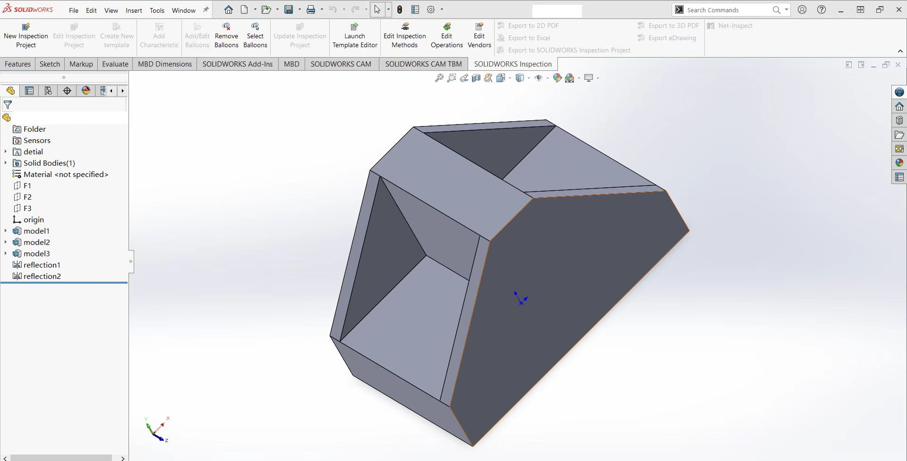
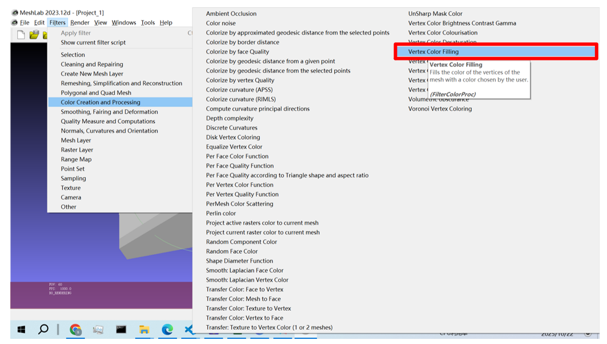
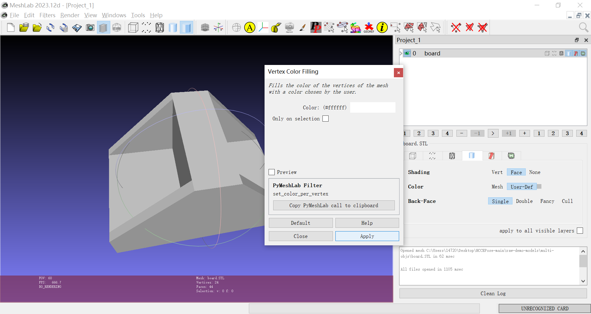
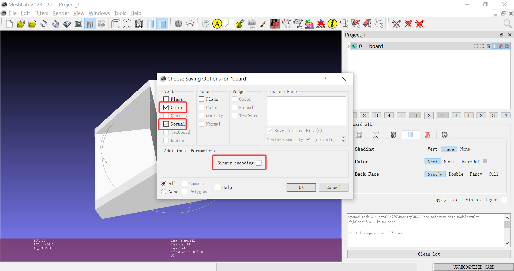
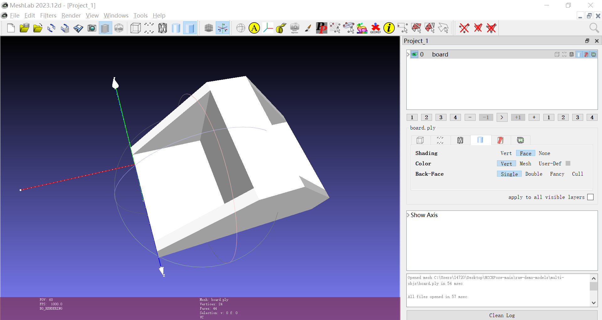
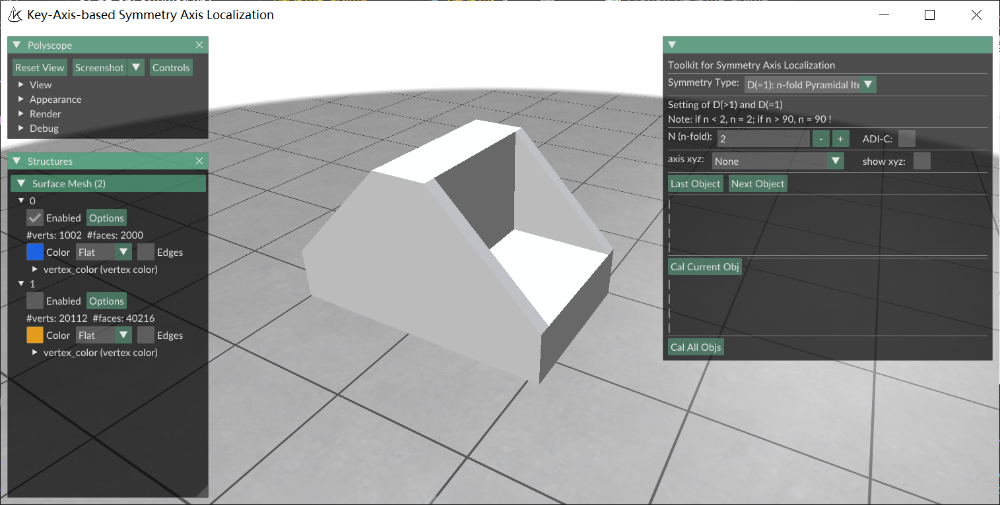
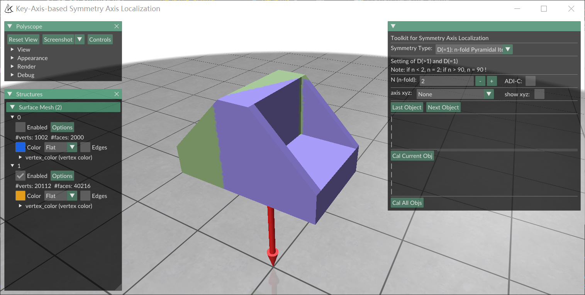

# 准备网格、旋转对称信息和模型元数据

本页使用本仓库根目录中的准备、训练或评测脚本。请按[安装说明](installation.md#公开训练与渲染源码)准备对应依赖，再从仓库根目录执行命令。应用推理使用根目录的 `s4_p3_*.py` 示例。

从 CAD 模型到训练数据，先要定好物体的坐标系、尺度和编号。下面用 [Bin-Picking 示例物体](https://huggingface.co/datasets/SEU-WYL/HccePose/tree/4e482e540314622981ccd4fce5beddac7f9d3e1d/demo-bin-picking)走一遍。后续脚本共用数据集的 `models/` 目录，并以毫米为模型坐标单位。

## 从 CAD 导出网格

我们在 SolidWorks 中设计了示例零件，并导出为 [board.STL](https://huggingface.co/datasets/SEU-WYL/HccePose/blob/4e482e540314622981ccd4fce5beddac7f9d3e1d/raw-demo-models/multi-objs/board.STL)。你可以从这个文件开始，也可以使用自己的模型。



用 MeshLab 打开 STL，在 **Vertex Color Filling** 中为表面着色。




导出为 ASCII PLY，并勾选顶点颜色和法向量。



## 将模型居中并设置物体 ID

导出网格时，原点可能落在零件中心之外。



`s1_p1_obj_rename_center.py` 使用 PyMeshLab。单独安装脚本使用的参考版本：

```bash
python -m pip install pymeshlab==2023.12.post1
```

在脚本中设置 `input_ply` 和 `obj_id`，然后从仓库根目录运行。每个物体分配一个唯一的非负整数 ID。脚本把网格包围盒的中心平移到原点，按 BOP 规则命名文件，保存在输入网格旁边。平移会保留原有尺度，因此请先确认顶点坐标以**毫米**为单位。

| 输入文件 | 物体 ID | 输出文件 |
| --- | --- | --- |
| `board.ply` | `1` | `obj_000001.ply` |
| `board.ply` | `2` | `obj_000002.ply` |

把处理好的文件放入数据集的 `models/` 目录。

```bash
数据集名称
|--- models
      |--- obj_000001.ply
      ...
      |--- obj_000015.ply
```

## 用 KASAL 标注旋转对称性

圆锥、圆柱和多面体在不同的旋转下可能具有相同的外观。[KASAL](https://github.com/WangYuLin-SEU/KASAL) 提供八类旋转对称，可以用来拟合对称轴并保存 BOP 所需的对称信息。

```bash
pip install kasal-6d
```

将 `mesh_path` 指向你的数据集，启动图形界面：

```python
from kasal.app.polyscope_app import app
mesh_path = 'demo-bin-picking'
app(mesh_path)
```

KASAL 会读取该目录下的 PLY 和 OBJ 网格，并跳过已生成的 `_sym.ply` 可视化文件。



1. 在 **Symmetry Type** 中选择类型。对于 *n* 阶棱锥或棱柱对称，用 **N (n-fold)** 设置阶数。
2. 对具有纹理旋转对称性的物体，勾选 **ADI-C**。
3. 检查可视化中的对称轴是否与模型吻合。如果偏离，先复核对称类型，必要时用 **axis xyz** 手动拟合。



点击 **Cal Current Obj** 计算当前物体的对称轴。以物体 1 为例，`obj_000001_sym_type.json` 保存对称信息，`obj_000001_sym.ply` 用于查看拟合结果。

## 生成 BOP 模型元数据

将 `s1_p3_obj_infos.py` 中的 `dataset_path` 指向数据集并运行。脚本读取 `models/` 中的 BOP 网格，计算直径和包围盒，并将可用的旋转对称信息一起写入 `models_info.json`。后续[渲染训练场景](rendering.md)和制作标签时，使用这一套模型和元数据。

```bash
数据集名称
|--- models
      |--- models_info.json
      |--- obj_000001.ply
      ...
      |--- obj_000015.ply
```
