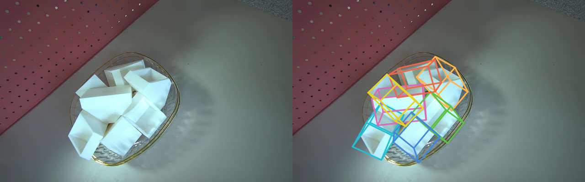

# 第一次预测

在项目根目录操作。先完成[环境安装](installation.md)和[资源准备](assets.md)。

## RGB 示例

使用根目录的 RGB 示例 `s4_p3_test_mi10_bin_picking.py`，将 `dataset_path` 指向下载的模型目录，例如 `data/demo-bin-picking`，再执行：

```bash
python s4_p3_test_mi10_bin_picking.py
```

该脚本读取 `sample_data/images/` 中的自带 JPG，并将检测框和位姿图保存在输入旁。脚本内参对应这些 JPG 采集图，不能套用到 640×400 的 RGB-D 帧。若在应用中直接使用下载的 RGB-D 彩色帧：

```python
import cv2
import numpy as np

from HccePose.bop_loader import bop_dataset, inout
from HccePose.tester import Tester

image = cv2.imread("data/test_imgs_RGBD/000003_rgb.png")
camera = np.asarray(inout.load_json("data/test_imgs_RGBD/000003_camera_matrix.json"))
tester = Tester(bop_dataset("data/demo-bin-picking"), hccepose_vis=True)
results = tester.predict(camera, image, [1])
```

这一步需要匹配的权重与支持 CUDA 的 GPU 环境。

## 查看效果

<figure>
  <a class="image-original" href="../assets/figures/quickstart-rgb-result.png" target="_blank" rel="noopener"></a>
  <figcaption><code>000003</code> 帧：左侧为彩色原图，右侧为按估计位姿投影到同一图像上的三维包围盒。不同颜色用于区分实例。</figcaption>
</figure>

图中展示的是上面 RGB + PnP 调用的结果。保存可视化图像及查看掩码、表面坐标的方法，见 [RGB 图片推理](rgb-inference.md#查看预测内容)。
