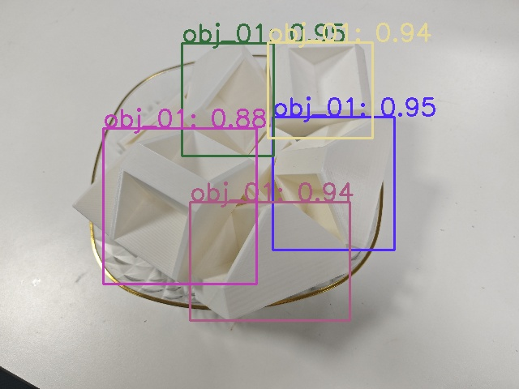
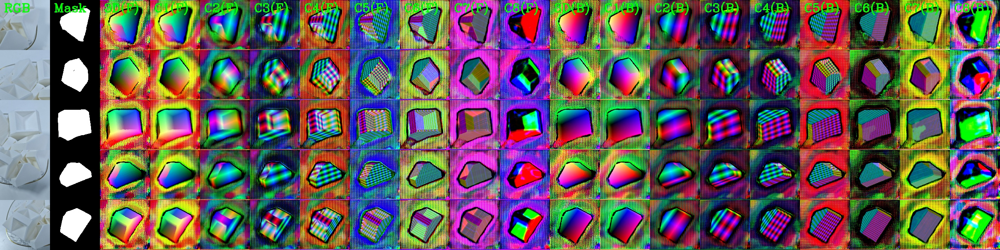
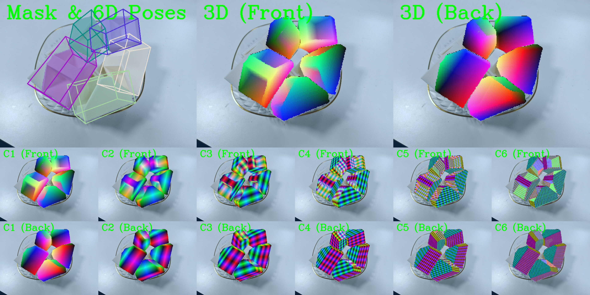

# RGB 图片推理

HccePose(BF) 从彩色图像估计已知物体的位姿。检测器可以识别多种目标物体，同一类别也可有多个实例；位姿网络的权重按物体分别加载。先按[资源页](assets.md)下载公开模型、检测器、位姿权重与输入帧，再运行[第一次预测](quickstart.md)。

## 模型与输入文件

| 资源 | 用途 |
| --- | --- |
| `models/models_info.json` 与 `obj_000001.ply` | 模型坐标范围、直径和网格，采用 BOP 毫米约定。 |
| `yolo11/train_obj_s/detection/obj_s/yolo11-detection-obj_s.pt` | 多类别检测器，类别顺序需与模型编号表一致。 |
| `HccePose/obj_01/best_score/` | 当前物体的位姿权重，保留原文件名。 |
| `test_imgs_RGBD/000003_rgb.png` | 公开的 640×400 输入帧；本页不需要深度图。 |
| `test_imgs_RGBD/000003_camera_matrix.json` | 按资源页从同帧校准文件生成的 3×3 内参。 |

只预测 `[1]` 并不减少初始化时需要加载的物体权重；模型表中的每个物体都要准备好资源。更换自己的物体时，需要匹配的检测器、位姿网络和模型元数据，不能只替换网格。

## 运行单图示例

将下面脚本保存在项目根目录。路径以脚本为锚点，从其他工作目录启动也指向同一套资源。

```python
import os
import sys

import cv2
import numpy as np

project_dir = os.path.dirname(os.path.abspath(__file__))
sys.path.insert(0, project_dir)

from HccePose.bop_loader import bop_dataset, inout
from HccePose.test_script_utils import save_visual_artifacts
from HccePose.tester import Tester

if __name__ == '__main__':
    data_root = os.path.join(project_dir, 'data')
    image = cv2.imread(os.path.join(data_root, 'test_imgs_RGBD', '000003_rgb.png'))
    camera = np.asarray(inout.load_json(os.path.join(data_root, 'test_imgs_RGBD', '000003_camera_matrix.json')))
    tester = Tester(bop_dataset(os.path.join(data_root, 'demo-bin-picking')), hccepose_vis=True)
    results = tester.predict(camera, image, [1])
    output_dir = os.path.join(project_dir, 'outputs', 'rgb')
    os.makedirs(output_dir, exist_ok=True)
    save_visual_artifacts([(os.path.join(output_dir, key + '.jpg'), results.get(key))
                           for key in ('show_2D_results', 'show_6D_vis0', 'show_6D_vis1', 'show_6D_vis2')])
```

对于仓库自带的 JPG 采集图，核对数据集路径和标定后，使用已有根目录示例：

```bash
python s4_p3_test_mi10_bin_picking.py
```

根目录示例读取 `sample_data/images/`，并将可视化保存在输入旁。其 JPG 相机内参与上方下载的 640×400 帧不同，不能混用。重复处理很多图片时，使用[Tester 接口](tester-api.md)在循环外初始化模型。

## 图像通道、坐标与有效位姿

OpenCV 的 `cv2.imread` 返回 BGR `uint8`，直接传入 `predict`。输入内参必须与相机和图像分辨率匹配；缩放图像后也要同步缩放内参。

读取 `results[obj_id]['pnp_success']` 判断初始位姿求解是否成功。`Rts` 为物体到相机的变换，平移单位为毫米。`conf` 来自 YOLO，不是位姿精度或 WAPR 评分。详细的掩码、坐标、logits 和变换形状见[结果字典](results-api.md)。

## 查看预测内容

下列图片来自公开上游的料箱抓取示例，仅用于解释输出形式。线框是按估计位姿投影的三维包围盒，不代表真值标签或场景中物体总数。







`show_2D_results` 展示检测框；`show_6D_vis0` 展示实例裁剪、掩码和编码；`show_6D_vis1`、`show_6D_vis2` 展示整图投影。画面可能拼接多个面板，不能把输出尺寸当成输入原图尺寸。

需要深度辅助估计时看 [WAPR](rgbd-wapr.md)，需要纯 RGB 或 RGB-D 精修时看 [MegaPose](rgbd-megapose.md)，连续帧处理见[视频教程](video.md)。
