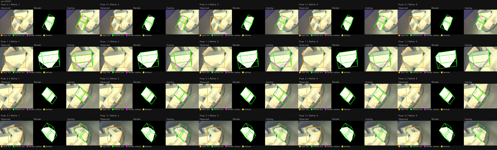
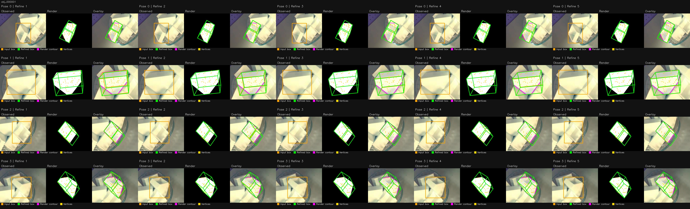

# MegaPose 位姿精修

MegaPose 从 HccePose 的初始位姿继续精修。RGB 模型只需彩色图像，RGB-D 模型还使用配准的米制深度图。两者都需要目标物体网格和相机内参。

## 环境与模型选择

首次注册可能克隆公开 MegaPose、在 `.envs/megapose/` 创建 Python 3.9 子环境并下载依赖与模型。需要网络、可写目录和 Conda。主项目 Python 环境与 MegaPose 子环境分开，设置见[安装说明](installation.md)。

```python
tester.register_megapose(
    megapose_model_name_rgb='megapose-1.0-RGB-multi-hypothesis',
    megapose_model_name_rgbd='megapose-1.0-RGBD',
)
```

也可首次 `predict(..., use_megapose=True)` 时自动注册。为多帧复用同一个 `Tester`，避免反复初始化。

## 同一帧使用 RGB 或 RGB-D

准备[资源页](assets.md)的公开帧并生成相机矩阵，将以下脚本保存于项目根目录。`use_depth=True` 读取深度，设为 `False` 时不读取深度文件、直接使用 RGB 模型。

```python
import json
import os
import sys

project_dir = os.path.dirname(os.path.abspath(__file__))
sys.path.insert(0, project_dir)

import cv2
import numpy as np
from HccePose.bop_loader import bop_dataset
from HccePose.tester import Tester
from HccePose.test_script_utils import save_visual_artifacts

if __name__ == '__main__':
    data_root = os.path.join(project_dir, 'data')
    capture_dir = os.path.join(data_root, 'test_imgs_RGBD')
    dataset = bop_dataset(os.path.join(data_root, 'demo-bin-picking'))
    image_bgr = cv2.imread(os.path.join(capture_dir, '000003_rgb.png'))
    with open(os.path.join(capture_dir, '000003_camera_matrix.json'), encoding='utf-8') as handle:
        cam_K = np.asarray(json.load(handle), dtype=np.float32)
    use_depth = True
    depth_m = None
    if use_depth:
        depth_raw = cv2.imread(os.path.join(capture_dir, '000003_depth.png'), cv2.IMREAD_UNCHANGED)
        if depth_raw is None or image_bgr is None or depth_raw.shape != image_bgr.shape[:2]:
            raise ValueError('Expected aligned RGB and depth')
        depth_m = depth_raw.astype(np.float32) * 1e-3
    if image_bgr is None:
        raise ValueError('Cannot decode RGB image')
    tester = Tester(dataset, CUDA_DEVICE='0', hccepose_vis=True)
    results = tester.predict(cam_K, image_bgr, [1], depth=depth_m,
                             use_megapose=True, megapose_vis=True)
    output_dir = os.path.join(project_dir, 'outputs', 'megapose')
    save_visual_artifacts([
        (os.path.join(output_dir, 'poses.jpg'), results.get('show_6D_vis1')),
        (os.path.join(output_dir, 'refinement.jpg'), results.get('show_megapose')),
    ])
```

毫米深度到米的系数仅适用于这个公开帧。自己的传感器应明确单位并完成彩色/深度配准。只用 RGB 时直接传 `depth=None`，不需要虚构深度图。

使用 `Refinement.refinement_test_utils.load_capture_frame(capture_dir, name, depth_scale_to_m=1e-3)` 读取公开采集帧时，也需显式保持单位约定。默认系数 `1e-3` 把毫米转换为米；米制输入用 `1`，十分之一毫米输入用 `1e-4`，不再根据深度中位数猜单位。

## 输出与实例对应

精修前的毫米位姿保存在 `Rts_hccepose`；`Rts` 中成功的实例更新为 MegaPose 结果。`megapose_valid_pose_ids` 是原实例行号，分数与该数组对齐。没有更新的行保留初值，因此不能把“有返回位姿”直接解释为“精修成功”。`conf` 仍是检测分数，`pnp_success` 仍记录初始 PnP。

调试图可通过 `megapose_vis=True` 获取；`megapose_vis_stages` 选择中间阶段。输出 BGR 图像适合 OpenCV 保存，详见[结果字典](results-api.md)与[工具接口](utilities-api.md)。

## 公开示例图

以下图像来自公开上游的同一帧示例，分别展示 RGB-D 和 RGB 模型的输出，不是新的性能或精度测量。





源码与模型使用条件见 [MegaPose](https://github.com/megapose6d/megapose6d)。比较方法与单位换算见[RGB-D 对比](depth-comparison.md)。
