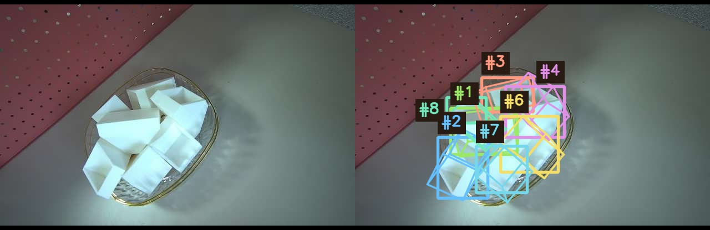
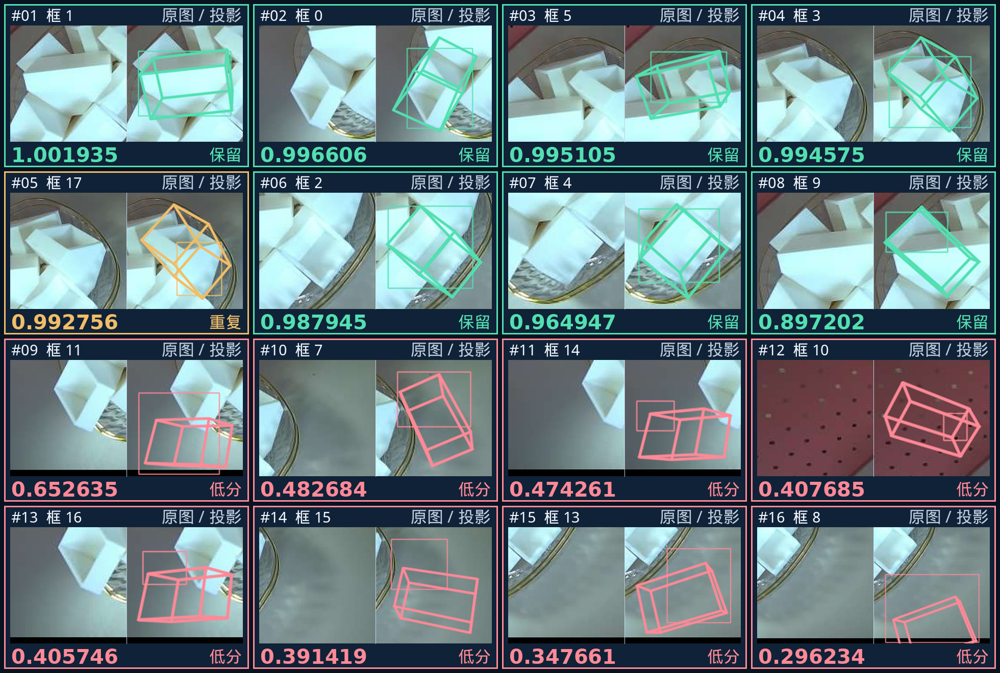

# WAPR 接入

## 掩码与深度，进入三维估计

WAPR 需[单独安装](installation.md#可选-wapr)。本接入依据 [WAPR 公开版本](https://github.com/WangYuLin-SEU/WAPR/tree/4e591be318a828c91980c58ef8bbdc34e6599881)。默认 `estimate` 模式将 HccePose 实例掩码还原至原图，调用 `estimate_many_categories_many_instances`，不使用 PnP 初值；`hybrid` 将有效 PnP 初值与 WAPR 候选混合；`refine` 只精修 PnP 初值，不生成全局旋转候选。选择方法见[三种模式](refinement-api.md)。

接入函数将 BGR 彩色图转为 RGB，再将配准深度、内参和实例信息传入 WAPR。


## 三角块 RGB-D 示例

下面展示三角块场景的输入、位姿投影，以及对应的实测深度点云和 CAD 网格。示例包含已保存的 16 条位姿与评分记录，可查看其中保留的 7 条，也可检查低分及重复项。评分不是真值对错或物体存在概率。



右图仅显示七个保留实例，不同颜色用于区分实例，编号沿用原评分排名。

## RGB 与三维联动查看

点击原图中的框、下方条目或三维网格，两侧会同步高亮。在画布上方选“平移”后拖动彩色坐标轴，选“旋转”后拖动带刻度的旋转环，滚轮缩放。“自由查看”支持拖动旋转、右键或 Shift 拖动平移；点击“对齐原图”恢复标定视角。手机可单指拖动操作轴或刻度环，双指缩放；“自由查看”支持单指旋转和双指平移/缩放。拖轴或环时加入第二指，会结束单指操作并转为双指查看。这些操作仅调整右侧展示，原图投影、保存的位姿和评分保持不变。白色散点表示观测深度，绿色、红色和橙色表面分别表示保留、低分和重复位姿，金色轮廓标记当前选中项。

<iframe class="wapr-scene-frame" src="../assets/wapr-viewer/index.html?lang=zh&amp;v=english-default-20261118" title="三角块 RGB-D 位姿、评分与实测深度点云交互查看器" width="900" height="900" style="display:block;width:100%;max-width:100%;height:900px;box-sizing:border-box;margin:24px 0;border:0;border-radius:18px" loading="lazy" allow="fullscreen" allowfullscreen></iframe>

此页面读取已保存的图像、点云、位姿和评分，在浏览器中完成展示，不执行模型推理。完整场景可切换“全部已评分”“保留”和“仅看选中项”；“保留”模式下，低分和重复项的按钮不可选。深度点云与 CAD 网格可独立开关；开启 CAD 网格后，可切换“CAD 线框模式”。

## 逐区域评分对照

每格左侧是原图裁剪，右侧是该位姿的投影，分数和筛选状态直接标在图上。拼图按四行四列紧凑排列，窄屏可横向查看，也可点击放大。绿色表示保留，橙色表示重复，红色表示低分；去重后的条目沿用原排名。

<div class="wapr-montage">

</div>

示例场景的评分是已保存的展示记录。运行下面的接口会根据新的输入生成结果，不会自动改写网页场景，也不保证与本例具有相同的检测数量或分数。

根目录示例调用 `Tester.predict(..., use_wapr=True)`，由 Tester 在掩码估计后自动执行 WBPS 筛选及 CAD 渲染掩码 NMS，并保留原始输出。门槛分别通过 `wbps_threshold=0.75` 与 `wapr_nms_iou_threshold=0.5` 设置。接口见[注册与多帧调用](refinement-api.md)，策略见[评分筛选与 NMS](wapr-postprocessing.md)。

## 输入与运行

准备 BGR 图像、配准深度、原图内参、米制物体网格与直径。示例从公开 BOP 毫米模型显式转换为米。

编辑 `s4_p3_test_mi10_bin_picking_RGBD_wapr.py` 的路径、物体编号、深度单位换算和 `wapr_mode`，再运行：

```bash
python s4_p3_test_mi10_bin_picking_RGBD_wapr.py
```

使用[资源页下载的示例](assets.md#下载一个-rgb-d-示例)时，将脚本入口中的路径设置为：

```python
dataset_root = os.path.join(current_dir, 'data', 'demo-bin-picking')
capture_dir = os.path.join(current_dir, 'data', 'test_imgs_RGBD')
frame_name = '000003'
image_path = os.path.join(capture_dir, frame_name + '_rgb.png')
depth_path = os.path.join(capture_dir, frame_name + '_depth.png')
intrinsics_path = os.path.join(capture_dir, frame_name + '_camera_matrix.json')
# 此帧的原始深度单位为毫米；自有数据需核对传感器单位。
depth_scale_to_m = 1e-3
```

`outputs/wapr.json` 保留原始实例顺序，含物体编号、实例索引、`pose_4x4_m`（物体到相机，平移单位为米）及针对本次输入计算的 `score_6d`。`outputs/wapr_filtered.json` 保存自动后处理报告。默认评分门槛为 0.75，同类渲染掩码 NMS 的 IoU 门槛为 0.5。评分并非概率，也不等于目标确认；应按应用核对这些阈值。

物体编号必须出现在本数据集的 `models_info.json` 中，每个编号只填一次。同类多个检测实例分别输出记录；若所有请求类别都未检出，原始 JSON 为 `[]`，保留记录也为空。`estimate` 与 `hybrid` 中，每张裁剪掩码须有对应变换及正观测深度，无效掩码会报错。`refine` 不要求前景掩码，但必须有有效 PnP 初值；失败或无效的初值不伪造分数，另列于报告的 `skipped_instances`。


## 多物体、多实例与掩码顺序

`object_ids` 选择物体类别；同一个编号只列一次，由检测结果产生该类的全部实例。入口会按物体组和组内实例顺序还原掩码，为每项准备对应的米制网格及直径，再调用公开的批量估计接口。输出中的 `object_id` 和 `instance_index` 用于追溯输入。

多个区域不等于多个真实物体。检测器可能漏检、重复检测或包含背景区域，WAPR 返回可计算的位姿与分数也不等于确认目标。需要保留原始结果与各实例标识，再按应用规则检查、去重及排序，不能根据展示数量推断查全率。

## 在自己的 Python 程序中接入

```python
from Refinement.refinement_group import restore_full_frame_masks, estimate_from_masks

# predictions 来自当前帧；不同物体使用各自的 mesh 与 diameter_m。
masks = restore_full_frame_masks(predictions[obj_id], image_bgr.shape)
instances = [{'mesh': mesh, 'diameter_m': diameter_m, 'mask': mask} for mask in masks]
results_wapr = estimate_from_masks(estimator, image_bgr, depth_m, cam_K, instances)
```

上例中的网格顶点、直径和深度都必须已经转换为米；`estimator` 是按公开安装说明初始化的 WAPR 对象。入口只估计给定掩码，不需要把 HccePose 的 PnP 初值传入。完整输入检查、原图还原和直接使用外部掩码的方法见[精修接口](refinement-api.md)。

## 结果文件与异常

| 字段 | 含义 |
| --- | --- |
| `object_id` | BOP 物体编号。 |
| `instance_index` | 该物体预测结果中的组内行号。 |
| `pose_4x4_m` | 物体到相机的齐次变换，平移为米。 |
| `score_6d` | WAPR 针对本次图像、深度和掩码计算的评分。 |

JSON 不保存固定实验分数，不使用真值标签生成评分。资源缺失、内参格式错误、重复或未知编号在模型加载前报错；形状不符、非有限深度、没有有效深度的掩码和无效输出不会被当作成功结果。读取和单位转换见[结果字典](results-api.md)。

原始与筛选输出必须使用不同路径，也不能指向输入图片、深度图或标定文件。软链接和硬链接造成的同文件情况会在加载模型前被拦截。

多帧应用可复用 `Tester` 和 WAPR 估计器。每次重新运行入口脚本都会重新初始化模型；高频处理应参考[接口教程](refinement-api.md)组织循环。首次运行所需资源准备与实际推理需分开计时。
